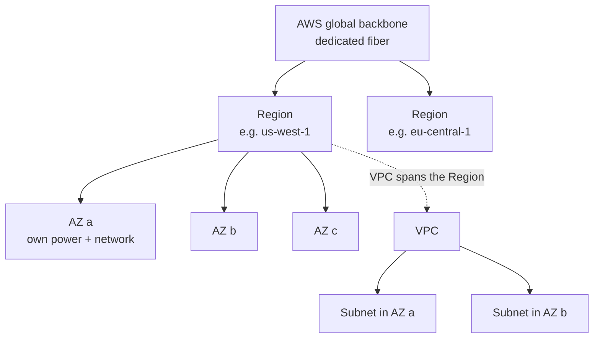

# AWS Global Infrastructure

> [!abstract] TL;DR
> AWS networking is built on top of a physical hierarchy: ==Regions (city-area clusters) contain at least three Availability Zones (independent data-center clusters)==. Your VPCs, subnets, and resources are deployed *into* that hierarchy. The first architecture decision is ==which Region to build in==, usually the one closest to your users. The baseline resilience rule is ==use at least two AZs==, so a fault in one AZ doesn't take down the whole solution.

**Lesson:** L1 – Architect Network Connectivity Strategies · **Previous:** [[Networking for Organizations]] · **Next:** [[Building a VPC]]
**Section hub:** [[Designing AWS Architecture for Organizations]]
**Sources:** Video L1-A03 "Architecting Network Connectivity Strategies" (en-us transcript). Material marked *beyond the lecture* is my addition.

---

## 1. Core Concepts

> [!info]+ Definition – Region
> A massive cluster of AWS hardware located in the area of a major city. AWS has dozens of Regions on every continent except Antarctica, connected by AWS's ==dedicated fiber-optic backbone network==. AWS keeps adding Regions in response to customer demand. ^def-region

> [!info]+ Definition – Availability Zone (AZ)
> An independent cluster of data centers within a Region. Each AZ has ==its own separate power and networking== and is physically located ==miles away from any other AZ==, so a fault in one AZ is unlikely to affect the others. AZs in a Region are connected by high-speed networking. Every Region has **at least three** AZs. ^def-az

> [!info]+ Definition – The networking stack built on top
> Inside a Region you deploy **VPCs**. A VPC contains a collection of **IP subnets**. Subnets are containers for networked computers and other resources (see [[Building a VPC]]). ^def-stack

---

## 2. Choosing a Region

The lecture calls this one of the ==first questions a cloud architect must answer==.

| Lecture guidance | Detail |
|---|---|
| Default | Most solutions need **one Region** |
| Which one | Usually the Region **closest to the users** of the solution |
| When to go multi-Region | **Mission-critical** systems that must stay reliable even through a **city-sized disaster** |

> [!note] Other Region-selection factors (*beyond the lecture*)
> - **Compliance / data residency:** regulations may require data to stay in a country or jurisdiction.
> - **Service availability:** not every service or feature launches in every Region at the same time.
> - **Cost:** prices for the same service differ between Regions.
> - **Latency** to users and to other systems, such as on-premises data centers.

---

## 3. Designing Across Availability Zones

> [!important] Well-architected rule
> A well-architected AWS solution should use ==at least two Availability Zones==, so that a fault in one AZ doesn't block access to all of the solution's resources. ^two-az-rule

| Service behavior (lecture) | Examples | What the architect does |
|---|---|---|
| **Automatically multi-AZ** | Amazon S3, Amazon DynamoDB | Nothing. Resilience across AZs is built in. |
| **User chooses the AZ** | Amazon EC2 | Place resources in several AZs on purpose, using subnets in each AZ |

**Why two AZs helps, in numbers** (*beyond the lecture*, and it assumes AZ failures are independent). If each AZ is available with probability $a$, a solution that survives as long as *either* AZ is up has:

$$
A_{2\text{ AZ}} = 1 - (1 - a)^2
$$

With $a = 0.999$: $A = 1 - (0.001)^2 = 0.999999$. The expected downtime falls from about 8.8 hours a year to about 32 seconds a year.

> [!warning] The independence assumption
> AZs are designed to fail independently: separate power, separate networking, miles apart. But shared Regional control planes, software deployments, and your *own* configuration can still create correlated failures. Treat the formula as an upper bound.

---

## 4. Worked Example – Steady Volatility Partners

Applying the lecture's guidance to the course's client ([[Building a VPC#1. The Client – Steady Volatility Partners|Steady Volatility Partners]]):

| Decision | Choice | Reason |
|---|---|---|
| Region | **US West (N. California)**, `us-west-1`. This is the Region used in the lab ([[Building a VPC#7. Lab Walkthrough – Exercise 1|Exercise 1]]). | Close to the San Francisco headquarters, per the lecture's example route table |
| Number of Regions | One, at first | The trading research platform doesn't yet need to survive a city-sized disaster. Revisit before live trading. |
| AZs | Two (`us-west-1a`, `us-west-1b`) | Satisfies the [[#^two-az-rule|two-AZ rule]]. Every tier gets one subnet per AZ. |
| Data storage | S3 | Already multi-AZ, so no extra design needed |

---

## 5. Pitfalls and Failure Modes

| Failure | Symptom | Mitigation |
|---|---|---|
| Single-AZ deployment | Full outage when that AZ has a fault | At least two AZs for every tier you control |
| Assuming every service is multi-AZ | An EC2-based component is the single point of failure | Check each service: automatic (S3, DynamoDB) or user-placed (EC2) |
| Picking a Region by habit | High latency for users; compliance violations | Decide based on users, regulations, services, and cost |
| Premature multi-Region | Doubled cost and complexity for little benefit | Reserve multi-Region for mission-critical, disaster-tolerant needs |

---

## 6. Key Takeaways

- [ ] A **Region** is a city-area hardware cluster. Regions are linked by AWS's private fiber backbone.
- [ ] Every Region has **at least three AZs**. Each AZ has separate power and networking and sits miles from the others.
- [ ] **Most solutions need one Region**, the one closest to their users. Multi-Region is for surviving city-scale disasters.
- [ ] Build across **at least two AZs** ([[#^two-az-rule]]).
- [ ] **S3 and DynamoDB** are multi-AZ automatically. For **EC2**, you choose the AZ.
- [ ] VPCs live in a Region, subnets live in AZs, and resources live in subnets ([[#^def-stack]]).

---

## 7. Critical Analysis

- **"Closest to users" is a simplification.** For a trading firm, what matters most may be latency to *exchanges and market-data providers*, not to employees. Regulated data may also be pinned to a specific jurisdiction whatever the latency.
- **AZ independence is designed, not guaranteed.** AWS has had Region-wide incidents caused by shared control planes. Two AZs protect against facility failures, not against every failure mode. A rigorous design states which failures it tolerates (AZ loss: yes; Region loss: no) and checks it with game days.
- **Cost of multi-AZ** (*beyond the lecture*): traffic between AZs is billed per GB, and highly available NAT means one NAT gateway per AZ. Resilience has a running cost that should appear in the cost-management pillar.
- **"At least three AZs" has exceptions in practice.** N. California (`us-west-1`) typically exposes only **two** AZs to an account. In [[Exercise 1 - Build the Network]], the spec's `us-west-1b` didn't exist, and `us-west-1c` was the second AZ.
- **What changes at organization scale:** AZ names such as `us-west-1a` are mapped differently in each account. When accounts must coordinate placement, use **AZ IDs** (e.g. `usw1-az1`) instead.

> [!question] Open discussion questions
> 1. At what point should Steady Volatility Partners' trading platform become multi-Region? What business metric would trigger that decision?
> 2. How would you test that a two-AZ design actually survives the loss of one AZ?

---

## 8. Self-Test

> [!question]- Q1. What is a Region, and how are Regions connected?
> A massive cluster of AWS hardware in the area of a major city. Regions are connected by AWS's dedicated fiber-optic backbone network.

> [!question]- Q2. What is the minimum number of AZs in a Region, and what makes AZs independent?
> At least **three**. Each AZ has separate power and networking and is miles away from the others, so a fault in one is unlikely to affect the rest.

> [!question]- Q3. How many Regions does a typical solution need, and how do you pick one?
> Usually **one**, the Region closest to the solution's users. Multi-Region is for mission-critical systems that must survive a city-sized disaster.

> [!question]- Q4. Which services does the lecture name as automatically multi-AZ, and which one makes you choose?
> **S3** and **DynamoDB** are automatically multi-AZ. **EC2** lets you choose the AZ for each resource.

> [!question]- Q5. (Quantitative, beyond the lecture) Each AZ is 99.5% available and failures are independent. What is the availability of a design that survives while either of two AZs is up? Roughly how much downtime per year?
> $1 - (0.005)^2 = 0.999975$, i.e. 99.9975%. That's about $0.000025 \times 8760 \approx 0.22$ hours, or **about 13 minutes per year**. A single AZ at 99.5% would be about 44 hours.

> [!question]- Q6. (Design) A client wants a single EC2 instance for a "critical" service "because AWS is reliable". What do you tell them?
> A single instance lives in one AZ, so an AZ fault takes the service down. The well-architected rule is **at least two AZs**: run instances in subnets in two AZs behind a load balancer, or use a service that is multi-AZ by default.

> [!tip] Flashcards
> Review this lesson with [[AWS Global Infrastructure - Flashcards]].

---

## 9. Glossary

| Term | Meaning |
|---|---|
| Region | A city-area cluster of AWS data centers, containing at least three AZs |
| Availability Zone (AZ) | An independent data-center cluster in a Region, with its own power and networking |
| AWS backbone | AWS's dedicated fiber-optic network connecting Regions |
| Multi-Region | A design spread across Regions to survive city-scale disasters |
| AZ ID | A stable cross-account identifier for a physical AZ (e.g. `usw1-az1`) |

---

## 10. Further Reading

- [AWS Global Infrastructure – Regions and Availability Zones](https://aws.amazon.com/about-aws/global-infrastructure/regions_az/)
- [AWS Well-Architected Framework – Reliability Pillar](https://docs.aws.amazon.com/wellarchitected/latest/reliability-pillar/welcome.html)
- [AZ IDs for your AWS resources](https://docs.aws.amazon.com/ram/latest/userguide/working-with-az-ids.html)
