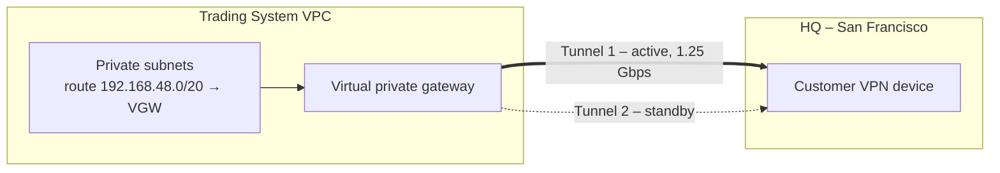
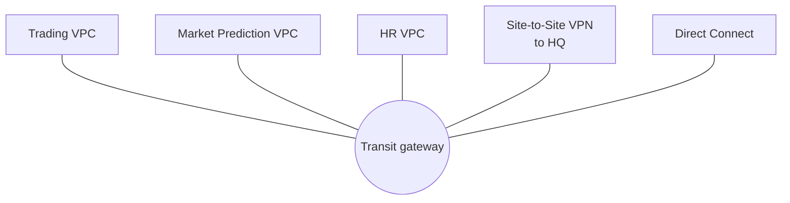
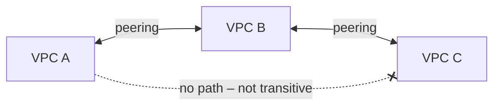

# Advanced VPC Connectivity

> [!abstract] TL;DR
> Beyond a single VPC, there are two connectivity problems: **VPC ↔ on-premises** and **VPC ↔ VPC**. For on-premises, a ==virtual private gateway (VGW) runs two IPsec tunnels, active-passive, at 1.25 Gbps each==, and a ==transit gateway (TGW) is a massively scalable Regional router for up to 5,000 networks==: VPCs, VPNs, and Direct Connect. For VPC-to-VPC, ==VPC peering connects exactly two VPCs, which must have no overlapping IPs, and peering is not transitive==. It also needs routes on both sides.

**Lesson:** L1 – Architect Network Connectivity Strategies · **Previous:** [[Building a VPC]] · **Next:** [[Secure and Private Connectivity]]
**Section hub:** [[Designing AWS Architecture for Organizations]]
**Sources:** Video L1-A06 (Advanced VPC Networking and Connectivity) and the peering half of L1-A11 (Exercise 2 Demo), en-us transcripts. The DNS half of Exercise 2 is in [[DNS and Network Resolution]]. Material marked *beyond the lecture* is my addition.

> [!todo]- Contents
> 1. [[#1. Core Concepts]]
> 2. [[#2. Connecting to Headquarters – VGW and Site-to-Site VPN]]
> 3. [[#3. Transit Gateway]]
> 4. [[#4. VPC Peering]]
> 5. [[#5. Choosing a Connectivity Option]]
> 6. [[#6. Lab Walkthrough – Exercise 2 Peering]]
> 7. [[#7. Pitfalls and Failure Modes]]
> 8. [[#8. Key Takeaways]]
> 9. [[#9. Critical Analysis]]
> 10. [[#10. Self-Test]]
> 11. [[#11. Glossary]]
> 12. [[#12. Further Reading]]

---

## 1. Core Concepts

The lecture's motivation: many cloud solutions ==must be managed from the corporate network or must reach systems that still live on-premises==. Over time, architects also need to connect workloads that were deliberately isolated in **separate VPCs**.

> [!info]+ Definition – Virtual private gateway (VGW)
> The AWS-side VPN endpoint attached to a VPC. It connects the VPC to a **VPN device at the customer location**. ^def-vgw

> [!info]+ Definition – Transit gateway (TGW)
> A ==massively scalable Regional router== that can interconnect up to **5,000 networks**: VPCs, VPN connections, and **Direct Connect** links. ^def-tgw

> [!info]+ Definition – VPC peering connection
> A resource that connects **one VPC to one other VPC**, in the same AWS account or a different one, so the two can communicate. ^def-peering

---

## 2. Connecting to Headquarters – VGW and Site-to-Site VPN

The lecture names two main ways to reach the organization's primary place of business: **VPN connectivity through a VGW**, or a **transit gateway**.

| VGW property (lecture) | Value |
|---|---|
| Tunnels | **Two IPsec tunnels** |
| Mode | **Active-passive**. If one tunnel fails, the other keeps the connection up. |
| Speed per tunnel | **1.25 Gbps** |
| Usable bandwidth | **1.25 Gbps**, because only one tunnel is active at a time |
| Routing requirement | The subnet's route table needs a **route to the VGW** for the on-premises range |

> [!note] Beyond the lecture
> - The **customer gateway** resource tells AWS about the on-premises device: its public IP and BGP ASN. Exercise 1 attached the VGW but left this step undone.
> - Routes can be **static** or learned dynamically with **BGP**. *Route propagation* can add on-premises routes to a route table automatically.
> - The redundancy covers **tunnel** failure on the AWS side. A single on-premises device or internet circuit is still a single point of failure.

---

## 3. Transit Gateway

| Aspect | Lecture | *Beyond the lecture* |
|---|---|---|
| Role | Regional router | Hub-and-spoke: each network attaches once |
| Scale | Up to **5,000** interconnected networks | That's the default per-TGW attachment quota |
| Attachment types | VPCs, VPNs, **Direct Connect** | Also peering between TGWs in different Regions |
| Routing | — | Its own route tables allow **segmentation**, e.g. production can't reach dev |
| VPN bandwidth | — | Supports **ECMP**, which spreads traffic across several VPN tunnels for more than 1.25 Gbps total |

---

## 4. VPC Peering

### Rules (lecture)

| Rule | Detail |
|---|---|
| **Accounts** | Works within one account or across accounts |
| **No overlapping IPs** | The two VPCs must have ==no IP addresses in common==. An IP conflict prevents peering. |
| **Exactly two VPCs** | One peering connection = two VPCs. You can create many peerings. |
| **Not transitive** | If A peers with B and B peers with C, ==A can't reach C==. A↔C needs its own peering. |
| **Request / accept** | One VPC owner sends a request. In the same account the lecture says it's accepted automatically (but see the lab note below). Across accounts, the other owner must accept it. |
| **Routes** | After the peering is established, configure the route tables **in each VPC** to send traffic for the other VPC's CIDR through the peering connection |

^peering-rules

> [!important] Plan for future peering
> Because overlap blocks peering, ==avoid conflicting CIDRs across all VPCs, even in different accounts==, so that peering stays possible later. This is an organization-wide IP-planning requirement, not a per-project one. ^plan-cidrs

### The scaling math (*beyond the lecture*)

A full mesh of $n$ VPCs with peering needs

$$
P(n) = \frac{n(n-1)}{2}
$$

connections, and each one needs routes on both sides. A transit gateway needs $n$ attachments.

| $n$ VPCs | Peering connections | TGW attachments |
|---|---|---|
| 3 | 3 | 3 |
| 10 | 45 | 10 |
| 50 | 1,225 | 50 |

---

## 5. Choosing a Connectivity Option

| Need | Lecture's tool | When it fits | *Beyond the lecture* trade-off |
|---|---|---|---|
| One VPC ↔ HQ | **VGW + VPN** | Simple hybrid link | Max 1.25 Gbps; internet-dependent |
| Many VPCs + VPNs + Direct Connect | **Transit gateway** | Organization-scale hub | Per-attachment and per-GB charges |
| A few VPCs ↔ each other | **VPC peering** | Easiest point-to-point option | No per-hour charge; doesn't scale as a mesh; not transitive |
| Dedicated, consistent bandwidth to on-premises | **Direct Connect** (attached to a TGW) | Heavy, steady hybrid traffic | Weeks to provision; not encrypted by default |

---

## 6. Lab Walkthrough – Exercise 2 Peering

> [!tip] Doing this lab
> Step-by-step console guide: [[Exercise 2 - Peering and Hybrid DNS - How To#1. Cross-Account Peering Request (Expected to Fail)|how-to, sections 1–2]].

| Step | What happened |
|---|---|
| 1. Cross-account peering request | Request from the **trading system VPC** to an HR VPC in account `111122223333`. It ==failed as expected==, because the account and VPC IDs are placeholders. The point was to show the cross-account workflow. |
| 2. Prepare a second VPC | Re-enabled the account's **default VPC** and renamed it **Market Prediction VPC** |
| 3. Same-account peering | Created "Trading System VPC – Market Prediction VPC" peering. The request appeared as *pending acceptance* and was **accepted** in the console. |
| 4. Route | Edited the trading VPC's **private route table**: Market Prediction VPC CIDR → peering connection |

> [!note] Lab vs. lecture
> - **Acceptance:** the lecture says same-account requests are accepted automatically, but the demo still accepts the request by hand. In practice, the console asks you to accept even within one account. Some automation, such as CloudFormation, can accept it for you.
> - **Return routes:** the demo only added a route on the **trading** side. The lecture's rule is that **both** VPCs need routes. Without a route back from the Market Prediction VPC, replies have no path.
> - **Why the peering worked** (*beyond the lecture*): default VPCs use `172.31.0.0/16`, which doesn't overlap the trading VPC's `172.19.0.0/16` ([[#^peering-rules]]).

---

## 7. Pitfalls and Failure Modes

| Failure | Symptom | Mitigation |
|---|---|---|
| Overlapping CIDRs | Peering request can't be created | Organization-wide IP plan ([[#^plan-cidrs]]), e.g. with VPC IPAM |
| Route on only one side | Pings and connections time out; one-way traffic | Add routes in **both** VPCs' route tables (and allow traffic in security groups and NACLs) |
| Assuming transitivity | A can reach B, B can reach C, but A can't reach C | Add A↔C peering, or move to a transit gateway |
| Expecting 2.5 Gbps from two VGW tunnels | Throughput tops out at about 1.25 Gbps | Only one tunnel is active. Use TGW + ECMP or Direct Connect for more. |
| Cross-account peering never accepted | Stuck in *pending acceptance*, which eventually expires | Coordinate with the peer account's owner |
| Peering mesh sprawl | Dozens of connections and route entries nobody can audit | Hub-and-spoke through a transit gateway |

---

## 8. Key Takeaways

- [ ] Hybrid connectivity to HQ uses a **VGW (VPN)** or a **transit gateway**.
- [ ] A VGW runs **two IPsec tunnels, active-passive, 1.25 Gbps each**, so 1.25 Gbps is usable. The subnet needs a **route to the VGW**.
- [ ] A **transit gateway** is a Regional router for up to **5,000** VPCs, VPNs, and Direct Connect links.
- [ ] **VPC peering:** two VPCs, same or different accounts, **no overlapping IPs**, **non-transitive** ([[#^peering-rules]]).
- [ ] Peering requires **request + accept + routes on both sides**.
- [ ] Plan CIDRs **across the whole organization** so future peering stays possible ([[#^plan-cidrs]]).

---

## 9. Critical Analysis

- **Peering's non-transitivity is a security feature, not just a limitation.** Each pairing must be explicit, which matches the course's "only required traffic" principle ([[Networking for Organizations#^least-privilege-network]]). A transit gateway makes connectivity *easy*, so its route tables must be segmented deliberately or it becomes a flat network.
- **Active-passive VPN is a resilience choice, not a throughput one.** For a quant firm that ships large datasets to HQ, 1.25 Gbps may be the bottleneck. At that rate, 5 TB takes about 9 hours (see Q5).
- **Cross-account peering ties two security domains together.** Accepting a peering with the HR account means its security groups and NACLs now protect the trading VPC too. Accept only when both sides have reviewed the routes and firewall rules.
- **What changes at organization scale:** the course's next lesson covers multi-account architectures. With dozens of accounts, peering becomes unmanageable, and **TGW (often shared through AWS RAM)** plus **central IP planning** become the norm. This is the "consolidate networks" challenge in the [[Designing AWS Architecture for Organizations#4. The Capstone – Pharmaceutical Company|capstone]].

> [!question] Open discussion questions
> 1. At how many VPCs would you switch Steady Volatility Partners from peering to a transit gateway? Consider operational and cost factors, not just the count.
> 2. Should the HR VPC be peered with the trading VPC at all? What business flow would justify it, and how would you limit it to that flow?
> 3. How would you design VPN redundancy so that an on-premises device failure doesn't cut the trading system off from HQ?

---

## 10. Self-Test

> [!question]- Q1. How does a VGW provide redundancy, and what bandwidth can you use?
> It establishes **two IPsec tunnels in active-passive mode**. If one fails, the other carries traffic. Each runs at **1.25 Gbps**, but only one is active, so usable bandwidth is **1.25 Gbps**.

> [!question]- Q2. What is a transit gateway, and what can it connect?
> A massively scalable **Regional router** that interconnects up to **5,000 networks**: VPCs, VPNs, and Direct Connect connections.

> [!question]- Q3. VPC A peers with B, and B peers with C. Can A reach C? What would you do?
> **No.** Peering isn't transitive. Create a separate A↔C peering, with routes on both sides, or connect all three through a transit gateway.

> [!question]- Q4. List the steps to make a cross-account VPC peering work.
> 1. Ensure the CIDRs **don't overlap**.
> 2. The requester sends a **peering request**.
> 3. The other account's owner **accepts** it.
> 4. Add **routes in both VPCs' route tables** that point the other VPC's CIDR at the peering connection.
> 5. *(Beyond the lecture)* Allow the traffic in security groups and NACLs.

> [!question]- Q5. (Quantitative) How long does it take to move 5 TB to HQ over a VGW VPN at full speed? Ignore overhead.
> $\dfrac{5 \times 10^{12} \times 8 \text{ bits}}{1.25 \times 10^{9} \text{ bits/s}} = 32{,}000 \text{ s} \approx$ **8.9 hours**. Real throughput is lower because of IPsec overhead and internet variability.

> [!question]- Q6. (Quantitative) An organization has 12 VPCs that all need to reach each other. How many peering connections and route entries does a full mesh need, compared with a transit gateway?
> Peerings: $\frac{12 \cdot 11}{2} = 66$. Each needs a route in both VPCs (at least one route table per VPC), so at least **132 route entries**. A TGW needs **12 attachments**, with routes managed centrally in TGW route tables.

> [!question]- Q7. (Design) A new research VPC is about to be created with `172.19.0.0/16`, the same range as the trading VPC. Why should you object, and what would you propose?
> Overlapping CIDRs would **block any future peering** (or clean routing through a transit gateway) between them. Propose an **organization-wide IP plan**, such as distinct `/16`s per VPC managed with VPC IPAM, and give the research VPC a non-overlapping range.

> [!tip] Flashcards
> Review this lesson with [[Advanced VPC Connectivity - Flashcards]].

---

## 11. Glossary

| Term | Meaning |
|---|---|
| Hybrid connectivity | Network connection between AWS and on-premises locations |
| Virtual private gateway (VGW) | AWS-side VPN endpoint attached to a VPC |
| Customer gateway | AWS resource describing the on-premises VPN device |
| IPsec tunnel | Encrypted network tunnel used by site-to-site VPN |
| Active-passive | One path carries traffic, and the other takes over on failure |
| Transit gateway (TGW) | Regional router interconnecting up to 5,000 networks |
| AWS Direct Connect | Dedicated private network link from on-premises to AWS |
| VPC peering | A one-to-one connection between two VPCs |
| Transitive routing | Reaching a third network through an intermediate one; peering doesn't allow it |
| ECMP | Equal-cost multi-path: spreading traffic over several equal routes (*beyond the lecture*) |

---

## 12. Further Reading

- [What is AWS Site-to-Site VPN](https://docs.aws.amazon.com/vpn/latest/s2svpn/VPC_VPN.html)
- [What is a transit gateway](https://docs.aws.amazon.com/vpc/latest/tgw/what-is-transit-gateway.html)
- [What is VPC peering](https://docs.aws.amazon.com/vpc/latest/peering/what-is-vpc-peering.html)
- [VPC peering limitations](https://docs.aws.amazon.com/vpc/latest/peering/vpc-peering-basics.html)
- [What is AWS Direct Connect](https://docs.aws.amazon.com/directconnect/latest/UserGuide/Welcome.html)
