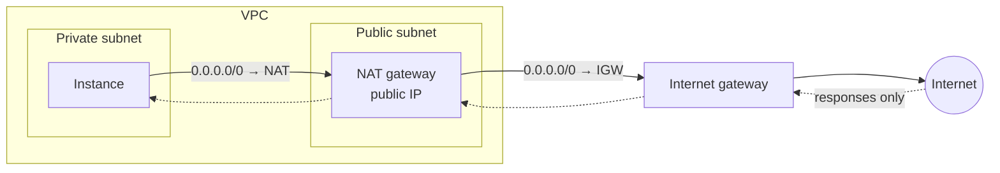
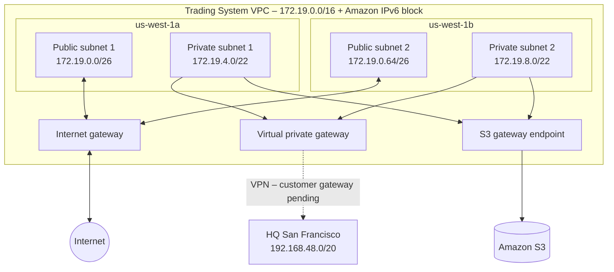

# Building a VPC

> [!abstract] TL;DR
> A VPC is a ==Regional, isolated network container== whose subnets live in individual AZs. ==Every subnet is linked to a route table, and the route table is the complete list of places that subnet can send traffic==. Connectivity is designed by choosing route **targets**: an internet gateway (public), a NAT gateway (outbound only), a virtual private gateway or transit gateway (on-premises), a gateway endpoint (S3/DynamoDB), or the automatic `local` route. For Steady Volatility Partners, the lab builds ==public subnets with an IGW route, and private subnets with routes only to headquarters over VPN and to S3 through a gateway endpoint==.

**Lesson:** L1 – Architect Network Connectivity Strategies · **Previous:** [[AWS Global Infrastructure]] · **Next:** [[Advanced VPC Connectivity]]
**Section hub:** [[Designing AWS Architecture for Organizations]]
**Sources:** Videos L1-A04 (Building a VPC Story), L1-A05 (Building a VPC), and L1-A10 (Exercise 1 Demo), en-us transcripts, plus the "Leveraging Global Architecture for Networking Goals" lesson page and the "Exercise: Build the Network" lab sheet. Material marked *beyond the lecture* is my addition.

> [!todo]- Contents
> 1. [[#1. The Client – Steady Volatility Partners]]
> 2. [[#2. Requirements]]
> 3. [[#3. Core Concepts]]
> 4. [[#4. Public vs. Private Subnets]]
> 5. [[#5. Route Targets – Where Traffic Can Go]]
> 6. [[#6. The Course Design]]
> 7. [[#7. Lab Walkthrough – Exercise 1]]
> 8. [[#8. Pitfalls and Failure Modes]]
> 9. [[#9. Key Takeaways]]
> 10. [[#10. Critical Analysis]]
> 11. [[#11. Self-Test]]
> 12. [[#12. Glossary]]
> 13. [[#13. Further Reading]]

---

## 1. The Client – Steady Volatility Partners

| Fact | Detail (lecture) |
|---|---|
| Who | A popular **hedge fund**, known for exceptional returns for high-net-worth investors |
| New initiative | **Quantitative trading** using **machine learning** to detect market changes |
| Crown jewels | **Proprietary trading algorithms**. Losing this intellectual property is the threat the network must prevent. |
| Provider | AWS, chosen for its robust global architecture |
| Headquarters | **San Francisco**, on-premises range `192.168.48.0/20` |
| Your role | Consultant implementing the project |

---

## 2. Requirements

| # | Requirement (lecture) | How the course design meets it |
|---|---|---|
| R1 | Some compute **needs internet connectivity** | **Public subnets** with a route to an internet gateway |
| R2 | Other parts must remain **strictly disconnected** from the internet | **Private subnets** with no internet gateway route and no NAT |
| R3 | Compute must **read and write S3** | **S3 gateway endpoint** in the private route table |
| R4 | S3 data must **never cross the internet** | Same gateway endpoint: a private path inside the AWS network |
| R5 | *(A06/Exercise 1)* Connection to **corporate headquarters** | **Virtual private gateway** (VPN), with a route for the HQ range |

> [!important] The design tension
> R1 and R3 demand connectivity, while R2 and R4 restrict it. The lesson goal is to ==balance connectivity needs with stringent security measures==. This is the [[Networking for Organizations#4. The Two Jobs of a Trustworthy Network|two jobs of a trustworthy network]] made concrete. ^svp-tension

---

## 3. Core Concepts

> [!info]+ Definition – VPC
> A way to isolate parts of a cloud workload from each other, like separate networks on different floors of one building. A VPC ==exists entirely inside one Region== but holds resources in ==any of that Region's AZs==. ^def-vpc

> [!info]+ Definition – Resource
> The lecture's generic term for anything you create in your AWS account that stays there until you remove it. ^def-resource

> [!info]+ Definition – Subnet
> A group of related compute resources inside a VPC, such as web servers in one subnet and database servers in another. Subnets are the ==network homes for VMs and other compute==, and their connection point to the rest of the solution. (*Beyond the lecture:* each subnet sits in exactly one AZ.) ^def-subnet

> [!info]+ Definition – Route table
> Routing rules that decide how and where a subnet's traffic can go. It lists ==every possible destination== the subnet's computers can reach and the **next hop** toward each one. A computer can only reach destinations in its subnet's route table. Subnets with **identical** routing needs can **share** a route table, which means fewer tables to manage. ^def-route-table

> [!info]+ Definition – Local route
> Routing **between subnets in the same VPC** is handled automatically by a `local` route, which uses the VPC's built-in routing. ^def-local-route

---

## 4. Public vs. Private Subnets

The lecture lists four internet-connectivity profiles a host can have: it sends requests out, it receives requests in, it does both, or it has no internet connection at all.

> [!info]+ Definition – Public subnet
> A subnet is public only when **both** of these hold:
> 1. Its VPC has an **internet gateway attached**.
> 2. The subnet's route table has a **route that targets that internet gateway**.
>
> If either is missing, the subnet is **private**. Public subnets let instances **receive** requests from the internet and **start** their own outbound requests. ^def-public

> [!info]+ Definition – Private subnet
> A subnet whose instances should **not be directly reachable from the internet**. Either the VPC has no IGW, or the subnet's route table has no route to it. Private subnets are typical for resources that other parts of the solution must reach but that must ==never directly accept a request from an internet client==. ^def-private

### NAT gateway – outbound only

What if a private instance must download a patch, but must stay hidden from inbound internet traffic? Use a **NAT gateway**, which allows outbound request traffic and blocks inbound connections from the internet.

> [!warning] Common misunderstanding (lecture)
> The NAT gateway is deployed ==in a public subnet, not in the private subnet== that needs it. The VPC's built-in routing lets the private instance reach the NAT gateway. The NAT gateway itself needs to be in a public subnet so it can get a **public IP address** and receive the **responses** coming back from the internet. ^nat-placement

| Profile | Subnet | Route to the internet |
|---|---|---|
| Receive + send | Public | `0.0.0.0/0 → igw-…` |
| Send only | Private | `0.0.0.0/0 → nat-…` (NAT gateway in a public subnet) |
| No internet at all | Private | No IGW or NAT route |

---

## 5. Route Targets – Where Traffic Can Go

The lecture's catalog of what a subnet can route to:

| Destination | Route target | Notes (lecture) |
|---|---|---|
| Other subnets in the VPC | `local` | Automatic |
| Internet, two-way | **Internet gateway (IGW)** | Makes the subnet public |
| Internet, outbound only | **NAT gateway** | Placed in a public subnet ([[#^nat-placement]]) |
| On-premises network | **Virtual private gateway (VGW)** or **transit gateway (TGW)** | Secure hybrid connection. See [[Advanced VPC Connectivity]]. |
| S3 or DynamoDB | **Gateway VPC endpoint** | Private, secure access without crossing the internet. See [[Secure and Private Connectivity#4. VPC Endpoints – The Side Door]]. |
| Another VPC | **Peering connection** | See [[Advanced VPC Connectivity#4. VPC Peering]] |

> [!tip] Longest-prefix match (*beyond the lecture*)
> When a destination matches several routes, the **most specific** one wins. A private subnet with both `0.0.0.0/0 → NAT` and an S3 prefix-list route sends S3 traffic to the endpoint, not to the NAT gateway. ^longest-prefix

---

## 6. The Course Design

This is the design built in Exercise 1, in Region `us-west-1` (N. California):

**Route tables (custom, not the VPC's default table):**

| Route table | Associated subnets | Destination | Target |
|---|---|---|---|
| Public | Public 1, Public 2 | VPC IPv4 and IPv6 CIDRs | `local` |
| Public | | `0.0.0.0/0` | Internet gateway |
| Public | | `::/0` | Internet gateway |
| Private | Private 1, Private 2 | VPC IPv4 and IPv6 CIDRs | `local` |
| Private | | `192.168.48.0/20` (HQ) | Virtual private gateway |
| Private | | S3 prefix list | Gateway endpoint (added automatically) |

> [!info] R2 is enforced by absence
> The private subnets are "strictly disconnected" because ==no route to the internet exists==. Firewalls ([[Secure and Private Connectivity]]) add defense in depth, but the missing route is the primary control. ^isolation-by-routing

---

## 7. Lab Walkthrough – Exercise 1

> [!success] My results
> Completed 2026-10-17. Everything matched the spec. The second AZ was `us-west-1c`, because this account has no `us-west-1b`. Full audit: [[Exercise 1 - Build the Network]].

### The brief – "Build the Network"

The exercise restates the client and its requirements in business terms:

| Exercise statement | Network requirement | Implemented by |
|---|---|---|
| "**Limited** Internet connectivity will be needed" | Only some subnets reach the internet, and only where needed | Public subnets + `TradingSystemIGW` route |
| All other communication must meet strict security requirements, to avoid **loss of intellectual property** in the proprietary trading algorithms | Protect internal resources | Private subnets with no internet route ([[#^isolation-by-routing]]) |
| Employees at **corporate HQ** can connect to VPC-based computers | Hybrid connectivity | `VPN to Corp HQ` virtual private gateway + route for `192.168.48.0/20` |
| Move VPC-generated data to **S3 without exposing it to the Internet** | Private path to S3 | `TradingSystemS3Endpoint` gateway endpoint |

**Objectives:** create a VPC → create subnets → attach an internet gateway → configure a VPN connection to HQ → create route tables → configure an S3 VPC endpoint → configure routing. Everything is done in the **VPC console**.

### Resource names

| Resource | Name | Key settings |
|---|---|---|
| VPC | `TradingSystemVPC` | `us-west-1`; IPv4 `172.19.0.0/16`; IPv6 Amazon-provided |
| Subnets | `Public Subnet 1`, `Public Subnet 2`, `Private Subnet 1`, `Private Subnet 2` | See [[#Subnet sizing]] |
| Internet gateway | `TradingSystemIGW` | Attached to `TradingSystemVPC` |
| Route tables | `TradingSystemPublicRouteTable`, `TradingSystemPrivateRouteTable` | Public → both public subnets; private → both private subnets |
| Virtual private gateway | `VPN to Corp HQ` | Attached to `TradingSystemVPC` |
| Gateway endpoint | `TradingSystemS3Endpoint` | Service S3 in `us-west-1`; associated with the private route table |

### Step-by-step

Console click-path, checks, troubleshooting, cleanup, and the CLI version: [[Exercise 1 - Build the Network - How To]].

### Subnet sizing

The public subnets need 64 addresses each and the private subnets 1,024. The instructor notes that `/22` is too big for 64 addresses and `/26` is just right.

$$
\text{total addresses} = 2^{32-\text{prefix}}
$$

> [!warning] The exercise's "usable = Total − 2" is generic networking, not AWS
> The exercise sheet says only the network and broadcast addresses are reserved, giving 62 and 1,022 usable addresses. That's the classic on-premises rule. **AWS reserves five addresses in every subnet**, so usable = Total − 5:
>
> | Offset | Example in Public Subnet 1 | Reserved for |
> |---|---|---|
> | First | `172.19.0.0` | Network address |
> | +1 | `172.19.0.1` | VPC router |
> | +2 | `172.19.0.2` | DNS server ([[DNS and Network Resolution#^def-vpc-dns]]) |
> | +3 | `172.19.0.3` | Reserved by AWS for future use |
> | Last | `172.19.0.63` | Network broadcast (AWS doesn't support broadcast, but reserves it) |
>
> Use the exercise's numbers if a course quiz asks for them, but design real subnets with **Total − 5**. This is *beyond the lecture*, from AWS's VPC documentation.

^aws-reserved-five

| Subnet | AZ | CIDR | Total | Exercise "usable" (− 2) | **AWS usable (− 5)** | **AWS assignable range** |
|---|---|---|---|---|---|---|
| Public Subnet 1 | `us-west-1a` | `172.19.0.0/26` | $2^6 = 64$ | 62 | **59** | `172.19.0.4` – `172.19.0.62` |
| Public Subnet 2 | `us-west-1b` | `172.19.0.64/26` | 64 | 62 | **59** | `172.19.0.68` – `172.19.0.126` |
| Private Subnet 1 | `us-west-1a` | `172.19.4.0/22` | $2^{10} = 1024$ | 1,022 | **1,019** | `172.19.4.4` – `172.19.7.254` |
| Private Subnet 2 | `us-west-1b` | `172.19.8.0/22` | 1,024 | 1,022 | **1,019** | `172.19.8.4` – `172.19.11.254` |

> [!tip] Why the private subnets start at `172.19.4.0` (*beyond the lecture*)
> A `/22` block must start on a multiple of 4 in the third octet (`.0`, `.4`, `.8`, …). `172.19.0.0/22` would overlap the public `/26` subnets, so the first free aligned `/22` is `172.19.4.0`.

> [!success] Transcript gaps resolved
> The exercise sheet confirms the values reconstructed from the garbled demo captions: VPC `172.19.0.0/16`, and 1,024 addresses per private subnet.

### Post-lab self-check

- [ ] `TradingSystemIGW` shows state **Attached** to `TradingSystemVPC`
- [ ] `VPN to Corp HQ` shows state **attached**
- [ ] Each subnet is in the right AZ and is **explicitly** associated with the right route table (not the main table)
- [ ] The public table has `local` (IPv4 + IPv6), `0.0.0.0/0` → `igw-…`, and `::/0` → `igw-…`
- [ ] The private table has `local` (IPv4 + IPv6), `192.168.48.0/20` → `vgw-…`, and `pl-…` → `vpce-…`, and **no** `0.0.0.0/0` or `::/0` route
- [ ] *Optional, beyond the lab:* the VPC Resource map view shows each subnet → route table → target as designed

> [!note] Lab cost (*beyond the lecture*; check current pricing)
> Nothing here is a typically billed hourly resource. The VPC, subnets, route tables, internet gateway, and gateway endpoint are free, and no NAT gateway, VPN connection, or public IPv4 address is created. Exercise 2's **Route 53 Resolver endpoints** are the expensive part. Follow that lab's cleanup.

---

## 8. Pitfalls and Failure Modes

| Failure | Symptom | Mitigation |
|---|---|---|
| NAT gateway placed in the private subnet | Outbound internet never works | Put NAT in a **public** subnet ([[#^nat-placement]]) |
| IGW created but not attached, or attached with no route | "Public" subnet can't reach the internet | A public subnet needs **both** an attachment and a route ([[#^def-public]]) |
| Relying on the default route table | New subnets silently inherit unintended routes | Create custom route tables and associate them explicitly |
| Gateway endpoint associated only with the private table | Public-subnet compute reaches S3 through the IGW path, which breaks R4 | Associate the endpoint with **every** route table whose compute uses S3 |
| Sizing AWS subnets with "Total − 2" | Subnet runs out of IPs sooner than planned | AWS reserves **5** per subnet ([[#^aws-reserved-five]]) |
| Overlapping or misaligned CIDRs | Subnet creation fails; future peering or VPN conflicts | Plan the address space; align blocks to their prefix |
| VGW attached but no customer gateway | VPN shows down; HQ unreachable | Complete the customer gateway and VPN connection with on-premises details |
| Single-AZ tiers | One AZ fault removes a tier | One subnet per tier per AZ (as in the lab) |

---

## 9. Key Takeaways

- [ ] A VPC is **Regional**. Its subnets hold resources in the Region's AZs.
- [ ] Each subnet is linked to **one route table**. The table is the **complete list of reachable destinations**. Subnets with identical needs can share a table.
- [ ] **Public subnet = IGW attached to the VPC + a route to it.** Anything else is private.
- [ ] A **NAT gateway** gives private instances outbound-only internet, and it **lives in a public subnet** ([[#^nat-placement]]).
- [ ] On-premises connectivity goes through a **VGW** or **TGW**. VPC-internal traffic uses the automatic **local** route.
- [ ] **Gateway endpoints** give private access to **S3 and DynamoDB** without crossing the internet.
- [ ] Course design: public subnets → IGW. Private subnets → HQ via VGW, plus S3 via gateway endpoint. No internet route ([[#^isolation-by-routing]]).

---

## 10. Critical Analysis

- **Did the lab fully meet R4?** The S3 endpoint is associated only with the **private** route table. If compute in the **public** subnets also reads or writes the sensitive bucket, that traffic goes to S3's public endpoint through the IGW. The requirement says the *compute resources*, not just private ones. A stricter design associates the endpoint with the public table too, and enforces the requirement with a bucket policy on `aws:SourceVpce` (see [[Secure and Private Connectivity#5. Worked Example – Locking S3 to the VPC]]).
- **IPv6 changes the "private" definition** (*beyond the lecture*). The private table has no `::/0` route, so it stays private. But NAT gateways don't serve IPv6. Outbound-only IPv6 needs an **egress-only internet gateway**. Teams that add `::/0 → IGW` to a "private" table to "fix IPv6" make the subnet public for IPv6.
- **"Strictly disconnected" still has paths.** The private subnets reach HQ over VPN and S3 through the endpoint. Each of those is a legitimate but auditable exception. If HQ itself has internet access, the "offline" tier's real exposure depends on HQ's controls.
- **Route-table sharing scales well**, since one table serves all subnets in a tier across AZs. But per-AZ targets such as NAT gateways eventually force **one table per AZ** for highly available outbound access.
- **Public-subnet nuance** (*beyond the lecture*): a route to the IGW makes a subnet *able* to reach the internet. An instance also needs a **public IPv4 address** (or an Elastic IP) to actually communicate.

> [!question] Open discussion questions
> 1. The private subnets have no NAT. How will the ML instances get OS patches and Python packages? Over the VPN through HQ, from an S3 mirror, or something else? What are the security trade-offs of each?
> 2. Why do you think the course gave public subnets `/26` but private subnets `/22`? What does that suggest about where the workload's compute lives?
> 3. When would you choose a transit gateway instead of a VGW for the HQ connection?

---

## 11. Self-Test

> [!question]- Q1. What is the scope of a VPC, and where can its resources live?
> A VPC lives entirely inside **one Region**, but it holds resources in **any of that Region's AZs**.

> [!question]- Q2. What two conditions make a subnet public?
> The VPC has an **internet gateway attached**, **and** the subnet's route table has a **route to that IGW**. If either is missing, the subnet is private.

> [!question]- Q3. Where must a NAT gateway be deployed, and why?
> In a **public subnet**. It needs a public IP and must receive responses from the internet. Private instances reach it through the VPC's built-in routing.

> [!question]- Q4. What route targets does the lecture name for internet, on-premises, intra-VPC, and S3/DynamoDB traffic?
> Internet: **IGW** (two-way) or **NAT gateway** (outbound only). On-premises: **VGW** or **TGW**. Intra-VPC: the automatic **local** route. S3/DynamoDB: a **gateway VPC endpoint**.

> [!question]- Q5. (Quantitative) You need a subnet with at least 200 usable addresses on AWS. What is the smallest prefix, and how many usable addresses does it give?
> A `/24` has $256 - 5 = 251$ usable addresses, which is enough. A `/25` gives only $128 - 5 = 123$. So the answer is **/24, with 251 usable**. AWS reserves 5 addresses, not the generic 2 ([[#^aws-reserved-five]]).

> [!question]- Q5b. Which five addresses does AWS reserve in `172.19.4.0/22`?
> `172.19.4.0` (network), `172.19.4.1` (VPC router), `172.19.4.2` (DNS), `172.19.4.3` (reserved for future use), and `172.19.7.255` (broadcast). The first assignable address is `172.19.4.4`.

> [!question]- Q6. (Quantitative) Is `172.19.2.0/22` a valid CIDR block? Why did the lab use `172.19.4.0/22`?
> **No.** A `/22` spans 4 third-octet values and must start on a multiple of 4, so `172.19.2.0` isn't aligned. `172.19.0.0/22` would overlap the public `/26` subnets, so `172.19.4.0/22` is the first free aligned block.

> [!question]- Q7. (Design) Steady Volatility Partners' security team says the market-data collectors in the public subnets now also write to the sensitive S3 bucket. What do you change?
> Associate the **S3 gateway endpoint with the public route table** too, so S3 traffic from those subnets goes through the endpoint (longest-prefix match beats `0.0.0.0/0`). Then add a **bucket policy** that denies access unless `aws:SourceVpce` is the endpoint.

> [!tip] Flashcards
> Review this lesson with [[Building a VPC - Flashcards]].

---

## 12. Glossary

| Term | Meaning |
|---|---|
| VPC | A Regional, isolated virtual network that holds subnets in the Region's AZs |
| Resource | Anything you create in an AWS account that persists until removed |
| Subnet | A group of related resources in a VPC, in one AZ |
| Route table | The list of destinations a subnet can reach, and the next hop for each |
| Local route | Automatic route for traffic between subnets in the same VPC |
| Internet gateway (IGW) | VPC attachment that enables two-way internet traffic |
| NAT gateway | Outbound-only internet access for private subnets; lives in a public subnet |
| Virtual private gateway (VGW) | The AWS side of a site-to-site VPN connection to on-premises |
| Customer gateway | The AWS record of the on-premises VPN device |
| Transit gateway (TGW) | A scalable Regional router for VPCs, VPNs, and Direct Connect |
| Gateway VPC endpoint | Route-table target for private access to S3 or DynamoDB |
| Public subnet | Subnet in a VPC with an attached IGW and a route to it |
| Private subnet | Any subnet without that IGW route |
| Egress-only internet gateway | Outbound-only internet access for IPv6 (*beyond the lecture*) |

---

## 13. Further Reading

- [How Amazon VPC works](https://docs.aws.amazon.com/vpc/latest/userguide/how-it-works.html)
- [Subnets for your VPC](https://docs.aws.amazon.com/vpc/latest/userguide/configure-subnets.html)
- [Route tables](https://docs.aws.amazon.com/vpc/latest/userguide/VPC_Route_Tables.html)
- [Internet gateways](https://docs.aws.amazon.com/vpc/latest/userguide/VPC_Internet_Gateway.html)
- [NAT gateways](https://docs.aws.amazon.com/vpc/latest/userguide/vpc-nat-gateway.html)
- [Gateway endpoints for Amazon S3](https://docs.aws.amazon.com/vpc/latest/privatelink/vpc-endpoints-s3.html)
