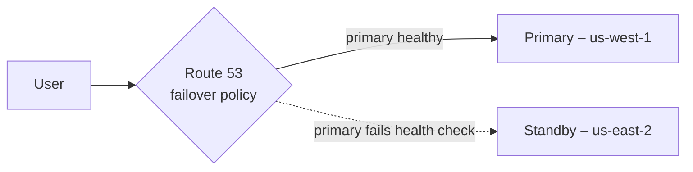
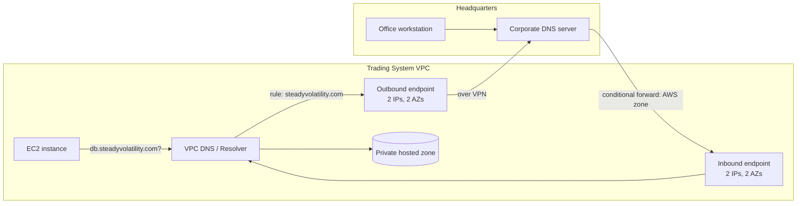

# DNS and Network Resolution

> [!abstract] TL;DR
> Every VPC has a ==built-in DNS server==, and every EC2 instance automatically uses it and gets an internal DNS name based on its private IPv4 address. **Amazon Route 53** is AWS's managed DNS. It is also a **domain registrar**, hosts **public and private hosted zones**, and offers **advanced routing** (failover, latency, geolocation). By default, ==cloud DNS and on-premises DNS can't see each other==. The fix is **Route 53 Resolver**: an ==inbound endpoint receives queries forwarded from on-premises, and an outbound endpoint plus a forwarding rule sends queries for the corporate domain to on-premises DNS==.

**Lesson:** L1 – Architect Network Connectivity Strategies · **Previous:** [[Secure and Private Connectivity]] · **Next:** [[Monitoring and Logging Network Traffic]]
**Section hub:** [[Designing AWS Architecture for Organizations]]
**Sources:** Video L1-A08 (DNS and Network Resolution) and the DNS half of L1-A11 (Exercise 2 Demo), en-us transcripts. Material marked *beyond the lecture* is my addition.

> [!todo]- Contents
> 1. [[#1. DNS Inside Every VPC]]
> 2. [[#2. Amazon Route 53]]
> 3. [[#3. Hybrid DNS – Route 53 Resolver]]
> 4. [[#4. Lab Walkthrough – Exercise 2 DNS]]
> 5. [[#5. Pitfalls and Failure Modes]]
> 6. [[#6. Key Takeaways]]
> 7. [[#7. Critical Analysis]]
> 8. [[#8. Self-Test]]
> 9. [[#9. Glossary]]
> 10. [[#10. Further Reading]]

---

## 1. DNS Inside Every VPC

DNS saves us from memorizing IP addresses. The lecture stresses that it's ==quietly at work automatically in every VPC==.

> [!info]+ Definition – VPC built-in DNS server
> An inherent DNS server exposed at a reserved address in every VPC. The lecture calls it "the second usable IP address". (*Beyond the lecture:* AWS documents it as the VPC CIDR **base + 2**, e.g. `172.19.0.2` for the trading VPC. It's also reachable at `169.254.169.253`.) It's often called the **Amazon-provided DNS** or **Route 53 Resolver**. ^def-vpc-dns

What every new EC2 instance gets automatically (lecture):

| Automatic behavior | Example (*beyond the lecture* formatting) |
|---|---|
| Sends name-resolution requests to the VPC's DNS server | Resolver = `172.19.0.2` |
| Gets a **private IPv4** address | `172.19.4.10` |
| Gets a unique **internal DNS name** generated from that private IP | `ip-172-19-4-10.us-west-1.compute.internal` |
| If it has a **public IP**, the same naming applies to that address | `ec2-<public-ip>.us-west-1.compute.amazonaws.com` |

> [!note] Beyond the lecture
> These behaviors depend on two VPC attributes: `enableDnsSupport` (the resolver works) and `enableDnsHostnames` (instances get DNS hostnames). Both must be on for private hosted zones and interface endpoint private DNS to work.

---

## 2. Amazon Route 53

> [!info]+ Definition – Amazon Route 53
> AWS's **fully managed DNS** service. It resolves names to IP addresses, and it can also act as a **domain name registrar**: you can register new domains or **transfer in** domains registered elsewhere. ^def-route53

| Capability (lecture) | What it does |
|---|---|
| **Domain registration** | Create new domains, or transfer existing ones in from other registrars |
| **Public hosted zone** | DNS records exposed to the internet |
| **Private hosted zone** | DNS records visible only inside **one or more associated VPCs** |
| **Advanced routing** | Multi-location failover, latency-based routing, geographic routing, distributing traffic across locations, **active-passive failover** |

| Routing policy (*beyond the lecture*, named) | Use |
|---|---|
| Simple | One record, no logic |
| Failover | Active-passive. Health checks move traffic to the standby when the primary fails. |
| Latency | Send users to the Region with the lowest measured latency |
| Geolocation / geoproximity | Route by the user's location, e.g. for data residency or localized content |
| Weighted | Split traffic by percentage, e.g. canary releases |
| Multivalue answer | Return several healthy IPs |

---

## 3. Hybrid DNS – Route 53 Resolver

### The problem (lecture)

People and applications find each other by **name**, in both directions:
- On-premises technologists connecting to cloud applications.
- Cloud developers connecting back to servers at headquarters.

But ==by default, cloud and on-premises use entirely separate DNS systems==:
- On-premises DNS **can't resolve** names in a Route 53 **private hosted zone**, such as the EC2 instances' names.
- Cloud servers know **nothing** about the on-premises private DNS zones that haven't been shared outside.

### The solution – Route 53 Resolver forwarding

> [!info]+ Definition – Inbound resolver endpoint
> Receives DNS queries **forwarded from the on-premises DNS server** so on-premises clients can resolve cloud names. ^def-inbound

> [!info]+ Definition – Outbound resolver endpoint
> Forwards **cloud-originated queries for the corporate domain** to the **on-premises DNS server**. A **resolver rule** decides which domains go out. ^def-outbound

| Direction | Query from | For names in | Path |
|---|---|---|---|
| Cloud → on-premises | EC2 in the VPC | Corporate domain | VPC resolver → **forwarding rule** → **outbound endpoint** → on-premises DNS |
| On-premises → cloud | Office clients | Private hosted zone | On-premises DNS (conditional forwarder, *beyond the lecture*) → **inbound endpoint** → VPC resolver |

**Logging (lecture):** for troubleshooting, enable query logging to **S3**, **CloudWatch Logs**, or **Amazon Data Firehose**. (*Beyond the lecture:* Resolver query logging captures the DNS queries made by resources in the VPCs you associate with the logging configuration.)

---

## 4. Lab Walkthrough – Exercise 2 DNS

> [!tip] Doing this lab
> Step-by-step console guide: [[Exercise 2 - Peering and Hybrid DNS - How To#3. Outbound Resolver Endpoint – "Outbound HQ"|how-to, sections 3–7]].

All of this was done in the **Route 53 console**, for the **trading system VPC**:

| Step | Configuration |
|---|---|
| 1. Outbound endpoint | Name **"Outbound HQ"**, IPv4. **Two IP addresses in different AZs**: one in the private subnet in `us-west-1a` and one in the private subnet in `us-west-1b`. Uses the **default security group**. |
| 2. Inbound endpoint | Name **"Inbound from HQ"**, IPv4. Automatically selected IPs in the **private subnets of both AZs**. Default security group. |
| 3. Outbound forwarding rule | Name **"outbound resolver rule"**. It forwards queries for **`steadyvolatility.com`** through *Outbound HQ* to the corporate DNS server at **`172.31.16.2`**. |
| 4. Query logging | Logs go to a new **CloudWatch Logs** log group (roughly "SteadyVolatilityPartners/DNSlogs"; the caption is garbled). Enabled for all activity in the trading system VPC. |
| 5. Clean up | **Resolver components can be costly**, so remove them in this order: **disassociate the VPC from the rule → delete the rule → delete the inbound and outbound endpoints**. |

> [!question] Lab inconsistency worth noticing
> In Exercise 1, HQ's network is `192.168.48.0/20`, reached through the VGW. But the forwarding rule targets `172.31.16.2`, which falls in `172.31.0.0/16`, the **default VPC range** peered as the Market Prediction VPC. For a real design, the forwarding target must be the corporate DNS server's IP, reachable through a route (here, an address in `192.168.48.0/20` over the VPN). Otherwise the outbound endpoint has nowhere to send queries. This is probably just a demo placeholder, but it's a good check: ==forwarding needs both a rule and a network path==. ^dns-needs-route

> [!warning] Why two IPs in two AZs
> Each IP is an ENI in a subnet, so it lives in one AZ. Two AZs keep hybrid DNS working when one AZ fails. This is the [[AWS Global Infrastructure#^two-az-rule|two-AZ rule]] applied to DNS.

---

## 5. Pitfalls and Failure Modes

| Failure | Symptom | Mitigation |
|---|---|---|
| Forwarding target unreachable | Queries for the corporate domain time out | The target IP must be routable, e.g. through the VPN ([[#^dns-needs-route]]) |
| Endpoint SG blocks DNS | Forwarded queries silently fail | Allow TCP **and** UDP 53: outbound on the outbound endpoint's SG, inbound from on-premises on the inbound endpoint's SG |
| Rule created but not associated with the VPC | The VPC still sends corporate names to the public internet | Associate the rule with every VPC that needs it |
| On-premises side not configured | Office can't resolve cloud names even though the inbound endpoint exists | Add a **conditional forwarder** on-premises pointing to the inbound endpoint IPs |
| `enableDnsHostnames` / `enableDnsSupport` off | Private hosted zone and endpoint private DNS don't resolve | Turn both VPC attributes on |
| Leaving lab resolver endpoints running | Surprise bill | Follow the lecture's cleanup order |
| Single-AZ endpoint IPs | Hybrid DNS fails during an AZ fault | Spread IPs across at least two AZs |

---

## 6. Key Takeaways

- [ ] Every VPC has a **built-in DNS server** at a reserved address (base + 2). Instances use it automatically.
- [ ] Each instance gets an **internal DNS name derived from its private IPv4**, and a public one if it has a public IP.
- [ ] **Route 53** is managed DNS, a **registrar** (new domains and transfers), and **public and private hosted zones**.
- [ ] **Private hosted zones** serve one or more VPCs. **Public zones** are exposed to the internet.
- [ ] Route 53 supports **failover, latency-based, and geographic routing**.
- [ ] By default, **cloud and on-premises DNS are separate**. **Route 53 Resolver** bridges them.
- [ ] **Inbound endpoint:** on-premises → cloud names. **Outbound endpoint + forwarding rule:** cloud → corporate names.
- [ ] Query logs go to **S3, CloudWatch Logs, or Data Firehose**. **Clean up** resolver resources, because they're costly.

---

## 7. Critical Analysis

- **DNS is a security boundary that often goes unwatched.** Firewalls ([[Secure and Private Connectivity]]) don't log DNS to the VPC resolver, and as [[Monitoring and Logging Network Traffic#3. What Flow Logs Do Not Capture|flow logs]] show, that traffic is excluded from flow logs too. Malware often uses **DNS tunneling** for exfiltration, so for the "strictly disconnected" tier, query logging (and *beyond the lecture*, Route 53 Resolver DNS Firewall) is the main visibility into that channel.
- **Hybrid DNS creates a dependency on HQ.** If the VPN is down, every lookup for `steadyvolatility.com` fails. Consider which cloud workloads truly need corporate names, and whether to cache or replicate critical records.
- **Routing policies aren't load balancers.** DNS answers are cached according to TTLs, so failover takes at least one TTL. For a trading system, a 60-second TTL may still be too slow, and health-check design matters.
- **Cost at scale** (*beyond the lecture*): resolver endpoints are billed per ENI-hour. Organizations typically centralize them in a **shared networking VPC** and **share resolver rules** across accounts with AWS RAM, instead of building them per VPC.

> [!question] Open discussion questions
> 1. Should the strictly offline ML tier be able to resolve *any* external names? How would you enforce "no" at the DNS layer?
> 2. What TTLs would you choose for a failover record that fronts a trading API, and what are the trade-offs?
> 3. How would you design hybrid DNS so that a VPN outage doesn't break cloud workloads?

---

## 8. Self-Test

> [!question]- Q1. What DNS configuration does every new EC2 instance get automatically?
> It sends name-resolution requests to the **VPC's built-in DNS server**. It gets a **private IPv4 address** and a unique **internal DNS name** generated from it, and the same for a public IP if it has one.

> [!question]- Q2. Besides resolving names, what can Route 53 do?
> Act as a **domain registrar** (register new domains, transfer in existing ones). Host **public and private hosted zones**. Provide **advanced routing**: multi-location failover, latency-based, geographic, traffic distribution, and active-passive failover.

> [!question]- Q3. What's the difference between public and private hosted zones?
> **Private** hosted zones control DNS within **one or more VPCs**. **Public** zones are **exposed to the internet**.

> [!question]- Q4. Why can't on-premises DNS resolve EC2 names in a private hosted zone by default, and what fixes it?
> Cloud and on-premises use **separate DNS systems**. Fix it with a **Route 53 Resolver inbound endpoint** that receives queries forwarded from the on-premises DNS server.

> [!question]- Q5. What is the lab's teardown order for Resolver components, and why bother?
> **Disassociate the VPC from the rule → delete the rule → delete the inbound and outbound endpoints.** The components can generate significant costs.

> [!question]- Q6. (Quantitative, beyond the lecture) Each resolver endpoint IP (ENI) costs about \$0.125 per hour. The lab creates an inbound and an outbound endpoint with 2 IPs each. What's the monthly cost if you forget to delete them?
> $4 \text{ ENIs} \times \$0.125 \times 730 \text{ h} \approx \$365$ per month, before query charges. (Prices vary, so check current pricing.) That's why the instructor stresses cleanup.

> [!question]- Q7. (Quantitative, beyond the lecture) What is the VPC DNS server's address for the trading VPC `172.19.0.0/16`?
> Base + 2 = **`172.19.0.2`**.

> [!question]- Q8. (Design) Steady Volatility Partners' cloud apps must look up `ldap.steadyvolatility.com`, and HQ analysts must reach `model-api.trading.internal` in a private hosted zone. Design it.
> - **Cloud → HQ:** an **outbound endpoint** (IPs in two AZs) and a **forwarding rule** for `steadyvolatility.com`, targeting the corporate DNS IP reachable over the VPN. Associate the rule with the VPC.
> - **HQ → cloud:** an **inbound endpoint** (two AZs). On-premises DNS gets a **conditional forwarder** for `trading.internal` pointing at those IPs.
> - Endpoint SGs allow TCP/UDP 53. Enable **query logging**.

> [!tip] Flashcards
> Review this lesson with [[DNS and Network Resolution - Flashcards]].

---

## 9. Glossary

| Term | Meaning |
|---|---|
| DNS | Domain Name System; resolves names to IP addresses |
| VPC DNS server | Built-in resolver at the VPC's base + 2 address |
| Amazon Route 53 | AWS managed DNS, domain registrar, and DNS routing service |
| Hosted zone | A container for a domain's DNS records in Route 53 |
| Private hosted zone | DNS records visible only within associated VPCs |
| Public hosted zone | DNS records published to the internet |
| Route 53 Resolver | The VPC's DNS resolution service and its hybrid forwarding features |
| Inbound endpoint | Resolver ENIs that accept queries from on-premises |
| Outbound endpoint | Resolver ENIs that forward queries to on-premises DNS |
| Resolver (forwarding) rule | Maps a domain to target DNS servers through an outbound endpoint |
| Conditional forwarder | On-premises DNS setting that forwards a specific domain elsewhere (*beyond the lecture*) |
| TTL | Time-to-live: how long resolvers cache a DNS answer |

---

## 10. Further Reading

- [DNS attributes for your VPC](https://docs.aws.amazon.com/vpc/latest/userguide/vpc-dns.html)
- [What is Amazon Route 53](https://docs.aws.amazon.com/Route53/latest/DeveloperGuide/Welcome.html)
- [Choosing a routing policy](https://docs.aws.amazon.com/Route53/latest/DeveloperGuide/routing-policy.html)
- [What is Route 53 Resolver](https://docs.aws.amazon.com/Route53/latest/DeveloperGuide/resolver.html)
- [Resolver query logging](https://docs.aws.amazon.com/Route53/latest/DeveloperGuide/resolver-query-logs.html)
