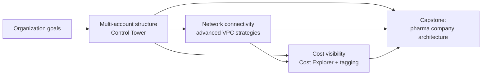

# Designing AWS Architecture for Organizations

> [!abstract] TL;DR
> This is the **hub** for the first major section of the AWS Cloud Architect course. It moves from single-workload AWS skills to ==designing infrastructure for a whole organization==: many accounts, many networks, and shared budgets. It has three pillars: ==advanced VPC network connectivity, governed multi-account environments (AWS Control Tower), and cost visibility (Cost Explorer plus tagging)==. It ends with a capstone in which you act as a senior cloud architect for a pharmaceutical company.

**Instructor:** Mike Hammond. He has 25 years as a technical trainer and has spent the last five at AWS as a Cloud educator.
**Prerequisite:** A foundation in AWS Fundamentals, Cloud Development, or Cloud DevOps.
**Next section:** [[Designing AWS Architecture for Workloads]]. It moves from organization-wide design to migrating individual workloads (Well-Architected Migration Lens, the 4 Rs).
**Sources:** The course welcome page, the instructor's intro video transcript, and the "Workspace and Tools" course page. Everything marked *beyond the lecture* is background I added to prepare for later lessons. It is not course content.

> [!example]+ Lessons in this section
> **Lesson 1 – Architect Network Connectivity Strategies**
> 1. [[Networking for Organizations]] (A02): trustworthy networks; virtual services replace hardware; only required traffic ([[Networking for Organizations - Flashcards|flashcards]])
> 2. [[AWS Global Infrastructure]] (A03): Regions, AZs, Region choice, two-AZ rule ([[AWS Global Infrastructure - Flashcards|flashcards]])
> 3. [[Building a VPC]] (A04–A05, Ex 1): Steady Volatility Partners; subnets, route tables, public/private, NAT, gateway endpoints ([[Building a VPC - Flashcards|flashcards]]) · lab: [[Exercise 1 - Build the Network|✅ Exercise 1 results]]
> 4. [[Advanced VPC Connectivity]] (A06, Ex 2): VGW VPN, transit gateway, VPC peering ([[Advanced VPC Connectivity - Flashcards|flashcards]])
> 5. [[Secure and Private Connectivity]] (A07a–b): security groups, NACLs, VPC endpoints ([[Secure and Private Connectivity - Flashcards|flashcards]])
> 6. [[DNS and Network Resolution]] (A08, Ex 2): VPC DNS, Route 53, Resolver hybrid DNS ([[DNS and Network Resolution - Flashcards|flashcards]])
> 7. [[Monitoring and Logging Network Traffic]] (A09, Ex 3): VPC Flow Logs and analysis ([[Monitoring and Logging Network Traffic - Flashcards|flashcards]])
>
> **Lesson 1 labs** (how-tos, no flashcards)
> - [[Exercise 1 - Build the Network - How To|Exercise 1 – Build the Network]] · [[Exercise 1 - Build the Network|✅ results]]
> - [[Exercise 2 - Peering and Hybrid DNS - How To|Exercise 2 – Peering and Hybrid DNS]]
> - [[Exercise 3 - VPC Flow Logs - How To|Exercise 3 – VPC Flow Logs]]
>
> **Lesson 2 – Design a Multi-Account AWS Environment**
> 1. [[AWS Organizations]] (A01–A02): why multi-account; root/OUs/management account; consolidated billing; policy types ([[AWS Organizations - Flashcards|flashcards]])
> 2. [[Organizational Units and Service Control Policies]] (A03): function-based OUs; 11 recommended OUs; SCP inheritance ([[Organizational Units and Service Control Policies - Flashcards|flashcards]])
> 3. [[AWS Control Tower]] (A04): landing zone; controls; Account Factory; AWS RAM ([[AWS Control Tower - Flashcards|flashcards]])
> 4. [[Centralized Logging and Event Notification]] (A05): CloudTrail, Config, Log Archive, analytics options ([[Centralized Logging and Event Notification - Flashcards|flashcards]])
> 5. [[Governance and Compliance in Multi-Account Environments]] (A06, A09): Artifact; guidance levels; Audit Manager ([[Governance and Compliance in Multi-Account Environments - Flashcards|flashcards]])
>
> **Lesson 2 labs** (how-tos, no flashcards)
> - [[Exercise 1 - Manage Accounts using AWS Organizations - How To|Exercise 1 – Create and Manage Accounts using AWS Organizations]]
> - [[Exercise 2 - AWS Control Tower - How To|Exercise 2 – Implementing Governance Policies in AWS Control Tower]]
>
> **Lesson 3 – Determine Cost and Visibility Strategies**
> 1. [[AWS Cost and Usage Monitoring Tools]] (A01–A02): Cost Explorer, Budgets and budget actions, Trusted Advisor ([[AWS Cost and Usage Monitoring Tools - Flashcards|flashcards]])
> 2. [[Cost Optimization and Analysis Strategies]] (A03): Compute Optimizer, Cost Anomaly Detection, Cost Optimization Hub ([[Cost Optimization and Analysis Strategies - Flashcards|flashcards]])
> 3. [[AWS Purchasing Options and Rightsizing]] (A04): On-Demand / SP / RI / Spot; S3 classes, lifecycle, Storage Lens ([[AWS Purchasing Options and Rightsizing - Flashcards|flashcards]])
> 4. [[Tagging Strategies and Cost Allocation]] (A05, A08): tags, cost allocation tags, enforcement, CUR 2.0 ([[Tagging Strategies and Cost Allocation - Flashcards|flashcards]])
>
> **Lesson 3 labs** (how-tos, no flashcards)
> - [[Exercise 1 - Using AWS Cost Explorer - How To|Exercise 1 – Using AWS Cost Explorer and Compute Optimizer for Cost Analysis]]
> - [[Exercise 2 - Implementing Tagging - How To|Exercise 2 – Implementing Tagging and Reporting Strategies]]
>
> **Project – Design and Architect Infrastructure for an Organization** (Excipient Technologies)
> - [[Project Overview]]: rubric checklist, Cloud Lab rules
> - [[Project Report – Excipient Technologies]]: compiled report for export
>
> **Next section →** [[Designing AWS Architecture for Workloads]]

> [!todo]- Contents
> 1. [[#1. Course Goals]]
> 2. [[#2. The Three Pillars]]
> 3. [[#3. Workspace and Tools]]
> 4. [[#4. The Capstone – Pharmaceutical Company]]
> 5. [[#5. Pre-Reading Primer]]
> 6. [[#6. Anticipated Pitfalls]]
> 7. [[#7. Key Takeaways]]
> 8. [[#8. Critical Analysis]]
> 9. [[#9. Self-Test]]
> 10. [[#10. Glossary]]
> 11. [[#11. Further Reading]]

---

## 1. Course Goals

The course is framed around organizations that need AWS environments that are ==scalable, secure, and cost-efficient== at the same time. The instructor's intro names three focus areas for "large, complex AWS implementations":

1. **Networking capabilities**
2. **Technologies for supporting large multi-account organizations**
3. **Cost optimization strategies**

> [!info]+ Definition – The shift this course makes
> Earlier AWS courses optimize *one workload in one account*. This course optimizes *an organization*: many teams, accounts, and VPCs that must be **connected**, **governed**, and **paid for** coherently. ^org-shift

The stated end goal is to "design architectures that align with industry best practices and organizational objectives." That means the grading criterion is *fit to the organization*, not just technical correctness.

---

## 2. The Three Pillars

| Pillar | Learning outcome (from the welcome page) | Named tools | Core question it answers |
|---|---|---|---|
| **Network connectivity** | Architect secure and scalable network connectivity with advanced VPC strategies | Amazon VPC, AWS Direct Connect, AWS VPN | How do many isolated networks talk to each other, and to on-premises, safely? |
| **Multi-account governance** | Build and govern multi-account AWS environments to support organizational goals | AWS Organizations, AWS Control Tower | How do you give teams autonomy without losing central control? |
| **Cost management** | Optimize costs and visibility using Cost Explorer and tagging strategies | AWS Cost Explorer, tagging strategies, rightsizing | Who is spending what, and is it worth it? |

> [!note] How the pillars connect (my reading, *beyond the lecture*)
> The account structure comes first. Accounts are the unit of **isolation** (network and security boundaries) and the unit of **billing** (cost attribution). So decisions in the governance pillar constrain both the network design and the cost reporting. ^pillars-coupled

---

## 3. Workspace and Tools

The course runs on the **AWS Cloud Platform**, using a **temporary AWS account** provided for the duration of the course. Access directions are on the next course page.

### Interfaces

| Interface | Role in the course | Best for |
|---|---|---|
| **AWS Management Console** | Primary interface for configuring and managing services such as VPCs, AWS Organizations, and AWS Control Tower | Learning foundational tasks; experimenting with service configuration |
| **AWS CLI** | Automates resource management with scripts | Repeatable, scalable tasks; reducing manual work |

> [!tip] Console to learn, CLI to scale (*beyond the lecture*)
> Use the console to understand what a setting does. Then capture the same change as a CLI command. Clicking through 50 accounts doesn't scale, and the CLI history becomes a record of what you built. This is also the bridge to infrastructure as code (CloudFormation, Terraform), which organizations use for anything they must reproduce.

### Services, grouped by pillar

| Pillar | Service / practice | What the course says you'll do with it |
|---|---|---|
| Network connectivity | **Amazon VPC** | Design isolated, secure networks; configure VPCs, subnets, route tables, and network access control |
| Network connectivity | **AWS Direct Connect** | Establish high-speed, reliable connections between on-premises infrastructure and AWS; critical for hybrid cloud |
| Network connectivity | **AWS VPN** | Implement secure, encrypted communication between on-premises and cloud networks; practice configuring VPNs |
| Multi-account governance | **AWS Organizations** and **AWS Control Tower** | Manage multiple accounts, enforce governance, centralize operations; build a scalable structure for large organizations |
| Cost management | **AWS Cost Explorer** | Analyze cost and usage trends; apply tagging and ==rightsizing== to cut unnecessary spend |
| Cost management | **Tagging strategies** | Organize resources with tags to improve cost management and visibility; track expenses across projects |

> [!info]+ Definition – Hybrid connectivity: Direct Connect vs. Site-to-Site VPN
> Both connect an on-premises network to AWS. **Site-to-Site VPN** runs an *encrypted IPsec tunnel over the public internet*. It is quick and cheap to set up, but its performance depends on the internet path. **Direct Connect** is a *dedicated private link* through a Direct Connect location. It gives consistent bandwidth and latency but needs provisioning lead time, and it is *not encrypted by default*. (The comparison details are *beyond the lecture*.) ^def-hybrid

| | Site-to-Site VPN | Direct Connect |
|---|---|---|
| Path | Public internet | Dedicated private link |
| Encryption | Yes (IPsec) | Not by default; add MACsec or run VPN over it |
| Setup time | Minutes to hours | Weeks (physical provisioning) |
| Performance | Variable | Consistent, high bandwidth |
| Common pattern | Primary for small sites; **backup for Direct Connect** | Primary link for heavy, steady hybrid traffic |

> [!warning] Temporary lab accounts (*beyond the lecture*)
> Course sandbox accounts often have restricted permissions, limited Regions, or session time limits. They are also wiped when the course ends. Keep your own notes and CLI commands here in the vault, not only in the account. Some services, such as Direct Connect, need physical provisioning, so expect to *design* them rather than fully build them in a lab.

---

## 4. The Capstone – Pharmaceutical Company

> [!success] Now released
> The capstone is **Excipient Technologies**. See [[Project Overview]].

From the welcome page: you play a ==senior cloud architect== tasked with designing and optimizing a pharmaceutical company's AWS infrastructure in a *dynamic multi-account setup*. The three stated challenges map one-to-one onto the pillars:

| Capstone challenge | Pillar |
|---|---|
| Consolidate networks | Network connectivity |
| Enforce governance | Multi-account governance |
| Manage costs | Cost management |

> [!example] Why pharma is a good stress test (*beyond the lecture*)
> Pharmaceutical companies run regulated workloads, such as clinical-trial and manufacturing systems under GxP and data-integrity rules, next to ordinary corporate IT and research. That pushes you toward **strong account-level isolation** for regulated data, **auditable guardrails**, and **chargeback by business unit or research program**. All three pillars matter at once. Expect the project's actual requirements to be more specific than this. Update this section when the project brief is released.

---

## 5. Pre-Reading Primer

*Everything in this section is beyond the lecture.* These are short orientation definitions for the tools the welcome page names, so later lessons have something to attach to.

> [!info]+ Definition – Amazon VPC
> A **Virtual Private Cloud** is a logically isolated network in an AWS Region. You define its IP range in CIDR notation, split it into subnets across Availability Zones, and control traffic with route tables, security groups, and network ACLs. ^def-vpc

> [!info]+ Definition – AWS Organizations
> The service that groups AWS accounts under a **management account** into **organizational units (OUs)**. It provides consolidated billing and **service control policies (SCPs)**, which cap what IAM principals in member accounts can do. ^def-organizations

> [!info]+ Definition – AWS Control Tower
> An orchestration layer over Organizations and related services. It sets up a **landing zone**: a pre-configured multi-account baseline with log-archive and audit accounts, plus **controls** (guardrails). Controls are *preventive* (block an action) or *detective* (flag non-compliance). ^def-control-tower

> [!info]+ Definition – AWS Cost Explorer and cost allocation tags
> **Cost Explorer** visualizes and forecasts spend, filtered by service, account, Region, or tag. **Cost allocation tags** are key–value tags (e.g. `CostCenter=Oncology`) that you *activate* in the Billing console so spend can be grouped by them. Tags only attribute cost from when they are applied and activated. They are not retroactive. ^def-cost-explorer

### Likely "advanced VPC strategies"

The tools page confirms **VPC, Direct Connect, and VPN** ([[#^def-hybrid]]). It doesn't name the VPC-to-VPC options. These are the usual candidates for organization-scale connectivity:

| Strategy | Topology | Scales well? | Notes |
|---|---|---|---|
| VPC peering | Point-to-point mesh | Poorly. $n$ VPCs need $\frac{n(n-1)}{2}$ peerings for a full mesh | Not transitive |
| AWS Transit Gateway | Hub-and-spoke | Yes | Central routing hub; supports route-table segmentation |
| AWS PrivateLink | Service-level exposure | Yes | Exposes one service, not a whole network |
| Shared VPC (AWS RAM) | Central VPC, subnets shared to accounts | Yes | Network team owns the VPC; app teams deploy into it |
| Site-to-Site VPN / Direct Connect | Hybrid to on-premises | Yes | **Named by the course.** See [[#^def-hybrid]] |

The mesh math shows why "consolidate networks" matters. For 20 VPCs:

$$
\frac{20 \times 19}{2} = 190 \text{ peering connections} \quad \text{vs.} \quad 20 \text{ Transit Gateway attachments}
$$

---

## 6. Anticipated Pitfalls

*Beyond the lecture.* These are common failure modes in exactly the areas this course covers. Revisit them as lessons confirm or correct them.

| Failure | Symptom | Mitigation |
|---|---|---|
| Overlapping CIDR ranges | VPCs can't be peered or routed together during consolidation | Plan a central IP address scheme (e.g. Amazon VPC IPAM) before creating VPCs |
| Everything in one account | Blast radius is the whole company; IAM sprawl; no clean cost split | Separate accounts per workload/environment under OUs |
| Guardrails added after the fact | Existing resources violate controls; teams resist | Establish the landing zone first; enroll accounts into it |
| Inconsistent or missing tags | Large "untagged" bucket in Cost Explorer; chargeback disputes | Mandatory tag policy, enforced at creation; activate cost allocation tags early |
| Peering mesh growth | Quadratic number of connections; hard-to-audit routes | Hub-and-spoke via Transit Gateway |

---

## 7. Key Takeaways

- [ ] The course shifts the unit of design from a workload to an **organization** ([[#^org-shift]]).
- [ ] Three pillars: **network connectivity**, **multi-account governance**, **cost management**.
- [ ] Named tools: **VPC**, **Direct Connect**, **VPN**, **AWS Organizations**, **AWS Control Tower**, **AWS Cost Explorer**, and **tagging strategies**.
- [ ] Labs use a **temporary AWS account**, driven through the **Management Console** (learn) and the **AWS CLI** (automate).
- [ ] Hybrid connectivity: **VPN** = encrypted tunnel over the internet; **Direct Connect** = dedicated private link ([[#^def-hybrid]]).
- [ ] The capstone is a **pharmaceutical company**: consolidate networks, enforce governance, manage costs.
- [ ] Account structure drives both network boundaries and cost attribution ([[#^pillars-coupled]]).
- [ ] Success means aligning with **best practices and organizational objectives**, not just a working build.

---

## 8. Critical Analysis

- **Vendor framing.** The instructor works at AWS, and the course teaches AWS-native tools such as Control Tower and Cost Explorer. That is appropriate for an AWS architect track. But the multi-account and landing-zone patterns are general. Azure management groups and Google Cloud's resource hierarchy solve the same problem. Watch for which ideas are *architecture principles* and which are *AWS product features*.
- **"Best practices" needs a reference.** The welcome page appeals to "industry best practices" without naming a source. The most likely anchors are the [AWS Well-Architected Framework](https://aws.amazon.com/architecture/well-architected/) and the AWS multi-account whitepaper. Check each lesson's recommendations against them.
- **Cost optimization vs. cost visibility.** Cost Explorer and tags give *visibility*. They don't reduce spend by themselves. Real optimization needs actions, plus an organizational process (FinOps) to act on what the reports show. The tools page names **rightsizing**. Watch whether the course also covers commitment discounts (Savings Plans, Reserved Instances) and storage lifecycle policies.
- **Governance tension.** Strong preventive guardrails reduce risk but slow teams down. The interesting design question is where to put each control: SCP, Control Tower control, or detective check plus remediation.
- **What changes at scale.** At tens of accounts, manual setup is fine. At hundreds, account vending, IP planning, and tag enforcement must be automated, or the architecture drifts.

> [!question] Open discussion questions
> 1. In a regulated pharma setting, which controls should be **preventive** and which **detective**? Why?
> 2. When is a shared VPC preferable to a VPC per account connected through Transit Gateway?
> 3. Should cost allocation follow the **account** boundary, the **tag** boundary, or both? What happens when they disagree?

---

## 9. Self-Test

> [!question]- Q1. What are the three pillars of this section, and which AWS tool is named for each?
> Network connectivity (advanced **VPC** strategies), multi-account governance (**AWS Control Tower**), and cost management (**AWS Cost Explorer** plus tagging strategies).

> [!question]- Q2. What three challenges does the capstone pose, and in what industry?
> A **pharmaceutical company**: consolidate networks, enforce governance, and manage costs in a dynamic multi-account setup.

> [!question]- Q3. Why does the account structure come before the network and cost designs?
> Accounts are both the isolation boundary and the billing boundary. The OU/account layout therefore decides which networks must be connected and how spend is attributed ([[#^pillars-coupled]]).

> [!question]- Q4. When would you use the AWS CLI instead of the Management Console?
> The **console** is for learning and experimenting with configurations. The **CLI** is for automating resource management with scripts: repeatable, scalable work that reduces manual effort, such as applying the same change across many accounts.

> [!question]- Q5. (Design, partly beyond the lecture) A manufacturing site needs steady, high-bandwidth access to AWS, and the company can't tolerate an outage if that link fails. What do you propose?
> **Direct Connect** as the primary link for consistent bandwidth and latency, with a **Site-to-Site VPN** over the internet as a backup path. If the data must be encrypted in transit, add encryption on the Direct Connect link (MACsec, or VPN over Direct Connect), because Direct Connect isn't encrypted by default.

> [!question]- Q6. (Quantitative, beyond the lecture) A company has 12 VPCs that all need to reach each other. How many VPC peering connections does a full mesh need, and how many Transit Gateway attachments?
> Peering: $\frac{12 \times 11}{2} = 66$ connections. Transit Gateway: **12** attachments, one per VPC. Peering grows as $O(n^2)$, hub-and-spoke as $O(n)$.

> [!question]- Q7. (Design, beyond the lecture) A research team says it can't tell how much its genomics pipelines cost because they share an account with other teams. What two changes would you recommend?
> 1. Give the team's workloads their **own account** (or OU) so spend is separated by account.
> 2. Apply a **mandatory cost allocation tag** (e.g. `Project`), activate it in Billing, and enforce it with a tag policy. Cost Explorer can then group spend by project even across shared resources.
>
> > [!warning]
> > Tags aren't retroactive. Past untagged spend stays unattributed.

> [!tip] Flashcards
> No flashcards for this welcome page. Its content is course logistics. A flashcards deck will start with the first content lesson.

---

## 10. Glossary

| Term | Meaning |
|---|---|
| VPC | Virtual Private Cloud. An isolated virtual network in an AWS Region |
| CIDR | Classless Inter-Domain Routing. Notation for IP ranges, e.g. `10.0.0.0/16` |
| AWS Organizations | Service for grouping and centrally governing multiple AWS accounts |
| OU | Organizational unit. A group of accounts inside an organization |
| SCP | Service control policy. A permission ceiling applied to accounts or OUs |
| AWS Control Tower | Service that sets up and governs a multi-account landing zone |
| Landing zone | A well-architected multi-account baseline environment |
| Control (guardrail) | A preventive or detective governance rule in Control Tower |
| Transit Gateway | Regional hub that routes between VPCs and on-premises networks |
| AWS Direct Connect | Dedicated private network link from on-premises to AWS |
| AWS Site-to-Site VPN | Encrypted IPsec tunnel between on-premises and AWS over the internet |
| AWS CLI | Command-line tool for scripting and automating AWS resource management |
| Rightsizing | Matching resource size/type to actual usage to cut waste |
| Cost Explorer | AWS tool for visualizing, analyzing, and forecasting spend |
| Cost allocation tag | An activated tag used to group costs in billing reports |

---

## 11. Further Reading

- [AWS Well-Architected Framework](https://aws.amazon.com/architecture/well-architected/)
- [Organizing Your AWS Environment Using Multiple Accounts (whitepaper)](https://docs.aws.amazon.com/whitepapers/latest/organizing-your-aws-environment/organizing-your-aws-environment.html)
- [What is AWS Organizations](https://docs.aws.amazon.com/organizations/latest/userguide/orgs_introduction.html)
- [What is AWS Control Tower](https://docs.aws.amazon.com/controltower/latest/userguide/what-is-control-tower.html)
- [What is Amazon VPC](https://docs.aws.amazon.com/vpc/latest/userguide/what-is-amazon-vpc.html)
- [What is a transit gateway](https://docs.aws.amazon.com/vpc/latest/tgw/what-is-transit-gateway.html)
- [What is AWS Direct Connect](https://docs.aws.amazon.com/directconnect/latest/UserGuide/Welcome.html)
- [What is AWS Site-to-Site VPN](https://docs.aws.amazon.com/vpn/latest/s2svpn/VPC_VPN.html)
- [AWS CLI User Guide](https://docs.aws.amazon.com/cli/latest/userguide/cli-chap-welcome.html)
- [Analyzing your costs with AWS Cost Explorer](https://docs.aws.amazon.com/cost-management/latest/userguide/ce-what-is.html)

%% Study hint: as each lesson lands, add it to a "Lessons in this section" list at the top of this hub, with Previous/Next links in each lesson note. Update section 3 when the capstone brief is released. %%
