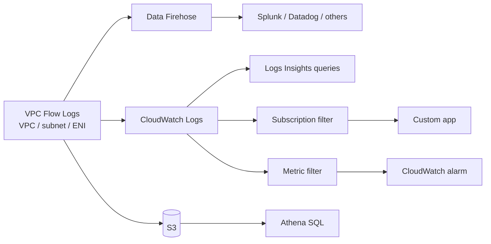

# Monitoring and Logging Network Traffic

> [!abstract] TL;DR
> Preventive controls (routes, SGs, NACLs) don't make a network immune to attack. Good security adds ==detective capabilities that reveal both proper and improper use==. The most direct tool is **VPC Flow Logs**. They can be scoped to a ==VPC, a subnet, or a single ENI==, delivered to ==S3, CloudWatch Logs, or Amazon Data Firehose== (with an IAM role that grants permission), and analyzed with Logs Insights, metric filters and alarms, Athena, or third-party SIEMs. Some traffic is ==never logged==: the VPC's DNS server and router, DHCP, the instance metadata service, and Windows license activation.

**Lesson:** L1 – Architect Network Connectivity Strategies · **Previous:** [[DNS and Network Resolution]] · **Next lesson:** [[AWS Organizations]] (L2 – Design a Multi-Account AWS Environment)
**Section hub:** [[Designing AWS Architecture for Organizations]]
**Sources:** Videos L1-A09 (Monitoring and Logging Network Traffic), L1-A12 (Exercise 3 Demo), and L1-A13 (Lesson Review), en-us transcripts. Material marked *beyond the lecture* is my addition.

> [!todo]- Contents
> 1. [[#1. Why Monitor – Detective Controls]]
> 2. [[#2. VPC Flow Logs]]
> 3. [[#3. What Flow Logs Do Not Capture]]
> 4. [[#4. Analyzing Flow Logs]]
> 5. [[#5. Lab Walkthrough – Exercise 3]]
> 6. [[#6. Worked Example – Spotting a Port Scan]]
> 7. [[#7. Pitfalls and Failure Modes]]
> 8. [[#8. Key Takeaways]]
> 9. [[#9. Critical Analysis]]
> 10. [[#10. Self-Test]]
> 11. [[#11. Glossary]]
> 12. [[#12. Further Reading]]

---

## 1. Why Monitor – Detective Controls

The lecture's argument:

- Implementing security features ==doesn't make the network immune to attack==.
- Good network security includes **ongoing monitoring** to:
  - **verify** that communication happens the way it was designed
  - spot **the telltale signs of threat actors** probing for weaknesses or attacking resources
- Good practice goes beyond *preventing* insecure communication. It includes **detective capabilities** that identify **both proper and improper** use of the network.
- **Troubleshooting** needs a deep understanding of how the network actually operates.

| Control type | Purpose | Examples from this lesson |
|---|---|---|
| **Preventive** | Stop bad traffic | Route tables ([[Building a VPC]]), SGs and NACLs ([[Secure and Private Connectivity]]) |
| **Detective** | See what traffic actually happened | **VPC Flow Logs**, Resolver query logs ([[DNS and Network Resolution]]) |

> [!info]+ Definition – Detective control
> A capability that **identifies** proper and improper activity after or while it happens, as opposed to a preventive control that blocks it. ^def-detective

---

## 2. VPC Flow Logs

> [!info]+ Definition – VPC Flow Logs
> The ==most direct way to know what's happening inside an AWS network==. They capture information about the traffic at a chosen location and write it to a log destination. ^def-flow-logs

| Aspect | Lecture |
|---|---|
| **Scope** | A whole **VPC**, particular **subnets**, or individual **ENIs**, such as an instance's ENI or a **VPC endpoint**'s ENI |
| **Destinations** | **S3**, **CloudWatch Logs**, or other destinations through **Amazon Data Firehose** |
| **Permissions** | The VPC Flow Logs service needs permission to write to the destination. An important step is building an **IAM role** for the logging task. |

> [!note] Beyond the lecture
> - Flow logs record **metadata about flows** (source/destination IP and port, protocol, packets, bytes, start/end time, **ACCEPT/REJECT**), **not packet contents**. For payloads, use **Traffic Mirroring**.
> - You can capture **ALL**, **ACCEPT**, or **REJECT** traffic.
> - The **aggregation interval** is **1 minute or 10 minutes**.
> - Records appear after a delay (minutes), so flow logs aren't a real-time intrusion-prevention system.

---

## 3. What Flow Logs Do Not Capture

Some traffic is deliberately **not logged**, partly to protect the security of the AWS network itself.

| Not logged (lecture) | What it is |
|---|---|
| Traffic to the VPC's **built-in DNS server** | Queries to the Amazon-provided resolver ([[DNS and Network Resolution#^def-vpc-dns]]) |
| Traffic to the VPC's **built-in router** | The reserved router address |
| **DHCP** traffic | Dynamic Host Configuration Protocol, which assigns IP addresses to new instances |
| **Instance metadata service (IMDS)** traffic | Instances asking about their cloud environment. The lecture calls this proprietary. |
| **Windows license activation** | A new Windows instance contacting Microsoft to activate its license |

> [!warning] Blind spot – DNS
> Because DNS queries to the VPC resolver don't appear in flow logs, ==DNS-based exfiltration or command-and-control is invisible to flow logs==. Pair flow logs with **Route 53 Resolver query logging** ([[DNS and Network Resolution#3. Hybrid DNS – Route 53 Resolver]]). ^dns-blind-spot

---

## 4. Analyzing Flow Logs

| Tool (lecture) | What it does |
|---|---|
| **CloudWatch Logs** / **Logs Insights** | View and **query** flow logs interactively |
| **Subscription filters** | **Forward** log events to custom applications as they arrive |
| **Metric filters** → **CloudWatch alarms** | Turn log patterns into **numerical metrics**, then **alarm** on thresholds |
| **Amazon Athena** | SQL queries over flow logs **stored in S3** |
| **Third-party tools** (e.g. Splunk, Datadog) | Stream logs to external analysis and SIEM platforms |



---

## 5. Lab Walkthrough – Exercise 3

> [!tip] Doing this lab
> Step-by-step console guide: [[Exercise 3 - VPC Flow Logs - How To]].

The goal is to send all of the trading VPC's traffic metadata to CloudWatch Logs.

| Step | Configuration |
|---|---|
| 1. Log group | `/aws/tradingsystem/vpcflowlogs`, **retention 1 month** (then logs expire), **Standard** log class |
| 2. IAM policy | **TradingSystemLogGroupPolicy** on the CloudWatch Logs service. Three **write** actions: `CreateLogGroup`, `CreateLogStream`, `PutLogEvents`. Two **list** actions: `DescribeLogGroups`, `DescribeLogStreams`. Applies to any appropriate CloudWatch Logs resource. |
| 3. IAM role | **Custom trust policy** that lets the AWS service principal **`vpc-flow-logs.amazonaws.com`** assume the role. The role carries the policy from step 2. |
| 4. Flow log | **"TradingSystemVPC flow log"** on the trading system VPC. Captures **all traffic**, with a **1-minute aggregation interval**. Destination: the log group from step 1. Uses the role from step 3. |

The two policies, written out as JSON (*beyond the lecture*; the lab built them in the console):

```json
{
  "Version": "2012-10-17",
  "Statement": [{
    "Effect": "Allow",
    "Action": [
      "logs:CreateLogGroup",
      "logs:CreateLogStream",
      "logs:PutLogEvents",
      "logs:DescribeLogGroups",
      "logs:DescribeLogStreams"
    ],
    "Resource": "*"
  }]
}
```

```json
{
  "Version": "2012-10-17",
  "Statement": [{
    "Effect": "Allow",
    "Principal": { "Service": "vpc-flow-logs.amazonaws.com" },
    "Action": "sts:AssumeRole"
  }]
}
```

> [!tip] Two halves of every service role
> The **permissions policy** says *what* the role can do (write to CloudWatch Logs). The **trust policy** says *who* can use the role (the VPC Flow Logs service). A flow log fails to deliver if either half is wrong. ^role-two-halves

---

## 6. Worked Example – Spotting a Port Scan

*Beyond the lecture.* A default-format flow log record, with fields in order:

```text
version account-id interface-id srcaddr dstaddr srcport dstport protocol packets bytes start end action log-status
2 123456789012 eni-0abc123 203.0.113.50 172.19.0.10 51544 22 6 1 40 1760700000 1760700060 REJECT OK
```

This one reads as: a single TCP (protocol 6) packet from `203.0.113.50` to port 22 (SSH) on a public-subnet instance was **rejected** by the SG or NACL.

**A Logs Insights query** for the top sources of rejected traffic:

```sql
fields @timestamp, srcAddr, dstPort
| filter action = "REJECT"
| stats count(*) as rejects by srcAddr
| sort rejects desc
| limit 10
```

**Turning it into an alarm:** create a **metric filter** that counts `REJECT` records. Then add a **CloudWatch alarm** when rejects exceed a threshold, e.g. 500 in 5 minutes. A sudden rise suggests someone is **probing for weaknesses**, which is the telltale sign the lecture describes.

> [!example] What this tells the security team
> - Many REJECTs on many ports from one source means a **port scan**. Preventive controls are working, but someone is looking.
> - **ACCEPT** records from the private subnets to unexpected destinations mean a **design or compromise problem**. This is the "verify that communication happens the way we designed it" check.

---

## 7. Pitfalls and Failure Modes

| Failure | Symptom | Mitigation |
|---|---|---|
| Missing or wrong IAM role | Flow log status shows delivery errors; log group stays empty | Permissions policy **and** trust policy for `vpc-flow-logs.amazonaws.com` ([[#^role-two-halves]]) |
| Treating prevention as enough | Attacks go unnoticed until damage is done | Add detective controls: flow logs, metric filters, alarms |
| Relying on flow logs for DNS visibility | DNS tunneling is missed | Enable Resolver query logging ([[#^dns-blind-spot]]) |
| No retention policy | Logs grow forever; storage costs climb | Set retention (the lab uses 1 month), or archive to S3 with lifecycle rules |
| Logs nobody reads | A compliance checkbox with no detection value | Build metric filters, alarms, and regular queries |
| Expecting packet contents | Can't see what data was sent | Flow logs are metadata only; use Traffic Mirroring for payloads |
| Capturing only ACCEPT | Probing attempts go unseen | Capture **ALL**, or at least REJECT, at security-relevant scopes |

---

## 8. Key Takeaways

- [ ] Security features **don't make a network immune**. Monitor continuously to **verify design** and **detect threats** ([[#^def-detective]]).
- [ ] **VPC Flow Logs** are the most direct view of network traffic. Scope: **VPC, subnet, or ENI** (including VPC endpoints).
- [ ] Destinations: **S3, CloudWatch Logs, Data Firehose**. Delivery needs an **IAM role**.
- [ ] Analyze with **Logs Insights**, **subscription filters**, **metric filters + alarms**, **Athena** (S3), or **Splunk/Datadog**.
- [ ] **Not logged:** VPC DNS server and router traffic, **DHCP**, **IMDS**, **Windows license activation**.
- [ ] Lab: log group with 1-month retention → policy with 3 write + 2 describe actions → role trusted by `vpc-flow-logs.amazonaws.com` → flow log on ALL traffic at 1-minute aggregation.
- [ ] Next lesson: **larger multi-account architectures** (from the lesson review).

---

## 9. Critical Analysis

- **Flow logs show *that* traffic happened, not *what* it carried.** They're great for verifying [[Networking for Organizations#^least-privilege-network|"only required traffic"]] and for spotting scans. They're weak against exfiltration over *allowed* paths, such as HTTPS to an approved S3 endpoint. Complement them with CloudTrail S3 data events and Resolver query logs.
- **The exclusions are a meaningful blind spot.** IMDS abuse (stealing instance credentials through the metadata service, as in several real breaches) isn't visible in flow logs. The mitigation is preventive: **require IMDSv2** and limit role permissions (*beyond the lecture*).
- **The lab's IAM policy is broader than needed.** It allows the actions on any appropriate CloudWatch Logs resource. A least-privilege version scopes `Resource` to the one log group's ARN. Better still, add `aws:SourceAccount` / `aws:SourceArn` conditions to the trust policy to prevent the confused-deputy problem.
- **Cost and volume scale with traffic.** At organization scale, teams usually centralize flow logs in a **log-archive account**, typically in S3 with Athena. CloudWatch Logs ingestion gets expensive at high volume. This ties to the [[Designing AWS Architecture for Organizations#5. Pre-Reading Primer|Control Tower log-archive account]] in the next lesson.
- **Detection without response is incomplete.** An alarm needs an owner and a runbook. Who responds when rejected SSH attempts spike at 3 a.m.?

> [!question] Open discussion questions
> 1. Which scope would you choose for Steady Volatility Partners: VPC-wide ALL traffic, or targeted ENIs (interface endpoints, NAT, internet-facing instances)? Justify it in terms of cost versus coverage.
> 2. Which three metric-filter alarms would you create first, and why?
> 3. How would you detect the offline ML tier making a connection it should never make?

---

## 10. Self-Test

> [!question]- Q1. Why isn't a well-configured set of SGs, NACLs, and routes enough on its own?
> Security features don't make a network immune. You also need **detective** capabilities to **verify** traffic matches the design and to **detect** threat actors probing or attacking, and for **troubleshooting**.

> [!question]- Q2. At what three scopes can you enable VPC Flow Logs, and to which destinations can they go?
> Scopes: a **VPC**, a **subnet**, or an individual **ENI** (an instance's or a VPC endpoint's). Destinations: **S3**, **CloudWatch Logs**, or others through **Amazon Data Firehose**.

> [!question]- Q3. Name four kinds of traffic that flow logs don't capture.
> Traffic to the VPC's **built-in DNS server** and **router**, **DHCP** traffic, **instance metadata service (IMDS)** traffic, and **Windows license activation** traffic.

> [!question]- Q4. How do you go from flow logs to an automatic alert?
> Create a **CloudWatch metric filter** that turns matching log events into a **numeric metric**, then create a **CloudWatch alarm** on that metric's threshold.

> [!question]- Q5. In Exercise 3, what are the two halves of the IAM role, and what does each contain?
> **Permissions policy:** CloudWatch Logs `CreateLogGroup`, `CreateLogStream`, `PutLogEvents`, `DescribeLogGroups`, `DescribeLogStreams`. **Trust policy:** lets the service principal **`vpc-flow-logs.amazonaws.com`** assume the role.

> [!question]- Q6. (Quantitative, beyond the lecture) A VPC produces 3 million flow-log records a day at about 150 bytes each. How much data per month, and roughly what would CloudWatch Logs ingestion cost at about \$0.50 per GB?
> $3 \times 10^6 \times 150 \text{ B} = 450 \text{ MB/day} \approx 13.5 \text{ GB/month}$. At \$0.50/GB, that's about **\$6.75 per month** for ingestion, plus storage. Volume grows with traffic, so at organization scale S3 + Athena is usually cheaper. (Vended-log pricing is tiered, so check current pricing.)

> [!question]- Q7. (Design) The security team fears the offline ML tier could leak data through DNS. Flow logs show nothing unusual. Why is that not reassuring, and what do you add?
> DNS queries to the VPC's built-in resolver are **not captured by flow logs**, so the flow logs can't show DNS tunneling. Add **Route 53 Resolver query logging** for the VPC (and, *beyond the lecture*, Resolver DNS Firewall), and alarm on unusual domains or query volumes.

> [!tip] Flashcards
> Review this lesson with [[Monitoring and Logging Network Traffic - Flashcards]].

---

## 11. Glossary

| Term | Meaning |
|---|---|
| Detective control | A capability that identifies proper and improper activity |
| Preventive control | A capability that blocks unwanted activity |
| VPC Flow Logs | Records of traffic metadata at a VPC, subnet, or ENI |
| CloudWatch Logs Insights | Interactive query language for CloudWatch Logs |
| Subscription filter | Streams matching log events to another service or app |
| Metric filter | Turns log patterns into CloudWatch metrics |
| CloudWatch alarm | Triggers when a metric crosses a threshold |
| Amazon Athena | Serverless SQL over data in S3 |
| Amazon Data Firehose | Streaming delivery to storage and third-party tools |
| IMDS | Instance metadata service; tells an instance about its environment |
| DHCP | Dynamic Host Configuration Protocol; assigns IP addresses |
| Trust policy | IAM policy stating who may assume a role |
| Aggregation interval | Window over which flow records are collected (1 or 10 minutes) |

---

## 12. Further Reading

- [Logging IP traffic using VPC Flow Logs](https://docs.aws.amazon.com/vpc/latest/userguide/flow-logs.html)
- [Flow log records](https://docs.aws.amazon.com/vpc/latest/userguide/flow-log-records.html)
- [Publish flow logs to CloudWatch Logs](https://docs.aws.amazon.com/vpc/latest/userguide/flow-logs-cwl.html)
- [Analyzing log data with CloudWatch Logs Insights](https://docs.aws.amazon.com/AmazonCloudWatch/latest/logs/AnalyzingLogData.html)
- [Creating metrics from log events using filters](https://docs.aws.amazon.com/AmazonCloudWatch/latest/logs/MonitoringLogData.html)
