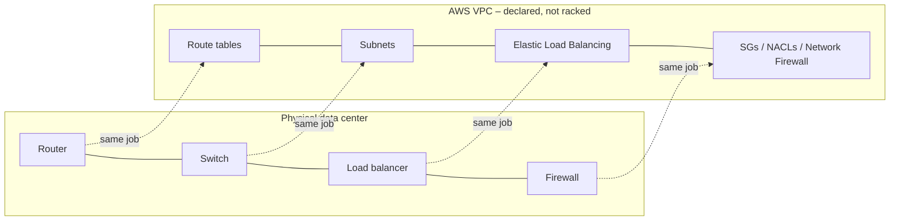
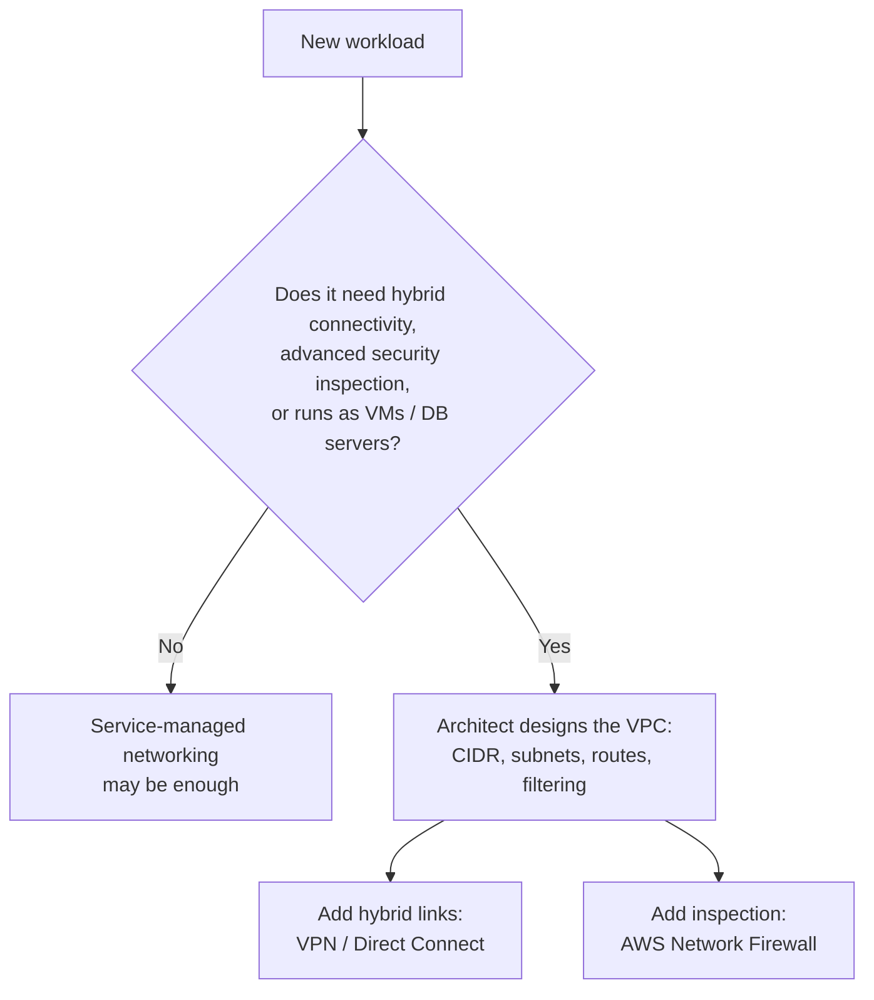
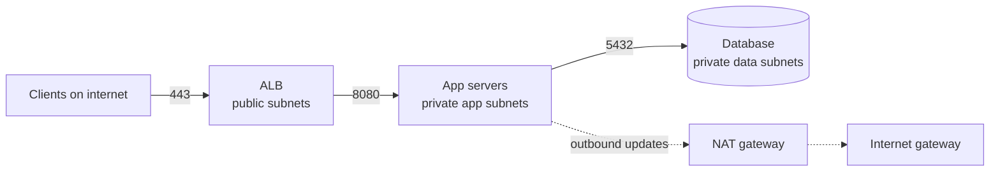

# Networking for Organizations

> [!abstract] TL;DR
> AWS networking ==replaces physical routers, switches, gateways, and load balancers with virtual services==. You *declare the network outcome you want* and AWS delivers it, without touching hardware. A trustworthy network has two jobs that pull against each other: ==connect every system that must talk, and block every flow that isn't required==. This lesson covers the AWS global infrastructure, VPCs, and subnets, the foundation for hybrid connectivity and advanced controls such as AWS Network Firewall.

**Lesson:** L1 – Architect Network Connectivity Strategies · **Next:** [[AWS Global Infrastructure]]
**Section hub:** [[Designing AWS Architecture for Organizations]]
**Prerequisite:** [[Designing AWS Architecture for Organizations#5. Pre-Reading Primer|Pre-reading primer]] (VPC definition, VPC connectivity options)
**Related:** [[Designing AWS Architecture for Organizations#3. Workspace and Tools|Workspace and Tools]] (Direct Connect vs. VPN)
**Sources:** The "Building Trustworthy Networks Using AWS" lesson page and video L1-A02 (Intro to Networking for Organizations), en-us transcript. Material marked *beyond the lecture* is my addition. Section 6 maps the rest of the lesson to its own notes.

> [!todo]- Contents
> 1. [[#1. The Scenario – Investment Company]]
> 2. [[#2. Core Concepts]]
> 3. [[#3. From Physical Hardware to Virtual Services]]
> 4. [[#4. The Two Jobs of a Trustworthy Network]]
> 5. [[#5. Managed vs. Custom Network Configuration]]
> 6. [[#6. What the Lesson Covers – Global Infrastructure, VPCs, Subnets]]
> 7. [[#7. Worked Example – A Least-Privilege VPC for the Investment Firm]]
> 8. [[#8. Pitfalls and Failure Modes]]
> 9. [[#9. Key Takeaways]]
> 10. [[#10. Critical Analysis]]
> 11. [[#11. Self-Test]]
> 12. [[#12. Glossary]]
> 13. [[#13. Further Reading]]

---

## 1. The Scenario – Investment Company

You're an **IT solutions consultant** hired by an up-and-coming **investment company** to build its next generation of cloud-enabled solutions. The lecture frames three questions to answer:

| Question | Maps to |
|---|---|
| How will the solution accomplish the customer's **business goals**? | Cloud-enabled solutions |
| How will you **assemble the network resources** that support the critical servers? | Network resources |
| How will you keep **communication in that network safe**? | Network security |

> [!note] Why an investment firm (*beyond the lecture*)
> Financial services adds regulatory and confidentiality pressure: client data, trading systems, and audit requirements. "Keep communication safe" therefore isn't optional hardening. It's part of the business requirement.

---

## 2. Core Concepts

The lesson page groups its main considerations into three areas:

| Area | What the lesson says |
|---|---|
| **Cloud-enabled solutions** | Use AWS tools to replicate the features of traditional networking hardware. Use virtual services instead of physical deployment. |
| **Network resources & security** | Build infrastructure from virtual equivalents of routers, switches, load balancers, etc. Restrict unnecessary traffic to protect systems from threats. |
| **Configuration needs** | Where needed, configure custom network settings for hybrid communication and high-level security tools such as **AWS Network Firewall**. Ensure all critical IT systems keep connectivity and function. |

> [!info]+ Definition – Cloud networking (as framed in the lecture)
> The same practices IT professionals have long used to build reliable business networks, except that ==you define the desired outcomes of the network design instead of physically deploying and managing hardware==. AWS networking services deliver those capabilities. ^def-cloud-networking

> [!info]+ Definition – Required traffic
> Network communication that some business function actually depends on. The lecture's design target is a network in which ==the only traffic is required traffic==. ^def-required-traffic

> [!info]+ Definition – AWS Network Firewall
> A managed **network firewall and intrusion detection/prevention system (IDS/IPS)** for VPCs. The lesson names it as a high-level security tool that needs custom network configuration. (*Beyond the lecture:* you deploy it into dedicated firewall subnets and route traffic through its endpoints. It supports stateless rules, stateful rules, and Suricata-compatible IPS signatures.) ^def-network-firewall

---

## 3. From Physical Hardware to Virtual Services

The lecture names routers, switches, gateways, and load balancers as the physical building blocks AWS replaces. The specific AWS counterparts below are *beyond the lecture*. Expect later lessons to cover them.

| On-premises hardware | Job | AWS virtual equivalent |
|---|---|---|
| Router | Forward traffic between networks | The VPC's built-in router, controlled by **route tables** |
| Switch / VLAN | Connect hosts within a network segment | **Subnets** inside a VPC; the AWS-managed network fabric |
| Internet gateway / edge router | Connect the network to the internet | **Internet gateway**; **NAT gateway** for outbound-only access |
| VPN concentrator / WAN link | Connect to other sites | **Site-to-Site VPN**, **Direct Connect**, **Transit Gateway** |
| Load balancer | Spread traffic across servers | **Elastic Load Balancing**: Application (L7), Network (L4), Gateway (third-party appliances) |
| Firewall / IDS / IPS | Filter and inspect traffic | **Security groups**, **network ACLs**, **AWS Network Firewall** |

> [!tip] Declarative networking
> The lecture's key difference is **declare outcome, not deploy device**. You don't choose cable runs or switch ports. You state "this subnet routes to that gateway" or "only port 443 from the load balancer", and AWS implements it. The skill shifts from *operating hardware* to *specifying intent precisely*. ^declarative

---

## 4. The Two Jobs of a Trustworthy Network

The lecture names two failure directions. A good design avoids both.

| Failure direction | Consequence (from the lecture) |
|---|---|
| **Too closed**: missing connections | Critical IT systems can't talk to each other. The business function fails. |
| **Too open**: "throw the doors wide open" | At best, unnecessary traffic wastes limited network resources. At worst, it opens a path for malicious software to disrupt or actively harm systems. |

> [!important] Design principle
> ==Connect what's required, and only what's required.== This is the network form of **least privilege** (my term; the lecture doesn't use it). ^least-privilege-network

One way to think about it (*beyond the lecture*): let $R$ be the set of required flows and $A$ the set of flows the network actually allows. A trustworthy network targets $A = R$.

$$
\underbrace{R \setminus A}_{\text{broken functionality}} = \varnothing
\qquad\text{and}\qquad
\underbrace{A \setminus R}_{\text{excess attack surface}} = \varnothing
$$

The first set is visible right away, because something breaks and someone complains. The second set is **silent**: nothing breaks, so over-permissive rules tend to pile up over time.

---

## 5. Managed vs. Custom Network Configuration

The lecture distinguishes two cases:

| Case | Who configures the network | Examples (lecture) |
|---|---|---|
| **Automatic** | Many AWS services use networking resources that are configured automatically | (Not named in the lecture. *Beyond the lecture:* e.g. Amazon S3 or AWS Lambda run outside your VPC by default.) |
| **Custom** | The cloud architect must specify the network configuration directly | Virtual machines, database servers, and other resources; **hybrid communication** with a physical office; **high-level network security solutions** |

---

## 6. What the Lesson Covers – Global Infrastructure, VPCs, Subnets

The intro promises the **AWS global infrastructure**, **virtual private clouds**, and **subnets** ("subnets for isolated, secure network areas"). The full lesson (L1 – Architect Network Connectivity Strategies) delivers those and more. Each part has its own note:

| Video | Topic | Note |
|---|---|---|
| A03 | Regions, AZs, choosing a Region, the two-AZ rule | [[AWS Global Infrastructure]] |
| A04–A05, Exercise 1 | VPCs, subnets, route tables, public/private subnets, NAT, gateway endpoints | [[Building a VPC]] |
| A06, Exercise 2 (peering) | VGW VPN, transit gateway, VPC peering | [[Advanced VPC Connectivity]] |
| A07a–b | Security groups, network ACLs, VPC endpoints | [[Secure and Private Connectivity]] |
| A08, Exercise 2 (DNS) | VPC DNS, Route 53, Resolver hybrid DNS | [[DNS and Network Resolution]] |
| A09, Exercise 3 | VPC Flow Logs and analysis | [[Monitoring and Logging Network Traffic]] |

The lesson confirms this note's earlier placeholder: subnets are the isolated network areas, public vs. private is decided by routing ([[Building a VPC#^def-public]]), and AWS Network Firewall is the advanced option beyond SGs and NACLs ([[Secure and Private Connectivity]]).

---

## 7. Worked Example – A Least-Privilege VPC for the Investment Firm

*Beyond the lecture.* This shows how the lecture's principles turn into a concrete design.

**Requirements:** a client-facing web portal, an application tier, and a client database. It must survive the loss of one AZ. Only required traffic is allowed.

**Design:** VPC `10.0.0.0/16` across two AZs, with three subnet tiers.

| Subnet | AZ a | AZ b | Route to internet |
|---|---|---|---|
| Public (load balancer, NAT gateway) | `10.0.0.0/24` | `10.0.1.0/24` | Internet gateway |
| Private app | `10.0.10.0/24` | `10.0.11.0/24` | Outbound only, via NAT gateway |
| Private data | `10.0.20.0/24` | `10.0.21.0/24` | None |

**Allowed flows (the set $R$)**, enforced with security groups that reference each other:

| From | To | Port | Rule |
|---|---|---|---|
| Internet | ALB security group | 443 | Allow `0.0.0.0/0` |
| ALB security group | App security group | 8080 | Source = ALB security group ID |
| App security group | DB security group | 5432 | Source = app security group ID |
| Everything else | — | — | Implicitly denied |

> [!success] Why this meets both of the lecture's goals
> Every required path exists, so critical systems can talk. The database has **no route to the internet** and accepts traffic **only from the app tier**, so a compromised web-facing component can't reach the database directly. Unneeded traffic never enters the network ([[#^least-privilege-network]]).

---

## 8. Pitfalls and Failure Modes

| Failure | Symptom | Mitigation |
|---|---|---|
| Doors wide open (`0.0.0.0/0` on admin or DB ports) | Scans and brute-force attempts in logs; exposed services | Allow only required ports and sources; use security-group references instead of broad CIDRs |
| Missing route or rule | Timeouts between tiers; "it works in dev" | Map required flows first ($R$), then build rules from that map |
| Lifting on-prem designs 1:1 | Virtual appliances recreating a flat network | Use native constructs: subnets per tier, SGs per role |
| Single-AZ subnets for critical tiers | Outage when one AZ fails | Mirror each tier's subnets across at least two AZs |
| Undersized or overlapping CIDRs | Can't add subnets; can't connect VPCs or on-prem networks later | Plan addressing for the whole organization up front (see the hub's [[Designing AWS Architecture for Organizations#6. Anticipated Pitfalls\|pitfalls]]) |
| Rule creep (silent $A \setminus R$) | Rules nobody can explain | Review rules regularly; tag rules with an owner and purpose; enable VPC Flow Logs |

---

## 9. Key Takeaways

- [ ] AWS provides **virtual equivalents** of routers, switches, gateways, and load balancers.
- [ ] Cloud networking means **defining desired outcomes**, not deploying hardware ([[#^declarative]]).
- [ ] A trustworthy network **connects every required flow and nothing more** ([[#^least-privilege-network]]).
- [ ] Unnecessary traffic **wastes resources** at best and **enables malicious software** at worst.
- [ ] Many services configure networking automatically. **VMs, database servers, hybrid links, and advanced security tools need custom configuration**.
- [ ] **AWS Network Firewall** is a managed network IDS/IPS ([[#^def-network-firewall]]).
- [ ] The lesson covers the **AWS global infrastructure, VPCs, and subnets**. Subnets create isolated, secure network areas.

---

## 10. Critical Analysis

- **"Replicate traditional hardware" is only half right.** The constructs are analogous, but the operating model differs. There's no broadcast or multicast by default, no Layer 2 adjacency between hosts, and security groups attach to *network interfaces* rather than network perimeters. Designs that copy on-prem topology one-to-one often miss what the cloud does better (per-workload micro-segmentation) and keep what it doesn't need (choke-point appliances everywhere).
- **"Only required traffic" is a goal, not a method.** The lecture states the principle but not *how to discover* $R$. In practice it comes from application dependency mapping, Flow Logs analysis, and threat modeling. The hard part is keeping $R$ current as applications change.
- **Shared responsibility.** AWS secures the physical network. The customer owns everything this lesson calls custom configuration. Declarative networking makes misconfiguration *easy to create at scale*: one bad template copied into 50 accounts.
- **At organization scale,** per-VPC rules become unmanageable. Expect centralized inspection (Network Firewall in an inspection VPC behind Transit Gateway) and policy-as-code. AWS Firewall Manager can push rules across accounts.
- **Evaluating a design:** test reachability both ways. Confirm every required flow works, and confirm that representative *disallowed* flows fail. AWS tools such as Reachability Analyzer and Network Access Analyzer help with this (*beyond the lecture*).

> [!question] Open discussion questions
> 1. For the investment firm, which flows belong in $R$ that a first draft would probably miss (backups, patching, monitoring, DNS, identity)?
> 2. Is centralized inspection through AWS Network Firewall better than distributed security groups, or are they complementary? What do you gain and lose with each?
> 3. When does service-managed networking (outside your VPC) become a security or compliance problem rather than a convenience?

---

## 11. Self-Test

> [!question]- Q1. What physical networking components does the lecture say AWS replaces with virtual services?
> Routers, switches, gateways, and load balancers.

> [!question]- Q2. What is the key difference between cloud and on-premises networking, according to the lecture?
> Instead of physically deploying and managing hardware, you **define the desired outcomes** of the network design, and AWS networking services deliver them.

> [!question]- Q3. What are the two failure directions of network design, and what does each cost?
> **Too closed:** critical systems can't talk to each other. **Too open:** unnecessary traffic wastes limited network resources at best, and at worst opens a path for malicious software to disrupt or harm systems.

> [!question]- Q4. Which situations require a cloud architect to configure the network directly instead of relying on automatic configuration?
> Creating virtual machines, database servers, or similar resources; hybrid communication between the cloud and a physical office; and high-level network security solutions such as AWS Network Firewall.

> [!question]- Q5. (Quantitative, beyond the lecture) A VPC is `10.0.0.0/16`. How many `/24` subnets fit in it, and how many usable addresses does each have?
> $2^{24-16} = 256$ subnets. Each `/24` has $2^{8} = 256$ addresses, minus 5 AWS-reserved = **251 usable**.

> [!question]- Q6. (Design, beyond the lecture) The investment firm's auditors ask you to prove that the database can't be reached from the internet. What design features and evidence would you show?
> **Design:** the database sits in private subnets with no route to an internet gateway, and its security group allows port 5432 only from the app security group.
> **Evidence:** route tables, security group rules, a Reachability Analyzer or Network Access Analyzer result showing no internet path, and VPC Flow Logs showing no inbound traffic from outside the VPC.
>
> > [!tip]
> > This is the "show $A \setminus R = \varnothing$" half of the design. It's the half that fails silently.

> [!tip] Flashcards
> Review this lesson with [[Networking for Organizations - Flashcards]].

---

## 12. Glossary

| Term | Meaning |
|---|---|
| Cloud-enabled solution | A business system built from cloud services instead of owned hardware |
| Virtual service | A software-defined replacement for a physical network device |
| Required traffic | Network flows some business function actually depends on |
| AWS Network Firewall | Managed network firewall and IDS/IPS for VPCs |
| IDS / IPS | Intrusion detection system (alerts) / intrusion prevention system (blocks) |
| Hybrid communication | Connectivity between AWS and on-premises sites |
| Region | A geographic AWS area containing multiple Availability Zones |
| Availability Zone | One or more isolated data centers within a Region |
| VPC | Logically isolated virtual network in one Region |
| Subnet | An IP range within a VPC, in a single AZ; an isolated network area |
| Route table | Rules that decide where traffic from a subnet goes |
| Security group | Stateful, allow-only filter attached to network interfaces |
| Network ACL | Stateless, allow-and-deny filter applied at the subnet boundary |

---

## 13. Further Reading

- [AWS Global Infrastructure – Regions and Availability Zones](https://aws.amazon.com/about-aws/global-infrastructure/regions_az/)
- [What is Amazon VPC](https://docs.aws.amazon.com/vpc/latest/userguide/what-is-amazon-vpc.html)
- [Subnets for your VPC](https://docs.aws.amazon.com/vpc/latest/userguide/configure-subnets.html)
- [What is AWS Network Firewall](https://docs.aws.amazon.com/network-firewall/latest/developerguide/what-is-aws-network-firewall.html)
- [Security best practices for your VPC](https://docs.aws.amazon.com/vpc/latest/userguide/vpc-security-best-practices.html)

%% Study hint: this is the lesson's framing note. Review it last, after the six topic notes, and check whether you can explain how each one serves "only required traffic". %%
