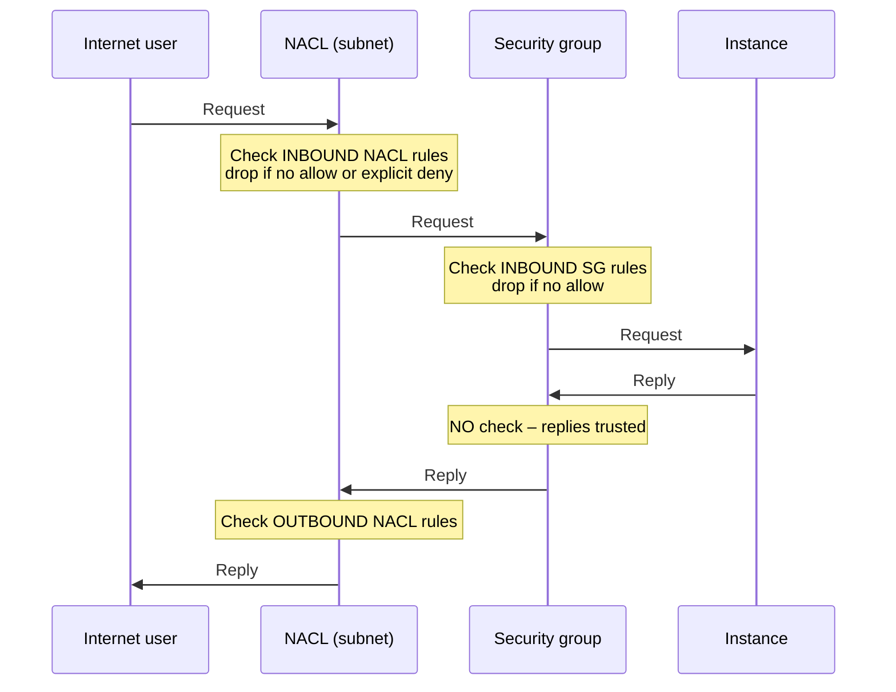
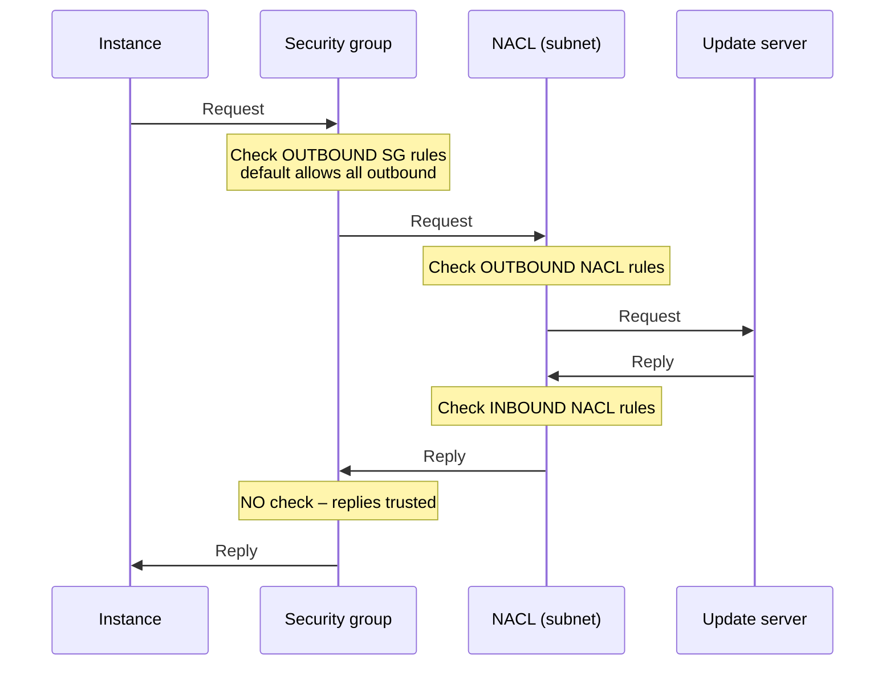
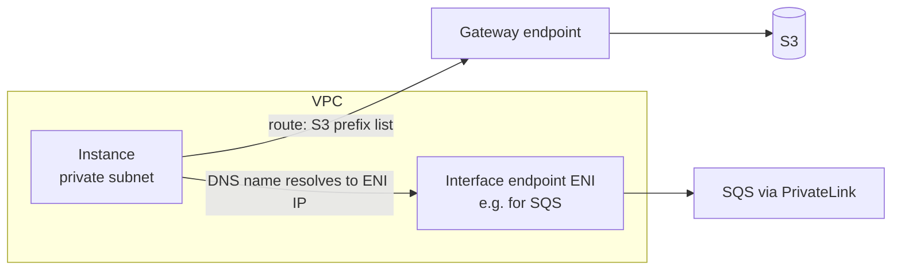

# Secure and Private Connectivity

> [!abstract] TL;DR
> A VPC is secured by two complementary firewalls. ==Network ACLs guard subnets and check traffic in both directions, including replies. Security groups guard ENIs (instances, interface endpoints, some Lambda functions) and let reply traffic through unchecked==. Anything not allowed is dropped. For private access to AWS services, ==VPC endpoints are a "side door" that keeps traffic inside the AWS network==. **Gateway endpoints** (the original type, S3 and DynamoDB only) are route-table entries. **Interface endpoints** (the newer type, most other services, built on AWS PrivateLink) are ENIs in your subnets.

**Lesson:** L1 – Architect Network Connectivity Strategies · **Previous:** [[Advanced VPC Connectivity]] · **Next:** [[DNS and Network Resolution]]
**Section hub:** [[Designing AWS Architecture for Organizations]]
**Sources:** Videos L1-A07a and L1-A07b (Secure and Private Connectivity, parts 1–2), en-us transcripts. The lecture never uses the words *stateful* and *stateless*. Those terms, plus rule-evaluation details, are *beyond the lecture*.

> [!todo]- Contents
> 1. [[#1. Why Restrict Traffic]]
> 2. [[#2. Security Groups vs. Network ACLs]]
> 3. [[#3. Two Traffic Flows Through the Firewalls]]
> 4. [[#4. VPC Endpoints – The Side Door]]
> 5. [[#5. Worked Example – Locking S3 to the VPC]]
> 6. [[#6. Pitfalls and Failure Modes]]
> 7. [[#7. Key Takeaways]]
> 8. [[#8. Critical Analysis]]
> 9. [[#9. Self-Test]]
> 10. [[#10. Glossary]]
> 11. [[#11. Further Reading]]

---

## 1. Why Restrict Traffic

The lecture's argument:

- VPC compute is capable of ==nearly limitless network communication== over many protocols and ports.
- Most cloud applications need **only a few** of those communications.
- So limit what computers can **receive**, and in some cases what they can **send**.
- That also ==limits the ways threat actors can target== internet-exposed systems.

> [!info]+ Definition – Firewall
> A control that **discards network communications that don't meet your requirements**. Packets the firewalls don't approve **never reach their destination**. They are dropped. Secure use of a VPC **requires** firewalls. ^def-firewall

This is the security half of [[Networking for Organizations#^least-privilege-network|connect only what's required]].

---

## 2. Security Groups vs. Network ACLs

| | Security group (SG) | Network ACL (NACL) |
|---|---|---|
| Protects | **ENIs**: instances, **interface endpoints**, some **Lambda** capabilities | **Subnets**: limits traffic flowing between subnets |
| Matches on | IP addresses, protocols, port numbers | IP addresses, protocols, port numbers |
| Reply traffic | ==Not checked==. SGs assume reply traffic is trustworthy. | ==Checked== against rules for the reply's direction |
| Rule types | Allow rules only (*beyond the lecture*) | Allow rules **and explicit deny** rules |
| Default (lecture) | **All outbound allowed**. You might restrict this in high-security environments. | — |
| Defaults (*beyond the lecture*) | No inbound allowed until you add rules | Default NACL allows all. A **custom** NACL denies all until you add rules. |
| Evaluation (*beyond the lecture*) | All rules considered together | Rules checked **in number order**; first match wins |
| Common term (*beyond the lecture*) | **Stateful** | **Stateless** |

> [!info]+ Definition – Security group
> A firewall attached to an **elastic network interface**. It drops requests that no SG rule permits, and it ==lets replies to permitted traffic through without checking rules==. ^def-sg

> [!info]+ Definition – Network ACL
> A firewall at the **subnet boundary**. It drops traffic in **either direction**, requests *and* replies, if ==no rule permits it or an explicit deny rule blocks it==. ^def-nacl

> [!tip] Order of checks
> Traffic that **enters** a subnet meets the **NACL first**, then the SG. Traffic that **leaves** an instance meets the **SG first**, then the NACL. The NACL is the outer wall, and the SG is the door to each instance. ^check-order

---

## 3. Two Traffic Flows Through the Firewalls

### Flow A – An internet user requests a web page from your instance



### Flow B – Your instance downloads a software update



| Hop | Flow A (inbound request) | Flow B (outbound request) |
|---|---|---|
| NACL checks | **Inbound** request and **outbound** reply | **Outbound** request and **inbound** reply |
| SG checks | **Inbound** request only | **Outbound** request only |
| Total rule checks | 3 | 3 |

> [!warning] The NACL reply trap (*beyond the lecture*)
> Because the NACL checks replies, it must allow the **reply's ports**. Replies go back to the client's **ephemeral port**, typically 1024–65535. A NACL that allows inbound 443 but has no outbound rule for ephemeral ports **silently breaks** Flow A. ^ephemeral-ports

---

## 4. VPC Endpoints – The Side Door

### The lecture's analogy

The instructor tells a story about a highway rest stop with two fast-food brands that share one kitchen. Staff can walk through from one counter to the other, so customers don't have to stand in both lines. In the same way, an instance in a VPC that wants to query **DynamoDB** in the same Region shouldn't have to leave the VPC, go out to the public internet, and get in line at DynamoDB's "front door". The EC2 instance and DynamoDB probably run in the **same AZ**, possibly in the **same building**. Without endpoints, traffic would ==leave the building and come back in== to reach data in that same building.

> [!info]+ Definition – VPC endpoint
> A resource created in a VPC that opens a ==side door to another AWS service==. It allows private communication between instances and AWS services while **keeping that traffic inside the AWS network**. ^def-endpoint

### Two types

| | Gateway endpoint | Interface endpoint |
|---|---|---|
| Age | **Original** type | **Newer** type |
| Services | **Only S3 and DynamoDB** | **Most other** AWS services |
| Mechanism | An **entry in a route table you choose** that redirects requests for the service to the endpoint, like routing internet traffic to an IGW | An **ENI** (a virtual network adapter) in **at most one subnet per AZ**, which becomes that AZ's connection point to the service |
| Addressing | Route-table target (prefix list) | Private IP; AWS recommends a **DNS-resolvable name** so apps refer to it by name |
| Built on | — | **AWS PrivateLink** |
| Protected by | Route tables and endpoint policies | **Security groups** (because it's an ENI, see [[#^def-sg]]) |
| Cost (*beyond the lecture*) | Free | Hourly per AZ + per GB |

> [!tip] Mental model
> The lecture suggests thinking of an S3 gateway endpoint as an "**S3 gateway**" and a DynamoDB gateway endpoint as a "**DynamoDB gateway**". They are just route targets, like an IGW. ^gateway-mental-model



---

## 5. Worked Example – Locking S3 to the VPC

*Beyond the lecture.* This builds on [[Building a VPC#6. The Course Design|the course design]]: Steady Volatility Partners' private subnets reach S3 through a gateway endpoint. Here are three layers that turn "the data never crosses the internet" into something enforceable.

**Layer 1 – Route:** the gateway endpoint in the route tables of every subnet that uses S3 ([[Building a VPC#^longest-prefix]]).

**Layer 2 – Endpoint policy:** the endpoint can reach only the firm's bucket, which blocks exfiltration to other buckets.

```json
{
  "Statement": [{
    "Effect": "Allow",
    "Principal": "*",
    "Action": ["s3:GetObject", "s3:PutObject", "s3:ListBucket"],
    "Resource": ["arn:aws:s3:::svp-quant-data", "arn:aws:s3:::svp-quant-data/*"]
  }]
}
```

**Layer 3 – Bucket policy:** the bucket rejects any access that doesn't arrive through the endpoint.

```json
{
  "Version": "2012-10-17",
  "Statement": [{
    "Sid": "DenyUnlessFromSvpEndpoint",
    "Effect": "Deny",
    "Principal": "*",
    "Action": "s3:*",
    "Resource": ["arn:aws:s3:::svp-quant-data", "arn:aws:s3:::svp-quant-data/*"],
    "Condition": { "StringNotEquals": { "aws:SourceVpce": "vpce-EXAMPLE" } }
  }]
}
```

> [!warning]
> The bucket-policy deny also blocks console and administrator access from outside the VPC. Add a carefully scoped exception for a break-glass role, and test it on a non-production bucket first.

**Firewalls for the private subnet**, which receives HTTPS from HQ (`192.168.48.0/20`):

| Control | Direction | Rule |
|---|---|---|
| SG | Inbound | TCP 443 from `192.168.48.0/20` |
| SG | Outbound | Restrict the default "allow all" to only what's needed, e.g. TCP 443 to the S3 prefix list |
| NACL | Inbound | #100 allow TCP 443 from `192.168.48.0/20`; #110 allow TCP 1024–65535 from S3 ranges (replies) |
| NACL | Outbound | #100 allow TCP 1024–65535 to `192.168.48.0/20` (replies); #110 allow TCP 443 to S3 ranges |
| NACL | Both | Final `*` rule: deny all |

> [!note] NACLs can't reference prefix lists
> Security groups can use the S3 **prefix list** as a destination, but NACL rules take only **CIDRs**. A tight NACL has to list S3's published IP ranges for the Region. That's one reason many teams keep NACLs coarse and put fine-grained control in SGs.

---

## 6. Pitfalls and Failure Modes

| Failure | Symptom | Mitigation |
|---|---|---|
| NACL missing ephemeral-port rules | Connections time out even though SG rules look right | Allow reply ports (1024–65535) in the opposite direction ([[#^ephemeral-ports]]) |
| Expecting SG deny rules | Can't block a single bad IP with an SG | Use a **NACL explicit deny** (or AWS Network Firewall) |
| Leaving SG outbound at "allow all" in high-security tiers | A compromised host can reach anything its routes allow | Restrict outbound in sensitive environments, as the lecture suggests |
| Interface endpoint SG too strict | Apps can't reach the AWS service through the endpoint | The endpoint ENI's SG must allow inbound 443 from the client subnets |
| Interface endpoint without private DNS | Apps still resolve the service's public name and route through NAT/IGW | Enable the endpoint's private DNS name, or have apps use the endpoint DNS name |
| Gateway endpoint missing from a route table | That subnet's S3/DynamoDB traffic takes the public path or fails | Associate the endpoint with every relevant route table |
| No endpoint policy | Endpoint can reach any bucket, an exfiltration path | Endpoint policy that allows only approved resources |

---

## 7. Key Takeaways

- [ ] Limit what instances **receive** and, where it matters, what they **send**. Unneeded traffic is attack surface.
- [ ] **Security groups** protect **ENIs** (instances, interface endpoints, some Lambda functions). **Network ACLs** protect **subnets**.
- [ ] **SGs don't check replies.** **NACLs check both directions** and support **explicit deny**.
- [ ] Inbound traffic: **NACL, then SG**. Outbound traffic: **SG, then NACL** ([[#^check-order]]).
- [ ] SGs **allow all outbound by default**. Restrict this in high-security environments.
- [ ] A **VPC endpoint** is a **side door** that keeps service traffic inside the AWS network ([[#^def-endpoint]]).
- [ ] **Gateway endpoints:** original, **S3 and DynamoDB only**, **route-table entry**. **Interface endpoints:** newer, **most services**, **ENI per AZ**, **DNS name**, **PrivateLink**.

---

## 8. Critical Analysis

- **"Leave the building" is a teaching image, not packet-level truth.** Even without endpoints, traffic from EC2 to S3 or DynamoDB in the same Region generally stays on AWS's network. But it uses the services' *public* endpoints, so it needs an IGW or NAT path. The strongest arguments for endpoints are therefore **control and evidence**: no internet route needed, a policy on the endpoint, and an `aws:SourceVpce` check on the resource. That's what an auditor can verify.
- **Two firewall layers, one model.** Some argue NACLs are redundant once SGs are well written. A good use of NACLs is coarse, subnet-wide **guardrails**, such as "this subnet never talks to the internet range" or explicit denies of known-bad CIDRs, because they're hard to override per instance. Keeping both fine-grained invites the [[#^ephemeral-ports|ephemeral-port]] mistakes above.
- **SG "trust replies" behavior is a feature with a cost.** It simplifies rules, but a permitted outbound request opens a return path. That's why the lecture's advice to restrict outbound rules in high-security tiers matters. In the trading VPC, unrestricted outbound plus the VPN to HQ means a compromised instance could reach anything HQ routes.
- **Interface endpoints concentrate risk.** One ENI-based endpoint for a service like Secrets Manager becomes the path every workload uses. Its SG and policy become high-value controls. Log it with [[Monitoring and Logging Network Traffic|flow logs]].
- **At organization scale**, centralizing interface endpoints in a shared-services VPC reduces cost (fewer ENI-hours) but adds DNS complexity and cross-VPC trust. Gateway endpoints can't be shared across VPCs at all.

> [!question] Open discussion questions
> 1. Would you configure NACLs in the trading VPC beyond the default allow-all? Which specific rules justify their maintenance cost?
> 2. How would you prove, with logs, that no S3 traffic from the private subnets used the public path?
> 3. When should a team use AWS Network Firewall instead of only SGs and NACLs?

---

## 9. Self-Test

> [!question]- Q1. What do security groups protect, and what do network ACLs protect?
> **SGs** protect **elastic network interfaces**: instances, VPC interface endpoints, and some Lambda capabilities. **NACLs** protect **subnets**, limiting traffic between them.

> [!question]- Q2. An internet user requests a page from an instance. List every firewall check in order, request and reply.
> 1. **NACL inbound** (request)
> 2. **SG inbound** (request)
> 3. Instance responds
> 4. SG: **no check** on the reply
> 5. **NACL outbound** (reply)

> [!question]- Q3. Under what two conditions does a NACL drop traffic?
> When **no rule permits** it, or when an **explicit deny rule** blocks it.

> [!question]- Q4. What is the default outbound behavior of a security group, and when might you change it?
> **All outbound requests are allowed.** You might restrict it in a **high-security environment**.

> [!question]- Q5. Compare gateway and interface endpoints: services, mechanism, and the technology underneath.
> **Gateway:** the original type, **S3 and DynamoDB only**, implemented as a **route-table entry** that redirects service traffic. **Interface:** the newer type, **most other services**, implemented as an **ENI** in at most one subnet per AZ with a DNS name, built on **AWS PrivateLink**.

> [!question]- Q6. (Quantitative, beyond the lecture) A NACL allows inbound TCP 443 from anywhere. How many ports must the outbound rule allow for replies, assuming the usual ephemeral range 1024–65535?
> $65535 - 1024 + 1 = 64{,}512$ ports. Without that outbound rule, the replies are dropped.

> [!question]- Q7. (Quantitative, beyond the lecture) An interface endpoint costs about \$0.01 per AZ-hour. What does one endpoint in two AZs cost per month, before data charges? What about 10 such endpoints in each of 20 VPCs?
> $0.01 \times 2 \times 730 \approx \$14.60$ per endpoint per month. $14.60 \times 10 \times 20 \approx \$2{,}920$ per month. That's why large organizations centralize interface endpoints. (Prices vary by Region, so check current pricing.)

> [!question]- Q8. (Design) The security team wants to block one malicious IP range from ever reaching the trading subnets, regardless of which SGs developers write. What do you use, and why?
> A **NACL explicit deny** rule, numbered low so it's evaluated first, on the trading subnets. SGs can't express deny rules, and NACLs apply to the whole subnet, so developers' SG changes can't bypass it.

> [!tip] Flashcards
> Review this lesson with [[Secure and Private Connectivity - Flashcards]].

---

## 10. Glossary

| Term | Meaning |
|---|---|
| Firewall | A control that drops network traffic not matching your rules |
| Security group (SG) | ENI-level firewall; doesn't check replies; allow rules only |
| Network ACL (NACL) | Subnet-level firewall; checks both directions; allow and deny rules |
| Elastic network interface (ENI) | A virtual network adapter attached in a subnet |
| Stateful / stateless | Tracks connections and auto-allows replies / evaluates every packet independently (*beyond the lecture*) |
| Ephemeral port | Short-lived client port (typically 1024–65535) that replies are sent to |
| VPC endpoint | A side door from a VPC to an AWS service that stays in the AWS network |
| Gateway endpoint | Route-table-based endpoint for S3 and DynamoDB |
| Interface endpoint | ENI-based endpoint for most AWS services |
| AWS PrivateLink | The technology underlying interface endpoints |
| Endpoint policy | Resource policy limiting what an endpoint can reach |
| `aws:SourceVpce` | Condition key naming the endpoint a request came through |

---

## 11. Further Reading

- [Control traffic to your AWS resources using security groups](https://docs.aws.amazon.com/vpc/latest/userguide/vpc-security-groups.html)
- [Control subnet traffic with network access control lists](https://docs.aws.amazon.com/vpc/latest/userguide/vpc-network-acls.html)
- [What is AWS PrivateLink](https://docs.aws.amazon.com/vpc/latest/privatelink/what-is-privatelink.html)
- [Gateway endpoints](https://docs.aws.amazon.com/vpc/latest/privatelink/gateway-endpoints.html)
- [Control access to VPC endpoints using endpoint policies](https://docs.aws.amazon.com/vpc/latest/privatelink/vpc-endpoints-access.html)
