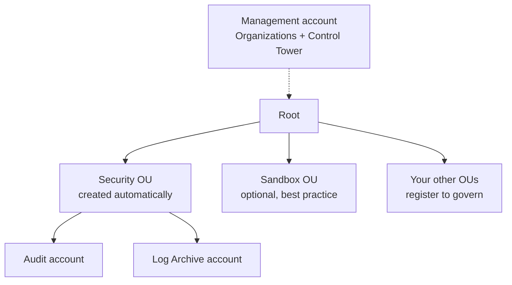
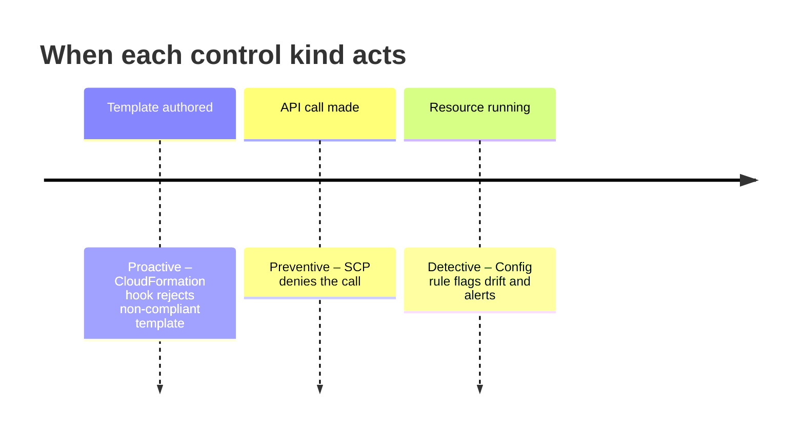

# AWS Control Tower

> [!abstract] TL;DR
> **Control Tower** automates what AWS Professional Services once built by hand: a ==landing zone==, meaning a secure, well-architected multi-account environment from day 1. It **builds on AWS Organizations**, either creating one or adopting an existing one. Its management account is the org's management account. It creates a **Security OU** with an **Audit** account and a **Log Archive** account, plus an optional **Sandbox** OU. It governs with three kinds of **controls**: ==preventive (SCPs), detective (AWS Config rules), and proactive (CloudFormation hooks)==. Accounts arrive either by **enrolling** existing ones or through **Account Factory**, which is built on Service Catalog. **AWS RAM** shares resources across accounts. A consumer's effective access is the ==intersection of the share's permissions and its own IAM==.

**Lesson:** L2 – Design a Multi-Account AWS Environment · **Previous:** [[Organizational Units and Service Control Policies]] · **Next:** [[Centralized Logging and Event Notification]]
**Section hub:** [[Designing AWS Architecture for Organizations]]
**Sources:** Video L2-A04 (AWS Control Tower), en-us transcript. Material marked *beyond the lecture* is my addition.

> [!todo]- Contents
> 1. [[#1. Origin – From ProServe Engagements to Automation]]
> 2. [[#2. Control Tower and AWS Organizations]]
> 3. [[#3. What the Landing Zone Creates]]
> 4. [[#4. Controls – Preventive, Detective, Proactive]]
> 5. [[#5. Bringing Accounts Under Control Tower]]
> 6. [[#6. Worked Example – Onboarding a New Developer]]
> 7. [[#7. AWS RAM – Sharing Resources Across Accounts]]
> 8. [[#8. Pitfalls and Failure Modes]]
> 9. [[#9. Key Takeaways]]
> 10. [[#10. Critical Analysis]]
> 11. [[#11. Self-Test]]
> 12. [[#12. Glossary]]
> 13. [[#13. Further Reading]]

---

## 1. Origin – From ProServe Engagements to Automation

When AWS was young and growing fast, a common customer request was:

> [!quote] Paraphrasing the lecture
> Let me add new projects to an environment that's **already configured with security best practices**, without having to learn everything about AWS first.

| Era | How landing zones were built |
|---|---|
| Early | **AWS Professional Services (ProServe)** sold a **landing zone** engagement. Solutions architects **manually** built a set of accounts and initial security restrictions. |
| Today | An **automated** solution. Any customer can launch a landing zone with minimal effort and deploy into an environment that's ==well-architected on day 1== |

> [!info]+ Definition – Landing zone
> A pre-configured, secure **multi-account baseline**: a set of accounts plus consistent security restrictions, ready for workloads. Control Tower creates and maintains it. ^def-landing-zone

---

## 2. Control Tower and AWS Organizations

Control Tower ==relies on AWS Organizations== for the structure behind many of its capabilities.

| Starting point | What happens (lecture) |
|---|---|
| **New to AWS** (no organization) | Control Tower **creates the organization automatically**. The account where you launch Control Tower becomes the **management account** for both Organizations and Control Tower. |
| **Organizations already set up** | Control Tower **uses the existing organization**. Its management account becomes the Control Tower management account. Existing OUs can **stay as they are** or be **brought under Control Tower management** (registered). |

> [!note] Registered vs. unregistered OUs
> In [[Exercise 2 - AWS Control Tower - How To|Exercise 2]], the Workloads and Corporate OUs from Exercise 1 appear in Control Tower but are **not governed** until you **register** them. Parent OUs come first, then their children.

---

## 3. What the Landing Zone Creates

| Created by Control Tower | Purpose (lecture) |
|---|---|
| **Security OU** | Home for the two automatically created accounts |
| **Audit account** | Managing **auditing** |
| **Log Archive account** | **Centralizing logging** (see [[Centralized Logging and Event Notification]]) |
| **Sandbox OU** *(optional)* | Developer accounts for experimenting. Optional, but aligned with AWS best practice ([[Organizational Units and Service Control Policies#3. Recommended Top-Level OUs]]). |

---

## 4. Controls – Preventive, Detective, Proactive

Controls (formerly "guardrails") strengthen **security and compliance**. There are three kinds:

| Kind | Implemented with | When it acts | Effect |
|---|---|---|---|
| **Preventive** | **SCPs** in AWS Organizations | At the **API call** | **Blocks** calls that would make the environment insecure or non-compliant |
| **Detective** | **AWS Config rules** | **After** a resource exists or changes | **Spots** misconfigured resources and raises **alerts** |
| **Proactive** (newest) | **CloudFormation hooks** | **Before** deployment | **Prevents deploying** resources whose template doesn't meet requirements |

> [!info]+ Definition – Proactive control
> A control that evaluates **CloudFormation templates** through **hooks** and ==refuses to deploy non-compliant resources==. It catches problems earlier than detective controls, and with more context than an SCP. ^def-proactive

> [!tip] Telling the features apart – keyword cues
> Quizzes describe these features by their *job*, not their implementation. Match on the verbs:
>
> | Description says… | Feature | Hook |
> |---|---|---|
> | "**automated** system for **creating** accounts with security" | **Account Factory** | A factory *makes* accounts, already secured |
> | "**actively block** insecure actions" in the environment | **Preventive control** | Stops it **at the API call** (SCP) |
> | "**signal / alert** admins when resources are **misconfigured**" | **Detective control** | Investigates **after** the fact (Config rule) |
> | "**reject / prevent deployment** of a non-compliant **template**" | **Proactive control** | Checks **before deployment** (CloudFormation hook) |
> | "OU for **security and auditing** accounts" | **Security OU** | Holds the **Audit** and **Log Archive** accounts |
> | "pre-configured **secure multi-account environment**" | **Landing zone** | What Control Tower builds |
>
> The usual trap is mixing up preventive and proactive, because **both block**. Preventive blocks *actions* (API calls) in the environment. Proactive blocks *templates* before anything is deployed.

^ct-keyword-cues

The **guidance levels** (mandatory / strongly recommended / elective) are covered in [[Governance and Compliance in Multi-Account Environments#3. Control Tower Control Guidance Levels]].

---

## 5. Bringing Accounts Under Control Tower

### Path A – Enroll an existing account

1. **Invite** it into the organization Control Tower uses. That may mean **removing it from another organization** first.
2. **Enroll** it into Control Tower.
3. **Prerequisite:** Control Tower needs **administrative privileges** in that account. Create an **IAM role** there that lets the Control Tower **management account** use administrator privileges. (*Beyond the lecture:* the role is named `AWSControlTowerExecution`.)

### Path B – Account Factory

> [!info]+ Definition – Account Factory
> A Control Tower feature that ==creates an account, places it in the OU you choose, and applies all of Control Tower's security requirements==, all automatically. ^def-account-factory

| Option | What it does |
|---|---|
| **Basic** Account Factory | Creates a standard governed account |
| **Account Factory Customization (AFC)** | Uses **your own blueprints** for specialized accounts, then has Account Factory create those instead |

**Account Factory is built on AWS Service Catalog**, which **productizes CloudFormation templates** into deployable units that make sense even to **non-technical** users.

---

## 6. Worked Example – Onboarding a New Developer

The lecture's scenario: the dev team hires someone, and the **team manager** needs a **sandbox account** for them.

| Without Control Tower | With Account Factory via Service Catalog |
|---|---|
| Sign up for a new account (email, payment) | Manager launches the "sandbox account" **product** |
| Invite it into the organization | Account is created **inside** the organization |
| Move it to the right OU | Placed in the **Sandbox OU** automatically |
| Apply security baselines by hand | **Controls and baselines applied** automatically |
| Needs deep AWS knowledge | Needs **little AWS knowledge** |

The payoff: **less effort** to get the new employee going, and **less AWS expertise** required of the manager.

---

## 7. AWS RAM – Sharing Resources Across Accounts

> [!info]+ Definition – AWS Resource Access Manager (RAM)
> Lets ==resources in one account be used from one or many other accounts==. You can share with **specific accounts**, an **OU**, or the **whole organization**, and configure which permissions apply and which users get access. ^def-ram

| Role | Configures |
|---|---|
| **Sharing account** (owns the resource) | Permissions attached to a **resource share**. These are the **maximum** any consumer can use. |
| **Consuming account** | Its **own IAM permissions** granting its users access to the share's contents |

$$
\text{effective access} = P_{\text{resource share}} \;\cap\; P_{\text{consumer IAM}}
$$

> [!example] The lecture's example
> The sharing account allows only **read** on a resource. The consumer's IAM grants **read and write**. Effective: **read only**. The consumer can't write, whatever its IAM says. Like [[Organizational Units and Service Control Policies#^scp-no-grant|SCPs and IAM]], one side sets a ceiling and only the **overlap** takes effect. ^ram-intersection

> [!tip] Connections to Lesson 1 (*beyond the lecture*)
> Things commonly shared through RAM include **VPC subnets** (VPC sharing), **transit gateways** ([[Advanced VPC Connectivity#3. Transit Gateway]]), and **Route 53 Resolver rules** ([[DNS and Network Resolution#3. Hybrid DNS – Route 53 Resolver]]). This is how a central network account serves many workload accounts.

---

## 8. Pitfalls and Failure Modes

| Failure | Symptom | Mitigation |
|---|---|---|
| Existing OUs left unregistered | Accounts in them get no Control Tower controls | **Register** OUs, parents before children |
| Enrolling without the admin role | Enrollment fails | Create the execution role (`AWSControlTowerExecution`) in the target account first |
| Account still in another organization | Can't invite it | Remove it from the old organization first |
| Relying only on detective controls | Problems found after deployment | Add **preventive** and **proactive** controls where blocking is acceptable |
| Proactive control without its prerequisite | Console refuses to enable it | Enable the required control first (see Exercise 2) |
| RAM consumer expects full access | Writes fail on a shared resource | The share's permissions are the ceiling ([[#^ram-intersection]]) |
| Creating accounts by hand | Inconsistent baselines | Use **Account Factory** |

---

## 9. Key Takeaways

- [ ] Control Tower automates the **landing zone**: a secure multi-account environment, well-architected on day 1.
- [ ] It's **built on Organizations**. It creates one or adopts the existing one, and the management account is shared.
- [ ] It creates a **Security OU** with **Audit** and **Log Archive** accounts, plus an optional **Sandbox OU**.
- [ ] **Controls:** **preventive** = SCPs (block API calls), **detective** = Config rules (alert on drift), **proactive** = CloudFormation hooks (block non-compliant templates).
- [ ] Existing accounts: **invite → enroll**, which needs an admin role for the management account.
- [ ] New accounts: **Account Factory** (built on **Service Catalog**), with optional **customization** blueprints.
- [ ] **AWS RAM** shares resources. Effective = **share permissions ∩ consumer IAM**.

---

## 10. Critical Analysis

- **Opinionated by design.** Control Tower's value is that it decides for you: a Security OU, a log archive, mandatory controls. That's ideal for a fast-growing company with little cloud maturity. A firm with an existing, well-designed organization may find Control Tower's structure clashes with its own, which is why *adopting* an existing organization needs careful OU registration planning.
- **Three control kinds is defense in depth across time.** Proactive catches problems *before* deployment (if everyone deploys through CloudFormation). Preventive blocks *at* the API. Detective catches *after* the fact, including console clicks and non-CloudFormation tooling. No single kind is enough: proactive controls don't see console changes, and SCPs can't express "this bucket must have versioning".
- **Account Factory moves the bottleneck.** Self-service account creation removes the IT gate the lesson worries about ([[AWS Organizations#1. The Scenario – Scaling Past One Account|don't impede growth]]). But it can cause account sprawl. Pair it with Sandbox spending limits and the Suspended OU lifecycle.
- **RAM is how multi-account stays economical.** Without it, every account needs its own transit gateway, Resolver endpoints, and so on. With it, shared-services accounts serve everyone, and the intersection rule keeps the sharer in control.

> [!question] Open discussion questions
> 1. Steady Volatility Partners already has an organization from Exercise 1. What are the risks of launching Control Tower on top of it, compared with starting fresh?
> 2. Which controls would you make **proactive** rather than **detective** for the trading workloads, and why?
> 3. Should the network team share **subnets** (VPC sharing) or a **transit gateway** with workload accounts? What does each mean for account autonomy?

---

## 11. Self-Test

> [!question]- Q1. What is a landing zone, and how did AWS's approach to creating them change?
> A pre-configured, secure multi-account baseline. At first, **AWS ProServe** built them **manually** as a paid engagement. Now **Control Tower** creates them **automatically**.

> [!question]- Q2. What happens to the management account when Control Tower is launched in an account with no organization, and when it's launched where an organization already exists?
> **No organization:** Control Tower creates one, and the launching account becomes the management account for both. **Existing organization:** Control Tower uses it, and the existing management account becomes the Control Tower management account.

> [!question]- Q3. Which OU and accounts does Control Tower create automatically?
> A **Security OU** containing an **Audit** account and a **Log Archive** account. A **Sandbox OU** is optional.

> [!question]- Q4. Match each control kind to its implementation and its timing.
> - **Preventive:** SCPs, at the API call (blocks).
> - **Detective:** AWS Config rules, after the fact (alerts).
> - **Proactive:** CloudFormation hooks, before deployment (blocks non-compliant templates).

> [!question]- Q5. What must exist before an existing account can be enrolled in Control Tower?
> The account must be **in the organization** Control Tower uses, and it needs an **IAM role** that gives the Control Tower **management account** administrator privileges in it.

> [!question]- Q6. (Quantitative) A resource share grants {Read, List}. The consumer's IAM grants {Read, Write, Delete}. What can the consumer do?
> $\{\text{Read}, \text{List}\} \cap \{\text{Read}, \text{Write}, \text{Delete}\} = \{\text{Read}\}$. Read only. List isn't granted by the consumer's IAM, and Write and Delete aren't allowed by the share.

> [!question]- Q7. (Design) A hedge fund wants a new quant researcher productive on day 1, in a governed account, without involving the cloud team. Design the process.
> Publish an **Account Factory** product (with Account Factory Customization for a research blueprint) through **Service Catalog**. The manager launches it, the account lands in the **Sandbox** (or non-prod Workloads) OU, and Control Tower applies controls automatically. Spending limits on the Sandbox OU keep costs bounded.

> [!tip] Flashcards
> Review this lesson with [[AWS Control Tower - Flashcards]].

---

## 12. Glossary

| Term | Meaning |
|---|---|
| AWS Control Tower | Service that sets up and governs a multi-account landing zone |
| Landing zone | Secure, pre-configured multi-account baseline |
| AWS ProServe | AWS Professional Services; once built landing zones manually |
| Security OU | Control Tower-created OU for the Audit and Log Archive accounts |
| Audit account | Account for security auditing |
| Log Archive account | Account that centralizes logs |
| Control | A Control Tower governance rule (preventive, detective, or proactive) |
| CloudFormation hook | Pre-deployment check that can reject a template |
| Enroll | Bring an existing org account under Control Tower governance |
| Register (an OU) | Bring an existing OU under Control Tower governance |
| Account Factory | Automated, governed account creation |
| Account Factory Customization | Custom blueprints for Account Factory |
| AWS Service Catalog | Turns CloudFormation templates into self-service products |
| AWS RAM | Resource Access Manager; cross-account resource sharing |
| Resource share | RAM container holding shared resources and their maximum permissions |

---

## 13. Further Reading

- [What is AWS Control Tower](https://docs.aws.amazon.com/controltower/latest/userguide/what-is-control-tower.html)
- [About controls in AWS Control Tower](https://docs.aws.amazon.com/controltower/latest/controlreference/controls.html)
- [Provision accounts with Account Factory](https://docs.aws.amazon.com/controltower/latest/userguide/account-factory.html)
- [What is AWS Resource Access Manager](https://docs.aws.amazon.com/ram/latest/userguide/what-is.html)
