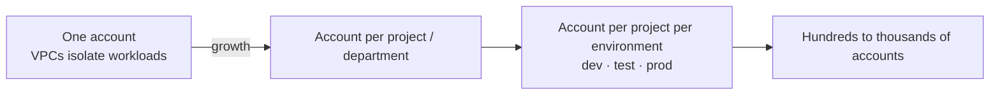
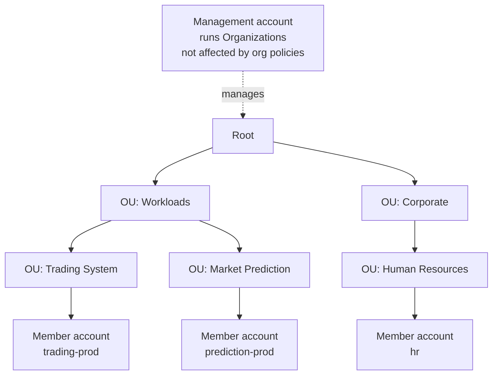

# AWS Organizations

> [!abstract] TL;DR
> As a company grows, the ==AWS account itself becomes the unit of isolation==, replacing the VPC. That isolates projects, departments, and dev/test/prod environments from each other's mistakes. Hundreds or thousands of accounts bring problems: one bill per account, separate user lists, and inconsistent security policies. **AWS Organizations** groups accounts under a **root** into **organizational units (OUs)**, run from a **management account**. ==Consolidated billing== merges the bills and pools usage for volume discounts. ==All features== adds central **policies**, led by **service control policies (SCPs)**. Organizations, Control Tower, and the accounts themselves are **free**: you pay only for the resources inside.

**Lesson:** L2 – Design a Multi-Account AWS Environment · **Previous lesson:** [[Monitoring and Logging Network Traffic]] · **Next:** [[Organizational Units and Service Control Policies]]
**Section hub:** [[Designing AWS Architecture for Organizations]]
**Sources:** Videos L2-A01 (Design a Multi-Account AWS Environment) and L2-A02 (Intro to AWS Organizations and Control Tower), en-us transcripts. Material marked *beyond the lecture* is my addition.

> [!todo]- Contents
> 1. [[#1. The Scenario – Scaling Past One Account]]
> 2. [[#2. Why Multiple Accounts]]
> 3. [[#3. The Problems Account Sprawl Creates]]
> 4. [[#4. AWS Organizations – Structure]]
> 5. [[#5. Consolidated Billing vs. All Features]]
> 6. [[#6. Worked Example – The S3 Volume Discount]]
> 7. [[#7. Organization Policy Types]]
> 8. [[#8. Control Tower – First Look]]
> 9. [[#9. Pitfalls and Failure Modes]]
> 10. [[#10. Key Takeaways]]
> 11. [[#11. Critical Analysis]]
> 12. [[#12. Self-Test]]
> 13. [[#13. Glossary]]
> 14. [[#14. Further Reading]]

---

## 1. The Scenario – Scaling Past One Account

Phase one at Steady Volatility Partners went well: traffic flows to the right places, and the architecture is **secure by default** ([[Building a VPC]]). That design used a **single AWS account**, which the lecture calls very common for businesses starting out in the cloud.

The new challenge: a business with **multiple departments**, each needing **isolated environments for development, production, and compliance**. It's adopting AWS in many areas at once. The architect's two-sided job:

| Don't… | …but also don't… |
|---|---|
| let IT **impede the organization's rapid growth** | let the organization's work become **insecure** |

The lesson's guiding question: how do you structure an AWS environment that ==scales with growth, stays secure and compliant, and remains manageable and cost-effective==? The answer uses two services: **AWS Organizations** and **AWS Control Tower** ([[AWS Control Tower]]).

---

## 2. Why Multiple Accounts

Getting started is easy: sign up with an **email address** and a **payment method**. One account can isolate resources with VPCs, explore AWS, and host a proof of concept. As the organization grows:

| Pattern (lecture) | What the account separates |
|---|---|
| **Account per project** | Projects from each other. A mistake in one project can't harm another. |
| **Account per department** | Business units |
| **Several accounts per project** | **Development** (new features being built), **test/staging** (ideas tested before deployment), and **production** |

> [!info]+ Definition – Account as the unit of isolation
> Larger organizations adopt ==accounts instead of VPCs as the logical container for projects==. That gives each project more independence and reduces the **blast radius** of mistakes. ^account-isolation

---

## 3. The Problems Account Sprawl Creates

Large companies can easily manage **hundreds or thousands** of accounts. The lecture names three challenges:

| Challenge | Detail |
|---|---|
| **Billing** | Every account gets its **own monthly bill**, so 1,000 accounts means 1,000 bills for finance |
| **Identity** | Each account has **its own list of users**. Tracking who can do what, where, gets complex. |
| **Security policy** | Each account's security policies are **independent**. Enforcing consistency or corporate policy can take lots of manual work. |

> [!note] Accounts are free
> AWS doesn't charge for having an account. It charges for the **resources running inside** it. The same is true of **AWS Organizations** and **AWS Control Tower**: no fee for the services, only for resources in the member accounts. ^accounts-free

---

## 4. AWS Organizations – Structure

> [!info]+ Definition – Organization
> A single coherent structure that groups multiple AWS accounts. Its top is the **root**. ^def-organization

> [!info]+ Definition – Organizational unit (OU)
> A logical grouping of accounts by ==function, compliance needs, or need for common security controls==. OUs can **nest**, collecting several OUs into higher-level units. ^def-ou

> [!info]+ Definition – Management account
> The account that ==hosts the AWS Organizations service itself==, where organization changes are made. ==Policies applied to the organization don't apply to the management account.== ^def-management-account

> [!info]+ Definition – Member account
> Any other account in the organization, placed under an OU. Existing accounts **join by invitation**. ^def-member-account

*(The OU names come from the lesson's [[Exercise 1 - Create and Manage Accounts using AWS Organizations - How To|Exercise 1]] demo.)*

---

## 5. Consolidated Billing vs. All Features

| Feature set | What you get (lecture) |
|---|---|
| **Consolidated billing only** | The simplest use: **aggregates the billing** of all accounts, and nothing more |
| **All features** | Consolidated billing **plus** centralized **policy management** to control account actions, plus **integration with many other AWS services**, so configuration scales to many accounts at once |

> [!tip] Consolidated billing alone can justify Organizations
> Many AWS services offer **volume discounts**: they get cheaper the more you use. With Organizations, ==all spending is aggregated first, then the volume discounts are applied==. ^volume-pooling

---

## 6. Worked Example – The S3 Volume Discount

The lecture's example: five accounts store **226 TB** in S3 in total. S3 gets cheaper **above 50 TB per month** (only the amount above the threshold is discounted).

| | Separate accounts | One organization |
|---|---|---|
| Who crosses 50 TB | Only Account 4 (65 TB) | The **pooled** 226 TB |
| TB at the base rate | 211 | **50** |
| TB at the discounted rate | **15** | **176** |
| Savings (lecture) | — | about **3%** |

**Checking the 3%** (*beyond the lecture*, with illustrative S3 Standard prices of \$0.023/GB for the first 50 TB and \$0.022/GB above that). Costs are per GB-month, ×1,000 GB/TB:

$$
C_{\text{separate}} = (211 \times 0.023 + 15 \times 0.022) \times 1000 = \$5{,}183
$$

$$
C_{\text{org}} = (50 \times 0.023 + 176 \times 0.022) \times 1000 = \$5{,}022
$$

$$
\text{savings} = \frac{5183 - 5022}{5183} \approx 3.1\%
$$

The lecture's 3% holds. The general principle:

$$
\text{pooled tiers} \;\Rightarrow\; \text{cost}(\textstyle\sum_i u_i) \le \sum_i \text{cost}(u_i)
$$

That holds whenever the price per unit falls as usage rises. Pooling can never cost more.

---

## 7. Organization Policy Types

Available with **all features**. Policies can target **accounts, OUs, or the whole organization**.

| Policy type | What it does (lecture) |
|---|---|
| **Service control policies (SCPs)** | The **centerpiece**. They enable and disable **AWS API calls**, or **entire services**, for accounts or OUs. Deep dive: [[Organizational Units and Service Control Policies]]. |
| **Tag policies** | **Standardize tagging** of resources (key for [[Designing AWS Architecture for Organizations#2. The Three Pillars|cost visibility]]) |
| **Backup policies** | Manage **backup plans** across accounts |
| **AI services opt-out policies** | Opt out of certain **data collection** by AWS AI services |

> [!note] Beyond the lecture
> AWS has since added more policy types, such as **resource control policies (RCPs)**, which cap permissions on *resources* rather than principals, and **declarative policies**. Check the current Organizations documentation for the full list.

---

## 8. Control Tower – First Look

The second multi-account tool. It **ties together several AWS capabilities** to create a secure environment for deploying solutions:

| Component (lecture) | Role |
|---|---|
| **Account Factory** | Automated creation of new AWS accounts |
| **Landing zone** | Secures accounts **consistently** |
| **Controls** | Policy management over the set of accounts |
| **Dashboard** | Quick view of the whole managed environment |

Deep dive: [[AWS Control Tower]].

---

## 9. Pitfalls and Failure Modes

| Failure | Symptom | Mitigation |
|---|---|---|
| Staying single-account too long | One mistake or compromise affects every project; IAM sprawl | Move to an account per workload/environment ([[#^account-isolation]]) |
| Standalone accounts | 1,000 bills; no volume pooling | An organization with consolidated billing ([[#^volume-pooling]]) |
| Running workloads in the management account | Org policies don't constrain it ([[#^def-management-account]]) | Keep the management account for organization administration only |
| Consolidated billing only | No central guardrails; manual per-account security | Enable **all features** |
| Per-account user lists | Can't answer "who can do what, where" | Centralize identity (*beyond the lecture*: IAM Identity Center) |

---

## 10. Key Takeaways

- [ ] Growing organizations use **accounts, not VPCs**, as the container for projects, departments, and environments.
- [ ] Account sprawl creates three problems: **many bills, many user lists, inconsistent policies**.
- [ ] **Accounts, Organizations, and Control Tower are free**. You pay for resources.
- [ ] Organizations structure: **root → OUs (nestable) → member accounts**, administered from the **management account**.
- [ ] **Org policies don't apply to the management account.**
- [ ] **Consolidated billing** pools usage, so **volume discounts** apply to the total (about 3% saved on the S3 example).
- [ ] **All features** adds **SCPs, tag, backup, and AI opt-out policies**, plus integration with other services.
- [ ] **Control Tower** = Account Factory + landing zone + controls + dashboard.

---

## 11. Critical Analysis

- **The management-account exemption is the biggest design consequence here.** Because SCPs don't apply to it, a compromised management account bypasses every guardrail. Best practice (*beyond the lecture*) is to run **no workloads** there, tightly restrict who can sign in, and delegate service administration to member accounts.
- **Volume pooling is real but modest.** 3% on storage is a nice talking point. The bigger multi-account savings usually come from **sharing commitment discounts** (Savings Plans, Reserved Instances) across accounts, and from *visibility* that drives cleanup. Lesson 3 (cost optimization) should test this.
- **"Accounts are free" isn't the whole cost story.** Each account carries baseline resources: CloudTrail, Config, a VPC, and sometimes NAT gateways. Those multiply with account count. Account-per-environment is right for isolation, but the baseline should be lean.
- **Org charts change; functions don't.** The lecture motivates OUs by function and compliance, not departments. The next note explains why ([[Organizational Units and Service Control Policies#2. What Makes an OU Structure Good]]).

> [!question] Open discussion questions
> 1. For Steady Volatility Partners, which workloads deserve their own accounts: trading, market prediction, HR? What about dev, test, and prod for each?
> 2. If accounts are free, what *is* the cost of having 500 of them? Think about operations, identity, and network.
> 3. Is there a case for staying on consolidated billing only, without all features?

---

## 12. Self-Test

> [!question]- Q1. Why do larger organizations shift from VPCs to accounts as their isolation boundary?
> Accounts give projects **more independence**. A mistake in one project is less likely to harm another. Accounts also cleanly separate departments and dev/test/prod environments.

> [!question]- Q2. What three management challenges come with hundreds of AWS accounts?
> **One bill per account**, **separate user lists** per account (hard to track permissions), and **independent security policies** (hard to keep consistent or enforce corporate policy).

> [!question]- Q3. What is the management account, and what is special about it?
> The account that **hosts AWS Organizations** and from which changes are made. **Policies applied to the organization don't apply to it.**

> [!question]- Q4. What's the difference between consolidated billing and all features?
> **Consolidated billing** only aggregates bills (with volume-discount pooling). **All features** adds **centralized policies** (SCPs, tag, backup, AI opt-out) and **integration with other AWS services** to configure many accounts at once.

> [!question]- Q5. (Quantitative) Three accounts store 30 TB, 30 TB, and 40 TB in S3. The tier breaks at 50 TB, at \$0.023/GB below and \$0.022/GB above. What does pooling save per month?
> **Separate:** no account crosses 50 TB, so $100 \times 0.023 \times 1000 = \$2{,}300$.
> **Pooled:** $50 \times 0.023 \times 1000 + 50 \times 0.022 \times 1000 = 1{,}150 + 1{,}100 = \$2{,}250$.
> **Savings:** **\$50/month (about 2.2%)**. Illustrative prices; check current pricing.

> [!question]- Q6. What do AWS Organizations and Control Tower cost?
> **Nothing** for the services themselves. Costs come only from the **resources** used in the accounts.

> [!question]- Q7. (Design) A team proposes running the company's main production database in the management account "because it's the most secure account". Respond.
> Org policies, **including SCPs, don't apply to the management account**, so it's the one account *without* guardrails. It should host only organization administration. Put the database in a member account under a Workloads OU, where SCPs and controls apply.

> [!tip] Flashcards
> Review this lesson with [[AWS Organizations - Flashcards]].

---

## 13. Glossary

| Term | Meaning |
|---|---|
| AWS Organizations | Service that groups accounts into one centrally managed structure |
| Organization | The account hierarchy, topped by the root |
| Root | Top container of an organization |
| Organizational unit (OU) | Nestable grouping of accounts by function, compliance, or controls |
| Management account | Hosts Organizations; exempt from org policies |
| Member account | Any non-management account in the organization |
| Consolidated billing | One bill for all accounts, with pooled volume discounts |
| All features | Consolidated billing + policies + service integrations |
| Service control policy (SCP) | Org policy that enables or disables API calls and services |
| Tag / backup / AI opt-out policy | Org policies for tagging, backup plans, and AI data-collection opt-out |
| Volume discount | Lower unit price at higher usage tiers |

---

## 14. Further Reading

- [What is AWS Organizations](https://docs.aws.amazon.com/organizations/latest/userguide/orgs_introduction.html)
- [Organizing Your AWS Environment Using Multiple Accounts (whitepaper)](https://docs.aws.amazon.com/whitepapers/latest/organizing-your-aws-environment/organizing-your-aws-environment.html)
- [Consolidated billing for AWS Organizations](https://docs.aws.amazon.com/awsaccountbilling/latest/aboutv2/consolidated-billing.html)
- [Management policy types in AWS Organizations](https://docs.aws.amazon.com/organizations/latest/userguide/orgs_manage_policies.html)
