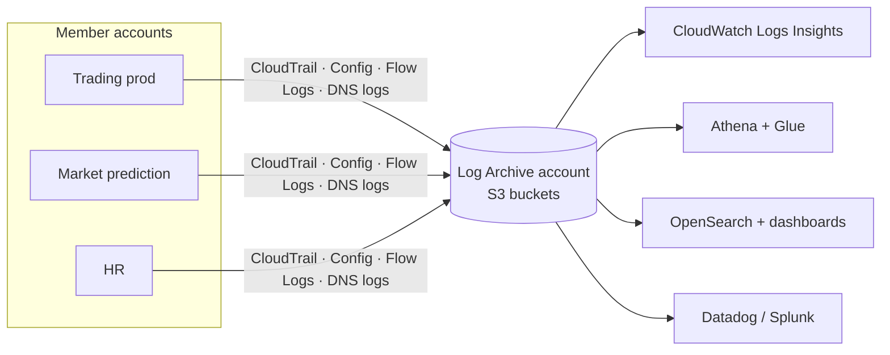
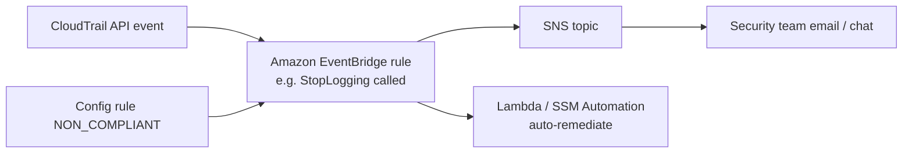

# Centralized Logging and Event Notification

> [!abstract] TL;DR
> In AWS, ==everything is an API call==, whether it comes from the console, the CLI, or an SDK. **AWS CloudTrail** logs those API interactions (plus console sign-ins and scheduled events) to S3. It does ==not== log network traffic *to* your EC2 or RDS resources; use flow logs or application logs for that. **AWS Config** watches resource **configuration**, **notifies** admins of drift, and can **remediate automatically**. In a multi-account design, all logs flow to the ==Log Archive account==. Then you choose an analytics strategy: **CloudWatch Logs Insights** (simple and cheap, with natural-language queries), **Athena** (SQL over S3, priced per TB scanned, with Glue for schemas), **OpenSearch** (clusters and dashboards), or **third-party** tools (Datadog, Splunk).

**Lesson:** L2 – Design a Multi-Account AWS Environment · **Previous:** [[AWS Control Tower]] · **Next:** [[Governance and Compliance in Multi-Account Environments]]
**Section hub:** [[Designing AWS Architecture for Organizations]]
**Sources:** Video L2-A05 (Centralized Logging and Event Notification Strategies), en-us transcript. The video spends little time on "event notification" beyond AWS Config alerts, so the notification-pipeline material (EventBridge, SNS) is *beyond the lecture*.

> [!todo]- Contents
> 1. [[#1. Why Logs Matter]]
> 2. [[#2. Everything Is an API Call]]
> 3. [[#3. AWS CloudTrail]]
> 4. [[#4. AWS Config]]
> 5. [[#5. The Log Archive Account]]
> 6. [[#6. Choosing an Analytics Strategy]]
> 7. [[#7. Event Notification Pipeline]]
> 8. [[#8. Pitfalls and Failure Modes]]
> 9. [[#9. Key Takeaways]]
> 10. [[#10. Critical Analysis]]
> 11. [[#11. Self-Test]]
> 12. [[#12. Glossary]]
> 13. [[#13. Further Reading]]

---

## 1. Why Logs Matter

A cloud architecture needs resources that ==gather data about how the workload behaves==. The lecture lists three moments when you'll need it:

| Moment | Question the logs answer |
|---|---|
| Resolving a **trouble ticket** | Why is the application misbehaving? |
| **Forensics** | Who deleted that critical resource? |
| **Design** | What should the next version of the system do differently? |

---

## 2. Everything Is an API Call

> [!info]+ Definition – API call (AWS control plane)
> The primary way to tell an AWS service what to do is through ==its API==. Deleting an S3 object, updating a DynamoDB item, or adding an IAM role are all, underneath, API calls. ^everything-api

| Where the request starts | Ends up as |
|---|---|
| **Management Console** web page | An API call to the service |
| **CLI** script | An API call |
| Application using an **SDK** (e.g. Java) | An API call |

This is why one service, CloudTrail, can audit nearly everything people and automation do in an account. It's also why [[Organizational Units and Service Control Policies#6. What SCPs Are Used For|SCPs]] can control nearly everything.

---

## 3. AWS CloudTrail

> [!info]+ Definition – AWS CloudTrail
> Logs ==API-call-based read and write interactions== with AWS services and stores them in an **S3 bucket**. ^def-cloudtrail

| CloudTrail logs (lecture) | CloudTrail does **not** log |
|---|---|
| API calls (reads and writes) | **Network requests to compute resources you created**, e.g. traffic to an EC2 instance or an RDS database server |
| **Console sign-ins** (not API calls in the normal sense) | |
| Events from **scheduled events** you created in the account | |

> [!important] Control plane vs. data plane
> CloudTrail is for when you **call an AWS service and tell it to do something**. To capture traffic *to* your instances or databases, use ==VPC Flow Logs== ([[Monitoring and Logging Network Traffic]]) or **application logging**. ^cloudtrail-scope

> [!note] Beyond the lecture
> - CloudTrail records **management events** by default. **Data events** (e.g. S3 object-level `GetObject`/`PutObject`) are optional and billed separately.
> - An **organization trail** created from the management account logs every member account to one bucket. Control Tower sets this up, delivering to the Log Archive account.

---

## 4. AWS Config

> [!info]+ Definition – AWS Config
> Monitors the ==configuration settings== of important resources. When a resource drifts out of alignment with defined settings, Config **notifies an administrator** and can **trigger automated remediation**. ^def-config

| | CloudTrail | AWS Config |
|---|---|---|
| Records | **Who did what** (API activity) | **What things look like** (resource configuration over time) |
| Question answered | "Who deleted the bucket policy?" | "Which buckets are public right now? When did this one become public?" |
| Response | Investigation | **Notification** and **automated remediation** |
| In Control Tower | Org-wide trail to Log Archive | Powers **detective controls** ([[AWS Control Tower#4. Controls – Preventive, Detective, Proactive]]) |

---

## 5. The Log Archive Account

> [!important] Aggregate everything centrally
> The ==Log Archive account is the ideal place to aggregate all log data== from the organization's accounts: CloudTrail, Config, flow logs, and DNS query logs. It's the account Control Tower creates in the Security OU ([[AWS Control Tower#3. What the Landing Zone Creates]]). ^log-archive

Why a separate account (*beyond the lecture*): an attacker who compromises a workload account can't delete the evidence, because the logs live elsewhere, protected by mandatory controls ([[Governance and Compliance in Multi-Account Environments#3. Control Tower Control Guidance Levels]]).

---

## 6. Choosing an Analytics Strategy

Once the logs are in S3 in the Log Archive account, the next decision is the **analytics strategy**.

| Option | How it works (lecture) | Query style | Cost model | Best for |
|---|---|---|---|---|
| **CloudWatch Logs Insights** | Built into CloudWatch Logs. **Metric filters** turn logs into numbers for alerting. **Subscription filters** forward entries to other apps, e.g. **Lambda**. | Simple **proprietary** query language, or **natural language** that AI translates | Simple and **inexpensive** | Quick operational queries and alerts |
| **Amazon Athena** | Loads data from S3 into **temporary hardware**, runs the query, releases the hardware. Needs a **table definition**, which the **AWS Glue crawler** can generate. | **SQL** | **Flat price per TB read** from S3 | SQL analysis of large archives in S3 |
| **Amazon OpenSearch Service** | A **cluster of instances** running ingestion tasks from many sources, for querying and **dashboards**. Commonly paired with **Kibana**. | Search and dashboards | Cluster runs continuously | Interactive search and dashboards |
| **Third-party** | Ingest and analyze logs, augmenting AWS's built-in tools. Market leaders include **Datadog** and **Splunk**. | Vendor-specific | Vendor pricing | Organizations with an existing SIEM/observability platform |

> [!note] Kibana today (*beyond the lecture*)
> OpenSearch Service ships **OpenSearch Dashboards**, a fork of Kibana.

### Athena cost (*beyond the lecture*, illustrative \$5 per TB scanned)

$$
\text{cost per query} = \text{TB scanned} \times \$5
$$

A query scanning 400 GB of raw JSON CloudTrail logs costs $0.4 \times 5 = \$2.00$. Convert the logs to **Parquet** (columnar and compressed, often about 90% smaller to scan) and **partition by date**, and the same question might scan 20 GB, about **\$0.10**. Storage layout, not query cleverness, drives Athena cost.

---

## 7. Event Notification Pipeline

*Beyond the lecture.* The lesson title promises "event notification", but the video only covers Config notifying admins and subscription filters forwarding to Lambda. A typical pattern:

| Event | Route | Action |
|---|---|---|
| `cloudtrail:StopLogging` called | EventBridge → SNS | Page security immediately |
| S3 bucket becomes public (Config) | EventBridge → SSM Automation | Re-enable Block Public Access |
| Root user sign-in | EventBridge → SNS | Alert. Root use should be rare. |

Control Tower adds related plumbing: it aggregates security notifications in the **Audit** account through SNS.

---

## 8. Pitfalls and Failure Modes

| Failure | Symptom | Mitigation |
|---|---|---|
| Expecting CloudTrail to show traffic to EC2/RDS | "No record of who connected to the database" | CloudTrail is control plane only. Use flow logs and app/database logs ([[#^cloudtrail-scope]]). |
| Logs left in each workload account | Attacker deletes the evidence; no cross-account view | Centralize in the **Log Archive** account ([[#^log-archive]]) |
| Athena without a schema | Queries fail | Define tables, e.g. with a **Glue crawler** |
| Athena over raw, unpartitioned logs | Slow, expensive queries | Partition by date/account; use columnar formats |
| OpenSearch for occasional queries | Paying for an always-on cluster | Use Insights or Athena for ad-hoc queries |
| Config detects but nobody's notified | Drift persists unnoticed | Wire Config → EventBridge → SNS, or auto-remediate |
| No S3 data events where needed | Can't tell who read sensitive objects | Enable data events selectively for sensitive buckets |

---

## 9. Key Takeaways

- [ ] Logs answer three needs: **trouble tickets, forensics** (who deleted it?), and **next-version design**.
- [ ] **Everything is an API call**, whether from the console, CLI, or SDK ([[#^everything-api]]).
- [ ] **CloudTrail** logs API reads and writes, **console sign-ins**, and **scheduled events** to **S3**. It doesn't log **network traffic to your compute**.
- [ ] **AWS Config** tracks resource **configuration**, **notifies** on drift, and can **auto-remediate**.
- [ ] Aggregate all logs in the **Log Archive account**.
- [ ] Analytics: **Logs Insights** (cheap, natural-language capable, metric and subscription filters), **Athena** (SQL, \$/TB, Glue schemas), **OpenSearch** (clusters, Kibana dashboards), **third-party** (Datadog, Splunk).

---

## 10. Critical Analysis

- **Centralized logging is a security control, not just convenience.** The key property is that **workload-account admins can't alter the logs**. That depends on bucket policies, Object Lock, and Control Tower's mandatory controls, which [[Governance and Compliance in Multi-Account Environments]] covers.
- **CloudTrail's blind spot is the biggest misconception.** Many breaches happen through the *data plane*: application exploits, database queries, S3 reads with valid credentials. CloudTrail management events show none of that. A complete design layers CloudTrail with S3 data events, flow logs, DNS query logs, and application logs ([[Monitoring and Logging Network Traffic#^dns-blind-spot]]).
- **The analytics choice is a cost/latency/skills trade-off.** Insights is cheap but proprietary. Athena is serverless SQL but its cost depends on data layout. OpenSearch is interactive but always-on. Third-party tools fit existing processes but bring egress and license costs. Many organizations use two: Insights for operations, plus Athena or a SIEM for security.
- **Natural-language queries need verification.** AI-translated queries are convenient, but an analyst must check the generated query. A subtly wrong filter in a forensic investigation can mean a false "all clear".

> [!question] Open discussion questions
> 1. For Steady Volatility Partners' regulators, which logs must be immutable, and for how long? How would you enforce that in the Log Archive account?
> 2. When would you pay for OpenSearch instead of using Athena?
> 3. Which three EventBridge notifications would you set up first, and who should receive each?

---

## 11. Self-Test

> [!question]- Q1. Why can one service (CloudTrail) audit almost everything done in an AWS account?
> Because **everything is an API call**. Console, CLI, and SDK actions all end up as calls to a service's API, which CloudTrail logs.

> [!question]- Q2. Besides API calls, what does CloudTrail log? What does it not log?
> It also logs **console sign-ins** and events from **scheduled events** you created. It does **not** log **network requests to compute resources** like EC2 instances or RDS databases.

> [!question]- Q3. What's the difference between CloudTrail and AWS Config?
> **CloudTrail** records **who did what** (API activity). **Config** records **resource configuration** over time, detects drift from defined settings, **notifies** admins, and can **auto-remediate**.

> [!question]- Q4. Where should an organization aggregate its logs, and why?
> In the **Log Archive account**: one place to analyze them, and (beyond the lecture) out of reach of workload-account admins and attackers.

> [!question]- Q5. What does Athena need before it can query logs, and which service can provide it?
> A **table definition** (schema) describing the data's structure. The **AWS Glue crawler** can generate it.

> [!question]- Q6. (Quantitative, beyond the lecture) Security runs 30 Athena queries a month, each scanning 500 GB of raw logs at \$5/TB. What's the monthly cost? What if partitioning cuts each scan to 25 GB?
> Raw: $30 \times 0.5 \times 5 = \$75$. Partitioned: $30 \times 0.025 \times 5 = \$3.75$, a **95% reduction**. (Illustrative price; check current pricing.)

> [!question]- Q7. (Design) Someone queried the trading database with stolen credentials, and CloudTrail shows nothing. Why, and what should have been in place?
> Database queries are **data-plane network traffic** to RDS, which CloudTrail doesn't capture. You'd need **database audit logs**, **VPC Flow Logs** (connection metadata), and application logs, all centralized in the **Log Archive** account.

> [!tip] Flashcards
> Review this lesson with [[Centralized Logging and Event Notification - Flashcards]].

---

## 12. Glossary

| Term | Meaning |
|---|---|
| API | Application programming interface; how every AWS action is requested |
| AWS CloudTrail | Logs API calls, console sign-ins, and scheduled events to S3 |
| Management / data events | Control-plane API calls / object-level operations, which are optional (*beyond the lecture*) |
| AWS Config | Records resource configurations, flags drift, and can remediate |
| Log Archive account | Central account where organization logs are aggregated |
| CloudWatch Logs Insights | Query engine for CloudWatch Logs, with natural-language support |
| Metric filter | Turns log patterns into CloudWatch metrics |
| Subscription filter | Forwards log events to other services, e.g. Lambda |
| Amazon Athena | Serverless SQL over S3, priced per TB scanned |
| AWS Glue crawler | Infers schemas and creates table definitions |
| Amazon OpenSearch Service | Managed search and analytics clusters, with dashboards |
| Kibana / OpenSearch Dashboards | Visualization front end for OpenSearch |
| Amazon EventBridge | Event bus that routes events to targets (*beyond the lecture*) |

---

## 13. Further Reading

- [What is AWS CloudTrail](https://docs.aws.amazon.com/awscloudtrail/latest/userguide/cloudtrail-user-guide.html)
- [What is AWS Config](https://docs.aws.amazon.com/config/latest/developerguide/WhatIsConfig.html)
- [Querying AWS CloudTrail logs with Athena](https://docs.aws.amazon.com/athena/latest/ug/cloudtrail-logs.html)
- [Analyzing log data with CloudWatch Logs Insights](https://docs.aws.amazon.com/AmazonCloudWatch/latest/logs/AnalyzingLogData.html)
- [What is Amazon OpenSearch Service](https://docs.aws.amazon.com/opensearch-service/latest/developerguide/what-is.html)
