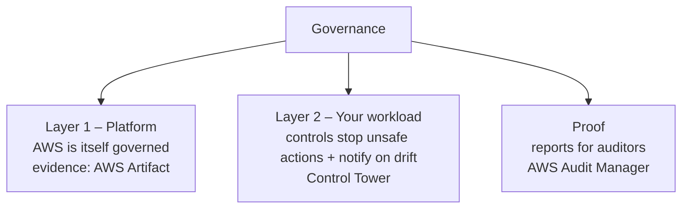
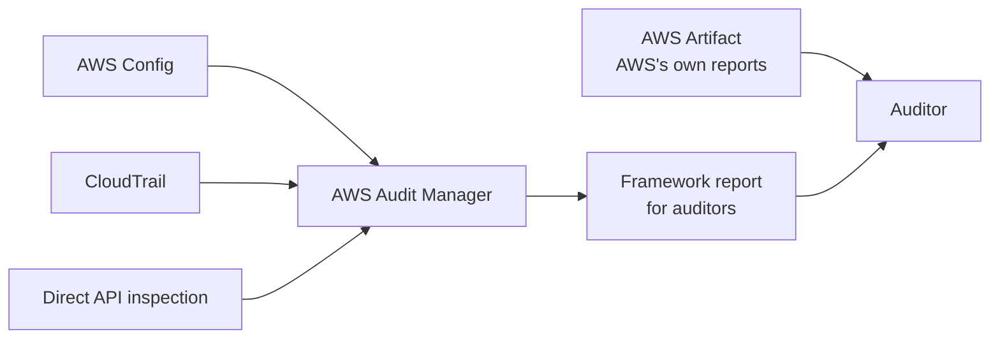

# Governance and Compliance in Multi-Account Environments

> [!abstract] TL;DR
> **Governance** balances ==speed and agility with proof that resources are used wisely and sensitive data is protected==. It means explaining spend to the board and proving controls to regulators. Compliance has two layers:
> 1. **The platform:** AWS holds 143 security standards and certifications (at recording time). Its audit reports are downloadable from ==AWS Artifact==.
> 2. **Your workload:** Control Tower controls come in three **guidance levels**:
>    - ==Mandatory==: always on. Protects Control Tower itself.
>    - ==Strongly recommended==: off by default, but AWS best practice.
>    - ==Elective==: off by default. Enterprise-grade restrictions.
>
> **AWS Audit Manager** gathers evidence from Config, CloudTrail, and its own API calls to generate framework compliance reports.

**Lesson:** L2 – Design a Multi-Account AWS Environment · **Previous:** [[Centralized Logging and Event Notification]] · **Next lesson:** [[AWS Cost and Usage Monitoring Tools]] (L3 – Determine Cost and Visibility Strategies)
**Section hub:** [[Designing AWS Architecture for Organizations]]
**Sources:** Videos L2-A06 (Governance and Compliance in Multi-Account Environments) and L2-A09 (Lesson Review), en-us transcripts. Material marked *beyond the lecture* is my addition.

> [!todo]- Contents
> 1. [[#1. What Governance Means]]
> 2. [[#2. Layer 1 – A Governed Platform and AWS Artifact]]
> 3. [[#3. Control Tower Control Guidance Levels]]
> 4. [[#4. AWS Audit Manager]]
> 5. [[#5. Worked Example – A Control Baseline for a Hedge Fund]]
> 6. [[#6. Pitfalls and Failure Modes]]
> 7. [[#7. Key Takeaways]]
> 8. [[#8. Critical Analysis]]
> 9. [[#9. Self-Test]]
> 10. [[#10. Glossary]]
> 11. [[#11. Further Reading]]

---

## 1. What Governance Means

| Need | Audience (lecture) |
|---|---|
| Respond to business needs with **speed and agility** | The business |
| Explain **what we're paying for and what value we get** | The **board of directors** |
| Prove sensitive workloads (**payment data, medical data, classified information**) are managed to **minimize the risk of loss** | **Industry watchdogs** and **government agencies** |

> [!info]+ Definition – Governance
> The broad practice of ensuring IT solutions use resources wisely and protect sensitive information, while still allowing rapid scaling. The systems built to support it are called ==compliance regimes== or ==governance frameworks==. ^def-governance

---

## 2. Layer 1 – A Governed Platform and AWS Artifact

One element of governance is building on a cloud platform that is **itself** built to governance best practices.

| Fact (lecture) | Detail |
|---|---|
| AWS compliance scope | **143** security standards and compliance certifications, *at the time of recording* |
| Where the evidence is | **AWS Artifact**, a **self-service portal** |
| What you get | Documents from **auditors and accreditation agencies** showing AWS is a well-governed platform. **Free** for AWS users to download. |

> [!info]+ Definition – AWS Artifact
> The self-service portal for AWS's own **audit and verification documentation**, used to prove the *platform* layer to your auditors. ^def-artifact

> [!note] Shared responsibility (*beyond the lecture*)
> Artifact proves AWS's side, the security **of** the cloud. It says nothing about your configuration, the security **in** the cloud. That's what Layer 2 is for.

---

## 3. Control Tower Control Guidance Levels

The next step is verifying that **your workload** implements its own controls to:
- **stop unsafe actions** when possible
- **notify administrators** when a system **drifts** into an unsecured state

This is one of **Control Tower's major strengths**. Control Tower provides a **configurable** control system. ==Not every organization should turn on every control.==

| Guidance level | Default | Can disable | Purpose (lecture) |
|---|---|---|---|
| **Mandatory** | **On** | **No** | Keeps **Control Tower functioning**. Prevents tampering with the resources that give it visibility into the landing zone. |
| **Strongly recommended** | Off | Yes | AWS **best practice** for well-architected multi-account environments |
| **Elective** | Off | Yes | Goes further. Constraints common in **highly secured large enterprises**. |

^guidance-levels

### Mandatory – protect Control Tower itself

> [!important] If you could break the mandatory controls, you might break Control Tower
> They block reconfiguring:
> - the **S3 buckets** Control Tower uses in the **Log Archive** account
> - **CloudWatch Logs** and **CloudTrail**
> - Control Tower-created **Config rules**, **IAM roles**, **SNS topics**, and **subscriptions** to those topics

### Strongly recommended – best-practice hygiene

| Control area (lecture) | Detects or enforces |
|---|---|
| Under-secured internet connections | **Unrestricted** inbound access, e.g. TCP or **SSH** open to the world |
| Public resources that should be private | Publicly accessible **S3 buckets**, **RDS databases** |
| Audit logging | **CloudTrail** is logging API interactions |
| Root user security | **Root MFA** enabled; **no access keys** for the root user |

> [!warning] Why root controls matter
> The root user normally has **unrestricted** power to create and destroy. The lecture's nightmare scenario: a threat actor with root credentials **scripts the deletion of every resource** in the account. That would be a **critical account security failure**. ^root-risk

### Elective – enterprise-grade restrictions

| Control area (lecture) | Example |
|---|---|
| S3 configuration lock-down (via **SCPs**) | Disallow changes to **encryption** and **logging** settings, **bucket policies**, **lifecycle policies**, and **replication** |
| MFA | Require **MFA to delete** S3 objects. Detect **IAM users without MFA**. |

> [!tip] Guidance level vs. behavior
> Guidance level (mandatory / strongly recommended / elective) is **independent** of behavior (preventive / detective / proactive, see [[AWS Control Tower#4. Controls – Preventive, Detective, Proactive]]). For example, a strongly recommended control can be **detective**, and an elective control can be **preventive**.

---

## 4. AWS Audit Manager

> [!info]+ Definition – AWS Audit Manager
> Generates **reports demonstrating compliance** with various **compliance frameworks**, based on ==evidence gathered automatically== from accounts you identify. ^def-audit-manager

| Evidence source (lecture) | What it contributes |
|---|---|
| **AWS Config** | Resource configuration state and rule compliance |
| **AWS CloudTrail** | Who did what, and when ([[Centralized Logging and Event Notification#3. AWS CloudTrail]]) |
| **Its own API calls** | Directly inspects how things are configured in your environment |

Artifact proves **AWS's** side. Audit Manager proves **your** side. Together they give the auditor both layers.

---

## 5. Worked Example – A Control Baseline for a Hedge Fund

*Beyond the lecture.* This applies the guidance levels to Steady Volatility Partners' OUs (from [[Exercise 2 - AWS Control Tower - How To|Exercise 2]]):

| OU | Guidance levels to enable | Example controls | Rationale |
|---|---|---|---|
| All (landing zone) | **Mandatory** (automatic) | Protect Log Archive buckets and CloudTrail | Non-negotiable |
| Workloads (trading, market prediction) | **Strongly recommended** + selected **elective** | No unrestricted SSH; no public S3/RDS; deny changes to bucket encryption and replication; proactive DynamoDB PITR | Protects the trading IP. Regulators expect encryption and resilience. |
| Corporate / Human Resources | **Strongly recommended** + elective **replication lock** | Prevent S3 replication changes (data residency of employee records) | Personal data |
| DeveloperTestArea (sandbox) | **Strongly recommended** (mostly detective) | Detect S3 Block Public Access removal | Freedom to experiment, with visibility |

**Scale of OU-level enablement:** enabling $c$ controls on $u$ OUs takes $c \times u$ actions, regardless of how many accounts $n$ sit under them. Enabling per account would take $c \times n$. With 6 controls, 4 OUs, and 60 accounts, that's $24$ vs. $360$ actions. New accounts inherit OU controls **automatically**.

---

## 6. Pitfalls and Failure Modes

| Failure | Symptom | Mitigation |
|---|---|---|
| Turning on every elective control | Teams blocked; shadow IT | Enable per OU, based on risk ([[#^guidance-levels]]) |
| Skipping strongly recommended controls | Public buckets, open SSH, unprotected root go unnoticed | Enable them at least on Workloads and Sandbox |
| Trying to modify Control Tower's Log Archive buckets | Changes blocked; or, if bypassed, Control Tower breaks | Mandatory controls exist to protect Control Tower. Work with them. |
| Treating Artifact reports as your compliance | Auditor rejects the evidence | Artifact covers AWS's layer. Use **Audit Manager** for yours. |
| Root user with access keys or no MFA | Catastrophic-compromise risk ([[#^root-risk]]) | Root MFA, no root access keys, alarms on root sign-in |
| Controls with no notification path | Drift detected, nobody acts | Route detective findings to people ([[Centralized Logging and Event Notification#7. Event Notification Pipeline]]) |

---

## 7. Key Takeaways

- [ ] **Governance** = agility **plus** accountability to the **board** (spend and value) and **regulators** (protecting payment, medical, and classified data).
- [ ] Frameworks for this are called **compliance regimes** or **governance frameworks**.
- [ ] **Layer 1:** AWS's own compliance (143 standards at recording), with evidence in **AWS Artifact** (free, self-service).
- [ ] **Layer 2:** your controls stop unsafe actions and **notify on drift**. That's Control Tower's strength.
- [ ] **Mandatory** controls are always on and can't be disabled. They protect Control Tower's Log Archive buckets, CloudTrail, CloudWatch Logs, Config rules, IAM roles, and SNS.
- [ ] **Strongly recommended** (off by default): open SSH/TCP, public S3/RDS, CloudTrail on, **root MFA**, **no root access keys**.
- [ ] **Elective** (off by default): enterprise lock-downs such as S3 encryption, logging, policy, lifecycle, and replication changes, and MFA delete.
- [ ] **AWS Audit Manager** builds framework reports from **Config**, **CloudTrail**, and its own **API calls**.
- [ ] Lesson review: choosing between **Organizations alone** and **Control Tower** is critical for scaling **without compromising security and compliance**. Next lesson: **cost optimization**.

---

## 8. Critical Analysis

- **"143 certifications" is necessary but not sufficient.** It shows AWS's platform is audited. Most real compliance failures are customer misconfigurations. The lecture's two-layer framing is right, but the effort is overwhelmingly in Layer 2.
- **Guidance levels encode AWS's opinion, not your risk.** "Strongly recommended" is a good default. But a hedge fund's regulators, or a pharma company's (as in the [[Designing AWS Architecture for Organizations#4. The Capstone – Pharmaceutical Company|capstone]]), may require specific *elective* controls, and some sandbox OUs may justifiably skip some. The architect should map each enabled control to a requirement.
- **Mandatory controls show how to protect a control system.** The governance tooling (logs, Config rules, roles) must itself be protected from the people it governs. The same principle applies to custom tooling: put it in protected accounts behind SCPs.
- **Audit Manager automates evidence, not judgment.** It collects and organizes evidence well. Whether a control *meets* a regulation's intent is still a human call, and automated "compliant" scores can create false confidence.
- **Lesson review takeaway:** Organizations alone suits teams that want minimal structure and full control. Control Tower suits those who want a governed baseline fast. The cost lesson next will show that governance has a running cost too: Config rule evaluations and CloudTrail storage.

> [!question] Open discussion questions
> 1. Which elective controls would you require for the trading Workloads OU, and how would you justify each one to developers?
> 2. How would you combine AWS Artifact and Audit Manager outputs into a single package for a regulator?
> 3. Should the sandbox OU have *more* or *fewer* controls than production? Argue both sides.

---

## 9. Self-Test

> [!question]- Q1. What is governance, and who does it answer to?
> Ensuring IT uses resources wisely and protects sensitive data while still moving fast. It answers to the **board** (what we pay for and the value we get) and to **regulators and agencies** (protection of payment, medical, and classified data).

> [!question]- Q2. What is AWS Artifact, and what does it prove?
> A **free, self-service portal** of AWS's audit and accreditation documents. It proves **AWS's platform** is well-governed, not your workload.

> [!question]- Q3. Compare the three Control Tower guidance levels.
> **Mandatory:** on, can't be disabled; protects Control Tower itself. **Strongly recommended:** off by default; AWS best practice. **Elective:** off by default; enterprise-grade restrictions.

> [!question]- Q4. What do mandatory controls protect, and why?
> Control Tower's resources: **Log Archive S3 buckets**, **CloudWatch Logs**, **CloudTrail**, **Config rules**, **IAM roles**, and **SNS topics and subscriptions**. Tampering with them could **break Control Tower** and blind it to the landing zone.

> [!question]- Q5. Name four things strongly recommended controls check.
> **Unrestricted inbound** (e.g. SSH), **public S3 buckets / RDS**, **CloudTrail logging enabled**, **root MFA** and **no root access keys**.

> [!question]- Q6. (Quantitative) You must enable 8 controls across 5 OUs holding 120 accounts. How many enablement actions at the OU level, compared with per account? What happens when 20 new accounts join those OUs?
> OU level: $8 \times 5 = 40$. Per account: $8 \times 120 = 960$. New accounts in governed OUs **inherit** the controls with **zero** extra actions. Per account, that would be $8 \times 20 = 160$ more.

> [!question]- Q7. (Design) An auditor asks Steady Volatility Partners to prove both that AWS is secure and that the firm's S3 data is encrypted and not public. What do you provide?
> **AWS Artifact** reports for the platform layer. An **AWS Audit Manager** assessment for the firm's layer, using Config evidence (encryption, Block Public Access) and CloudTrail evidence. Backed by **strongly recommended** (public S3 detection) and **elective** (deny encryption-setting changes) Control Tower controls on the relevant OUs.

> [!tip] Flashcards
> Review this lesson with [[Governance and Compliance in Multi-Account Environments - Flashcards]].

---

## 10. Glossary

| Term | Meaning |
|---|---|
| Governance | Balancing agility with accountable, safe use of resources |
| Compliance regime / governance framework | A formal set of requirements for governing IT |
| AWS Artifact | Self-service portal for AWS's own compliance reports |
| Guidance level | Control Tower's ranking of a control: mandatory, strongly recommended, elective |
| Mandatory control | Always on; protects Control Tower's own resources |
| Strongly recommended control | AWS best-practice control; off by default |
| Elective control | Enterprise-grade optional control; off by default |
| Root user | An account's all-powerful original identity |
| MFA delete | Requiring MFA to delete S3 object versions |
| AWS Audit Manager | Automates evidence collection and framework compliance reports |

---

## 11. Further Reading

- [What is AWS Artifact](https://docs.aws.amazon.com/artifact/latest/ug/what-is-aws-artifact.html)
- [AWS Control Tower control reference – guidance levels](https://docs.aws.amazon.com/controltower/latest/controlreference/controls.html)
- [What is AWS Audit Manager](https://docs.aws.amazon.com/audit-manager/latest/userguide/what-is.html)
- [AWS Shared Responsibility Model](https://aws.amazon.com/compliance/shared-responsibility-model/)
