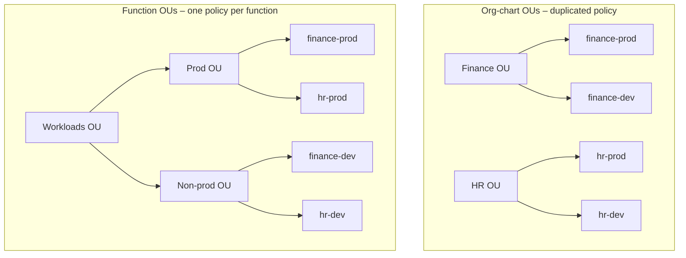
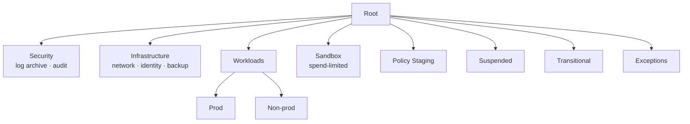
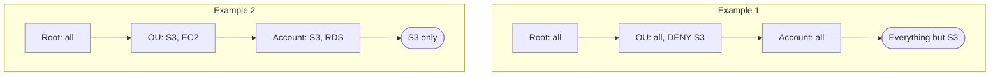

# Organizational Units and Service Control Policies

> [!abstract] TL;DR
> A good OU structure ==groups accounts by function, not by the corporate org chart==, so the same policies and automation apply once to every similar account. AWS recommends **11 top-level OUs**, such as Workloads (split into prod and non-prod), Sandbox, Security, Infrastructure, Suspended, Transitional, Policy Staging, and Exceptions. **SCPs** are created in the management account and attached to the root, OUs, or accounts, and they **inherit downward**. They ==never grant permissions; they cap what IAM can grant==. A permission is effective only if IAM grants it **and** ==every SCP from the root down to the account allows it==. Any implicit or explicit deny along the path wins.

**Lesson:** L2 – Design a Multi-Account AWS Environment · **Previous:** [[AWS Organizations]] · **Next:** [[AWS Control Tower]]
**Section hub:** [[Designing AWS Architecture for Organizations]]
**Sources:** Video L2-A03 (Strategic Structuring of AWS Organizations), en-us transcript. Material marked *beyond the lecture* is my addition.

> [!todo]- Contents
> 1. [[#1. Why OU Design Matters]]
> 2. [[#2. What Makes an OU Structure Good]]
> 3. [[#3. Recommended Top-Level OUs]]
> 4. [[#4. Service Control Policies – Guardrails, Not Grants]]
> 5. [[#5. SCP Inheritance – Worked Examples]]
> 6. [[#6. What SCPs Are Used For]]
> 7. [[#7. Pitfalls and Failure Modes]]
> 8. [[#8. Key Takeaways]]
> 9. [[#9. Critical Analysis]]
> 10. [[#10. Self-Test]]
> 11. [[#11. Glossary]]
> 12. [[#12. Further Reading]]

---

## 1. Why OU Design Matters

Identifying the OU structure is a ==critical step== in a multi-account architecture.

| Badly designed OUs | Well-designed OUs |
|---|---|
| Create **confusion** | Make it easy to apply **configuration policies consistently** |
| Require **duplicate administrative effort** | Make it easy to **share resources across accounts** with **AWS RAM** (Resource Access Manager; see [[AWS Control Tower#7. AWS RAM – Sharing Resources Across Accounts]]) |
| Increase the risk of **configuration mistakes** | Give **automation a target**: apply a change to every account in a group that needs it |

---

## 2. What Makes an OU Structure Good

> [!important] Don't mirror the org chart
> Surprisingly to new cloud architects, AWS ==does not recommend an OU structure that matches the corporate org chart==. Similar accounts often exist in **different divisions**. A department-based structure **duplicates effort** and **increases misconfiguration risk**. AWS best practice is to ==group accounts by function==. ^ou-by-function

Examples of account **functions** from the lecture:

| Function | Example |
|---|---|
| Production business application | A customer-facing web server environment |
| Deployment machinery | A **continuous delivery** system that ships new application versions |
| Security enablement | Security tooling for the company's cloud workloads |
| Experimentation | A developer testing ground |
| Not yet integrated | Accounts just acquired in a **merger** |



In the bad design, the "prod" rules must be attached and maintained **twice**, once per department. In the good design, they're attached **once** to the Prod OU.

---

## 3. Recommended Top-Level OUs

AWS best-practice documentation identifies ==11 recommended top-level OUs==. The lecture describes these:

| OU | Purpose (lecture) |
|---|---|
| **Workloads** | The company's projects for internal or customer-facing business needs. Split further into **production** and **non-production** (test/staging) sub-OUs. Project or department OUs can sit *inside*, if that helps deploy policies to them. |
| **Sandbox** | Developer experimentation, often under **tight spending limits** or restrictions on which services can be used |
| **Security** | Security tooling. Most notably an account for **organization-wide log data** and an account for **auditing** by trusted security staff. |
| **Infrastructure** | Shared services: **backup and restore**, **identity management**, **network management**, **monitoring** |
| **Suspended** | Accounts **awaiting deletion** |
| **Transitional** | Accounts entering through a **merger or acquisition** |
| **Policy Staging** | Test potentially **disruptive policy changes** before applying them to sensitive production accounts |
| **Exceptions** | Accounts that don't fit neatly elsewhere |

> [!note] The rest of the 11 (*beyond the lecture*, per AWS's multi-account whitepaper)
> **Deployments** (CI/CD tooling, matching the lecture's "continuous delivery" function), **Individual Business Users**, and **Business Continuity**. Check the whitepaper for current names.

> [!question] Where do developer accounts go
> The lecture gives two valid options:
> - Treat them as **non-production workloads**, in a non-prod OU under Workloads.
> - Treat them as **sandbox** accounts, in the cost-limited Sandbox OU.



---

## 4. Service Control Policies – Guardrails, Not Grants

> [!info]+ Definition – Service control policy (SCP)
> Possibly the **most important part of AWS Organizations**. SCPs are created and attached **from the management account**, to an **account**, an **OU**, or the **root**. Their effects ==inherit downward==: root → OUs → accounts. ^def-scp

> [!important] SCPs don't grant permissions
> SCPs ==manage the restriction of permission granting==. They limit what can be granted through **IAM** and **IAM Identity Center**. Only permissions that are **both** granted by IAM **and** permitted by SCPs take effect. ^scp-no-grant

**Effective permissions** for a principal in an account at depth $k$:

$$
E \;=\; P_{\text{IAM}} \;\cap\; S_{\text{root}} \;\cap\; S_{\text{OU}_1} \;\cap\; \cdots \;\cap\; S_{\text{OU}_k} \;\cap\; S_{\text{account}}
$$

Here $S_x$ is what the SCPs attached at level $x$ allow. Any **explicit deny** anywhere removes the action outright.

> [!example] The lecture's IAM vs. SCP example
> An IAM admin grants a user **EC2 and RDS**. In a standalone account, that's enough. But the account's OU only permits **EC2** through SCPs. The user gets an **error** on RDS. Effective permissions are **EC2 only**.

> [!info]+ Definition – FullAWSAccess
> When you configure Organizations, an SCP named **FullAWSAccess** (allows all actions) is attached **by default** to every account, every OU, and the root. ^def-fullawsaccess

**The two rules to remember:**
1. An account has only the permissions allowed by **every** SCP at its level **and above** it.
2. ==Any denial, implicit or explicit, prevents the permission.== ^scp-two-rules

---

## 5. SCP Inheritance – Worked Examples

Both accounts are in an organization whose **root** has **FullAWSAccess**.

| Level | Example 1 | Example 2 |
|---|---|---|
| Root | FullAWSAccess | FullAWSAccess |
| OU | FullAWSAccess **+ Deny S3** | **Allow S3, Allow EC2** |
| Account | FullAWSAccess | **Allow S3, Allow RDS** |
| **Effective** | **Everything except S3** | **S3 only** |



- **Example 1:** the OU's **explicit deny** on S3 wins. The account-level FullAWSAccess can't "turn it back on". An SCP permission has to be present at **every** level above the account.
- **Example 2:** take the intersection. Root {all} ∩ OU {S3, EC2} ∩ account {S3, RDS} = **{S3}**. EC2 is implicitly denied at the account level, and RDS at the OU level.

> [!tip] Syntax
> SCPs use the **same syntax as IAM policies**. They can deny very granularly using **condition** elements. ^scp-syntax

---

## 6. What SCPs Are Used For

Almost everything in AWS is an **API call**, so SCPs can revoke permission to **any API action** your design requires. The lecture's examples:

| Goal | SCP pattern |
|---|---|
| Data residency / cost | Allow only **certain Regions** |
| Cost / standardization | Allow only **certain EC2 instance types** |
| Protect sensitive actions | Require **MFA**, e.g. before **deleting key resources** |
| Regulatory compliance | Require **encryption** |
| Protect security visibility | Block **turning off CloudTrail** or **deleting key log files** |
| Centralized egress | Stop accounts from configuring **their own direct internet access** when all internet traffic must go through a security account |
| Organizational integrity | Stop accounts from **leaving the organization** |

**An example SCP** (*beyond the lecture*; illustrative, test it in a Policy Staging OU first):

```json
{
  "Version": "2012-10-17",
  "Statement": [
    {
      "Sid": "DenyLeavingOrg",
      "Effect": "Deny",
      "Action": "organizations:LeaveOrganization",
      "Resource": "*"
    },
    {
      "Sid": "ProtectCloudTrail",
      "Effect": "Deny",
      "Action": ["cloudtrail:StopLogging", "cloudtrail:DeleteTrail"],
      "Resource": "*"
    },
    {
      "Sid": "DenyOutsideApprovedRegions",
      "Effect": "Deny",
      "NotAction": ["iam:*", "organizations:*", "sts:*", "support:*", "route53:*", "cloudfront:*"],
      "Resource": "*",
      "Condition": { "StringNotEquals": { "aws:RequestedRegion": ["us-west-1"] } }
    }
  ]
}
```

> [!warning] Why `NotAction` in the Region rule
> Global services such as IAM and Organizations are called through a single Region (us-east-1). A blanket Region deny would break them. Real Region-restriction SCPs keep a longer exemption list. Copy AWS's maintained example rather than writing your own.

---

## 7. Pitfalls and Failure Modes

| Failure | Symptom | Mitigation |
|---|---|---|
| OUs mirror the org chart | Same policy attached in many places; drift between copies | OUs by **function** ([[#^ou-by-function]]) |
| Expecting an SCP to grant access | "I attached an Allow SCP and the user still can't do it" | SCPs only **cap**. IAM must still grant ([[#^scp-no-grant]]). |
| Removing FullAWSAccess at one level | Everything below that level is denied except what's explicitly allowed | Understand allow-list vs. deny-list styles. Usually keep FullAWSAccess and add **Deny** SCPs. |
| Trying to re-allow below a deny | Account-level allow has no effect | A deny anywhere above wins ([[#^scp-two-rules]]) |
| Untested disruptive SCP on prod | Production outage | Use a **Policy Staging** OU first |
| Region-deny without global-service exemptions | IAM, STS, Organizations calls fail | Use `NotAction` exemptions |
| Expecting SCPs to limit the management account | Admins in management can still do "denied" things | SCPs don't apply to the management account ([[AWS Organizations#^def-management-account]]) |

---

## 8. Key Takeaways

- [ ] Good OUs make **consistent policy**, **RAM sharing**, and **automation** easy. Bad OUs cause confusion, duplication, and mistakes.
- [ ] ==Group OUs by **function**, not by org chart.==
- [ ] AWS recommends **11 top-level OUs**: Workloads (prod/non-prod), Sandbox, Security, Infrastructure, Suspended, Transitional, Policy Staging, Exceptions, and more.
- [ ] Developer accounts go in a **non-prod Workloads OU** or the **Sandbox OU**.
- [ ] SCPs are created in the **management account**, attach to **root, OU, or account**, and **inherit downward**.
- [ ] SCPs **restrict** what IAM can grant. **Effective = IAM ∩ every SCP level.** Any deny wins.
- [ ] **FullAWSAccess** is attached everywhere by default.
- [ ] SCPs use IAM syntax, including **conditions**, and can block any API action: Regions, instance types, MFA, encryption, CloudTrail, internet access, leaving the org.

---

## 9. Critical Analysis

- **Deny-list vs. allow-list.** Keeping FullAWSAccess and layering **Deny** SCPs (deny-list) is easier to reason about and fails *open* when new services launch. Replacing FullAWSAccess with explicit **Allow** SCPs (allow-list, as in Example 2) is tighter and fails *closed*, but every new service needs a policy change. Regulated firms, like a hedge fund, may justify allow-lists for production OUs.
- **SCPs constrain member-account root users too** (*beyond the lecture*). That's their key advantage over IAM alone: even a compromised **root** user in a member account can't stop CloudTrail if an SCP denies it. But they **don't** constrain the management account, and they **don't** affect service-linked roles.
- **SCPs are invisible at the point of failure.** A user sees "access denied" with no hint that an SCP three levels up caused it. Good governance includes **documenting** SCPs and using IAM's policy simulator and access-denied context to debug.
- **Function-based OUs vs. reporting needs.** Finance still wants cost **by department**. That's solved with **tags** and cost categories, not OU structure, which ties to Lesson 3 (cost).
- **Scale limits** (*beyond the lecture*): there are quotas on SCPs per target and on policy size. Large organizations consolidate statements and manage SCPs as **code** with reviews, like any production change.

> [!question] Open discussion questions
> 1. Design the OU tree for Steady Volatility Partners: trading, market prediction, HR, plus dev/prod. Where does the Exercise 1 "Corporate / Workloads" layout depart from function-based best practice?
> 2. Should the Sandbox OU use an allow-list SCP? Which services would you allow?
> 3. How would you safely roll out a "deny `0.0.0.0/0` routes to an IGW" policy, given that some accounts legitimately need public subnets?

---

## 10. Self-Test

> [!question]- Q1. Why doesn't AWS recommend OUs that mirror the corporate org chart?
> Similar accounts exist across departments, so department OUs **duplicate administrative effort** and **increase misconfiguration risk**. Group by **function** instead.

> [!question]- Q2. Name five recommended top-level OUs and their purpose.
> - **Workloads:** business applications, split into prod and non-prod.
> - **Sandbox:** developer experimentation with spending limits.
> - **Security:** log archive and audit accounts.
> - **Infrastructure:** shared network, identity, backup, and monitoring services.
> - **Policy Staging:** testing disruptive policy changes.
>
> Also: Suspended, Transitional, Exceptions.

> [!question]- Q3. An IAM policy grants `rds:*` but the user gets access denied. IAM is correct. What's the likely cause?
> An **SCP** at the account, an OU above it, or the root doesn't allow RDS (implicit deny) or explicitly denies it. SCPs cap what IAM can grant.

> [!question]- Q4. Root: FullAWSAccess. OU: FullAWSAccess + Deny EC2. Account: Allow EC2 only. What's effective?
> **Nothing.** The OU **explicitly denies EC2**, which wins. The account-level SCP allows **only EC2**, so everything else is implicitly denied at the account level. The intersection is empty.

> [!question]- Q5. (Quantitative) An organization has 4 departments, each with prod, test, and dev accounts. A "prod hardening" SCP must apply to all prod accounts. How many attachments do you need with department OUs, compared with function OUs?
> **Department OUs** (each holding mixed environments): you can't attach at the department level without hitting test and dev, so you attach to **4** prod accounts individually. That number grows with every new department. **Function OUs:** **1** attachment to the Prod OU. It covers new departments' prod accounts automatically.

> [!question]- Q6. What does FullAWSAccess do, and where is it attached by default?
> It **allows all actions**. It's attached by default to **every account, every OU, and the root**.

> [!question]- Q7. (Design) Steady Volatility Partners routes all internet egress through a central security account. Which SCP-based control protects that design?
> An SCP on the workload OUs that **denies creating or attaching internet gateways** (and adding routes that would bypass the central egress). Accounts then can't configure their own direct internet access. Test it in Policy Staging first.

> [!tip] Flashcards
> Review this lesson with [[Organizational Units and Service Control Policies - Flashcards]].

---

## 11. Glossary

| Term | Meaning |
|---|---|
| OU structure | The tree of organizational units holding accounts |
| Function-based OU | An OU grouping accounts by their role (workloads, security, sandbox…) |
| Workloads OU | Business applications; split into prod and non-prod |
| Sandbox OU | Spend-limited developer experimentation |
| Security OU | Log archive and audit accounts |
| Infrastructure OU | Shared network, identity, backup, and monitoring services |
| Policy Staging OU | Proving ground for disruptive policy changes |
| Suspended / Transitional / Exceptions OU | Accounts awaiting deletion / from acquisitions / that don't fit elsewhere |
| SCP | Service control policy; caps the permissions IAM can grant |
| FullAWSAccess | Default SCP allowing all actions |
| Effective permissions | IAM grants ∩ all SCPs from the root down |
| Implicit deny | Not allowed because nothing allows it |
| Explicit deny | A Deny statement; always wins |
| AWS RAM | Resource Access Manager; shares resources across accounts |

---

## 12. Further Reading

- [Organizing Your AWS Environment Using Multiple Accounts – recommended OUs](https://docs.aws.amazon.com/whitepapers/latest/organizing-your-aws-environment/recommended-ous-and-accounts.html)
- [Service control policies (SCPs)](https://docs.aws.amazon.com/organizations/latest/userguide/orgs_manage_policies_scps.html)
- [SCP evaluation](https://docs.aws.amazon.com/organizations/latest/userguide/orgs_manage_policies_scps_evaluation.html)
- [Example SCPs](https://docs.aws.amazon.com/organizations/latest/userguide/orgs_manage_policies_scps_examples.html)
