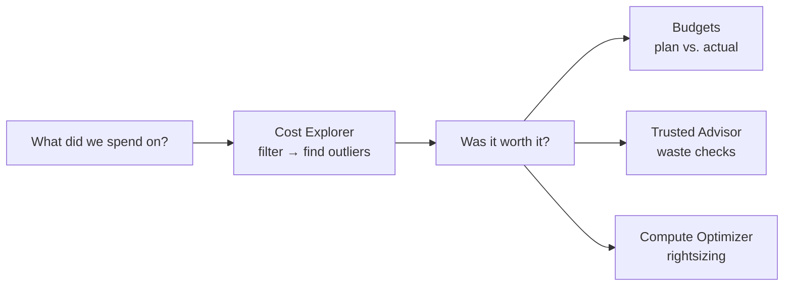
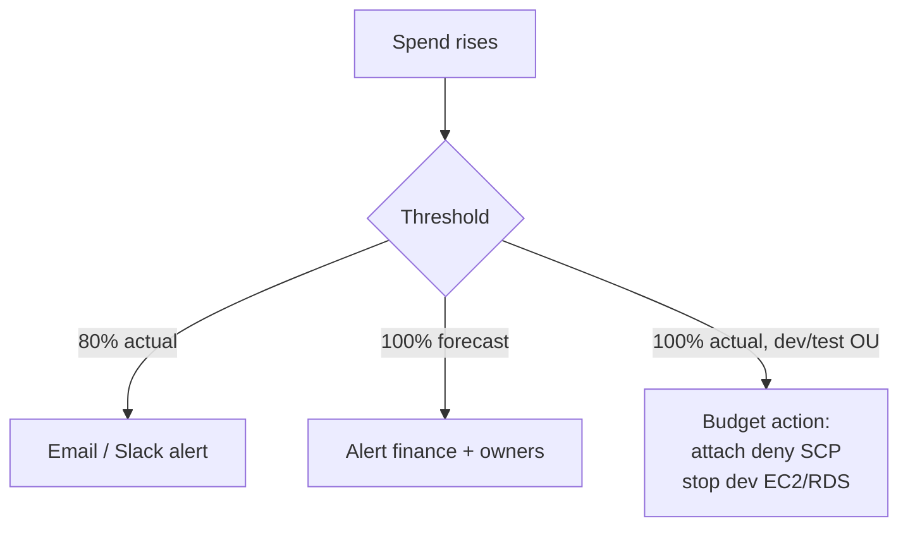

# AWS Cost and Usage Monitoring Tools

> [!abstract] TL;DR
> Cloud doesn't automatically save money. You need to answer two questions: ==what are we paying for, and is it worth it?== Three tools give that visibility:
> - **Cost Explorer**: the first stop. 13 months of history, a 12-month forecast, filters, and saved reports.
> - **AWS Budgets**: ==alerts on actual or forecasted overspend, or under-use of commitments==, plus **budget actions** that apply IAM/SCP denies or stop EC2/RDS.
> - **Trusted Advisor**'s cost checks: idle EC2, RDS, Redshift, and NAT gateways; Lambda timeouts; S3 buckets with no lifecycle policy.

**Lesson:** L3 – Determine Cost and Visibility Strategies · **Previous lesson:** [[Governance and Compliance in Multi-Account Environments]] · **Next:** [[Cost Optimization and Analysis Strategies]]
**Section hub:** [[Designing AWS Architecture for Organizations]]
**Sources:** Videos L3-A01 (Intro to Cost and Visibility Strategies) and L3-A02 (Intro to AWS Cost and Usage Monitoring Tools), en-us transcripts. Material marked *beyond the lecture* is my addition.

> [!todo]- Contents
> 1. [[#1. The Scenario – The CFO Notices the Bill]]
> 2. [[#2. AWS Cost Explorer]]
> 3. [[#3. AWS Budgets]]
> 4. [[#4. Budget Actions – When Warnings Aren't Enough]]
> 5. [[#5. AWS Trusted Advisor – Cost Optimization Checks]]
> 6. [[#6. Worked Example – A Budget Plan for Steady Volatility Partners]]
> 7. [[#7. Pitfalls and Failure Modes]]
> 8. [[#8. Key Takeaways]]
> 9. [[#9. Critical Analysis]]
> 10. [[#10. Self-Test]]
> 11. [[#11. Glossary]]
> 12. [[#12. Further Reading]]

---

## 1. The Scenario – The CFO Notices the Bill

Saving money on IT is a primary driver of cloud adoption. But IT ==can still be expensive in the cloud==. Every business needs to answer **what are we paying for**, and **are we getting business value for it?**

Steady Volatility Partners is growing. Its cloud supports **real-time trading**, **data analytics**, and **HR and administration**. But last quarter the **AWS bill climbed sharply**, and the **CFO** is concerned. Your mandate:

| Do | But remember |
|---|---|
| **Optimize** the infrastructure | The job "isn't just about cutting costs" |
| **Reduce unnecessary** expenses | Support the fund's **competitive edge** |
| Ensure every resource is **fully utilized** | Align spend with **high-stakes performance goals** |

The guiding questions: how do you keep infrastructure ==cost-effective *and* strategically aligned==, avoid pitfalls that cause financial loss, and find opportunities to optimize?

---

## 2. AWS Cost Explorer

> [!note] The bill is usually right
> When a bill is bigger than expected, it's natural to suspect AWS made a mistake. Usually the bill ==accurately reflects the services used==. So the first question is **"what did I spend my money on?"**, followed by **"was it worth it?"**

> [!info]+ Definition – AWS Cost Explorer
> Often the ==first stop== for understanding spend. It lets you **view and analyze** your AWS usage as **charts and graphs**. ^def-cost-explorer

| Feature (lecture) | Detail |
|---|---|
| Enabling | **The first time you open** the Cost Explorer console it's enabled, and past cost data appears **within 24 hours** |
| History | Updates **at least daily**, showing the **preceding 13 months** |
| Forecast | **12-month look-ahead**, based on recent usage trends |
| Filters | **Service**, **Region**, **Availability Zone**, **instance type**, **platform** (Linux/Windows), and **account** |
| Purpose of filtering | Spot **outliers**: high-cost accounts, services, or Regions get the most scrutiny |
| **Saved reports** | Save your preferred report configuration. Your reports sit alongside **built-in reports**: daily/monthly cost breakdowns, **AWS Marketplace** usage, and **Savings Plans / Reserved Instance** usage |

---

## 3. AWS Budgets

The lecture's analogy: when a family spends more than it makes, it **gets on a budget**. Organizations should be clear about **how much they intend to spend** on a workload, and how actual spending compares.

> [!info]+ Definition – AWS Budgets
> Lets you set **planned spend or usage** and get **alerts** when real or forecasted values cross thresholds. It works in **both directions**: ==overuse of resources==, and ==under-use of commitments you've prepaid for==. ^def-budgets

### Budget templates (simplified setup)

| Template (lecture) | Use |
|---|---|
| **Zero spend budget** | Accounts for **testing new ideas**. Notifies if *any* spending occurs beyond the **Free Tier**. |
| **Monthly cost budget** | Accounts with significant expected spend: a **monthly maximum** |
| **Savings Plans / RI utilization** | Checks that **pre-committed** spend is actually **being used** |

### Custom budgets

| Aspect | Options (lecture) |
|---|---|
| **Notification destinations** | **SNS topics**, **email**, chat tools (**Slack**, **Microsoft Teams**) |
| **Triggers** | **Actual** or **forecasted** spend crossing limits |
| **Threshold type** | Fixed **dollar amount** or **percentage** of the budget |
| **Multiple alerts** | E.g. actual at **80%** and **95%**; forecast at **100%, 150%, 200%, 500%** |

> [!example] Commitments need watching
> The instructor's drink-subscription analogy: once you've paid for the subscription, you're **incentivized to use it** to get your money's worth. The same applies to **Reserved Instances and Savings Plans**: 1- or 3-year commitments to cheaper compute. **Custom usage budgets** alert when utilization **falls below a target percentage**, through email, Slack/Teams, or SNS. ^commitment-utilization

---

## 4. Budget Actions – When Warnings Aren't Enough

The lecture's home analogy: "putting the credit cards in a block of ice", turning down the thermostat, switching off lights. **Budget actions** take **active measures**, both **blocking increases** and **turning off cost-generating components**.

| Action type (lecture) | Mechanism | Notes |
|---|---|---|
| **Apply an IAM policy** | Attach a policy, including **deny** permissions, to specific **users, groups, or roles** | E.g. deny creating new expensive resources |
| **Apply an SCP** | Attach an SCP to an **OU** in AWS Organizations | ==Only possible from the organization's management account== ([[Organizational Units and Service Control Policies#4. Service Control Policies – Guardrails, Not Grants]]) |
| **Target EC2 / RDS instances** | Turn off running servers | The lecture says "terminating". *Beyond the lecture:* AWS documents this action as **stopping** the instances. |

> [!warning] Use with care
> - **Permissions:** Budgets needs a **service role** with the right permissions. The AWS documentation lists the required statements.
> - **Production risk:** shutting down servers can hurt **live users**, causing lost business and customer goodwill. It's ==best for dev/test systems== that can stay offline until next month's budget. ^budget-actions-risk

---

## 5. AWS Trusted Advisor – Cost Optimization Checks

> [!info]+ Definition – AWS Trusted Advisor
> Organizes recommendations into categories that make an account more **performant**, **secure**, **fault tolerant**, and **cost-efficient**, among others. Its **cost optimization** category has ==dozens of checks== that flag wasted money. ^def-trusted-advisor

| Check type (lecture) | Examples |
|---|---|
| **Under-utilized resources** | **EC2 instances** and their **EBS volumes**; **Redshift** clusters; **RDS** database servers |
| **Idle managed services** | **NAT gateways** that aren't being used |
| **Other inefficiencies** | **Lambda functions** that frequently hit their **timeout** (wasted compute); **S3 buckets with no lifecycle policy** (costs grow without limit) |

> [!note] Beyond the lecture
> The full Trusted Advisor check set requires a **Business (or higher) Support plan**. Basic accounts see only a limited set.

---

## 6. Worked Example – A Budget Plan for Steady Volatility Partners

*Beyond the lecture.* This applies the lecture's tools to the OU structure from [[Exercise 2 - AWS Control Tower - How To|Lesson 2]].

| Scope | Budget | Alerts | Action |
|---|---|---|---|
| `DeveloperTestArea` accounts | **Zero spend** (beyond Free Tier) | Any spend → developer + manager | — |
| Trading System prod | **Monthly cost**: \$40,000 | Actual 80%, 95%; forecast 100%, 150% → SNS → on-call + finance | **None.** Never auto-stop trading. |
| Market Prediction (GPU training) | **Monthly cost**: \$25,000 | Actual 80%; forecast 100% | At 100% actual: SCP denying **new** `p*`/`g*` instances on the non-prod OU |
| Organization-wide | **Savings Plans utilization** | Below 90% → FinOps | — |

**Forecast thresholds** catch problems early. Suppose spend after 10 days is \$18,000 of a \$40,000 month. A naive linear forecast for a 30-day month gives:

$$
\hat{S}_{30} = 18{,}000 \times \frac{30}{10} = \$54{,}000 = 135\% \text{ of budget}
$$

The 100% forecast alert fires on **day 10**, weeks before the 100% *actual* alert would. (AWS's forecast model is more sophisticated than linear, but the principle holds.)

---

## 7. Pitfalls and Failure Modes

| Failure | Symptom | Mitigation |
|---|---|---|
| Assuming the bill is wrong | Time wasted disputing accurate charges | Start with Cost Explorer: what did we use? |
| Only **actual**-spend alerts | Overspend found after it happened | Add **forecasted** thresholds |
| Unused commitments | Paying for RIs/SPs nobody uses | **Utilization budgets** ([[#^commitment-utilization]]) |
| Budget actions on production | Outage; lost customers | Limit stop/deny actions to **dev/test** ([[#^budget-actions-risk]]) |
| SCP budget action from a member account | Action fails | SCP actions only work from the **management account** |
| Ignoring Trusted Advisor | Idle NAT gateways and unattached EBS volumes keep billing | Review the cost checks regularly |
| Opening Cost Explorer too late | No data on day 1 | Enable it early. It takes up to 24 hours to populate. |

---

## 8. Key Takeaways

- [ ] The core questions: **what are we paying for**, and **is it worth it?**
- [ ] **Cost Explorer:** enabled on first visit (data within 24h), **13 months** of history, **12-month forecast**, filters by service/Region/AZ/instance type/platform, **saved reports**.
- [ ] **Budgets:** templates (**zero spend**, monthly, **SP/RI utilization**) and custom budgets. Alerts on **actual or forecast**, by **\$ or %**, to SNS, email, Slack, or Teams.
- [ ] Budgets watch **under-use of commitments** as well as overspend.
- [ ] **Budget actions:** IAM deny policies, **SCPs (management account only)**, and turning off EC2/RDS. Best for **dev/test**. They need a **service role**.
- [ ] **Trusted Advisor** cost checks: under-used EC2/EBS/Redshift/RDS, idle **NAT gateways**, **Lambda timeouts**, **S3 buckets without lifecycle policies**.

---

## 9. Critical Analysis

- **Visibility isn't optimization.** Cost Explorer and Budgets tell you *that* money is spent. Deciding *whether it's worth it* needs business context: revenue per trading strategy, analyst productivity. The lecture's "competitive edge" framing matters. Cutting GPU spend that funds a profitable model is a loss, not a saving.
- **Budget actions are a governance decision, not a technical one.** Automatically denying spend is safe in sandboxes and dangerous in production. Hedge-fund trading systems should *never* be auto-stopped by a budget. Use alerts plus human decisions there.
- **Forecasts lag regime changes.** Forecasts based on recent trends miss step changes, such as a new model training run. Pair them with [[Cost Optimization and Analysis Strategies#3. AWS Cost Anomaly Detection|anomaly detection]], which looks for deviations rather than trends.
- **Account structure enables cost visibility.** Per-account budgets work *because* Lesson 2 separated workloads into accounts ([[AWS Organizations#^account-isolation]]). Inside a shared account, you need [[Tagging Strategies and Cost Allocation|tags]].

> [!question] Open discussion questions
> 1. Which Steady Volatility Partners accounts, if any, should have budget actions that stop resources? Who should approve that policy?
> 2. How would you measure "business value" for the market-prediction GPU spend?
> 3. Is a zero-spend budget enough for developer sandboxes, or do they also need SCP limits on instance types?

---

## 10. Self-Test

> [!question]- Q1. What two questions does cost visibility answer?
> **What did we spend our money on?** and **Was it worth it?** (Did we get business value?)

> [!question]- Q2. How much history and forecast does Cost Explorer show, and how is it enabled?
> **13 months** of history and a **12-month forecast**. It's enabled the **first time you open** the console, and data appears **within 24 hours**. It then updates at least daily.

> [!question]- Q3. Which budget template suits an account for testing new ideas, and what does it do?
> A **zero spend budget**. It notifies you if **any spending occurs beyond the Free Tier**.

> [!question]- Q4. Why would you budget for under-use rather than overspend?
> To make sure **pre-committed** Savings Plans or Reserved Instances are **actually used**. Unused commitments are wasted money.

> [!question]- Q5. Name three kinds of budget action, and one limitation of each.
> - **IAM deny policy** on users/groups/roles: needs the Budgets service role.
> - **SCP on an OU:** only from the **management account**.
> - **Turning off EC2/RDS:** can disrupt production, so use it on dev/test.

> [!question]- Q6. (Quantitative) A \$10,000 monthly budget has actual alerts at 80% and 95%, and forecast alerts at 100% and 150%. On day 12 of a 30-day month, spend is \$5,200. Using a linear forecast, which alerts have fired?
> Actual: $5{,}200 / 10{,}000 = 52\%$, so neither actual alert has fired. Forecast: $5{,}200 \times 30/12 = \$13{,}000 = 130\%$, so the **100% forecast alert fires**. The 150% one doesn't.

> [!question]- Q7. Name four Trusted Advisor cost checks from the lecture.
> Under-used **EC2/EBS**, **Redshift**, and **RDS**. Idle **NAT gateways**. **Lambda** functions hitting their **timeout**. **S3 buckets with no lifecycle policy**.

> [!question]- Q8. (Design) Developers keep leaving GPU instances running in sandbox accounts over weekends. Design an automated response.
> Give the Sandbox / `DeveloperTestArea` accounts a **monthly cost budget** with forecast alerts. Add a **budget action** at 100% actual that **stops their EC2 instances** and attaches an **SCP denying new GPU instance types** to that OU, run from the management account. Keep production OUs out of scope.

> [!tip] Flashcards
> Review this lesson with [[AWS Cost and Usage Monitoring Tools - Flashcards]].

---

## 11. Glossary

| Term | Meaning |
|---|---|
| AWS Cost Explorer | Charts, filters, forecasts, and saved reports of AWS spend |
| Saved report | A stored Cost Explorer configuration, alongside built-in reports |
| AWS Budgets | Planned spend/usage with alerts and actions |
| Zero spend budget | Alerts on any spend beyond the Free Tier |
| Usage / utilization budget | Tracks whether commitments (SP/RI) are used |
| Forecasted threshold | Alert when *predicted* end-of-period spend crosses a limit |
| Budget action | Automatic IAM/SCP denies or stopping of EC2/RDS when a budget is exceeded |
| AWS Trusted Advisor | Best-practice checks, including cost optimization |
| AWS Free Tier | Free usage allowances for many services |

---

## 12. Further Reading

- [Analyzing your costs with AWS Cost Explorer](https://docs.aws.amazon.com/cost-management/latest/userguide/ce-what-is.html)
- [Managing your costs with AWS Budgets](https://docs.aws.amazon.com/cost-management/latest/userguide/budgets-managing-costs.html)
- [Configuring budget actions](https://docs.aws.amazon.com/cost-management/latest/userguide/budgets-controls.html)
- [AWS Trusted Advisor check reference](https://docs.aws.amazon.com/awssupport/latest/user/trusted-advisor-check-reference.html)
