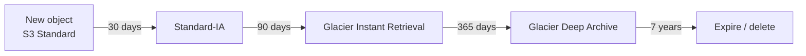

# AWS Purchasing Options and Rightsizing

> [!abstract] TL;DR
> The three big cloud cost drivers are **compute, storage, and data transfer**.
>
> **Compute.** EC2 offers three main ways to pay:
> - ==On-Demand==: full price, no commitment, for **unpredictable** demand.
> - ==Savings Plans / Reserved Instances==: commit for 1 or 3 years. About **30%** off, up to **72%** with prepayment, for **steady** demand.
> - ==Spot==: about **70–90%** off spare capacity, reclaimable with a **2-minute warning**, for **interruptible** work.
>
> AWS now recommends **Savings Plans** over RIs. They're more flexible but **don't reserve capacity**. Zonal RIs do.
>
> **Storage.** S3 trades cost against access frequency, availability, and latency. The classes are Standard, Standard-IA, One Zone-IA, the Glacier tiers, and Intelligent-Tiering, with minimum storage durations of 30, 90, or 180 days. **Lifecycle policies** move and **expire** objects. **Storage Lens** shows usage across buckets. **Volume tiers** get cheaper as usage grows.

**Lesson:** L3 – Determine Cost and Visibility Strategies · **Previous:** [[Cost Optimization and Analysis Strategies]] · **Next:** [[Tagging Strategies and Cost Allocation]]
**Section hub:** [[Designing AWS Architecture for Organizations]]
**Sources:** Video L3-A04 (AWS Purchasing Options and Rightsizing), en-us transcript. The video names **data transfer** as a cost driver but doesn't develop it, so section 9 is *beyond the lecture*. Rightsizing tools are in [[Cost Optimization and Analysis Strategies#2. AWS Compute Optimizer]].

> [!todo]- Contents
> 1. [[#1. The Three Cost Drivers]]
> 2. [[#2. EC2 Purchasing – The Bowling Alley]]
> 3. [[#3. Reserved Instances vs. Savings Plans]]
> 4. [[#4. Spot Instances]]
> 5. [[#5. Choosing a Purchasing Option]]
> 6. [[#6. S3 Storage Classes]]
> 7. [[#7. Lifecycle Policies, Intelligent-Tiering, and Storage Lens]]
> 8. [[#8. S3 Volume Discounts]]
> 9. [[#9. Data Transfer]]
> 10. [[#10. Worked Example – A Compute Portfolio for Steady Volatility Partners]]
> 11. [[#11. Pitfalls and Failure Modes]]
> 12. [[#12. Key Takeaways]]
> 13. [[#13. Critical Analysis]]
> 14. [[#14. Self-Test]]
> 15. [[#15. Glossary]]
> 16. [[#16. Further Reading]]

---

## 1. The Three Cost Drivers

| Driver (lecture) | What you pay for |
|---|---|
| **Compute** | Server processing power to run programs and software-driven tasks |
| **Storage** | Devices holding customer data for long-term use |
| **Data transfer** | Networking hardware carrying data from place to place |

Economizing on each is an important part of **solution design**, not just of operations. EC2 has grown from **one instance type at one hourly price** to **hundreds of types**, each payable in several ways.

---

## 2. EC2 Purchasing – The Bowling Alley

The lecture imagines AWS opening a bowling alley:

| Bowling scenario | EC2 option | Commitment | Price | Who benefits, and how |
|---|---|---|---|---|
| Walk in with a buddy, pay for a lane, bowl an hour, leave | **On-Demand** | None. Start and stop anytime; billing stops when you stop. | **Full retail** | You get total flexibility. The owner gets no guarantee you'll return. |
| Start an **office bowling league** that plays twice a week | **Savings Plans / Reserved Instances** | 1 or 3 years | **About 30% off**, up to **72%** with prepayment | The owner gets predictable demand. You get a discount, *if you show up*. |
| Your **favorite uncle** lets you bowl cheap, but takes the lane back if paying customers arrive | **Spot** | None, but **interruptible** | **About 70% off**, sometimes **80–90%** | The owner earns revenue from idle lanes. You play cheaply, with rare interruptions. |

> [!info]+ Definition – On-Demand Instance
> Compute you get ==instantly, with no long-term commitment==, at **full price**. It runs until you stop it, and billing stops when it stops. ^def-on-demand

> [!warning] Commitments only pay if you use them
> Paying for the league and staying home wastes money. If you buy Savings Plans or RIs, ==track utilization with AWS Budgets== ([[AWS Cost and Usage Monitoring Tools#^commitment-utilization]]). ^use-your-commitment

**Discount mechanics (lecture):**
- The **basic discount** (about **30%**) comes just from **committing** to 1 or 3 years.
- **Deeper discounts** (up to **72%**) come from **prepaying** some or all of the cost.

---

## 3. Reserved Instances vs. Savings Plans

| | **Reserved Instances (RIs)** | **Savings Plans (SPs)** |
|---|---|---|
| Age | **Older** approach | **Newer**. ==AWS now recommends them over RIs.== |
| What you commit to | Specific **instance types**, originally in specific **AZs** | A **\$ per hour** of compute spend |
| Scope | **Zonal** (one AZ) or **regional** (any AZ in the Region) | Usage **across Regions** counts toward the commitment |
| Usage above the commitment | — | Billed at **On-Demand** rates |
| Unused commitment | ==The excess reservation is lost== | Unused hourly commitment is still owed |
| Flexibility variants | **Standard**: deepest discount, fixed instance family. **Convertible**: can exchange for other types, smaller discount. | **Compute SP**: EC2 + **Lambda** + **Fargate**. **EC2 Instance SP**: EC2 only. **SageMaker SP**: ML resources. |
| **Capacity reservation** | ==**Zonal RIs reserve capacity**==, so you won't find that type sold out | ==**No capacity reservation**==. The type you want could be unavailable at that moment. |

^ri-vs-sp

> [!tip] Capacity is the hidden differentiator
> AWS doesn't keep idle hardware set aside for Savings Plans customers. For a workload that **must** get a specific instance type in a specific AZ at a specific moment (such as the market open), a **zonal RI** gives a capacity guarantee that a Savings Plan doesn't. (*Beyond the lecture:* **On-Demand Capacity Reservations** can also provide this, alongside a Savings Plan.)

---

## 4. Spot Instances

> [!info]+ Definition – Spot Instance
> Like On-Demand, but ==radically cheaper==: routinely **70%** off, sometimes **80–90%**. It uses AWS's **surplus capacity**: rather than let newly installed hardware sit idle, AWS sells it cheaply. AWS can **reclaim** it with a ==**2-minute warning**== when an RI or On-Demand customer needs it. ^def-spot

| Good Spot workloads (lecture) | Bad Spot workloads |
|---|---|
| **Background batch** processing | Anything where an interruption **disrupts a customer** |
| **Stateless web servers** (alongside non-interruptible ones) | Stateful single instances |
| **Data analytics** tasks | Latency-critical trading execution |
| Certain **containerized** applications | |
| **Graphics rendering** | |

Interruptions "don't happen often, but they can absolutely happen". Run Spot application servers **next to** On-Demand or committed capacity of the same type.

---

## 5. Choosing a Purchasing Option

| Option | Primary benefit | Use for (lecture) |
|---|---|---|
| **On-Demand** | **Limitless flexibility**; no commitment after you stop | **Unpredictable** demand: turn on what you need, turn it off when done |
| **Savings Plans / RIs** | Trade flexibility for **savings** (30%+) | **Consistent** demand, once you've learned the workload's steady baseline |
| **Spot** | Deepest discount | **Anywhere you can get away with it**: needed but not consistent, and early stops are acceptable |

### Break-even utilization for a commitment

Let $P$ be the On-Demand hourly price, $d$ the commitment discount, $H$ the hours in the term, and $u$ the fraction of hours you'd actually need the instance. Commit if:

$$
\underbrace{(1-d)\,P\,H}_{\text{committed, paid every hour}} \;<\; \underbrace{u\,P\,H}_{\text{on-demand, only when used}} \quad\Longleftrightarrow\quad u > 1 - d
$$

| Discount $d$ | Commit if utilization exceeds |
|---|---|
| 30% (no prepay) | **70%** |
| 50% | 50% |
| 72% (max, prepaid) | **28%** |

So a workload running more than **70% of the time** is already worth the basic commitment. Rightsizing **first** keeps you from committing to the wrong size ([[Cost Optimization and Analysis Strategies#8. Critical Analysis]]). ^break-even

---

## 6. S3 Storage Classes

S3 tiers trade **storage cost** against **access frequency**, **availability**, and **latency**.

| Class | Data temperature (lecture) | AZs | Latency | Minimum billed duration | Notes |
|---|---|---|---|---|---|
| **S3 Standard** | **Hot**: accessed **at least monthly** | **Multiple** | ms | None. Deleted files stop billing at month end. | Available while S3 works in at least one AZ |
| **S3 Standard-IA** | **Cool**: accessed **less than monthly** | Multiple | ms | **30 days** | Per-GB **retrieval** fee. Frequent retrieval wipes out the savings. |
| **S3 One Zone-IA** | Cool | **One** | ms | **30 days** | Cheaper. Use only for data you can **recreate** from a more resilient source. |
| **S3 Glacier** tiers | **Archive**: accessed **less than quarterly** | Multiple | **ms (newest tier)** to **minutes–hours (older tiers)** | **90 days** | Faster retrieval costs more |
| **S3 Glacier Deep Archive** | Archive | Multiple | Hours | **180 days** | Cheapest |
| **S3 Intelligent-Tiering** | **Unknown or changing** patterns | Multiple | ms (frequent/infrequent tiers) | — | Small **per-object monitoring** fee. S3 moves objects between frequent, infrequent, and archive tiers **automatically**. |

> [!note] Glacier tier names (*beyond the lecture*)
> **Glacier Instant Retrieval** (ms), **Glacier Flexible Retrieval** (minutes to hours), **Glacier Deep Archive** (hours).

### When does Standard-IA pay off?

*Beyond the lecture, using illustrative prices.* Let $p_s$ and $p_{ia}$ be the per-GB-month storage prices, $r$ the IA retrieval fee per GB, and $f$ the fraction of the data retrieved per month. IA is cheaper when:

$$
p_{ia} + f\,r < p_s \quad\Longleftrightarrow\quad f < \frac{p_s - p_{ia}}{r}
$$

With $p_s = 0.023$, $p_{ia} = 0.0125$, and $r = 0.01$: $f < 1.05$. So you'd need to retrieve **about the whole dataset once a month** before IA stops paying. That's where the lecture's "**less than once a month**" rule of thumb comes from. ^ia-break-even

---

## 7. Lifecycle Policies, Intelligent-Tiering, and Storage Lens

| Feature (lecture) | Use |
|---|---|
| **Lifecycle policy** | Objects become less valuable with **age**, so move them to cheaper classes on a schedule. ==Include **expiration**== so objects are **deleted** when no longer useful. Otherwise storage costs rise **without limit**. (Trusted Advisor flags buckets with no lifecycle policy: [[AWS Cost and Usage Monitoring Tools#5. AWS Trusted Advisor – Cost Optimization Checks]].) |
| **Intelligent-Tiering** | When the access pattern is **unclear or varies**. Automatic tiering for a small per-object fee. |
| **S3 Storage Lens** | **Aggregates usage metrics** across all buckets in an **account** or a whole **organization**. Shows **trends**, gives cost **recommendations**, and spots buckets with **unusual usage** compared with the average. |

*(An example lifecycle policy for trade records, beyond the lecture. The retention period should come from the firm's record-keeping rules.)*

---

## 8. S3 Volume Discounts

S3 prices **fall incrementally** as usage grows. The lecture's **US West (N. California)** prices, as used by Steady Volatility Partners:

| Monthly storage tier | Price per GB (lecture) |
|---|---|
| First **50 TB** | **\$0.026** |
| **50–450 TB** | **\$0.025** |
| Above **450 TB** | Lower again |

Regions differ in price but share the same **tiered structure**. Remember that an **AWS Organization sums S3 usage across all accounts** to reach these tiers ([[AWS Organizations#6. Worked Example – The S3 Volume Discount]]).

**Example:** 120 TB in us-west-1, using 1 TB = 1,000 GB for simplicity:

$$
50{,}000 \times 0.026 + 70{,}000 \times 0.025 = 1{,}300 + 1{,}750 = \$3{,}050 \text{ per month}
$$

That's an effective \$0.0254/GB, compared with \$3,120 if all 120 TB were billed at the first-tier price.

---

## 9. Data Transfer

*Beyond the lecture.* The video names data transfer as a top cost driver but doesn't detail it. These are the patterns from this course's earlier lessons that matter most:

| Transfer | Typical cost behavior | Course link |
|---|---|---|
| Into AWS from the internet | Generally free | — |
| **Out** to the internet | Billed per GB (the largest transfer cost for most) | — |
| Between **AZs** | Billed per GB in each direction | [[AWS Global Infrastructure#7. Critical Analysis]] |
| Through a **NAT gateway** | Per-GB processing fee, on top of transfer | [[Building a VPC]] |
| To S3/DynamoDB via a **gateway endpoint** | No endpoint charge | [[Secure and Private Connectivity#4. VPC Endpoints – The Side Door]] |
| Over **VPN / Direct Connect** to on-premises | Per-GB out; Direct Connect has a lower rate | [[Advanced VPC Connectivity]] |

---

## 10. Worked Example – A Compute Portfolio for Steady Volatility Partners

*Beyond the lecture, with illustrative prices.* The fund's compute has three patterns:

| Workload | Pattern | Option | Why |
|---|---|---|---|
| Trading API + market-data ingestion | 24/7, steady baseline of 20 instances | **Compute Savings Plan** for the baseline + **zonal RI / capacity reservation** for market-open-critical types | Steady → commit. Must get capacity at the open. |
| Intraday burst at market open | 2 hours/day, +10 instances | **On-Demand** | $u = 2/24 \approx 8\%$, far below the 70% break-even |
| Nightly backtests and model training | Interruptible batch | **Spot**, with checkpointing | 70–90% off, and interruptions only delay results |

With a \$1.00/h On-Demand price:

| Component | Hours/month | On-Demand cost | With chosen option |
|---|---|---|---|
| Baseline 20 × 730 h | 14,600 | \$14,600 | SP at 30% off: **\$10,220** |
| Burst 10 × 2 h × 21 days | 420 | \$420 | **\$420** |
| Batch 40 × 6 h × 30 days | 7,200 | \$7,200 | Spot at 70% off: **\$2,160** |
| **Total** | | **\$22,220** | **\$12,800** (about 42% saved) |

---

## 11. Pitfalls and Failure Modes

| Failure | Symptom | Mitigation |
|---|---|---|
| Committing before rightsizing | Paying for oversized commitments | Rightsize first, then commit ([[#^break-even]]) |
| Unused commitments | Low utilization; wasted spend | Utilization budgets ([[#^use-your-commitment]]) |
| Assuming a Savings Plan guarantees capacity | Launch fails, "insufficient capacity" | Zonal RIs or capacity reservations for critical capacity ([[#^ri-vs-sp]]) |
| Spot for customer-facing stateful workloads | Users disrupted on interruption | Only interruptible work, mixed with On-Demand |
| Standard RIs for evolving workloads | Stuck on an obsolete instance family | Convertible RIs or Savings Plans |
| IA for hot data | Retrieval fees exceed savings | Use IA only when retrieval is under about once a month ([[#^ia-break-even]]) |
| Deleting IA/Glacier objects early | Billed for 30/90/180 days anyway | Respect minimum durations in lifecycle design |
| Lifecycle without expiration | Storage cost grows forever | Add expiration rules |
| One Zone-IA for irreplaceable data | Data loss if the AZ fails | Use it only for re-creatable data |

---

## 12. Key Takeaways

- [ ] Cost drivers: **compute, storage, data transfer**.
- [ ] **On-Demand:** full price, no commitment. For **unpredictable** demand.
- [ ] **SP/RI:** 1–3 year commitment, about **30%** off, up to **72%** with prepayment. For **steady** demand. Track utilization.
- [ ] **RIs:** zonal (**reserves capacity**) or regional; **standard** (deepest discount, fixed family) or **convertible** (flexible, smaller discount). Unused reservations are lost.
- [ ] **Savings Plans:** \$/hour commitment across Regions; Compute (EC2/Lambda/Fargate), EC2 Instance, or SageMaker. **No capacity reservation.** AWS's recommended choice.
- [ ] **Spot:** 70–90% off spare capacity, **2-minute** reclaim warning. For batch, analytics, rendering, and stateless or containerized work.
- [ ] Commit when utilization exceeds $1 - d$ (70% at a 30% discount).
- [ ] **S3:** Standard (hot), Standard-IA (cool, 30-day min), One Zone-IA (re-creatable), Glacier (archive, 90-day min), Deep Archive (180-day min), Intelligent-Tiering (unknown patterns).
- [ ] **Lifecycle policies** with **expiration**; **Storage Lens** for org-wide visibility; **volume tiers** (us-west-1: 2.6¢ → 2.5¢ above 50 TB), pooled across the organization.

---

## 13. Critical Analysis

- **Commitments shift risk from AWS to you.** The discount pays you to absorb demand-forecasting risk. A fund whose strategy can be shut down overnight (a regulatory change, a failed model) should keep commitments below its *confident* baseline, not its *current* usage.
- **Savings Plans' flexibility has a price: no capacity guarantee.** For most workloads that's fine. For latency-critical trading at the open, a capacity shortfall costs more than any discount. The lecture's capacity point is the most underrated distinction in the section.
- **Spot needs architecture, not just a checkbox.** Workloads must handle the 2-minute notice by checkpointing training, draining connections, or using diversified instance pools. The savings are real, but the engineering cost belongs in the comparison.
- **Storage savings compound; storage waste compounds too.** Without expiration, S3 cost grows every month for every object ever written. Lifecycle policies are one of the few *permanent* optimizations.
- **The lecture's prices are a snapshot.** The \$0.026/\$0.025 us-west-1 prices and the percentages are illustrative and change over time. Use the AWS Pricing Calculator for real decisions.

> [!question] Open discussion questions
> 1. How much of Steady Volatility Partners' baseline would you cover with Savings Plans: 50%, 80%, or 100%? What's the downside of each?
> 2. Should model training use Spot, given that a delayed model might mean a missed trading opportunity?
> 3. Design a lifecycle policy for raw market tick data that analysts query heavily for 30 days, rarely for a year, and must keep for 7 years.

---

## 14. Self-Test

> [!question]- Q1. Name the three main IT and cloud cost drivers.
> **Compute**, **storage**, and **data transfer**.

> [!question]- Q2. Match each bowling-alley scenario to an EC2 purchasing option.
> - Walk in and pay per lane: **On-Demand**.
> - Office bowling league: **Savings Plans / Reserved Instances**.
> - The favorite uncle's cheap but reclaimable lane: **Spot**.

> [!question]- Q3. What discounts come from committing, and from prepaying?
> About **30%** for committing to 1 or 3 years. Up to **72%** with partial or full **prepayment**.

> [!question]- Q4. Give three differences between Reserved Instances and Savings Plans.
> - **RIs** commit to instance types, can be **zonal** (with **capacity reservation**) or regional, and come as standard or convertible.
> - **SPs** commit to **\$/hour**, apply **across Regions**, cover EC2/Lambda/Fargate (Compute SP), and **don't reserve capacity**.
> - AWS **recommends SPs**.

> [!question]- Q5. How much warning do Spot Instances get, and what workloads suit them?
> **Two minutes.** Interruptible work: **batch processing, data analytics, rendering, stateless web servers, and some containerized apps**, ideally alongside non-interruptible capacity.

> [!question]- Q6. (Quantitative) A workload runs 16 hours a day. Is a 1-year Savings Plan at 30% off worth it?
> $u = 16/24 \approx 67\%$. Break-even is $u > 1 - 0.30 = 70\%$. **Slightly not worth it.** On-Demand for just the 16 hours costs less than paying the committed rate for all 24. At 40% off (break-even 60%), it would be worth it.

> [!question]- Q7. (Quantitative) 10 GB is stored in Standard-IA and deleted after 12 days. How many days are billed, and why?
> **30 days.** Standard-IA has a **30-day minimum storage duration**.

> [!question]- Q8. Which S3 class suits data with an unknown or changing access pattern, and what's the trade-off?
> **S3 Intelligent-Tiering.** It moves objects between tiers automatically, for a **small per-object monitoring fee**.

> [!question]- Q9. (Design) The market-data archive grows 5 TB a month and is never deleted. What's wrong, and what fixes it?
> Without **expiration**, storage cost rises **without limit**. Add a **lifecycle policy**: transition to Standard-IA, then Glacier tiers as access declines, with **expiration** at the end of the required retention period. Monitor with **Storage Lens**.

> [!tip] Flashcards
> Review this lesson with [[AWS Purchasing Options and Rightsizing - Flashcards]].

---

## 15. Glossary

| Term | Meaning |
|---|---|
| On-Demand Instance | Pay-as-you-go EC2 at full price, no commitment |
| Reserved Instance (RI) | Discount for committing to instance types for 1–3 years |
| Zonal / regional RI | RI tied to one AZ (reserves capacity) / usable across a Region's AZs |
| Standard / convertible RI | Fixed family, deepest discount / exchangeable, smaller discount |
| Savings Plan (SP) | Discount for committing to \$/hour of compute for 1–3 years |
| Compute / EC2 Instance / SageMaker SP | SP covering EC2+Lambda+Fargate / EC2 only / SageMaker |
| Spot Instance | Deeply discounted spare capacity, reclaimable with a 2-minute warning |
| Capacity reservation | Guarantee that instance capacity is available |
| S3 Standard / Standard-IA / One Zone-IA | Hot / cool multi-AZ / cool single-AZ storage classes |
| S3 Glacier / Deep Archive | Archive tiers, with 90- and 180-day minimums |
| S3 Intelligent-Tiering | Automatic tiering for a per-object monitoring fee |
| Minimum storage duration | Days billed even if the object is deleted earlier |
| Lifecycle policy | Rules to transition and expire objects by age |
| S3 Storage Lens | Organization-wide S3 usage metrics and recommendations |

---

## 16. Further Reading

- [Amazon EC2 pricing options](https://aws.amazon.com/ec2/pricing/)
- [What are Savings Plans](https://docs.aws.amazon.com/savingsplans/latest/userguide/what-is-savings-plans.html)
- [Reserved Instances](https://docs.aws.amazon.com/AWSEC2/latest/UserGuide/ec2-reserved-instances.html)
- [Spot Instances](https://docs.aws.amazon.com/AWSEC2/latest/UserGuide/using-spot-instances.html)
- [Amazon S3 storage classes](https://aws.amazon.com/s3/storage-classes/)
- [Managing the lifecycle of objects](https://docs.aws.amazon.com/AmazonS3/latest/userguide/object-lifecycle-mgmt.html)
- [Amazon S3 Storage Lens](https://docs.aws.amazon.com/AmazonS3/latest/userguide/storage_lens.html)
