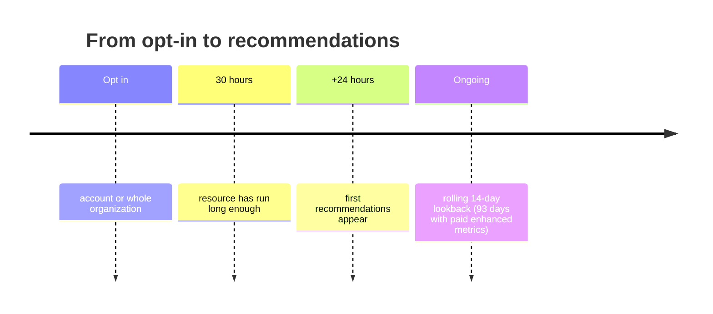

# Cost Optimization and Analysis Strategies

> [!abstract] TL;DR
> Two analysis tools go beyond "what did we spend":
> - **AWS Compute Optimizer** answers ==which instance type or size *should* this workload use?== It's opt-in and free (14-day lookback; 93 days with paid enhanced metrics). It reads CPU, GPU, memory, network, and storage use and labels each resource **under-provisioned**, **over-provisioned**, or **optimized**. For non-optimal resources it suggests a better type, with **estimated savings** and a **performance-risk** percentage.
> - **AWS Cost Anomaly Detection** catches ==spend that's unusual for *you*==: new services, new Regions, or spikes. It watches through **cost monitors** scoped by service, linked account, cost allocation tag, or cost category.
>
> From the lab demo, the **Cost Optimization Hub** consolidates savings recommendations across accounts.

**Lesson:** L3 – Determine Cost and Visibility Strategies · **Previous:** [[AWS Cost and Usage Monitoring Tools]] · **Next:** [[AWS Purchasing Options and Rightsizing]]
**Section hub:** [[Designing AWS Architecture for Organizations]]
**Sources:** Video L3-A03 (Cost Optimization and Analysis Strategies) and the tool tour in L3-A06 (Exercise 1 Demo), en-us transcripts. The caption once says "Compute **Analyzer**", which is a slip for Compute Optimizer. Material marked *beyond the lecture* is my addition.

> [!todo]- Contents
> 1. [[#1. The Rightsizing Problem]]
> 2. [[#2. AWS Compute Optimizer]]
> 3. [[#3. AWS Cost Anomaly Detection]]
> 4. [[#4. Cost Optimization Hub and the Free Tier Page]]
> 5. [[#5. Worked Example – Reading a Compute Optimizer Finding]]
> 6. [[#6. Pitfalls and Failure Modes]]
> 7. [[#7. Key Takeaways]]
> 8. [[#8. Critical Analysis]]
> 9. [[#9. Self-Test]]
> 10. [[#10. Glossary]]
> 11. [[#11. Further Reading]]

---

## 1. The Rightsizing Problem

EC2 users face **hundreds of instance types**. RDS, container applications, and even **Lambda** pose the same question: what size or configuration does this workload really need?

> [!info]+ Definition – Rightsizing
> Matching each resource's type and size to its **actual measured demand**: not so small that performance suffers, not so large that money is wasted. (The term comes from the A04 video title and is AWS's standard term.) ^def-rightsizing

---

## 2. AWS Compute Optimizer

> [!info]+ Definition – AWS Compute Optimizer
> A service that advises on ==the right resources for each workload==. It covers EC2 and similar compute, RDS, containers, and Lambda. ^def-compute-optimizer

### Setup and timing (lecture)

| Aspect | Detail |
|---|---|
| Enabled by default? | **No.** Opt in for **one account** or **all accounts in an organization** |
| First recommendations | Up to **24 hours** after the needed data is gathered |
| Data requirement | Many compute recommendations need the resource to have run for **30 hours** |
| Lookback window | The last **14 days** of data |
| Cost | **Free** |
| Paid option | **Enhanced infrastructure metrics**: analyzes **93 days** of history, for an extra charge |

### Inputs and outputs (lecture)

| Inputs (EC2 and similar) | Outputs |
|---|---|
| **CPU** utilization | A **finding**: ==under-provisioned==, ==over-provisioned==, or ==optimized== |
| **GPU** utilization | For non-optimal resources: the **best-fit instance type** |
| **Memory** usage | **Estimated monthly savings** from switching |
| **Network** consumption | **Performance risk %**: the chance the new type can't handle the workload |
| **Storage** (EBS volumes, instance store) | |

> [!warning] Memory needs an agent (*beyond the lecture*)
> EC2 doesn't report **memory** use by default. Compute Optimizer only sees it if the **CloudWatch agent** publishes memory metrics. Without them, memory-bound recommendations are less reliable.

> [!note] Lab detail (Exercise 1 demo)
> **Rightsizing preferences** let you choose Regions and instance families. The exercise sheet sets a **32-day lookback**, optimizes for **maximum savings**, and limits recommendations to the **GPU and ML-accelerator families** used by the trading system: **P** and **G** (GPU), **Trn** (AWS Trainium), and **Inf** (AWS Inferentia). See [[Exercise 1 - Using AWS Cost Explorer - How To]].

---

## 3. AWS Cost Anomaly Detection

> [!question] The core difficulty
> "Today's normal behavior will look very different from normal behavior in six months." How do you spot **truly unusual** spending while allowing for **normal growth**?

> [!info]+ Definition – AWS Cost Anomaly Detection
> Monitors for **sudden, surprising changes** in spending patterns, using a model of *your* normal behavior that adapts as you grow. ^def-anomaly-detection

**What counts as an anomaly (lecture):**
- a service that has **never been used** before
- spending in a **Region you've never used**
- **unusually high** spend on a service you use regularly

### Cost monitor types

Anomaly detection starts by choosing a **cost monitor**:

| Monitor type | Watches | Choose when (lecture) |
|---|---|---|
| **AWS services** | Each service's trend **separately** | You want per-service anomalies in an account |
| **Linked account** | The **aggregated spend** of a whole account | The account belongs to one **workload or department** |
| **Cost allocation tag** | Spend grouped by a tag value | Workloads share accounts but are tagged ([[Tagging Strategies and Cost Allocation]]) |
| **Cost category** | Spend grouped by a cost category | You've defined business groupings in billing |

**Alert subscriptions (from the demo):** daily or weekly summaries, or individual alerts. The **threshold** can be a **dollar amount** above expected spend or a **percentage**. The demo used **more than 10% above expected**.

> [!tip] Budgets vs. anomaly detection
> **Budgets** compare spend to a **number you set**. **Anomaly detection** compares spend to **your own learned pattern**. A \$500 spike in a new Region can be invisible to a \$40,000 budget but obvious to anomaly detection. ^budgets-vs-anomaly

---

## 4. Cost Optimization Hub and the Free Tier Page

*From the Exercise 1 demo, not the A03 lecture.*

| Tool | What the demo showed |
|---|---|
| **Cost Optimization Hub** | On first use, choose which accounts to include. The instructor recommends **all accounts in the organization**. It lists **savings opportunities** (beyond the lecture: rightsizing, idle resources, Savings Plans/RI purchases, deduplicated across sources). **Export** the recommendations regularly. |
| **Free Tier page** (Billing) | Shows **how much of each Free Tier allowance** you've used. For example, SNS: 16,000 of 1 million free requests; KMS: 233 of 20,000. More usage of those services wouldn't change the bill. |

---

## 5. Worked Example – Reading a Compute Optimizer Finding

*Beyond the lecture.* These are illustrative numbers in the format Compute Optimizer reports.

| Field | Market-prediction training node | Trading API server |
|---|---|---|
| Current type | `p3.8xlarge` (4 GPUs) | `c6i.large` |
| Finding | **Over-provisioned**: GPU about 22%, CPU about 15% | **Under-provisioned**: CPU above 90% at market open |
| Recommendation | `p3.2xlarge` (1 GPU) | `c6i.xlarge` |
| Est. monthly savings | about \$6,700 | −\$62 (costs more) |
| Performance risk | Medium | Very low |

**Expected value of acting on the training node.** If the performance risk translates to roughly $p$ = 20% chance the smaller node slows training enough to need a revert, and a revert costs about \$500 of engineering time:

$$
E[\text{net saving}] = 6{,}700 - 0.20 \times 500 = \$6{,}600 \text{ per month}
$$

The trading API recommendation *raises* cost, but under-provisioning at market open risks missed trades. Rightsizing is about **fit**, not just cutting.

---

## 6. Pitfalls and Failure Modes

| Failure | Symptom | Mitigation |
|---|---|---|
| Never opting in to Compute Optimizer | No recommendations | Opt in, ideally organization-wide |
| Expecting recommendations immediately | "It shows nothing" | Allow 30 hours of runtime + up to 24 hours |
| No memory metrics | Recommendations ignore memory pressure | Install the CloudWatch agent (*beyond the lecture*) |
| 14-day window misses monthly peaks | Downsized instance struggles at month-end | Enhanced infrastructure metrics (93 days) for cyclical workloads |
| Acting on savings while ignoring risk % | Performance incidents | Weigh performance risk, and test before production |
| Only using Budgets | Small but unusual spend goes unnoticed | Add anomaly monitors ([[#^budgets-vs-anomaly]]) |
| Wrong monitor granularity | Anomalies drowned in aggregate spend | Per-service monitors for shared accounts; linked-account monitors for workload accounts |

---

## 7. Key Takeaways

- [ ] **Compute Optimizer** recommends the right resources for EC2, RDS, containers, and Lambda.
- [ ] It's **opt-in** (account or organization) and **free**. Recommendations take up to **24h**, need **30 hours** of runtime, and use a **14-day** lookback. Paid **enhanced infrastructure metrics** give **93 days**.
- [ ] Inputs: **CPU, GPU, memory, network, storage**. Outputs: **under-provisioned / over-provisioned / optimized**, a recommended type, **estimated savings**, and **performance risk %**.
- [ ] **Cost Anomaly Detection** flags **new services, new Regions, and unusual spikes**, while allowing for normal growth.
- [ ] Monitor types: **AWS services**, **linked account**, **cost allocation tag**, **cost category**.
- [ ] *(Demo)* **Cost Optimization Hub** consolidates savings opportunities, so opt in all organization accounts. The **Free Tier** page shows allowance usage.

---

## 8. Critical Analysis

- **Recommendations are only as good as the window.** Fourteen days captures weekly cycles but not month-end, quarter-end, or annual events. A trading firm has many such cycles. The 93-day paid tier is worth it where cyclical peaks matter.
- **Rightsizing interacts with commitments.** Downsizing instances covered by a **standard RI** can *waste* the reservation. Rightsize **before** buying commitments, which is why the course covers [[AWS Purchasing Options and Rightsizing|purchasing options]] next.
- **Anomaly detection trades sensitivity for noise.** A 10% threshold on a volatile service will alert constantly. Teams should tune thresholds per monitor and route alerts to the **owning team**. That routing relies on tags or account structure.
- **GPU workloads are the high-leverage target.** For an ML-heavy quant fund, P/G/Trn/Inf instances dominate the bill. The demo's preference to include them reflects where the money is. (*Beyond the lecture:* Trainium and Inferentia are AWS-designed chips that can be much cheaper per unit of ML work than general-purpose GPUs, if the models support them.)

> [!question] Open discussion questions
> 1. Should rightsizing recommendations for production trading systems be applied automatically? What review process would you require?
> 2. Which cost monitor type fits Steady Volatility Partners best, given its account-per-workload structure from Lesson 2?
> 3. How would you tell a genuine anomaly from a planned model-training run? Can tags help?

---

## 9. Self-Test

> [!question]- Q1. When will you see your first Compute Optimizer recommendations after opting in?
> Resources usually need about **30 hours** of runtime data, then generating recommendations can take up to **24 hours**.

> [!question]- Q2. What are the three possible Compute Optimizer findings, and what accompanies a recommendation?
> **Under-provisioned**, **over-provisioned**, or **optimized**. A recommendation includes the **best-fit instance type**, **estimated monthly savings**, and a **performance risk percentage**.

> [!question]- Q3. What does enhanced infrastructure metrics change?
> The analysis window goes from **14 days to 93 days**, for an **extra charge**.

> [!question]- Q4. Give three examples of cost anomalies from the lecture.
> Use of a **never-used service**, spending in a **never-used Region**, and **unusually high spend** on a regularly used service.

> [!question]- Q5. When should you choose a linked-account monitor instead of an AWS services monitor?
> When the account belongs to a **single workload or department**, so its **aggregated** spend is what matters. AWS services monitors track each service separately.

> [!question]- Q6. (Quantitative) Compute Optimizer suggests moving 12 instances from \$1.20/h to \$0.60/h, with a performance risk such that about 2 of the 12 will need to move back. How much do you save per month, using 730 hours?
> Savings on 10 instances: $10 \times 0.60 \times 730 = \$4{,}380$ per month. The 2 reverted instances save nothing once moved back. So about **\$4,380 a month**, versus \$5,256 if all 12 worked.

> [!question]- Q7. (Design) A \$300/day charge appears in a Region nobody uses, and the monthly budget doesn't alert. Why not, and what catches it?
> \$300/day may sit well within the overall **budget**, which compares to a fixed number. **Cost Anomaly Detection** flags spend in a **never-used Region** as unusual for *your* pattern, so add an AWS services or linked-account monitor with alerts.

> [!tip] Flashcards
> Review this lesson with [[Cost Optimization and Analysis Strategies - Flashcards]].

---

## 10. Glossary

| Term | Meaning |
|---|---|
| Rightsizing | Matching resource type and size to actual demand |
| AWS Compute Optimizer | Recommends right-sized compute using utilization data |
| Enhanced infrastructure metrics | Paid Compute Optimizer option with a 93-day lookback |
| Under- / over-provisioned | Resource too small / too large for its workload |
| Performance risk | Compute Optimizer's estimate that a recommended type can't keep up |
| AWS Cost Anomaly Detection | ML-based detection of unusual spend |
| Cost monitor | Defines what Anomaly Detection watches: services, account, tag, or category |
| Cost category | Billing rule grouping costs into business categories |
| Cost Optimization Hub | Consolidated savings recommendations across accounts |
| Trainium / Inferentia | AWS ML chips for training and inference (Trn/Inf instance families) |

---

## 11. Further Reading

- [What is AWS Compute Optimizer](https://docs.aws.amazon.com/compute-optimizer/latest/ug/what-is-compute-optimizer.html)
- [Detecting unusual spend with AWS Cost Anomaly Detection](https://docs.aws.amazon.com/cost-management/latest/userguide/manage-ad.html)
- [Cost Optimization Hub](https://docs.aws.amazon.com/cost-management/latest/userguide/cost-optimization-hub.html)
