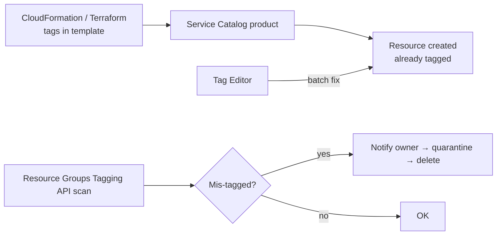
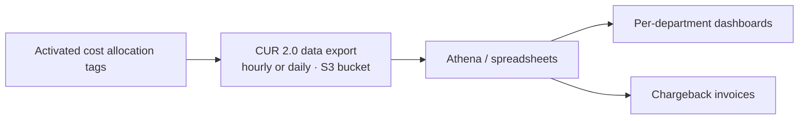

# Tagging Strategies and Cost Allocation

> [!abstract] TL;DR
> Finding an expensive resource is only half the job. You also need to know ==what it's for, who owns it, and who pays==. **Tags** (key–value pairs, up to **50** per resource, **case-sensitive**, never for secrets or personal data) carry that context.
> - **Apply them** at creation (ideally through **IaC** and **Service Catalog**), or afterwards with **Tag Editor**.
> - **Find gaps** with the **Resource Groups Tagging API**. Some enterprises **quarantine or delete** untagged resources.
> - **Activate cost allocation tags** (AWS-generated and user-defined) so they appear in billing data.
> - **Enforce** with **AWS Config** (detect and remediate) and **SCPs** (prevent).
> - **Deliver** the **Cost and Usage Report (CUR 2.0)** through Data Exports, so finance can charge spend back to teams.

**Lesson:** L3 – Determine Cost and Visibility Strategies · **Previous:** [[AWS Purchasing Options and Rightsizing]]
**Section hub:** [[Designing AWS Architecture for Organizations]]
**Sources:** Videos L3-A05 (Developing Tagging Strategies and Cost Allocation) and L3-A08 (Lesson Review), en-us transcripts. Tag policies are shown in the [[Exercise 2 - Implementing Tagging and Reporting Strategies - How To|Exercise 2 demo]], not the A05 lecture. Material marked *beyond the lecture* is my addition.

> [!todo]- Contents
> 1. [[#1. The Whose-Instance-Is-This Problem]]
> 2. [[#2. Tags – Rules of the Road]]
> 3. [[#3. Designing a Tag Schema]]
> 4. [[#4. Applying Tags]]
> 5. [[#5. Cost Allocation Tags]]
> 6. [[#6. Enforcing Tagging]]
> 7. [[#7. The Cost and Usage Report]]
> 8. [[#8. Worked Example – Showback for Steady Volatility Partners]]
> 9. [[#9. Pitfalls and Failure Modes]]
> 10. [[#10. Key Takeaways]]
> 11. [[#11. Critical Analysis]]
> 12. [[#12. Self-Test]]
> 13. [[#13. Glossary]]
> 14. [[#14. Further Reading]]

---

## 1. The Whose-Instance-Is-This Problem

Spotting over-budget resources isn't the end. You can't just turn off expensive things. Resources are often created by someone who then **forgets** them. The lecture's dialogue, paraphrased:

> [!quote] Paraphrasing the lecture
> "Whose instance is this? It costs \$4 an hour. Can I turn it off?" — "Ed went on vacation last week, maybe it's his." — "It could be production for that big new client… just leave it running until he's back."

At \$4/h, a week of not knowing costs $4 \times 24 \times 7 = \$672$.

The questions a resource should be able to answer about itself (lecture):

| Question | Example tag key (SVP-prefixed) |
|---|---|
| Who **created** it? | `aws:createdBy` (AWS-generated) |
| Which **project / workload / application**? | `SVP:Project` |
| Which **department**? | `SVP:Department` |
| **Dev/test** or **production**? | `SVP:Environment` |
| Whom do we **contact** with questions? | `SVP:Owner` |
| Which **cost center** pays? | `SVP:CostCenter` |
| Can it be **turned off at night or on weekends**? | `SVP:Schedule` |

---

## 2. Tags – Rules of the Road

> [!info]+ Definition – Tag
> Metadata attached to a resource as a **key–value pair**: a **key** (the name) and a **value** (the data). Tags explain ==why a resource matters and how it fits into your IT environment==. Resources can be tagged **at creation** or **later**. ^def-tag

| Rule (lecture) | Detail |
|---|---|
| **Limit** | Up to **50 unique tags** on most resources |
| **Case-sensitive** | `CostCenter` ≠ `costcenter`. Decide capitalization and naming standards **before** you start. |
| **AWS-reserved prefix** | Tags AWS applies automatically start with lowercase **`aws:`** |
| **Not for secrets** | Tags **aren't encrypted**, so never store sensitive or confidential data in them |
| **Not for personal data** | No personal information about people |
| **Custom prefix** | Prefix your tags to mark them as yours, e.g. Steady Volatility Partners' `SVP:` keys |

^tag-rules

**What tags are for (lecture):** **cost allocation**, **automation**, **resource organization**, and **access control**, by referencing tags in **IAM policies**. (*Beyond the lecture:* this is called attribute-based access control, or ABAC.)

---

## 3. Designing a Tag Schema

*Beyond the lecture.* A small mandatory set, with controlled values, beats a large optional one.

| Key | Required? | Allowed values | Used by |
|---|---|---|---|
| `SVP:CostCenter` | **Yes** | `0001`, `0002`, `0003` (the Exercise 2 sheet spells the key `svp:costcenter`, lowercase) | Chargeback (CUR), budgets |
| `SVP:Environment` | **Yes** | `Production`, `Test`, `Development` | Budget actions scope, schedules, SCP conditions |
| `SVP:Owner` | **Yes** | Team or user email alias | Contact, cleanup |
| `SVP:Project` | Recommended | Controlled list | Showback, anomaly monitors |
| `SVP:Schedule` | Optional | `24x7`, `business-hours` | Stop/start automation |
| `SVP:DataClass` | Optional | `Public`, `Internal`, `Confidential` | Access control. A label is fine; the data itself is not. |

---

## 4. Applying Tags

| Method (lecture) | When |
|---|---|
| **Console at creation** | Most create wizards have a tag step. EC2 launch is the lecture's example: the logical moment to record project and payer. |
| **CLI / SDK** | Programmatic creation |
| **Tag Editor** | **After the fact**: search resources by **Region**, **resource type**, and **existing tags**, find mis-tagged ones, and **batch-apply** tags |
| ==**Infrastructure as code**== | **CloudFormation** or **Terraform** templates attach tags **automatically** at creation, which is the ideal |
| **Service Catalog products** | Serve those templates to users **without giving them direct access to the templates**. Tags can't be skipped. |
| **Resource Groups Tagging API** | Scripts that **scan** for resources tagged the wrong way |

> [!important] Go further: automated quarantine
> Many cost-conscious enterprises ==automatically quarantine or delete improperly tagged resources==. Knowing that an untagged, ownerless expensive resource may disappear in **days or hours** is a strong incentive to tag. ^auto-quarantine



---

## 5. Cost Allocation Tags

Tracing a resource to its owner is good. ==Allocating portions of the bill to teams== is better. That needs a link between **bill line items** and teams.

> [!info]+ Definition – Cost allocation tag
> A tag you **activate** in Billing so that it becomes a **column in billing reports**. That turns chargeback into "a simple spreadsheeting task". ^def-cost-allocation-tag

| Type (lecture) | Examples |
|---|---|
| **AWS-generated** | A short list AWS can apply to resources you create. *(Demo: `aws:autoscaling:groupName`, `aws:cloudformation:stack-id`, `aws:createdBy`, and the EC2 launch-template ID tag.)* |
| **User-defined** | Your own tags that match your financial management, e.g. `SVP:CostCenter`. *(Demo: `Name`, `Owner`.)* |

> [!warning] Activation isn't retroactive (*beyond the lecture*)
> Activated tags only appear in billing data **from activation onward**, after a delay of up to about 24 hours. Activate them **early**.

---

## 6. Enforcing Tagging

| Tool (lecture) | Mode | How |
|---|---|---|
| **AWS Config** | **Detect + remediate** | A rule checks for a **list of required tags** on key resources, then sends **notifications** and runs **remediation** ([[Centralized Logging and Event Notification#4. AWS Config]]) |
| **Service control policies** | **Prevent** | ==Deny creating a resource== that doesn't follow tagging rules ([[Organizational Units and Service Control Policies]]) |
| **Tag policies** *(Exercise 2 demo)* | **Standardize** | An Organizations policy type ([[AWS Organizations#7. Organization Policy Types]]) that sets the allowed **key capitalization** and **values**, and can **prevent non-compliant tagging operations** on chosen resource types |

> [!warning] Tag policies don't make tags mandatory (*beyond the lecture*)
> A tag policy blocks a **wrong value** (`SVP:CostCenter = 9`) or **wrong case**, but it does **not** stop someone creating a resource with **no** `SVP:CostCenter` tag at all. To *require* the tag, use an **SCP** with a `Null` condition on the request tag:
>
> ```json
> {
>   "Sid": "RequireCostCenterOnEC2",
>   "Effect": "Deny",
>   "Action": "ec2:RunInstances",
>   "Resource": "arn:aws:ec2:*:*:instance/*",
>   "Condition": { "Null": { "aws:RequestTag/SVP:CostCenter": "true" } }
> }
> ```
>
> Combine them: the **SCP** requires the tag, the **tag policy** validates its value, and **Config** catches anything created outside these paths. ^tag-enforcement-layers

---

## 7. The Cost and Usage Report

> [!info]+ Definition – Cost and Usage Report (CUR)
> The ==primary resource your accounting team uses== to understand AWS spend and allocate it to departments. It's the most detailed billing dataset AWS provides. ^def-cur

| Aspect | Detail (lecture) |
|---|---|
| Where | **Billing and Cost Management → Data Exports** → create a new export |
| Versions | **CUR 2.0** is the current standard. Legacy **CUR 1.0** was still available at recording time. |
| Contents | Line items with **activated cost allocation tags** as columns |
| Advanced use | Some organizations build a **whole workload** that regularly generates the CUR, splits it into **stakeholder subsets**, and renders **dashboards**, giving them "the richest possible set of information" about cloud spend |



*(Demo options: **hourly** or **daily** granularity, a choice of file **format**, delivered to an **S3 bucket** under a prefix such as `CostReport/`. See the [[Exercise 2 - Implementing Tagging and Reporting Strategies - How To|Exercise 2 how-to]].)*

---

## 8. Worked Example – Showback for Steady Volatility Partners

*Beyond the lecture.* Monthly bill: **\$100,000**. After activating `SVP:CostCenter`, the CUR shows:

| Cost center | Tagged spend |
|---|---|
| 1 – Trading | \$52,000 |
| 2 – Market Prediction | \$24,000 |
| 3 – HR & Admin | \$6,000 |
| **Untagged** | **\$18,000** |

**Allocation coverage** = $82{,}000 / 100{,}000 = 82\%$.

A common way to spread untagged or shared costs (such as NAT gateways and the Log Archive account) is in **proportion to tagged spend**:

$$
\text{share}_i = \text{tagged}_i + \text{untagged} \times \frac{\text{tagged}_i}{\sum_j \text{tagged}_j}
$$

| Cost center | Tagged | + Proportional share of \$18,000 | Allocated |
|---|---|---|---|
| Trading | \$52,000 | $18{,}000 \times 52/82 = \$11{,}415$ | **\$63,415** |
| Market Prediction | \$24,000 | \$5,268 | **\$29,268** |
| HR & Admin | \$6,000 | \$1,317 | **\$7,317** |

Proportional spreading is a fallback. The real fix is raising coverage toward 95%+ through [[#^tag-enforcement-layers|enforcement]].

---

## 9. Pitfalls and Failure Modes

| Failure | Symptom | Mitigation |
|---|---|---|
| Inconsistent capitalization | `CostCenter`, `costcenter`, and `Cost-Center` show as different columns | Set the standard up front. Tag policies enforce case. |
| Secrets or PII in tags | Exposure (tags aren't encrypted) | Never put sensitive data in tags ([[#^tag-rules]]) |
| Manual tagging only | Coverage decays; "whose instance is this?" | IaC + Service Catalog, scans, quarantine ([[#^auto-quarantine]]) |
| Tags not activated for billing | CUR has no tag columns | Activate cost allocation tags, **early** |
| Relying on tag policies to require tags | Untagged resources still created | SCP `Null` condition to require them ([[#^tag-enforcement-layers]]) |
| Too many optional tags | Nobody fills them in consistently | A small mandatory set with controlled values |
| CUR delivered but unused | Finance still can't charge back | Build Athena or dashboard pipelines per stakeholder |

---

## 10. Key Takeaways

- [ ] Tags answer **what is it, who owns it, who pays, and can it be turned off**.
- [ ] Key–value pairs, up to **50** per resource, **case-sensitive**. `aws:` is reserved. **No secrets or PII.** Use a custom prefix like `SVP:`.
- [ ] Tags support **cost allocation, automation, organization, and access control** (IAM policies).
- [ ] Apply at creation (console, CLI, SDK). Ideally via **IaC + Service Catalog**. Fix later with **Tag Editor**. Scan with the **Resource Groups Tagging API**. Consider **auto-quarantine**.
- [ ] **Activate cost allocation tags** (AWS-generated + user-defined) so they appear in billing.
- [ ] Enforce with **Config** (detect/remediate) and **SCPs** (prevent). *(Demo)* **Tag policies** standardize keys and values.
- [ ] **CUR 2.0** through **Data Exports** is finance's primary chargeback dataset.
- [ ] Lesson review: you can now answer "who does this belong to?", "why are we spending so much?", and "are we getting good value?"

---

## 11. Critical Analysis

- **Tagging is a socio-technical problem.** The tools are simple; the hard part is agreeing on a schema across finance, engineering, and security, and keeping it current through reorganizations. A function-based account structure ([[Organizational Units and Service Control Policies#^ou-by-function]]) plus a few mandatory tags is more robust than an elaborate schema.
- **Account boundaries vs. tags for allocation.** Lesson 2's account-per-workload design already gives clean cost boundaries for free. Tags matter most **inside shared accounts** and for **cross-cutting** dimensions like environment or cost center. Use accounts for the coarse split and tags for the fine split.
- **Automatic deletion needs guardrails.** Quarantining untagged resources is powerful, but deleting a mis-tagged *production* database is catastrophic. Notify, then quarantine (stop or isolate), then delete only after a grace period. Exempt resources protected by explicit tags or OUs.
- **Showback before chargeback.** Showing teams their costs (showback) changes behavior with less friction than billing them (chargeback). The CUR supports both. The organizational choice matters more than the tooling.

> [!question] Open discussion questions
> 1. Which three tags would you make mandatory for Steady Volatility Partners, and why only three?
> 2. How should shared costs (Log Archive account, network hub, NAT gateways) be allocated: evenly, proportionally, or to a central IT cost center?
> 3. What grace period and exemptions would make automated quarantine safe for a trading firm?

---

## 12. Self-Test

> [!question]- Q1. What makes up a tag, and how many can most resources have?
> A **key** (name) and a **value** (data), together a key–value pair. Up to **50** per resource.

> [!question]- Q2. Name four tagging rules from the lecture.
> Tags are **case-sensitive**. AWS-applied tags use the **`aws:`** prefix. **No sensitive data** (tags aren't encrypted). **No personal information.** (Bonus: use a **custom prefix** for your own tags.)

> [!question]- Q3. What tool helps you find and fix mis-tagged resources after creation?
> **Tag Editor**. Search by Region, resource type, and existing tags, then **batch-apply** tags. For automation, use the **Resource Groups Tagging API**.

> [!question]- Q4. What must you do before tags appear in billing reports?
> **Activate** them as **cost allocation tags** in Billing and Cost Management, either AWS-generated or user-defined.

> [!question]- Q5. Which two enforcement tools does the lecture name, and how do they differ?
> **AWS Config** **detects** missing required tags, then notifies and can **remediate**. **SCPs** **prevent** creating resources that don't comply.

> [!question]- Q6. What is the CUR, and where do you create it?
> The **Cost and Usage Report**, finance's primary dataset for understanding and allocating spend. Create it in **Billing and Cost Management → Data Exports**. **CUR 2.0** is current; 1.0 is legacy.

> [!question]- Q7. (Quantitative) A \$60,000 bill has \$45,000 tagged: Team A \$30,000, Team B \$15,000. Allocate the untagged amount proportionally.
> Untagged is \$15,000. A: $30{,}000 + 15{,}000 \times \frac{30}{45} = \$40{,}000$. B: $15{,}000 + 15{,}000 \times \frac{15}{45} = \$20{,}000$. Coverage was 75%.

> [!question]- Q8. (Design) Developers keep launching EC2 instances with no `SVP:CostCenter`, or with invalid values like `CC-9`. Design layered enforcement.
> - An **SCP** denying `ec2:RunInstances` when `aws:RequestTag/SVP:CostCenter` is **null**, which requires the tag.
> - A **tag policy** allowing only values `1`/`2`/`3` with correct case, preventing non-compliant operations.
> - An **AWS Config** required-tags rule with **remediation** for resources created by other paths.
> - **IaC/Service Catalog** templates that set the tag automatically.

> [!tip] Flashcards
> Review this lesson with [[Tagging Strategies and Cost Allocation - Flashcards]].

---

## 13. Glossary

| Term | Meaning |
|---|---|
| Tag | A key–value pair of metadata on a resource |
| `aws:` prefix | Reserved for tags AWS applies automatically |
| Tag Editor | Console tool to search for and batch-tag resources |
| Resource Groups Tagging API | API for finding and tagging resources programmatically |
| Cost allocation tag | Tag activated to appear in billing reports |
| AWS-generated tag | Cost allocation tag AWS applies, e.g. `aws:createdBy` |
| User-defined tag | Your own tag, e.g. `SVP:CostCenter` |
| Tag policy | Organizations policy standardizing tag keys and values |
| Cost and Usage Report (CUR) | The most detailed AWS billing dataset, delivered through Data Exports |
| Showback / chargeback | Showing teams their costs / billing them for their costs |
| ABAC | Attribute-based access control using tags in IAM policies (*beyond the lecture*) |

---

## 14. Further Reading

- [Tagging best practices (whitepaper)](https://docs.aws.amazon.com/whitepapers/latest/tagging-best-practices/tagging-best-practices.html)
- [Using AWS cost allocation tags](https://docs.aws.amazon.com/awsaccountbilling/latest/aboutv2/cost-alloc-tags.html)
- [Tag policies](https://docs.aws.amazon.com/organizations/latest/userguide/orgs_manage_policies_tag-policies.html)
- [What are AWS Data Exports](https://docs.aws.amazon.com/cur/latest/userguide/what-is-data-exports.html)
- [Tag Editor](https://docs.aws.amazon.com/tag-editor/latest/userguide/tag-editor.html)
