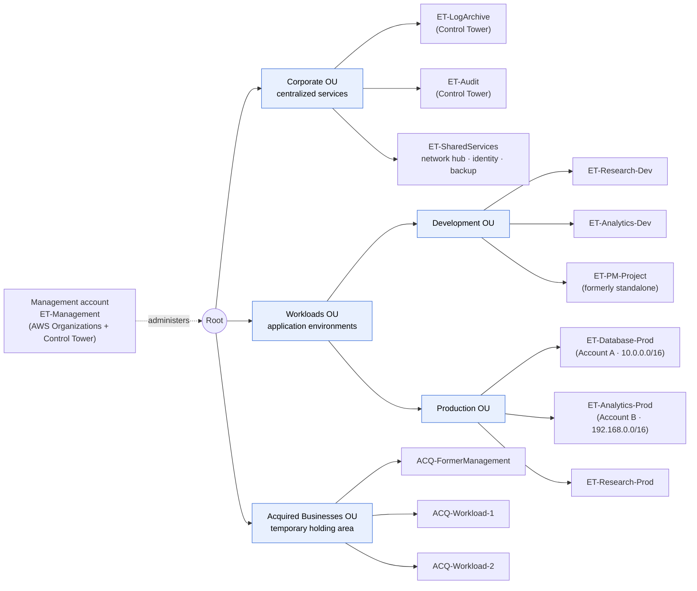
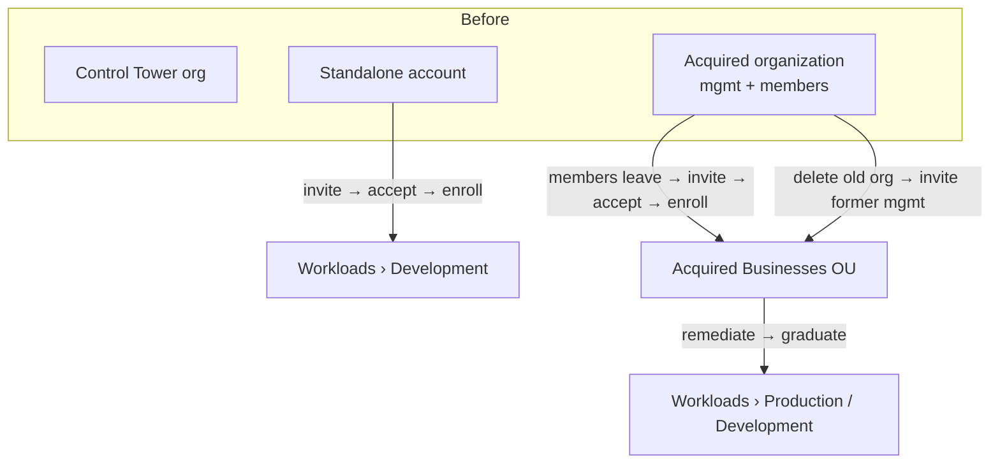
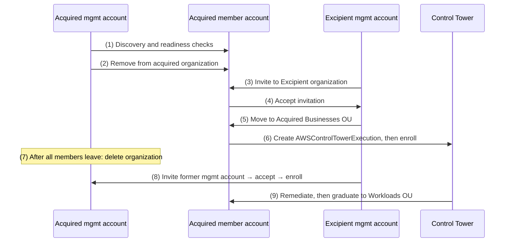
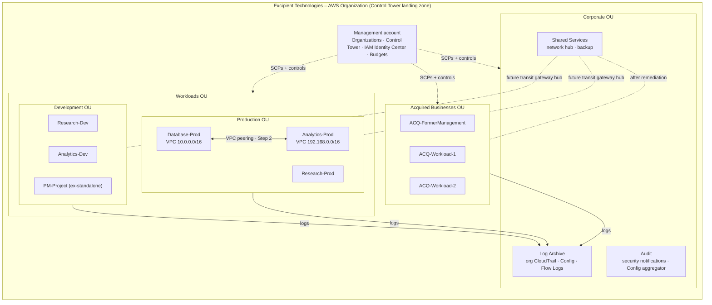

# Step 1 – Multi-Account Architecture Design

**Project:** [[Project Overview]] · **Compiled report:** [[Project Report – Excipient Technologies]]
**Concepts used:** [[AWS Organizations]] · [[Organizational Units and Service Control Policies]] · [[AWS Control Tower]] · [[Governance and Compliance in Multi-Account Environments]]

> [!warning] Draft for your review
> This is a complete draft that meets the rubric. Account names and budget-style figures are **illustrative assumptions** (the scenario doesn't name the accounts). Read it critically and adjust the wording so it's yours before you submit.

---

## Report Section

### Objective

Design a unified multi-account structure for Excipient Technologies. It must absorb a **standalone AWS account** and an **acquired AWS Organizations network** into the existing **AWS Control Tower** landing zone, under common governance.

### Current state

| Environment | Description | Integration challenge |
|---|---|---|
| **Control Tower environment** (target) | Existing landing zone: management account, Log Archive and Audit accounts, governed OUs | Becomes the single organization everything joins |
| **Standalone account** | Built independently by a project manager. Not in any organization and ungoverned. | Must be **invited**, prepared, and **enrolled** in Control Tower |
| **Acquired Organizations network** | A separate organization with its own management account, member accounts, and SCPs | An account can belong to **only one** organization. Each account must **leave** the old organization and **join** Excipient's. |

---

## 1. OU Hierarchy



### OU roles and purpose

| OU | Role and purpose | Accounts | Governance posture |
|---|---|---|---|
| **Root** | Top of the organization. Organization-wide baseline SCPs attach here. | Management account (administers; org SCPs don't apply to it) | Baseline guardrails for everyone |
| **Corporate OU** | **Centralized services**: logging, auditing, and shared infrastructure. This is the Control Tower **foundational OU** holding the Log Archive and Audit accounts (Control Tower lets you name it), plus a Shared Services account for the network hub, identity, and backup. | ET-LogArchive, ET-Audit, ET-SharedServices | Most restricted. Only security and platform teams have access. Mandatory controls protect the logs. |
| **Workloads OU** | **Application environments**: research, analytics, and product development. Split by **function** (environment), not department, so one policy set covers every similar account ([[Organizational Units and Service Control Policies#^ou-by-function]]). | — (parent of the two below) | Encryption, tagging, and identity guardrails shared by Dev and Prod |
| ↳ **Development OU** | Building and testing. Cost-limited. | ET-Research-Dev, ET-Analytics-Dev, **ET-PM-Project** | Instance-type limits and budget actions allowed |
| ↳ **Production OU** | Live and validated workloads (including GxP-regulated systems) | ET-Database-Prod, ET-Analytics-Prod, ET-Research-Prod | Strictest change control. **No** automated stop actions. |
| **Acquired Businesses OU** | **Temporary holding area** for acquired accounts while they're assessed and remediated. Accounts **graduate** to Workloads once compliant. | ACQ-FormerManagement, ACQ-Workload-1, ACQ-Workload-2 | Quarantine-style SCPs: no new internet exposure, no new IAM users |

> [!note] Why this shape
> - It follows AWS's **function-based** OU guidance ([[Organizational Units and Service Control Policies#3. Recommended Top-Level OUs]]). Corporate maps to AWS's *Security + Infrastructure* OUs, Workloads keeps its Prod/Non-prod split, and Acquired Businesses maps to the *Transitional* OU.
> - **Control Tower requirement:** OUs must be **registered** before accounts can be enrolled into them, so all five OUs are registered first ([[AWS Control Tower#2. Control Tower and AWS Organizations]]).

---

## 2. Integration Strategy – Overview



---

## 3. Standalone Account Integration

**Target:** Workloads OU › Development OU. If the assessment shows it already serves production users, it goes to Production instead.

1. **Assess the account** (owner: cloud architect + the project manager)
   - Inventory workloads, VPC CIDRs (check for overlap with the existing plan), IAM users and access keys, and monthly spend.
   - Check for **existing AWS Config recorders and delivery channels** and **CloudTrail trails**. These can conflict with Control Tower enrollment.
   - Secure the **root user**: MFA on, no root access keys. Record the root email owner.
2. **Prepare the landing zone**
   - Confirm the **Workloads** and **Development** OUs are **registered** in Control Tower.
3. **Invite** the account from the **management account**: AWS Organizations → **Add an AWS account → Invite an existing AWS account** (account ID).
4. **Accept** the invitation inside the standalone account: AWS Organizations → **Invitations → Accept**. It's now a member under Root, and consolidated billing starts.
5. **Grant Control Tower access:** create the IAM role **`AWSControlTowerExecution`** in the account, with **AdministratorAccess** and a trust policy for the **management account**.
6. **Resolve conflicts:** remove or adapt the pre-existing Config recorder and delivery channel (or follow AWS's procedure for enrolling accounts with existing Config resources). Keep application trails, but rely on the **organization trail** for audit.
7. **Move the account** to **Workloads › Development** (Organizations → Actions → Move).
8. **Enroll** it in Control Tower (Organization view → select the account → **Enroll**). Control Tower applies the baseline: org CloudTrail, Config, controls, and IAM Identity Center access.
9. **Post-enrollment hardening**
   - Migrate local IAM users to **IAM Identity Center**, then delete the users and their access keys.
   - Apply the **tagging standard** ([[Step 3 - Tagging Governance]]) and a **budget** ([[Step 4 - Cost Management Controls]]).
   - Verify in the Control Tower dashboard: **Enrolled**, no drift, controls compliant.

---

## 4. Acquired Organization Integration

**Constraint:** an AWS account can be a member of **only one** organization, and organizations can't be merged. Every acquired account must **leave** its organization and **join** Excipient's. The acquired **management account** can't leave its own organization, so that organization must be **deleted** after its members are gone.



1. **Discovery and planning**
   - Inventory the acquired organization's accounts, OU tree, **SCPs**, tag policies, identity setup, and workloads.
   - Record every **VPC CIDR** and flag overlaps with Excipient ranges. Overlap blocks peering ([[Advanced VPC Connectivity#^peering-rules]]) and must be re-addressed before connecting.
   - Review **billing**: Reserved Instance and Savings Plan sharing stops when accounts leave, and invoices split mid-month.
2. **Make each member account standalone-ready.** To leave, each account needs its own **payment method**, contact information, and an accessible **root user**. Confirm a break-glass admin path.
3. **Translate governance.** Map the acquired SCPs to Excipient's policies. Note anything they enforced that Excipient doesn't, and vice versa.
4. **Register** the **Acquired Businesses OU** in Control Tower and attach its quarantine SCP (section 5).
5. **Remove** each member account from the acquired organization (old management account → Organizations → *Remove from organization*, or the member leaves).
6. **Invite and accept:** Excipient's management account invites each account, and each account accepts.
7. **Move** the accounts to the **Acquired Businesses OU**, create **`AWSControlTowerExecution`** in each, and **enroll** them in Control Tower.
8. **Retire the old organization:** once no members remain, **delete** the acquired organization from its management account. Then invite, accept, place, and enroll that former management account like the others.
9. **Integrate the network** through the hub in ET-SharedServices: VPC peering for specific pairs (proven in Step 2), and a transit gateway as the number of VPCs grows.
10. **Graduate:** once tagging, encryption, identity, and Config compliance pass, move each account to **Workloads › Production** or **Development**. The OU's stricter guardrails apply automatically.

---

## 5. Governance and Security Policies

### Control Tower controls

| Guidance | Controls | Scope |
|---|---|---|
| **Mandatory** (always on) | Protect Log Archive buckets, CloudTrail, Config, and Control Tower roles | Whole landing zone |
| **Strongly recommended** | Disallow root access keys; detect root MFA off; detect public S3 buckets and RDS instances; detect unrestricted SSH | All registered OUs |
| **Elective** | Disallow changes to S3 replication, encryption, and logging settings | Corporate, Production |
| **Proactive** | Require encryption at rest on new data stores deployed through CloudFormation | Workloads |

### Service control policies per OU

| SCP | Attached to | Purpose |
|---|---|---|
| `ET-Root-Baseline` | Root | Can't leave the organization; protect audit services; no root-user activity |
| `ET-Workloads-Guardrails` | Workloads OU | Require encrypted EBS; no IAM users or keys (Identity Center only); block account-level S3 public access changes |
| `ET-RequireTags` | Workloads OU | Deny creation without required tags ([[Step 3 - Tagging Governance#3. SCP – Deny Creation Without Required Tags]]) |
| `ET-Dev-CostGuardrails` | Development OU | Limit EC2 to approved low-cost instance families |
| `ET-Acquired-Quarantine` | Acquired Businesses OU | No new internet gateways or peering, no IAM users, except for the platform team |

SCPs **cap** what IAM can grant and **inherit downward**. They never apply to the management account ([[Organizational Units and Service Control Policies#^scp-two-rules]]). Each exempts the Control Tower execution role so the landing zone keeps working. Test every SCP in a **staging OU** before attaching it.

**`ET-Root-Baseline`** (Root):

```json
{
  "Version": "2012-10-17",
  "Statement": [
    {
      "Sid": "DenyLeavingOrganization",
      "Effect": "Deny",
      "Action": "organizations:LeaveOrganization",
      "Resource": "*"
    },
    {
      "Sid": "ProtectAuditServices",
      "Effect": "Deny",
      "Action": [
        "cloudtrail:StopLogging",
        "cloudtrail:DeleteTrail",
        "config:StopConfigurationRecorder",
        "config:DeleteConfigurationRecorder",
        "config:DeleteDeliveryChannel"
      ],
      "Resource": "*",
      "Condition": {
        "ArnNotLike": { "aws:PrincipalArn": "arn:aws:iam::*:role/AWSControlTowerExecution" }
      }
    },
    {
      "Sid": "DenyRootUserActions",
      "Effect": "Deny",
      "Action": "*",
      "Resource": "*",
      "Condition": {
        "StringLike": { "aws:PrincipalArn": "arn:aws:iam::*:root" }
      }
    }
  ]
}
```

**`ET-Workloads-Guardrails`** (Workloads OU):

```json
{
  "Version": "2012-10-17",
  "Statement": [
    {
      "Sid": "RequireEncryptedEBS",
      "Effect": "Deny",
      "Action": "ec2:CreateVolume",
      "Resource": "*",
      "Condition": { "Bool": { "ec2:Encrypted": "false" } }
    },
    {
      "Sid": "NoLocalIAMUsersOrKeys",
      "Effect": "Deny",
      "Action": ["iam:CreateUser", "iam:CreateAccessKey"],
      "Resource": "*",
      "Condition": {
        "ArnNotLike": { "aws:PrincipalArn": "arn:aws:iam::*:role/AWSControlTowerExecution" }
      }
    },
    {
      "Sid": "ProtectS3AccountPublicAccessBlock",
      "Effect": "Deny",
      "Action": "s3:PutAccountPublicAccessBlock",
      "Resource": "*",
      "Condition": {
        "ArnNotLike": { "aws:PrincipalArn": "arn:aws:iam::*:role/AWSControlTowerExecution" }
      }
    }
  ]
}
```

**`ET-Dev-CostGuardrails`** (Development OU):

```json
{
  "Version": "2012-10-17",
  "Statement": [
    {
      "Sid": "AllowOnlyApprovedInstanceFamilies",
      "Effect": "Deny",
      "Action": "ec2:RunInstances",
      "Resource": "arn:aws:ec2:*:*:instance/*",
      "Condition": {
        "StringNotLike": { "ec2:InstanceType": ["t3.*", "t3a.*", "m6i.large", "m6i.xlarge"] }
      }
    }
  ]
}
```

**`ET-Acquired-Quarantine`** (Acquired Businesses OU):

```json
{
  "Version": "2012-10-17",
  "Statement": [
    {
      "Sid": "NoNewInternetExposureOrPeering",
      "Effect": "Deny",
      "Action": [
        "ec2:CreateInternetGateway",
        "ec2:AttachInternetGateway",
        "ec2:CreateVpcPeeringConnection",
        "ec2:AcceptVpcPeeringConnection"
      ],
      "Resource": "*",
      "Condition": {
        "ArnNotLike": {
          "aws:PrincipalArn": [
            "arn:aws:iam::*:role/AWSControlTowerExecution",
            "arn:aws:iam::*:role/ET-PlatformNetworkAdmin"
          ]
        }
      }
    },
    {
      "Sid": "NoLocalIAMUsers",
      "Effect": "Deny",
      "Action": ["iam:CreateUser", "iam:CreateAccessKey"],
      "Resource": "*",
      "Condition": {
        "ArnNotLike": { "aws:PrincipalArn": "arn:aws:iam::*:role/AWSControlTowerExecution" }
      }
    }
  ]
}
```

> [!tip] Region restriction
> Use Control Tower's **Region deny** landing-zone setting rather than a hand-written SCP. It already exempts global services correctly ([[Organizational Units and Service Control Policies#6. What SCPs Are Used For]]).

---

## 6. Final Architecture Diagram



### Explanation (report text)

The Control Tower landing zone is the single organization. The **Corporate OU** centralizes logging (Log Archive), auditing (Audit), and shared infrastructure (Shared Services). The **Workloads OU** separates **Development** from **Production**, so cost guardrails and change control differ by environment rather than by department. The **Acquired Businesses OU** is a governed holding area: acquired accounts get enrolled, logged, and protected immediately, but can't add internet exposure until remediation is done, after which they move into Workloads. The formerly standalone account joins Development after assessment. Every account sends logs to the Log Archive account, every OU inherits baseline SCPs from Root, and the Step 2 peering link between Database-Prod and Analytics-Prod is the first inter-account connection. A shared-services transit gateway is the planned scale-out path.

---

## Study Notes – Why These Choices

*Not part of the report. This is reasoning to help you defend the design.*

| Decision | Alternative | Why this one |
|---|---|---|
| Acquired accounts go to a holding OU first | Move them straight into Workloads | Unknown security posture, so apply restrictive SCPs until they're assessed (the *Transitional* OU pattern) |
| Dev/Prod split under Workloads | Department OUs (R&D, Marketing) | Avoids duplicated policy. Departments are tracked with the **CostCenter tag** instead (Step 3). |
| Logging in Corporate | A separate Security OU | The template asks for Corporate to hold logging and auditing. That's Control Tower's foundational OU under that name. |
| Org-chart departments ignored | — | [[Organizational Units and Service Control Policies#2. What Makes an OU Structure Good]] |
