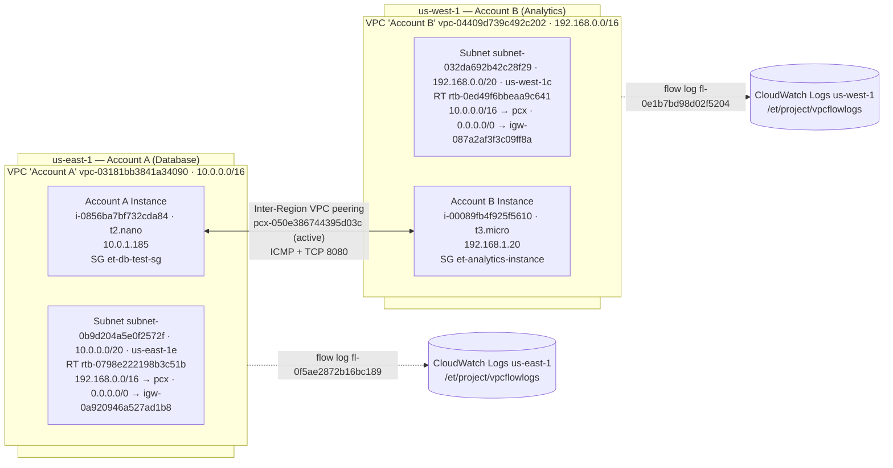

# Step 2 – Connectivity Report

**Project:** [[Project Overview]] · **Procedure:** [[Step 2 - Network Connectivity - How To]] · **Compiled report:** [[Project Report – Excipient Technologies]]

> [!todo] Still to do
> - [x] Flow log records (section 3.3, from the Logs Insights screenshot)
> - [x] Ping, curl, HTTP server, and flow-log screenshots embedded
> - [x] Peering, both route tables, and negative-test screenshots
> - [x] **Negative test**: 100% loss without the route, 0% after restoring it
> - [x] NACL and security group screenshots (account ID redacted)
> - [x] Temporary `SSH 0.0.0.0/0` rule removed
> - [ ] **Cleanup**: both instances, the peering connection, flow logs, log groups, and the IAM role and policy
>
> All configuration values below were verified against the CLI export (`step2-evidence/summary.txt`) taken on **2026-10-18**.

---

## Report Section

### 3.1 Network Architecture

Excipient's applications are spread across VPCs in different accounts. **Account A** hosts the company **database** in a private VPC (`10.0.0.0/16`). **Account B** hosts an **analytics application** (`192.168.0.0/16`). The analytics tier needs secure, private access to the database without going over the internet.

**Implementation note:** the course Cloud Lab provides a single AWS account, so the two accounts are represented by two **AWS Regions**, **us-east-1** (Account A) and **us-west-1** (Account B), connected by **inter-Region VPC peering**. That's permitted by the rubric ("separate accounts **or** Regions"). The test instances sit in public subnets only so they can be reached through EC2 Instance Connect. In production, the database would live in private subnets with no internet route.



### 3.2 VPC Peering Setup

**Resources**

| Item | Account A (us-east-1) | Account B (us-west-1) |
|---|---|---|
| VPC (Name) | `vpc-03181bb3841a34090` ("Account A") | `vpc-04409d739c492c202` ("Account B") |
| VPC CIDR | `10.0.0.0/16` | `192.168.0.0/16` |
| Subnet ID / CIDR / AZ | `subnet-0b9d204a5e0f2572f` / `10.0.0.0/20` / us-east-1e | `subnet-032da692b42c28f29` / `192.168.0.0/20` / us-west-1c |
| Route table (associated) | `rtb-0798e222198b3c51b` | `rtb-0ed49f6bbeaa9c641` |
| Route table association | `rtbassoc-0e69ece44ffde7243` | `rtbassoc-0f908bf10669db35e` |
| VPC main route table (unused) | `rtb-018288d7405480587` | `rtb-0ba79d6a87e3eb119` |
| Internet gateway (attached) | `igw-0a920946a527ad1b8` | `igw-087a2af3f3c09ff8a` |
| Instance (Name) | `i-0856ba7bf732cda84` ("Account A Instance") | `i-00089fb4f925f5610` ("Account B Instance") |
| Instance type | t2.nano | t3.micro |
| Private IPv4 | `10.0.1.185` | `192.168.1.20` |
| Public IPv4 (at export) | `107.22.142.170` | `54.176.64.198` |
| Status checks | ok / ok | ok / ok |

*Public IPv4 addresses change when an instance is stopped and started. These are the values at the time of the export.*

**Peering connection**

| Field | Value |
|---|---|
| Peering connection ID | `pcx-050e386744395d03c` |
| Requester | `vpc-03181bb3841a34090` (Account A), us-east-1, `10.0.0.0/16` |
| Accepter | `vpc-04409d739c492c202` (Account B), us-west-1, `192.168.0.0/16` |
| Status | **active** (confirmed from both Regions) |

![[step2-01-peering-active.png]]

**Route table updates**

| Route table | Destination | Target | State |
|---|---|---|---|
| `rtb-0798e222198b3c51b` (us-east-1) | `192.168.0.0/16` | `pcx-050e386744395d03c` | active |
| | `10.0.0.0/16` | local | active |
| | `0.0.0.0/0` | `igw-0a920946a527ad1b8` (test access only) | active |
| `rtb-0ed49f6bbeaa9c641` (us-west-1) | `10.0.0.0/16` | `pcx-050e386744395d03c` | active |
| | `192.168.0.0/16` | local | active |
| | `0.0.0.0/0` | `igw-087a2af3f3c09ff8a` (test access only) | active |

*us-east-1, `rtb-0798e222198b3c51b` ("Route Table Account A"): `192.168.0.0/16 → pcx-050e386744395d03c`, Active.*

![[step2-02-rtb-useast1.png]]

*us-west-1, `rtb-0ed49f6bbeaa9c641`: `10.0.0.0/16 → pcx-050e386744395d03c`, Active.*

![[step2-03-rtb-uswest1.png]]

> [!note] Troubleshooting finding – subnet association
> At first, neither subnet was **explicitly associated** with its configured route table, so both silently used their VPC's **main** route table, which had **only the local route**. As a result, EC2 Instance Connect timed out (no route to the internet gateway), and the peering routes weren't applied. It was diagnosed with `aws ec2 describe-route-tables --filters Name=association.subnet-id,…`, which returned no table. It was fixed by associating each subnet with its custom route table (`rtbassoc-0e69ece44ffde7243`, `rtbassoc-0f908bf10669db35e`). **Lesson:** a route only applies to subnets *associated* with its table. Always check the subnet's **Route table** tab, not just the table's routes.

**Security groups**

| SG | Inbound rule | Source | Purpose |
|---|---|---|---|
| `et-db-test-sg` `sg-0a445ec381aadfd4b` (us-east-1) | All ICMP – IPv4 | `192.168.0.0/16` | Ping from analytics |
| | TCP 8080 | `192.168.0.0/16` | App test traffic |
| | TCP 22 | `pl-0e4bcff02b13bef1e` (EC2 Instance Connect, us-east-1) | Admin login (test only) |
| `et-analytics-instance` `sg-0c25c71ec933935fe` (us-west-1) | All ICMP – IPv4 | `10.0.0.0/16` | Ping from database VPC |
| | TCP 8080 | `10.0.0.0/16` | App test traffic |
| | TCP 22 | `pl-0e99958a47b22d6ab` (`com.amazonaws.us-west-1.ec2-instance-connect`) | Admin login (test only) |
| | ~~TCP 22~~ | ~~`0.0.0.0/0`~~ | Temporary rule added during troubleshooting. **Since removed**: the final SG has only the 3 least-privilege rules. |

*Final security group rules (account Owner ID redacted):*

![[step2-10a-sg-useast1.png]]

![[step2-10b-sg-uswest1.png]]

*The `pl-0e99958a47b22d6ab` source is AWS's managed prefix list for EC2 Instance Connect in us-west-1:*

![[step2-09-prefix-list-us-west-1.png]]

Outbound: the default allow-all on both. Cross-Region peering can't reference the peer's security group, so rules use the **peer CIDR**. Only the required ports are opened to the peer.

**Network ACL updates** (both are the VPCs' **default** NACLs. Explicit allow rules were added ahead of the default rule 100.)

| NACL | Dir | # | Protocol / ports | Peer CIDR | Action |
|---|---|---|---|---|---|
| A `acl-0b86ac012751aa9ce` | In | 90 | ICMP | `192.168.0.0/16` | Allow |
| A | In | 91 | TCP 1024–65535 | `192.168.0.0/16` | Allow |
| A | Out | 90 | ICMP | `192.168.0.0/16` | Allow |
| A | Out | 91 | TCP 8080 | `192.168.0.0/16` | Allow |
| B `acl-0d7824466427fe00b` | In | 90 | ICMP | `10.0.0.0/16` | Allow |
| B | In | 91 | TCP 8080 | `10.0.0.0/16` | Allow |
| B | Out | 90 | ICMP | `10.0.0.0/16` | Allow |
| B | Out | 91 | TCP 1024–65535 | `10.0.0.0/16` | Allow |

Default rules are retained: **100** allow-all `0.0.0.0/0` and the final `*` deny (NACL A also has the IPv6 equivalents, **101** `::/0` allow and `*` deny). NACLs are stateless, so the reply direction (ephemeral ports 1024–65535) is explicitly allowed for the TCP 8080 test.

*NACL A, `acl-0b86ac012751aa9ce` (us-east-1), inbound: rule 90 ICMP and rule 91 TCP 1024–65535 from `192.168.0.0/16`, ahead of the defaults (100/101 allow, `*` deny):*

![[step2-04a-nacl-useast1.png]]

*NACL B, `acl-0d7824466427fe00b` (us-west-1), inbound: rule 90 ICMP and rule 91 TCP 8080 from `10.0.0.0/16`:*

![[step2-04b-nacl-uswest1.png]]

*Outbound rules (90/91 in the reverse direction) are confirmed in the CLI export, `step2-evidence/summary.txt`.*

### 3.3 Verification

| Test | Command | Expected | Result |
|---|---|---|---|
| Ping A → B | `ping -c 5 192.168.1.20` | 5/5 received, 0% loss | ✅ **5/5 received, 0% loss**, rtt avg **57.83 ms** |
| HTTP A → B | `curl -s -o /dev/null -w "HTTP %{http_code}\n" http://192.168.1.20:8080/` | `HTTP 200` | ✅ **HTTP 200** |
| Ping B → A | `ping -c 5 10.0.1.185` | 5/5 received | ✅ **5/5 received, 0% loss**, rtt avg **57.61 ms** |
| Negative test | Remove the peering route, ping B → A, re-add the route, ping again | 100% loss, then restored | ✅ **5/5 lost (100% loss)** without the route; **5/5 received, 0% loss** (avg 58.01 ms) after re-adding |

The ~58 ms round trip matches the physical distance between N. Virginia and N. California. That's consistent with traffic crossing the AWS backbone over the inter-Region peering link rather than staying local.

**Ping A → B** (from Account A Instance, `10.0.1.185`):

```text
PING 192.168.1.20 (192.168.1.20) 56(84) bytes of data.
64 bytes from 192.168.1.20: icmp_seq=1 ttl=127 time=57.7 ms
64 bytes from 192.168.1.20: icmp_seq=2 ttl=127 time=58.0 ms
64 bytes from 192.168.1.20: icmp_seq=3 ttl=127 time=57.7 ms
64 bytes from 192.168.1.20: icmp_seq=4 ttl=127 time=57.7 ms
64 bytes from 192.168.1.20: icmp_seq=5 ttl=127 time=58.1 ms

--- 192.168.1.20 ping statistics ---
5 packets transmitted, 5 received, 0% packet loss, time 4006ms
rtt min/avg/max/mdev = 57.683/57.830/58.056/0.160 ms
```

**Ping B → A** (from Account B Instance, `192.168.1.20`):

```text
PING 10.0.1.185 (10.0.1.185) 56(84) bytes of data.
64 bytes from 10.0.1.185: icmp_seq=1 ttl=127 time=57.6 ms
64 bytes from 10.0.1.185: icmp_seq=2 ttl=127 time=57.6 ms
64 bytes from 10.0.1.185: icmp_seq=3 ttl=127 time=57.6 ms
64 bytes from 10.0.1.185: icmp_seq=4 ttl=127 time=57.6 ms
64 bytes from 10.0.1.185: icmp_seq=5 ttl=127 time=57.6 ms

--- 10.0.1.185 ping statistics ---
5 packets transmitted, 5 received, 0% packet loss, time 4007ms
rtt min/avg/max/mdev = 57.602/57.607/57.617/0.005 ms
```

**Screenshots of repeat runs.** Later runs were captured as screenshots, all with 0% loss: A → B avg 59.27 ms and 58.89 ms; B → A avg 58.85 ms.

*Account A instance (`ip-10-0-1-185`): ping A → B and repeated `curl` returning `HTTP 200`. A ping to `8.8.8.8` also confirms the test instance's internet route.*

![[step2-05-ping-and-curl-a-to-b.png]]

*Account B instance (`ip-192-168-1-20`): ping B → A, then the `python3 -m http.server 8080` log showing five `GET / HTTP/1.1" 200` requests from `10.0.1.185`, which is the server side of the curl test.*

![[step2-07-ping-b-to-a-and-http-server.png]]

**Negative test.** With the peering route removed, the same ping from Account B to `10.0.1.185` failed completely: *5 packets transmitted, 0 received, 100% packet loss*. After the route was restored, it succeeded again (0% loss, avg 58.01 ms). This shows the traffic depends on the **peering route** specifically. It isn't reaching the other VPC by any other path, such as the internet.

![[step2-11-negative-test.png]]

**VPC Flow Logs**

| Flow log | VPC | Status | Traffic | Aggregation | Destination | IAM role |
|---|---|---|---|---|---|---|
| `fl-0f5ae2872b16bc189` (`et-db-flowlog`) | `vpc-03181bb3841a34090` (us-east-1) | **ACTIVE** | ALL | 60 s | CloudWatch Logs `/et/project/vpcflowlogs` | `et-flowlogs-role` |
| `fl-0e1b7bd98d02f5204` | `vpc-04409d739c492c202` (us-west-1) | **ACTIVE** | ALL | 60 s | CloudWatch Logs `/et/project/vpcflowlogs` | `et-flowlogs-role` |

Logs Insights query (run in each Region against `/et/project/vpcflowlogs`):

```sql
fields @timestamp, srcAddr, dstAddr, srcPort, dstPort, protocol, action, bytes
| filter (srcAddr like "10.0." and dstAddr like "192.168.")
      or (srcAddr like "192.168." and dstAddr like "10.0.")
| sort @timestamp desc
| limit 50
```

**How to read the records:** `protocol 1` = ICMP (ping), `protocol 6` + `dstPort 8080` = HTTP test, and `ACCEPT` = permitted by the SG and NACL.

**Result:** the query against `/et/project/vpcflowlogs` (last hour) returned **16 of 16 matching records, all `ACCEPT`**, covering 22:58–23:05 UTC on 2026-10-18 in both directions. Representative records:

| @timestamp (UTC) | srcAddr | dstAddr | srcPort | dstPort | protocol | action | bytes | Meaning |
|---|---|---|---|---|---|---|---|---|
| 2026-10-18 23:05:28 | 10.0.1.185 | 192.168.1.20 | 53508 | 8080 | 6 (TCP) | ACCEPT | 349 | curl request A → B |
| 2026-10-18 23:05:28 | 192.168.1.20 | 10.0.1.185 | 8080 | 53508 | 6 (TCP) | ACCEPT | 945 | HTTP 200 response B → A (ephemeral port) |
| 2026-10-18 23:05:28 | 10.0.1.185 | 192.168.1.20 | 0 | 0 | 1 (ICMP) | ACCEPT | 420 | ping echo requests A → B (5 × 84 bytes) |
| 2026-10-18 23:05:28 | 192.168.1.20 | 10.0.1.185 | 0 | 0 | 1 (ICMP) | ACCEPT | 420 | ping echo replies B → A |
| 2026-10-18 22:58:30 | 10.0.1.185 | 192.168.1.20 | 0 | 0 | 1 (ICMP) | ACCEPT | 840 | earlier ping run (10 packets) |

The byte counts are consistent with the tests: 5 pings × 84 bytes = **420 bytes**. The HTTP response (945 bytes) is larger than the request (349 bytes). The response returns to the client's **ephemeral port** (e.g. 53508), which is why the NACLs needed the `1024–65535` reply rules.

![[step2-08-flowlogs-insights.png]]

**Conclusion.** Traffic flows privately between the two VPCs over the active inter-Region peering connection `pcx-050e386744395d03c`, in **both directions**. That's shown by 0%-loss pings each way (~58 ms) and an `HTTP 200` from the analytics instance on TCP 8080. Both VPCs' flow logs are **ACTIVE** and capture all traffic to CloudWatch Logs. The route tables (with correct subnet associations), security groups (peer-CIDR rules), and NACLs (explicit stateless allow rules) together permit exactly the required inter-VPC traffic.

### 3.4 Configuration Evidence (Appendix)

The full configuration was exported from AWS CloudShell on 2026-10-18 in two forms:

| Evidence | Contents | Location |
|---|---|---|
| **CLI summary** | Peering status, subnets, route tables and associations, IGWs, SG and NACL rules, instances, status checks, flow log status, for both Regions | `step2-evidence/summary.txt` (this folder) |
| **Terraform (IaC) snapshot** | 23 resources imported with `terraform plan -generate-config-out`: VPCs, subnets, IGWs, route tables and associations, SGs, default NACLs, instances, peering connection and accepter, flow logs, log groups, IAM role | `step2-evidence/terraform/` (`generated.tf`, `imports.tf`, `providers.tf`). The account ID is redacted to `<ACCOUNT_ID>`. |

---

## 4. Screenshot Checklist

Screenshots live in the `screenshots/` subfolder. Embedded ones are ticked. For the rest, save them there with these names and embed them in section 3.2 (an exclamation mark followed by the filename in double brackets):

- [x] `step2-01-peering-active.png`: peering connection **active**
- [x] `step2-02-rtb-useast1.png`: us-east-1 route table with the `pcx` route
- [x] `step2-03-rtb-uswest1.png`: us-west-1 route table with the `pcx` route
- [x] `step2-11-negative-test.png`: ping fails without the route, succeeds after restoring it
- [x] `step2-04a-nacl-useast1.png` / `step2-04b-nacl-uswest1.png`: NACL inbound rules, both VPCs
- [x] `step2-05-ping-and-curl-a-to-b.png`: ping A → B 0% loss, plus curl `HTTP 200` (covers both 05 and 06)
- [x] `step2-07-ping-b-to-a-and-http-server.png`: ping B → A, plus the HTTP server log
- [x] `step2-08-flowlogs-insights.png`: Logs Insights, 16/16 ACCEPT records
- [x] `step2-09-prefix-list-us-west-1.png`: EC2 Instance Connect prefix list (supporting)
- [x] `step2-10a-sg-useast1.png` / `step2-10b-sg-uswest1.png`: final security group rules, Owner ID redacted

> [!warning] Before screenshotting
> Make sure no **personal information** is visible: no email address in the console's account menu, no browser profile name. The Cloud Lab rules prohibit personal data, and screenshots get shared with reviewers.

- [ ] Resources **cleaned up** ([[Step 2 - Network Connectivity - How To#9. Cleanup – Do This the Same Day]]), including the temporary **SSH `0.0.0.0/0`** rule on `sg-0c25c71ec933935fe`
