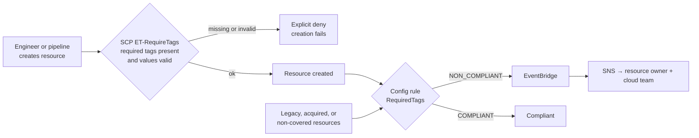

# Step 3 – Tagging Governance

**Project:** [[Project Overview]] · **Compiled report:** [[Project Report – Excipient Technologies]]
**Concepts used:** [[Tagging Strategies and Cost Allocation]] · [[Organizational Units and Service Control Policies]] · [[Centralized Logging and Event Notification#4. AWS Config]]

> [!warning] Draft for your review
> This is a complete draft. The cost-center and project values are **illustrative** (the scenario names R&D and Marketing). Review the JSON so you can explain each statement.

---

## Report Section

### Objective

Define a tagging strategy for Excipient Technologies and enforce it in two layers: **SCPs** *prevent* creating resources that lack the required tags, and **AWS Config** *detects* resources that slip through (created before enforcement, by excluded services, or in accounts not yet moved under the SCP).

The scenario says tags must track **environments** (Development, Production), assign **cost centers** (e.g. R&D, Marketing), and identify **resource owners**.

---

## 1. Tagging Strategy Table

| Category                    | Key                  | Value(s)                                                    | Purpose                                                                                                                                                                |
| --------------------------- | -------------------- | ----------------------------------------------------------- | ---------------------------------------------------------------------------------------------------------------------------------------------------------------------- |
| **Operational / lifecycle** | `Environment`        | `Development`, `Test`, `Production`                         | Identifies the lifecycle stage. Drives which guardrails, budgets, and schedules apply: dev resources can be stopped by budget actions, production can't. **Required.** |
| **Financial**               | `CostCenter`         | `R&D`, `Marketing`, `Manufacturing`, `Corporate-IT`         | Allocates spend to the department that pays. Activated as a **cost allocation tag** so it appears in Cost Explorer and the CUR for chargeback. **Required.**           |
| **Ownership**               | `Owner`              | Team alias, e.g. `research-platform-team`, `analytics-team` | Accountable team for operations, incidents, and cleanup ("whose instance is this?"). A **team alias, never a person's name or email**. **Required.**                   |
| **Business**                | `Project`            | e.g. `CompoundScreening`, `ClinicalAnalytics`, `PM-Project` | Ties resources to a program or product line for showback and anomaly monitoring. Recommended.                                                                          |
| **Security / compliance**   | `DataClassification` | `Public`, `Internal`, `Confidential`, `GxP-Regulated`       | Flags data sensitivity and regulated (GxP) systems for stricter controls and audit scope. Recommended.                                                                 |

**Tagging rules**
- Keys use **PascalCase** exactly as shown. Tags are **case-sensitive**.
- **Never** put secrets or personal data in tags; they aren't encrypted.
- The `aws:` prefix is reserved for AWS-generated tags.
- **Required** = `Environment`, `CostCenter`, `Owner`, enforced by SCP and Config. **Recommended** = `Project`, `DataClassification`, monitored by Config.
- Tags are applied automatically through **CloudFormation / Service Catalog** templates wherever possible, and **Tag Editor** is used for backfills.

---

## 2. Enforcement Design



| Layer                      | Tool                                        | Mode                                                       | Scope                                   |
| -------------------------- | ------------------------------------------- | ---------------------------------------------------------- | --------------------------------------- |
| Prevent                    | **SCP** `ET-RequireTags`                    | Deny creation without required tags or with invalid values | Workloads OU and Acquired Businesses OU |
| Detect                     | **AWS Config** managed rule `REQUIRED_TAGS` | Flag non-compliant existing resources                      | All accounts (organization rule)        |
| Notify                     | **EventBridge → SNS**                       | Alert owners on `NON_COMPLIANT`                            | Organization                            |
| Standardize *(supporting)* | **Tag policy**                              | Enforce key casing and allowed values                      | Organization                            |

---

## 3. SCP – Deny Creation Without Required Tags

`ET-RequireTags`, attached to the **Workloads OU** and the **Acquired Businesses OU**. Each required key gets its **own** `Null` statement. Several keys inside one `Null` block are ANDed, so the deny would only fire if *all* were missing.

```json
{
  "Version": "2012-10-17",
  "Statement": [
    {
      "Sid": "DenyEC2WithoutEnvironmentTag",
      "Effect": "Deny",
      "Action": ["ec2:RunInstances", "ec2:CreateVolume"],
      "Resource": ["arn:aws:ec2:*:*:instance/*", "arn:aws:ec2:*:*:volume/*"],
      "Condition": { "Null": { "aws:RequestTag/Environment": "true" } }
    },
    {
      "Sid": "DenyEC2WithoutCostCenterTag",
      "Effect": "Deny",
      "Action": ["ec2:RunInstances", "ec2:CreateVolume"],
      "Resource": ["arn:aws:ec2:*:*:instance/*", "arn:aws:ec2:*:*:volume/*"],
      "Condition": { "Null": { "aws:RequestTag/CostCenter": "true" } }
    },
    {
      "Sid": "DenyEC2WithoutOwnerTag",
      "Effect": "Deny",
      "Action": ["ec2:RunInstances", "ec2:CreateVolume"],
      "Resource": ["arn:aws:ec2:*:*:instance/*", "arn:aws:ec2:*:*:volume/*"],
      "Condition": { "Null": { "aws:RequestTag/Owner": "true" } }
    },
    {
      "Sid": "DenyRDSWithoutRequiredTags",
      "Effect": "Deny",
      "Action": "rds:CreateDBInstance",
      "Resource": "arn:aws:rds:*:*:db:*",
      "Condition": { "Null": { "aws:RequestTag/Environment": "true" } }
    },
    {
      "Sid": "DenyRDSWithoutCostCenter",
      "Effect": "Deny",
      "Action": "rds:CreateDBInstance",
      "Resource": "arn:aws:rds:*:*:db:*",
      "Condition": { "Null": { "aws:RequestTag/CostCenter": "true" } }
    },
    {
      "Sid": "DenyRDSWithoutOwner",
      "Effect": "Deny",
      "Action": "rds:CreateDBInstance",
      "Resource": "arn:aws:rds:*:*:db:*",
      "Condition": { "Null": { "aws:RequestTag/Owner": "true" } }
    },
    {
      "Sid": "DenyInvalidEnvironmentValues",
      "Effect": "Deny",
      "Action": ["ec2:RunInstances", "ec2:CreateVolume", "rds:CreateDBInstance"],
      "Resource": "*",
      "Condition": {
        "StringNotEqualsIfExists": {
          "aws:RequestTag/Environment": ["Development", "Test", "Production"]
        }
      }
    },
    {
      "Sid": "DenyInvalidCostCenterValues",
      "Effect": "Deny",
      "Action": ["ec2:RunInstances", "ec2:CreateVolume", "rds:CreateDBInstance"],
      "Resource": "*",
      "Condition": {
        "StringNotEqualsIfExists": {
          "aws:RequestTag/CostCenter": ["R&D", "Marketing", "Manufacturing", "Corporate-IT"]
        }
      }
    },
    {
      "Sid": "DenyRemovingRequiredTags",
      "Effect": "Deny",
      "Action": ["ec2:DeleteTags", "rds:RemoveTagsFromResource"],
      "Resource": "*",
      "Condition": {
        "ForAnyValue:StringEquals": { "aws:TagKeys": ["Environment", "CostCenter", "Owner"] },
        "ArnNotLike": { "aws:PrincipalArn": "arn:aws:iam::*:role/AWSControlTowerExecution" }
      }
    }
  ]
}
```

**How it works**

| Statement | Effect |
|---|---|
| `Null … "true"` | `aws:RequestTag/<Key>` is **absent** from the create request, so it's denied |
| `StringNotEqualsIfExists` | The tag is present but its value isn't in the allowed list, so it's denied |
| `DenyRemovingRequiredTags` | Stops someone tagging correctly at launch and stripping the tag afterwards |
| `Resource` scoping on EC2 | `RunInstances` touches many resource types (ENIs, AMIs, subnets). Scoping to `instance/*` and `volume/*` checks the tags where they're applied. |

> [!note] Coverage and limits
> - SCPs can only check tags on **create calls that accept tags in the request** (`aws:RequestTag`). EC2 and RDS support this well. Services that don't support tag-on-create are covered by the **Config rule** instead.
> - SCPs don't affect the **management account**.
> - Roll out through a **policy-staging OU** first, and make sure IaC templates already apply the tags so pipelines don't break.

---

## 4. AWS Config Rule – Detect Non-Compliant Resources

Uses the AWS-managed rule **`REQUIRED_TAGS`**. It checks up to six keys, optionally with allowed values.

**Per-account rule** (`PutConfigRule` input):

```json
{
  "ConfigRuleName": "RequiredTags",
  "Description": "Flags resources missing Environment, CostCenter, or Owner tags, or with invalid Environment/CostCenter values.",
  "Scope": {
    "ComplianceResourceTypes": [
      "AWS::EC2::Instance",
      "AWS::EC2::Volume",
      "AWS::EC2::VPC",
      "AWS::EC2::Subnet",
      "AWS::EC2::SecurityGroup",
      "AWS::RDS::DBInstance",
      "AWS::S3::Bucket",
      "AWS::DynamoDB::Table"
    ]
  },
  "Source": {
    "Owner": "AWS",
    "SourceIdentifier": "REQUIRED_TAGS"
  },
  "InputParameters": "{\"tag1Key\":\"Environment\",\"tag1Value\":\"Development,Test,Production\",\"tag2Key\":\"CostCenter\",\"tag2Value\":\"R&D,Marketing,Manufacturing,Corporate-IT\",\"tag3Key\":\"Owner\"}"
}
```

> [!note] Why not `AWS::AllSupported`
> The template's starter JSON uses `"ComplianceResourceTypes": ["AWS::AllSupported"]`. `REQUIRED_TAGS` evaluates only the resource types it supports, and the scope expects **specific resource type names**. Listing the types explicitly is valid and makes the coverage visible. Omitting `Scope` entirely also works: the rule then evaluates all the types it supports. Keep `"ConfigRuleName": "RequiredTags"` as the template asks.

**Organization-wide deployment** (`PutOrganizationConfigRule`, from the management account or the Config delegated admin, typically the **Audit** account):

```json
{
  "OrganizationConfigRuleName": "RequiredTags",
  "OrganizationManagedRuleMetadata": {
    "RuleIdentifier": "REQUIRED_TAGS",
    "Description": "Organization-wide required tag check for Excipient Technologies.",
    "ResourceTypesScope": [
      "AWS::EC2::Instance",
      "AWS::EC2::Volume",
      "AWS::RDS::DBInstance",
      "AWS::S3::Bucket",
      "AWS::DynamoDB::Table"
    ],
    "InputParameters": "{\"tag1Key\":\"Environment\",\"tag1Value\":\"Development,Test,Production\",\"tag2Key\":\"CostCenter\",\"tag2Value\":\"R&D,Marketing,Manufacturing,Corporate-IT\",\"tag3Key\":\"Owner\"}"
  }
}
```

**Notification on non-compliance** (EventBridge rule pattern → SNS topic `et-tag-compliance`):

```json
{
  "source": ["aws.config"],
  "detail-type": ["Config Rules Compliance Change"],
  "detail": {
    "configRuleName": [{ "prefix": "RequiredTags" }],
    "newEvaluationResult": { "complianceType": ["NON_COMPLIANT"] }
  }
}
```

The `prefix` match covers organization rules, whose deployed names in member accounts carry a suffix.

### Simulated evaluation output

| Resource | Account / OU | Missing or invalid | Result |
|---|---|---|---|
| `i-0a1b2c3d4e5f60001` | ET-Research-Dev / Development | — | COMPLIANT |
| `vol-0aa11bb22cc330002` | ACQ-Workload-1 / Acquired | `CostCenter`, `Owner` | **NON_COMPLIANT** |
| `my-legacy-bucket-0003` | ET-PM-Project / Development | `Environment=dev` (invalid value) | **NON_COMPLIANT** |
| `db-ANALYTICS0004` | ET-Analytics-Prod / Production | — | COMPLIANT |

*(Simulated: illustrative IDs. The non-compliant items come from the acquired and formerly standalone accounts, which predate enforcement. That's exactly the gap Config covers.)*

---

## 5. Supporting Tag Policy (Optional)

This standardizes casing and values organization-wide, and complements the SCP ([[Tagging Strategies and Cost Allocation#^tag-enforcement-layers]]):

```json
{
  "tags": {
    "Environment": {
      "tag_key": { "@@assign": "Environment" },
      "tag_value": { "@@assign": ["Development", "Test", "Production"] }
    },
    "CostCenter": {
      "tag_key": { "@@assign": "CostCenter" },
      "tag_value": { "@@assign": ["R&D", "Marketing", "Manufacturing", "Corporate-IT"] }
    },
    "Owner": {
      "tag_key": { "@@assign": "Owner" }
    }
  }
}
```

---

## Study Notes – Defending the Design

*Not part of the report.*

- **Why both an SCP and Config?** The SCP *prevents* violations, but only on create calls that support request tags, and only in the OUs it's attached to. Config *detects* everything else, including resources that existed before the policy. That's critical for the acquired and formerly standalone accounts.
- **Why separate `Null` statements?** Multiple keys in one condition block are ANDed. To deny when *any* required tag is missing, each key needs its own statement.
- **Why `Owner` is a team alias:** it avoids personal data in tags and survives staff turnover.
- **Why tag policies are optional here:** a tag policy can't require a tag to exist. The rubric asks for an SCP that denies creation without required tags.
