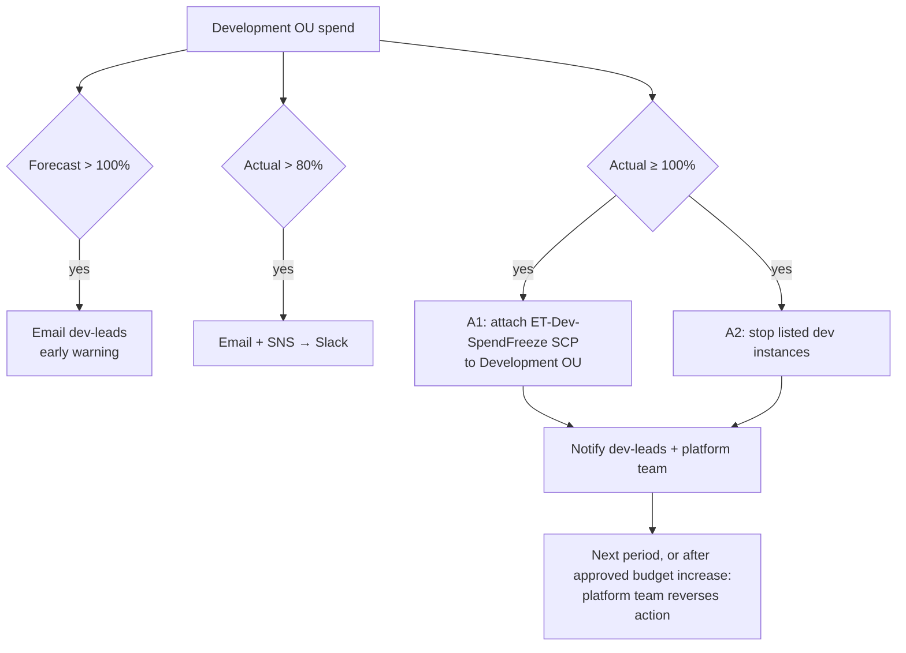

# Step 4 – Cost Management Controls

**Project:** [[Project Overview]] · **Compiled report:** [[Project Report – Excipient Technologies]]
**Concepts used:** [[AWS Cost and Usage Monitoring Tools#3. AWS Budgets]] · [[AWS Cost and Usage Monitoring Tools#4. Budget Actions – When Warnings Aren't Enough]] · [[Tagging Strategies and Cost Allocation#5. Cost Allocation Tags]]

> [!warning] Draft for your review
> Dollar amounts, account IDs, ARNs, and email addresses are **illustrative assumptions**. The scenario doesn't give Excipient's spend. The `example` domain is used deliberately: no real or personal addresses.

---

## Report Section

### Objective

Simulate **AWS Budgets** that track spend across the consolidated organization, and **budget actions** that notify stakeholders or stop additional spending when thresholds are reached. Controls are scoped to the Step 1 OU structure and the Step 3 `CostCenter` tag.

### Design principles

1. **Budgets are created in the management account.** It sees consolidated billing for every account, and it's the only account that can run **SCP budget actions**.
2. **Alert early on forecasts** and confirm with **actuals**.
3. **Automated enforcement only where an outage is acceptable** (Development). **Production gets alerts and human approval**, never automatic shutdown: a halted analytics or GxP system costs more than the overspend.
4. **Watch commitments too.** Savings Plans utilization alerts catch money paid but unused.

---

## 1. Notification Channels

| Channel | Identifier (illustrative) | Audience |
|---|---|---|
| SNS topic | `arn:aws:sns:us-east-1:111111111111:et-budget-alerts` | Cloud platform on-call; forwarded to Slack/Teams via AWS Chatbot |
| Email | `cloud-finance@excipient.example` | Finance / FinOps |
| Email | `dev-leads@excipient.example` | Development team leads |
| Email | `integration-office@excipient.example` | Acquisition integration team |
| Email | `rnd-finance@excipient.example` | R&D cost-center owner |

---

## 2. Budget Configuration

All budgets are **monthly**, **cost** type (unless noted), in **USD**, and created in the management account.

| #   | Budget name                   | Scope (filter)                                | Amount     | Alert thresholds                                                 | Notifies                 |
| --- | ----------------------------- | --------------------------------------------- | ---------- | ---------------------------------------------------------------- | ------------------------ |
| 1   | `ET-Org-Monthly-Total`        | Entire organization                           | \$60,000   | Actual **80%**, Actual **100%**, Forecast **100%**               | SNS + cloud-finance      |
| 2   | `ET-Production-Workloads`     | Linked accounts in the Production OU          | \$35,000   | Actual **85%**, Forecast **100%**, Actual **100%**               | SNS + cloud-finance      |
| 3   | `ET-Development-Workloads`    | Linked accounts in the Development OU         | \$8,000    | Actual **80%**, Forecast **100%**, Actual **100%** → **action**  | dev-leads + SNS          |
| 4   | `ET-Acquired-Businesses`      | Linked accounts in the Acquired Businesses OU | \$10,000   | Forecast **100%**, Actual **90%** → **action (manual approval)** | integration-office + SNS |
| 5   | `ET-CostCenter-RnD`           | Tag `CostCenter = R&D`                        | \$25,000   | Actual **80%**, Forecast **100%**                                | rnd-finance              |
| 6   | `ET-CostCenter-Marketing`     | Tag `CostCenter = Marketing`                  | \$5,000    | Actual **80%**, Forecast **100%**                                | cloud-finance            |
| 7   | `ET-SavingsPlans-Utilization` | Savings Plans (utilization budget)            | 90% target | Utilization **below 90%**                                        | cloud-finance            |

> [!note] Why these thresholds
> - **80% actual** gives teams time to react before the month ends.
> - **Forecast 100%** fires early in the month if the trend points to overspend ([[AWS Cost and Usage Monitoring Tools#6. Worked Example – A Budget Plan for Steady Volatility Partners]]).
> - Tag-based budgets (5, 6) depend on `CostCenter` being **activated as a cost allocation tag** (Step 3).

### Example budget definition (simulated `aws budgets create-budget` input)

**`ET-Development-Workloads`**, with `budget.json`:

```json
{
  "BudgetName": "ET-Development-Workloads",
  "BudgetLimit": { "Amount": "8000", "Unit": "USD" },
  "TimeUnit": "MONTHLY",
  "BudgetType": "COST",
  "CostFilters": {
    "LinkedAccount": ["222222222222", "333333333333", "444444444444"]
  }
}
```

and `notifications.json`:

```json
[
  {
    "Notification": {
      "NotificationType": "ACTUAL",
      "ComparisonOperator": "GREATER_THAN",
      "Threshold": 80,
      "ThresholdType": "PERCENTAGE"
    },
    "Subscribers": [
      { "SubscriptionType": "EMAIL", "Address": "dev-leads@excipient.example" },
      { "SubscriptionType": "SNS", "Address": "arn:aws:sns:us-east-1:111111111111:et-budget-alerts" }
    ]
  },
  {
    "Notification": {
      "NotificationType": "FORECASTED",
      "ComparisonOperator": "GREATER_THAN",
      "Threshold": 100,
      "ThresholdType": "PERCENTAGE"
    },
    "Subscribers": [
      { "SubscriptionType": "EMAIL", "Address": "dev-leads@excipient.example" }
    ]
  }
]
```

**Tag-scoped budget filter** (budget 5):

```json
{ "CostFilters": { "TagKeyValue": ["user:CostCenter$R&D"] } }
```

---

## 3. Budget Actions

| Action                            | Budget                     | Trigger           | Type                                       | Effect                                                                                            | Approval                                |
| --------------------------------- | -------------------------- | ----------------- | ------------------------------------------ | ------------------------------------------------------------------------------------------------- | --------------------------------------- |
| **A1 – Dev spend freeze**         | `ET-Development-Workloads` | Actual ≥ **100%** | `APPLY_SCP_POLICY`                         | Attach SCP `ET-Dev-SpendFreeze` to the **Development OU**: no new EC2, RDS, or SageMaker capacity | **Automatic**                           |
| **A2 – Stop idle dev compute**    | `ET-Development-Workloads` | Actual ≥ **100%** | `RUN_SSM_DOCUMENTS` (`STOP_EC2_INSTANCES`) | Stop the listed long-running dev instances                                                        | **Automatic**                           |
| **A3 – Acquired-accounts freeze** | `ET-Acquired-Businesses`   | Actual ≥ **90%**  | `APPLY_SCP_POLICY`                         | Attach `ET-Dev-SpendFreeze` to the **Acquired Businesses OU**                                     | **Manual**: integration office approves |
| **A4 – Production guard**         | `ET-Production-Workloads`  | Actual ≥ **100%** | `APPLY_IAM_POLICY`                         | Attach a deny-new-GPU-instances policy to the **developer role** (not to running workloads)       | **Manual**: CTO/finance approve         |

All actions use an execution role, `arn:aws:iam::111111111111:role/ET-BudgetsActionRole`, that the Budgets service is trusted to assume.

**Spend-freeze SCP `ET-Dev-SpendFreeze`** (applied by A1 and A3):

```json
{
  "Version": "2012-10-17",
  "Statement": [
    {
      "Sid": "FreezeNewCapacity",
      "Effect": "Deny",
      "Action": [
        "ec2:RunInstances",
        "ec2:CreateNatGateway",
        "rds:CreateDBInstance",
        "rds:CreateDBCluster",
        "sagemaker:CreateNotebookInstance",
        "sagemaker:CreateTrainingJob",
        "sagemaker:CreateEndpoint"
      ],
      "Resource": "*",
      "Condition": {
        "ArnNotLike": {
          "aws:PrincipalArn": [
            "arn:aws:iam::*:role/AWSControlTowerExecution",
            "arn:aws:iam::*:role/ET-PlatformBreakGlass"
          ]
        }
      }
    }
  ]
}
```

**Action A1 definition** (simulated `create-budget-action` input):

```json
{
  "AccountId": "111111111111",
  "BudgetName": "ET-Development-Workloads",
  "NotificationType": "ACTUAL",
  "ActionType": "APPLY_SCP_POLICY",
  "ActionThreshold": { "ActionThresholdValue": 100.0, "ActionThresholdType": "PERCENTAGE" },
  "Definition": {
    "ScpActionDefinition": {
      "PolicyId": "p-etdevfreeze1",
      "TargetIds": ["ou-et12-devwrkld"]
    }
  },
  "ExecutionRoleArn": "arn:aws:iam::111111111111:role/ET-BudgetsActionRole",
  "ApprovalModel": "AUTOMATIC",
  "Subscribers": [
    { "SubscriptionType": "SNS", "Address": "arn:aws:sns:us-east-1:111111111111:et-budget-alerts" },
    { "SubscriptionType": "EMAIL", "Address": "dev-leads@excipient.example" }
  ]
}
```

**Action A2 definition:**

```json
{
  "AccountId": "111111111111",
  "BudgetName": "ET-Development-Workloads",
  "NotificationType": "ACTUAL",
  "ActionType": "RUN_SSM_DOCUMENTS",
  "ActionThreshold": { "ActionThresholdValue": 100.0, "ActionThresholdType": "PERCENTAGE" },
  "Definition": {
    "SsmActionDefinition": {
      "ActionSubType": "STOP_EC2_INSTANCES",
      "Region": "us-east-1",
      "InstanceIds": ["i-0de0000000000aaa1", "i-0de0000000000aaa2"]
    }
  },
  "ExecutionRoleArn": "arn:aws:iam::111111111111:role/ET-BudgetsActionRole",
  "ApprovalModel": "AUTOMATIC",
  "Subscribers": [
    { "SubscriptionType": "EMAIL", "Address": "dev-leads@excipient.example" }
  ]
}
```

> [!important] Constraints
> - SCP actions only work from the **management account**.
> - SSM stop actions target **listed instance IDs** in one Region, so the list is maintained for known long-running dev hosts.
> - Production is protected by **manual approval**, never automatic stops ([[AWS Cost and Usage Monitoring Tools#^budget-actions-risk]]).

---

## 4. Escalation Flow



---

## 5. Simulated Outputs

### 5.1 Alert emails (simulated)

```text
Subject: AWS Budgets: ET-Development-Workloads has exceeded your alert threshold

You requested that we alert you when the ACTUAL cost associated with your
ET-Development-Workloads budget is greater than 80.00% for the current month.

Budget name:        ET-Development-Workloads
Budget type:        Cost
Budgeted amount:    $8,000.00
Alert type:         ACTUAL
Alert threshold:    > 80.00%
ACTUAL amount:      $6,450.27   (80.63% of budget)
```

```text
Subject: AWS Budgets: ET-Development-Workloads is forecasted to exceed your threshold

Alert type:         FORECASTED
Alert threshold:    > 100.00%
FORECASTED amount:  $8,960.00   (112.00% of budget)
```

### 5.2 SNS message delivered to Slack via Chatbot (simulated)

```json
{
  "budgetName": "ET-Development-Workloads",
  "notificationType": "ACTUAL",
  "threshold": "100.0%",
  "actualSpend": "8021.44 USD",
  "budgetLimit": "8000.00 USD",
  "actionTriggered": ["A1-DevSpendFreeze", "A2-StopIdleDevCompute"]
}
```

### 5.3 Budget action execution history (simulated `describe-budget-action-histories`)

| Time (UTC) | Action | Status | Detail |
|---|---|---|---|
| Day 26 14:05 | A1 – Dev spend freeze | STANDBY → **EXECUTION_IN_PROGRESS** | Threshold 100% reached (\$8,021.44) |
| Day 26 14:06 | A1 – Dev spend freeze | **EXECUTION_SUCCESS** | SCP `p-etdevfreeze1` attached to `ou-et12-devwrkld` |
| Day 26 14:06 | A2 – Stop idle dev compute | **EXECUTION_SUCCESS** | `i-0de0000000000aaa1`, `i-0de0000000000aaa2` → stopped |
| Day 27 09:30 | A3 – Acquired freeze | **PENDING** (awaiting approval) | Acquired OU at 91.2% |
| Day 27 11:02 | A3 – Acquired freeze | **EXECUTION_SUCCESS** | Approved by the integration office |

### 5.4 Enforcement seen by a developer (simulated)

```text
$ aws ec2 run-instances --image-id ami-0abc... --instance-type t3.large ...
An error occurred (UnauthorizedOperation) when calling the RunInstances operation:
You are not authorized to perform this operation. ... with an explicit deny in a
service control policy.
```

### 5.5 Simulated month summary

| Budget | Limit | Actual | % | Outcome |
|---|---|---|---|---|
| ET-Org-Monthly-Total | \$60,000 | \$51,870 | 86% | 80% alert sent; no action |
| ET-Production-Workloads | \$35,000 | \$29,400 | 84% | Below the 85% alert |
| ET-Development-Workloads | \$8,000 | \$8,021 | 100.3% | 80% + forecast alerts → **A1 and A2 executed** |
| ET-Acquired-Businesses | \$10,000 | \$9,120 | 91% | **A3 approved and executed** |
| ET-CostCenter-RnD | \$25,000 | \$21,300 | 85% | 80% alert to R&D finance |
| ET-SavingsPlans-Utilization | 90% | 94% | — | No alert |

---

## Study Notes – Defending the Design

*Not part of the report.*

- **Why the management account?** It's the only place that sees every account's spend under consolidated billing, and the only place SCP budget actions can run.
- **Why no automatic actions on production?** Budget actions that stop instances or deny capacity can take down live systems. For a pharma company, that could mean interrupted analytics or validated GxP systems.
- **Why both OU-scoped and tag-scoped budgets?** OU/account scoping answers "which environment overspent?". `CostCenter` tag scoping answers "which department pays?". That's the account-vs-tag split from [[Tagging Strategies and Cost Allocation#11. Critical Analysis]].
