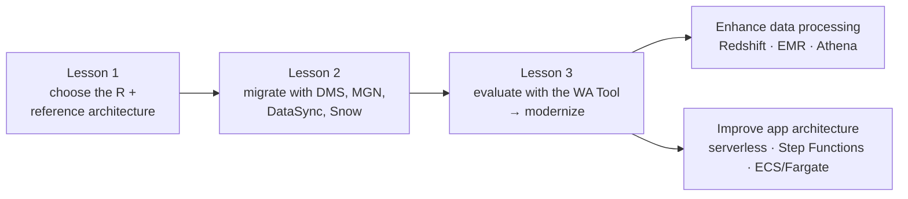
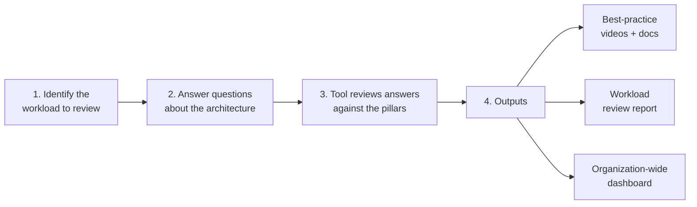
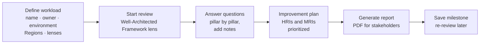

# AWS Well-Architected Tool

> [!abstract] TL;DR
> Lessons 1 and 2 got workloads **into** AWS. Lesson 3 **evaluates and optimizes** them once they're there.
>
> The **AWS Well-Architected Tool (WA Tool)** gives a ==consistent process for measuring an architecture against AWS best practices==:
> 1. Identify the workload.
> 2. Answer questions about it.
> 3. The tool reviews the answers against the framework's pillars.
> 4. You get **best-practice videos and docs**, a **workload report**, and an **organization-wide dashboard**.
>
> Its typical reliability and performance recommendations drive two **modernization strategies**:
> - ==enhance data processing== with Redshift, EMR, or Athena
> - ==improve application architecture== with serverless, application orchestration, or container orchestration
>
> **Cox Automotive** used the tool to win executive buy-in, align 350 teams, and save **$700K a year**.

**Lesson:** L3 – Determining New Architecture for Cloud Workloads · **Previous lesson:** [[Data Validation and Synchronization]] · **Next:** [[Enhancing Data Processing with Redshift, EMR, and Athena]]
**Section hub:** [[Designing AWS Architecture for Workloads]]
**Sources:** Videos C2-L3-A01, A02, A03, and A05, en-us transcripts. A WA Tool demo (likely A04) isn't in the bundle. Material marked *beyond the lecture* is my addition.

> [!warning] Five pillars or six?
> The A03 video lists **five** pillars. The AWS Well-Architected Framework has had **six** since late 2021, when **Sustainability** was added. Lesson 1 of this section uses six ([[Optimized Architectures and the Migration Lens]]). Expect "five" if a quiz is built from this video, but know that six is current.

> [!todo]- Contents
> 1. [[#1. Where This Lesson Fits]]
> 2. [[#2. Case Study – Cox Automotive]]
> 3. [[#3. Using the Well-Architected Tool]]
> 4. [[#4. From Review Results to Modernization]]
> 5. [[#5. Pitfalls and Failure Modes]]
> 6. [[#6. Key Takeaways]]
> 7. [[#7. Critical Analysis]]
> 8. [[#8. Self-Test]]
> 9. [[#9. Glossary]]
> 10. [[#10. Further Reading]]

---

## 1. Where This Lesson Fits

The lesson's stated plan: ==analyze workloads with the WA Tool==, then apply **two modernization techniques** that implement its results.

---

## 2. Case Study – Cox Automotive

| Aspect | Detail (lecture) |
|---|---|
| Company | **Cox Automotive**, a major automotive-technology company |
| When | At a **critical point during their AWS migration** |
| Scope | **All** services: new workloads, migrating workloads, and apps staying in their data centers |
| Before | Engineers worked through the framework questions **manually**, with **printed PDFs and spreadsheets**. Slow and cumbersome. |
| After | A streamlined review process. Insights on application health and migration progress, and ==executive buy-in== for more investment in **security** and **resilience** |
| Culture | A **data-driven** approach adopted across all cloud operations, aligning **350 engineering teams** and significantly reducing risk |
| Savings | **Over $700,000 a year** in operating costs compared with on-prem |
| New practices | Cost optimization treated as an **ongoing discipline**; **game days** to improve operational efficiency |

> [!tip] The lesson
> The WA Tool is not only a technical checklist. It's ==a communication tool to secure resources and drive organizational change==. ^wa-communication

---

## 3. Using the Well-Architected Tool

> [!info]+ Definition – AWS Well-Architected Tool
> A service that provides a **consistent process for measuring your architecture** against AWS best practices. Throughout the product lifecycle it **documents your decisions**, **recommends improvements**, and guides optimization for **reliability, security, efficiency, and cost-effectiveness**. ^def-wa-tool

### The process (lecture)

### The pillars

| Pillar (lecture lists the first five) | Focus |
|---|---|
| **Operational excellence** | Running and monitoring systems; continuous improvement |
| **Security** | Protecting data, systems, and assets |
| **Reliability** | Recovering from failure; meeting demand |
| **Performance efficiency** | Using resources efficiently as demand changes |
| **Cost optimization** | Avoiding unnecessary cost |
| *Sustainability* (*beyond the lecture*: the sixth pillar since 2021) | Minimizing environmental impact |

### Outputs (lecture)

| Output | Use |
|---|---|
| **Videos and documentation** on AWS best practices | Learn the fix for each identified risk |
| **Report** summarizing the workload review | Share with stakeholders (Cox's executive buy-in) |
| **Dashboard** of workload reviews across the organization | Track risk and improvement across many teams |

> [!note] Beyond the lecture
> Reviews flag **high-risk issues (HRIs)** and **medium-risk issues (MRIs)**. You can save **milestones** to show improvement over time, and apply **lenses** such as the Migration Lens from Lesson 1 or the Serverless Lens.

### Console walkthrough (repo demo)

The course repo's WA Tool demo (`lesson-3-managed-services/demo`) shows the console flow. It lists **six** pillars, confirming the sixth (sustainability).

| Step | Console action | Tip |
|---|---|---|
| 1 | **Well-Architected Tool → Define workload** | Free to use. Pick the Regions and lenses that apply. |
| 2 | **Start reviewing** → choose the Framework lens | Add the Migration or Serverless Lens if relevant |
| 3 | Answer each question; tick the best practices you follow; add **notes** | "None of these" counts as a risk |
| 4 | **Improvement plan** tab | Work HRIs first. Each links to the fix in AWS docs. |
| 5 | **Generate report** | The stakeholder-facing output (Cox's buy-in) |
| 6 | **Save milestone** | Shows progress between reviews |

**Practice:** [[Exercise 1 - Assessing and Optimizing Workloads - How To]] applies the same pillar-based review to a scenario on paper.

---

## 4. From Review Results to Modernization

A05: the WA Tool commonly produces **reliability** and **performance efficiency** recommendations that change the architecture. The lesson addresses them with two strategies:

| Strategy | Responds to | Services | Note |
|---|---|---|---|
| **Enhance data processing capabilities** | Adapting data processing to **changes in demand** through automation | **Redshift**, **EMR**, **Athena** | [[Enhancing Data Processing with Redshift, EMR, and Athena]] |
| **Improve application architecture** | Improving the **design of the service architecture** | **Serverless** (API Gateway, Lambda, Aurora Serverless), **application orchestration** (Step Functions), **container orchestration** (ECS/Fargate) | [[Serverless Modernization]] · [[Application and Container Orchestration]] |

---

## 5. Pitfalls and Failure Modes

| Failure | Symptom | Mitigation |
|---|---|---|
| Reviews done in spreadsheets (Cox before) | Slow, inconsistent, invisible to leadership | Use the WA Tool for a consistent, shareable process |
| One-time review | Findings go stale; risk creeps back | Treat reviews as **continuous**; save milestones |
| Reviewing only migrated workloads | Blind spots in on-prem or new apps | Apply the framework to **all** workloads (Cox did) |
| Technical findings with no business framing | No investment approved | Use the report to communicate risk and value ([[#^wa-communication]]) |
| Ignoring the sixth pillar | Sustainability gaps | Include Sustainability in reviews |

---

## 6. Key Takeaways

- [ ] Lesson 3 = **evaluate** (WA Tool) → **modernize** (data processing and application architecture).
- [ ] **WA Tool:** a consistent process for measuring architectures against AWS best practices. It documents decisions, recommends improvements, and guides optimization.
- [ ] **Process:** identify the workload → answer questions → review against the pillars → outputs.
- [ ] **Outputs:** best-practice **videos and docs**, a **workload report**, an **organization-wide dashboard**.
- [ ] **Pillars:** the lecture lists five (operational excellence, security, reliability, performance efficiency, cost optimization). **Sustainability** is the current sixth.
- [ ] **Cox Automotive:** printed PDFs → WA Tool; executive buy-in; 350 teams aligned; **$700K+ a year** saved; game days; cost optimization as an ongoing discipline.

---

## 7. Critical Analysis

- **A review tool is only as good as its answers.** The WA Tool scores self-reported answers. Teams that answer optimistically get a clean report and keep their risks. Pair reviews with evidence: Config rules, Trusted Advisor, and architecture diagrams.
- **The $700K figure is a comparison with on-prem, not purely the tool's effect.** Most of that saving came from migration and optimization work the reviews prioritized. The tool's real contribution was **prioritization and buy-in**.
- **Cultural change is the durable outcome.** Aligning 350 teams on one vocabulary (pillars, HRIs) matters more than any single fix. The same idea appears in Section 1's governance lesson: shared frameworks scale better than per-team judgment.
- **Lenses make reviews workload-specific.** The generic framework is broad. Applying the Migration or Serverless Lens gives questions that match the modernization being considered.

> [!question] Open discussion questions
> 1. How would you prevent optimistic self-assessment in WA Tool reviews across 50 teams?
> 2. Which Health Metrics Inc workload from Lesson 1 would most benefit from a WA Tool review after migration, and which pillar would you expect to show the most high-risk issues?

---

## 8. Self-Test

> [!question]- Q1. What is the AWS Well-Architected Tool?
> A service that provides a **consistent process for measuring your architecture against AWS best practices**. It documents decisions, recommends improvements, and guides optimization for reliability, security, efficiency, and cost-effectiveness.

> [!question]- Q2. What are the steps of a WA Tool review, and what outputs does it produce?
> Identify the workload → answer questions about the architecture → the tool reviews the answers against the pillars. Outputs: **best-practice videos and documentation**, a **workload review report**, and an **organization-wide dashboard**.

> [!question]- Q3. Name the pillars. How many does the lecture list, and how many are current?
> Operational excellence, security, reliability, performance efficiency, cost optimization (the lecture's **five**), plus **sustainability** (current total **six**).

> [!question]- Q4. What did Cox Automotive gain from the WA Tool?
> A streamlined review process instead of printed PDFs and spreadsheets, **executive buy-in** for security and resilience investment, a data-driven culture aligning **350 teams**, **$700K+ a year** saved compared with on-prem, and new practices such as **game days**.

> [!question]- Q5. Which two modernization strategies follow from typical WA Tool recommendations?
> **Enhancing data processing capabilities** (Redshift, EMR, Athena) and **improving application architecture** (serverless, application orchestration, container orchestration).

> [!tip] Flashcards
> Review this lesson with [[AWS Well-Architected Tool - Flashcards]].

---

## 9. Glossary

| Term | Meaning |
|---|---|
| AWS Well-Architected Tool | Service for running Well-Architected reviews of workloads |
| Well-Architected Framework | AWS best practices organized into pillars |
| Pillar | A focus area: operational excellence, security, reliability, performance efficiency, cost optimization, sustainability |
| Workload review | Answering the framework's questions for one workload |
| HRI / MRI | High-risk / medium-risk issue flagged by a review (*beyond the lecture*) |
| Lens | An add-on question set for a workload type (e.g. Migration, Serverless) |
| Game day | A planned exercise simulating failures or events to test operations |

---

## 10. Further Reading

- [What is the AWS Well-Architected Tool](https://docs.aws.amazon.com/wellarchitected/latest/userguide/intro.html)
- [AWS Well-Architected Framework](https://docs.aws.amazon.com/wellarchitected/latest/framework/welcome.html)
