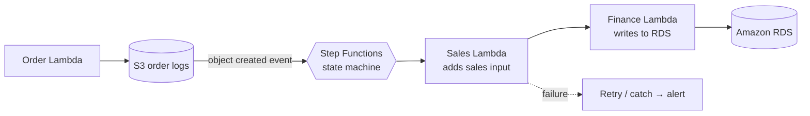
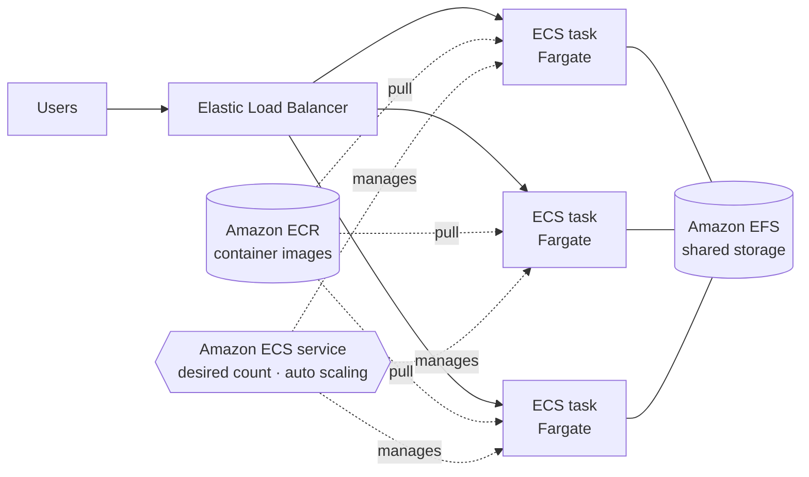

# Application and Container Orchestration

> [!abstract] TL;DR
> **Application orchestration with AWS Step Functions**
> - A ==serverless workflow service== that coordinates multiple AWS services.
> - It has a **visual workflow** designer and **JSON state machines**, with **tracking and error handling** built in.
> - Example: make sure the **sales** Lambda processes S3 order logs **before** the **finance** Lambda loads them into RDS.
>
> **Container orchestration** ==automates managing, scaling, and deploying containers== (replicas, auto scaling, networking).
> - Replace hand-managed **Docker on EC2** (own registry, EBS volumes, hand-configured load balancer and auto scaling) with **Amazon ECS** tasks on **AWS Fargate** (serverless compute).
> - Store images in **Amazon ECR**, keep the **load balancer**, and use **Amazon EFS** for shared storage.

**Lesson:** L3 – Determining New Architecture for Cloud Workloads · **Previous:** [[Serverless Modernization]] · **Next lesson:** not yet released
**Section hub:** [[Designing AWS Architecture for Workloads]]
**Sources:** Videos C2-L3-A09 (Complex Orchestration with Step Functions) and C2-L3-A11 (Lesson Review), en-us transcripts. A09 promises an ECS demo, which isn't in the bundle (likely files 10–11). Material marked *beyond the lecture* is my addition.

> [!warning] Two statements in A09 to correct
> - "The launch type is the configuration for the **OS**." The launch type actually chooses the **compute infrastructure** a task runs on: **EC2** instances you manage, or **Fargate** (serverless).
> - "The Fargate launch type **requires** EFS." Fargate tasks have built-in **ephemeral storage** (20 GiB by default, expandable). **EFS** is needed only when containers need **persistent or shared** storage, which is the case in the lecture's architecture. EBS volumes can also attach to Fargate tasks.

> [!todo]- Contents
> 1. [[#1. Why Orchestrate]]
> 2. [[#2. Application Orchestration with AWS Step Functions]]
> 3. [[#3. Container Orchestration with Amazon ECS and Fargate]]
> 4. [[#4. ECS vs. EKS]]
> 5. [[#5. Pitfalls and Failure Modes]]
> 6. [[#6. Key Takeaways]]
> 7. [[#7. Critical Analysis]]
> 8. [[#8. Self-Test]]
> 9. [[#9. Glossary]]
> 10. [[#10. Further Reading]]

---

## 1. Why Orchestrate

Cloud resources share an architecture, so developers can get ==complex coordination and orchestration with little effort==. Two kinds:

| Orchestration | Coordinates | AWS service |
|---|---|---|
| **Application orchestration** | Steps and services in a workflow | **AWS Step Functions** |
| **Container orchestration** | Containers across a cluster of machines | **Amazon ECS** (with **Fargate**); *beyond the lecture*: **EKS** for Kubernetes |

---

## 2. Application Orchestration with AWS Step Functions

> [!info]+ Definition – AWS Step Functions
> A ==serverless workflow service== for **coordinating multiple AWS services** and streamlining serverless applications. ^def-step-functions

| Feature (lecture) | Meaning |
|---|---|
| **Visual workflow** | Coordinate components on a diagram |
| **JSON-based state machines** | Define workflows that coordinate and automate almost any task and connection in AWS (*beyond the lecture*: written in **Amazon States Language**) |
| **Whole-workflow automation** | Built-in **tracking** of each execution and **error handling** |

### The lecture's example – ordering two teams' processing

> [!example] Sales before finance
> A **Lambda** function writes **order logs** to **S3**. The **finance** team wants to process them and enter the results into **RDS**. But the **sales** team must process the logs **first** and add its input. A Step Functions workflow guarantees that when data lands in S3, the **sales Lambda runs first**, then the **finance Lambda**. ^sales-then-finance



**The state machine in Amazon States Language** (*beyond the lecture*; function names illustrative):

```json
{
  "Comment": "Order-log processing: sales must run before finance",
  "StartAt": "SalesProcessing",
  "States": {
    "SalesProcessing": {
      "Type": "Task",
      "Resource": "arn:aws:states:::lambda:invoke",
      "Parameters": { "FunctionName": "sales-process-order-log", "Payload.$": "$" },
      "Retry": [{ "ErrorEquals": ["States.TaskFailed"], "IntervalSeconds": 5, "MaxAttempts": 3, "BackoffRate": 2.0 }],
      "Next": "FinanceProcessing"
    },
    "FinanceProcessing": {
      "Type": "Task",
      "Resource": "arn:aws:states:::lambda:invoke",
      "Parameters": { "FunctionName": "finance-load-to-rds", "Payload.$": "$.Payload" },
      "End": true
    }
  }
}
```

The ordering, retries, and execution history live in the state machine, **not** in either Lambda's code. That's the value of orchestration over chaining functions by hand.

---

## 3. Container Orchestration with Amazon ECS and Fargate

> [!info]+ Definition – Container orchestration
> Services that ==automate managing, scaling, and deploying containers across a cluster== of machines. They manage **replicas**, **auto scaling**, and **networking** (between containers and to external applications), which increases the **reliability and availability** that production containers need. ^def-container-orchestration

### Before – Docker on EC2, managed by hand (lecture)

| Component | How it was run |
|---|---|
| Compute | **EC2 instances** each running their own **Docker** and **Docker registry** |
| Storage | **EBS volumes** attached as local storage |
| Traffic | **Elastic Load Balancer** |
| The problem | Effective but **operationally inefficient**: load balancer, **Auto Scaling groups**, Docker daemons, and more all configured **manually** |

### After – ECS on Fargate (lecture's reference architecture)

| Component | Service | Definition (lecture) |
|---|---|---|
| Traffic | **Elastic Load Balancer** (kept) | Configured to work with the orchestration service |
| Orchestrator | **Amazon ECS** | Fully managed container orchestration: **run, stop, and manage Docker containers** on a cluster. Containers run as ECS **tasks**. |
| Compute (launch type) | **AWS Fargate** | **Serverless compute engine** for containers. AWS provisions and shuts down compute automatically based on traffic. |
| Images | **Amazon ECR** | Fully managed **Docker container registry**: store, manage, and deploy images securely |
| Shared storage | **Amazon EFS** | **Elastic, shared** storage usable by every task as it's provisioned |



> [!tip] What changes for the operations team
> Instead of configuring instances, Docker daemons, and Auto Scaling groups, the team declares an **ECS service** (image, CPU/memory, desired count, scaling policy) and AWS keeps it true. This is the *container* version of the serverless shift. ^ecs-declarative

**Scaling example** (*beyond the lecture*): with target tracking at 1,000 requests per task and a peak of 12,000 requests, ECS scales to $\lceil 12{,}000 / 1{,}000 \rceil = 12$ tasks, then back down after the peak. You pay Fargate only for running task time.

**Hands-on:** [[Exercise 3 - Deploy FastAPI on Amazon ECS with Fargate - How To]] builds this pattern end to end: a FastAPI image in ECR, an ECS service on Fargate, and an ALB in a CloudFormation-built VPC. The ECS demo missing from the transcript bundle is covered by the repo files.

---

## 4. ECS vs. EKS

*Beyond the lecture.* This connects to Lesson 1, where Health Metrics' on-prem Kubernetes was replatformed to **EKS** ([[Cloud Migration Strategies]]).

| | **Amazon ECS** | **Amazon EKS** |
|---|---|---|
| Orchestrator | AWS-native | Managed **Kubernetes** |
| Learning curve | Lower | Higher (Kubernetes concepts) |
| Portability | AWS-specific | Kubernetes manifests portable across clouds |
| Compute | EC2 or **Fargate** | EC2 or **Fargate** |
| Best when | New AWS-centric container apps; simplicity | Existing Kubernetes skills and workloads (Health Metrics) |

---

## 5. Pitfalls and Failure Modes

| Failure | Symptom | Mitigation |
|---|---|---|
| Ordering logic inside Lambdas (chained calls) | Hidden coupling; no visibility; retries duplicate work | **Step Functions** owns order, retries, and history ([[#^sales-then-finance]]) |
| No error handling in workflows | Silent partial processing | `Retry` and `Catch` states with alerting |
| Self-managed Docker on EC2 | Manual load balancer, ASG, and daemon toil; drift | **ECS on Fargate** ([[#^ecs-declarative]]) |
| Assuming containers keep local data | Data lost when tasks stop | **EFS** (or external data stores) for persistent and shared data |
| Hosting your own registry on EC2 | Patching, security, availability burden | **ECR** |

---

## 6. Key Takeaways

- [ ] **Step Functions:** serverless workflow service. **Visual workflows**, **JSON state machines**, **tracking and error handling**.
- [ ] Lecture example: S3 order logs → **sales Lambda first** → **finance Lambda** → RDS.
- [ ] **Container orchestration** automates container **management, scaling, deployment**: replicas, auto scaling, networking, for reliability and availability.
- [ ] Before: **Docker on EC2** with its own registry, EBS, and a hand-configured ELB and ASG. After: **ECS tasks on Fargate**, **ECR** images, **EFS** shared storage, ELB kept.
- [ ] **ECS** runs, stops, and manages Docker containers. **Fargate** is serverless compute for containers. **ECR** is the managed registry. **EFS** is elastic shared storage.
- [ ] Lesson review: **evaluate** with the WA Tool → **modernize** data processing and architecture → scalable, resilient, cost-effective apps.

---

## 7. Critical Analysis

- **Orchestration vs. choreography** (*beyond the lecture*): Step Functions *orchestrates*, with one controller deciding the order. Event-driven designs with EventBridge or SNS *choreograph*, where each service reacts to events. Orchestration wins when **order and error handling matter** (sales before finance). Choreography wins for loosely coupled fan-out.
- **Fargate removes servers, not architecture work.** You still design task sizing, networking (subnets, security groups), health checks, and scaling policies. A poorly sized Fargate task can cost more than well-packed EC2 hosts, so EC2 launch type plus Savings Plans can win for steady, dense workloads.
- **The lecture's storage claim matters for design reviews.** Saying "Fargate requires EFS" could push teams to add EFS where ephemeral storage or an external database is the right answer. Use EFS deliberately, for persistent or shared files.
- **Modernization should be justified by the review.** The lesson's logic is WA Tool findings → targeted changes. Adopting ECS or Step Functions without a reliability or performance finding behind it is fashion, not architecture.

> [!question] Open discussion questions
> 1. Should Health Metrics' Kubernetes workload stay on EKS (Lesson 1) or move to ECS? What would you need to know?
> 2. Where else in Health Metrics' workloads would ordered, multi-step processing justify Step Functions?

---

## 8. Self-Test

> [!question]- Q1. What is AWS Step Functions, and what are its main features?
> A **serverless workflow service** for coordinating multiple AWS services. Features: a **visual workflow**, **JSON-based state machines**, and automated workflows with **tracking and error handling**.

> [!question]- Q2. Describe the lecture's Step Functions example.
> A Lambda writes order logs to S3. A Step Functions workflow makes sure the **sales Lambda** processes each log **before** the **finance Lambda** enters the results into **RDS**.

> [!question]- Q3. What does container orchestration automate, and what does it provide?
> **Managing, scaling, and deploying** containers across a cluster: **replicas**, **auto scaling**, and **networking**, which increases **reliability and availability**.

> [!question]- Q4. In the lecture's reference architecture, what does each of ECS, Fargate, ECR, EFS, and the ELB do?
> **ECS:** runs, stops, and manages containers (tasks). **Fargate:** serverless compute for the tasks. **ECR:** stores container images. **EFS:** shared, elastic storage for the tasks. **ELB:** distributes traffic to the tasks.

> [!question]- Q5. What does an ECS launch type actually choose, and does Fargate always require EFS?
> The **compute infrastructure**: **EC2** instances you manage, or **Fargate** (serverless). **No.** Fargate has ephemeral storage. EFS is needed only for **persistent or shared** storage.

> [!question]- Q6. (Quantitative) An ECS service targets 800 requests per task and peaks at 10,000 requests. How many tasks run at peak?
> $\lceil 10{,}000 / 800 \rceil = \lceil 12.5 \rceil = $ **13 tasks**.

> [!tip] Flashcards
> Review this lesson with [[Application and Container Orchestration - Flashcards]].

---

## 9. Glossary

| Term | Meaning |
|---|---|
| AWS Step Functions | Serverless workflow orchestration service |
| State machine | A workflow definition of states and transitions |
| Amazon States Language | JSON language for Step Functions state machines (*beyond the lecture*) |
| Container orchestration | Automated management, scaling, and deployment of containers |
| Amazon ECS | AWS-managed container orchestration service |
| Task | A running set of containers in ECS |
| Launch type | Compute infrastructure for ECS tasks: EC2 or Fargate |
| AWS Fargate | Serverless compute for containers |
| Amazon ECR | Managed container image registry |
| Amazon EFS | Elastic, shared network file system |
| Amazon EKS | Managed Kubernetes (*beyond the lecture*) |

---

## 10. Further Reading

- [What is AWS Step Functions](https://docs.aws.amazon.com/step-functions/latest/dg/welcome.html)
- [What is Amazon Elastic Container Service](https://docs.aws.amazon.com/AmazonECS/latest/developerguide/Welcome.html)
- [AWS Fargate for Amazon ECS](https://docs.aws.amazon.com/AmazonECS/latest/developerguide/AWS_Fargate.html)
- [What is Amazon ECR](https://docs.aws.amazon.com/AmazonECR/latest/userguide/what-is-ecr.html)
