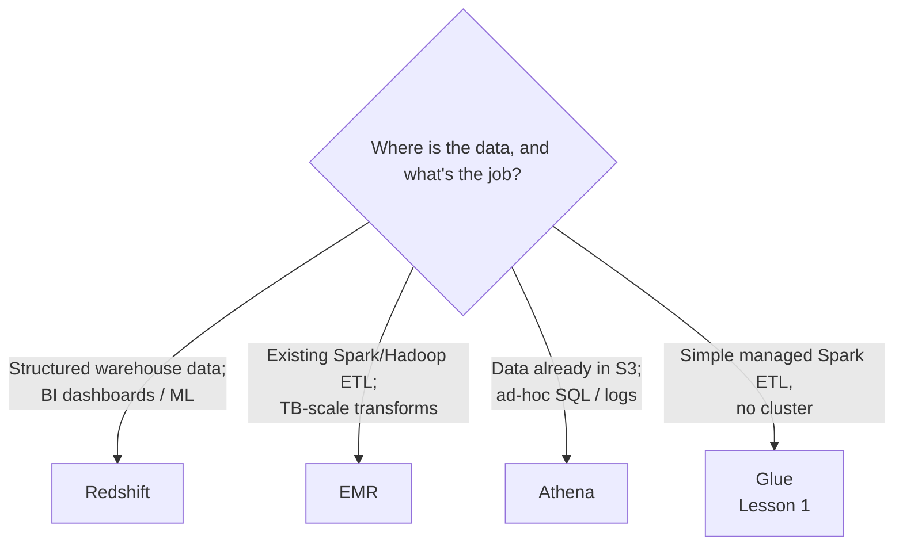

# Enhancing Data Processing with Redshift, EMR, and Athena

> [!abstract] TL;DR
> The **first modernization strategy**: integrate AWS **data processing services** so applications get more value from their data and scale with demand.
> - **Amazon Redshift**: a managed, ==petabyte-scale SQL data warehouse==. Massively parallel processing and columnar storage. For **BI and ML on data-warehouse data**.
> - **Amazon EMR**: a managed ==big-data platform== (Hadoop, Spark, Hive, Presto) with dynamic scaling. For **existing Spark/Hadoop ETL** and **terabyte-scale** pipelines.
> - **Amazon Athena**: ==serverless SQL directly on S3==, pay per query. For **extracting value from data already in S3**, including **logs**.
>
> The lab: query a raw Netflix-titles CSV in S3 with Athena.

**Lesson:** L3 – Determining New Architecture for Cloud Workloads · **Previous:** [[AWS Well-Architected Tool]] · **Next:** [[Serverless Modernization]]
**Section hub:** [[Designing AWS Architecture for Workloads]]
**Sources:** Video C2-L3-A06 (Modernizing Applications), the Athena demo, and the Athena exercise solution video, en-us transcripts. The course repo numbers the Athena lab **Exercise 2**. The demo files are labelled "L2 D1" / "L2 E1" in the bundle but belong to this lesson. Material marked *beyond the lecture* is my addition.

> [!todo]- Contents
> 1. [[#1. The Three Services]]
> 2. [[#2. Amazon Redshift]]
> 3. [[#3. Amazon EMR]]
> 4. [[#4. Amazon Athena]]
> 5. [[#5. Choosing a Data Processing Service]]
> 6. [[#6. Lab Walkthrough – Exercise 2 Athena]]
> 7. [[#7. Pitfalls and Failure Modes]]
> 8. [[#8. Key Takeaways]]
> 9. [[#9. Critical Analysis]]
> 10. [[#10. Self-Test]]
> 11. [[#11. Glossary]]
> 12. [[#12. Further Reading]]

---

## 1. The Three Services

| Service | One-line definition (lecture) | Interface | Ops model |
|---|---|---|---|
| **Amazon Redshift** | Fully managed **petabyte-scale data warehouse**, optimized for analyzing large datasets with **SQL-based tools** | SQL | Managed clusters, or serverless (*beyond the lecture*: Redshift Serverless) |
| **Amazon EMR** | Managed **big-data platform** processing vast data with open-source tools: **Apache Spark, Hive, Presto** | Spark / Hive / Presto | Managed clusters with dynamic scaling |
| **Amazon Athena** | **Serverless** query service for analyzing **data in S3** with **standard SQL** | SQL | Serverless, **pay per query** |

---

## 2. Amazon Redshift

> [!info]+ Definition – Amazon Redshift
> A fully managed, petabyte-scale **data warehouse**. Its **massively parallel processing (MPP)** architecture and **columnar storage** make it an optimized warehouse for SQL analytics. ^def-redshift

| | Detail (lecture) |
|---|---|
| **Apply when** | Enabling **business intelligence** on **existing data warehouses**; applying **machine learning** to data in existing warehouses |
| **Benefits** | Unlock the value of data with **low-latency queries**; **serverless** option, so you **pay only for what you use**, with **auto scaling**; analytics on traditional data-warehousing workloads |

> [!info]+ Definition – MPP and columnar storage (*beyond the lecture* explanation)
> **MPP** splits a query across many nodes that each process a slice of the data in parallel. **Columnar storage** stores each column together, so analytic queries that touch a few columns of many rows read far less data and compress well. ^def-mpp-columnar

---

## 3. Amazon EMR

> [!info]+ Definition – Amazon EMR
> A managed **big-data platform**: a **fully managed Hadoop cluster** with **Spark** and **Hive**, plus built-in optimized connectors to **S3** and other AWS services. ^def-emr

| | Detail (lecture) |
|---|---|
| **Apply when** | Optimizing **existing ETL pipelines**, especially those already on **Spark and Hadoop**; scaling a pipeline up to **big data** (terabytes of production data) |
| **Benefits** | Scale ETL jobs quickly with **automated dynamic scaling**, and **scale back** when idle. Minimal server management compared with a hand-built cluster of EC2 instances. |

> [!tip] EMR vs. Glue (Lesson 1)
> Both run Spark. **Glue** ([[Refactoring Data Workloads with AWS Glue]]) is **serverless**: you submit a job and pay per DPU-time. **EMR** gives a **managed cluster** you can tune, with more frameworks (Hive, Presto, HBase) and more control. Choose Glue for simple managed ETL, and EMR for existing Hadoop/Spark estates that need control and scale (*beyond the lecture* comparison). ^emr-vs-glue

---

## 4. Amazon Athena

> [!info]+ Definition – Amazon Athena
> A ==serverless== query service for analyzing data **stored in S3** using **standard SQL**, priced **per query**. ^def-athena

| | Detail (lecture) |
|---|---|
| **Apply when** | **Vast datasets in S3** that hold extractable business value; quickly analyzing **vast logs** in S3 |
| **Benefits** | **Cost-effective** analysis of S3 data with **simple, well-known SQL** |

**The three-step model (demo):**
1. **Point to your data source**, an S3 location.
2. **Specify the query output location**, also S3. The slide omits this, but the demo stresses it.
3. **Query** with familiar SQL.

See also Athena for log analytics in [[Centralized Logging and Event Notification#6. Choosing an Analytics Strategy]].

**Cost** (*beyond the lecture*, illustrative \$5 per TB scanned, 10 MB minimum per query):

$$
\text{cost} = \max(\text{data scanned}, 10\text{ MB}) \times \$5/\text{TB}
$$

The lab's ~3 MB CSV is billed as 10 MB, about **\$0.00005 per query**. A 2 TB raw log scan costs \$10, but the same question over date-partitioned Parquet might scan 50 GB and cost \$0.25.

---

## 5. Choosing a Data Processing Service

| Scenario | Service |
|---|---|
| BI team needs fast, repeated SQL over curated warehouse tables | **Redshift** |
| On-prem Hadoop/Spark pipeline processing TBs nightly | **EMR** |
| Analysts want to explore CSV/JSON/Parquet files and logs in S3 | **Athena** |
| Health Metrics' Spark job from Lesson 1, refactored to serverless | **Glue** ([[#^emr-vs-glue]]) |

---

## 6. Lab Walkthrough – Exercise 2 Athena

The demo and solution query **`netflix_titles.csv`** in S3:

| Item | Demo |
|---|---|
| Source | S3 bucket (the demo calls it "athena test") → `data/` folder → `netflix_titles.csv` |
| Output | A separate **Athena output bucket**, set in **Query editor → Settings** |
| Database | `CREATE DATABASE movies` |
| Table | External table `netflix_titles` over the `data/` folder |
| Demo queries | Count by type (**2,676 TV shows**, **6,131 movies**); top 10 countries by content count |
| **Exercise query** | ==Average release year for each rating== |
| Solution result | e.g. **TV-PG → 1944.0** |
| Repo layout | One bucket `athena-exercise-bucket-<suffix>` with `input/` (CSV) and `output/` (results) prefixes |

> [!warning] Why the demo's data looked "mislabeled"
> The instructor saw people's names in the country column and called the data unclean. The more likely cause is **parsing**: `netflix_titles.csv` has **quoted fields containing commas** (cast lists, countries). A table defined with a plain comma delimiter splits those fields and **shifts later columns**. Athena's **OpenCSVSerDe** handles quotes. The exercise is graded against the instructor's raw (shifted) results, so the how-to shows both versions.

Step by step: [[Exercise 2 - Query S3 Data with Amazon Athena - How To]].

---

## 7. Pitfalls and Failure Modes

| Failure | Symptom | Mitigation |
|---|---|---|
| No query result location set in Athena | Queries fail ("output location not set" / bucket doesn't exist) | **Settings → Query result location** to your output bucket |
| Plain comma delimiter on quoted CSV | Shifted columns; "dirty" results | `OpenCSVSerde` (or convert to Parquet) |
| Athena over huge raw files | Slow, expensive scans | Partition and convert to columnar formats |
| Self-managed Spark on EC2 | Constant cluster upkeep; idle cost | EMR (managed, dynamic scaling) or Glue (serverless) |
| Redshift for ad-hoc lake queries | Paying to load data that's queried once | Athena directly on S3 |

---

## 8. Key Takeaways

- [ ] Modernization strategy 1: **enhance data processing** with Redshift, EMR, and Athena.
- [ ] **Redshift:** managed **petabyte-scale data warehouse**; **MPP + columnar**; for **BI and ML on existing warehouses**; low latency; serverless pay-per-use with auto scaling.
- [ ] **EMR:** managed **Hadoop/Spark/Hive/Presto**; for **existing Spark/Hadoop ETL** and **TB-scale** pipelines; dynamic scaling up and down; minimal server management.
- [ ] **Athena:** **serverless SQL on S3**, **pay per query**; for valuable S3 datasets and **logs**.
- [ ] **Athena steps:** point to the S3 source → set the **S3 output location** → query.

---

## 9. Critical Analysis

- **The three services overlap more than the lecture suggests.** Redshift Spectrum queries S3 too, Athena can run Spark, and EMR Serverless removes cluster management. The useful distinction is **workload shape**: repeated low-latency BI (Redshift), heavy transformation pipelines (EMR/Glue), and ad-hoc exploration of lake data (Athena).
- **"Unclean data" vs. "misparsed data" matters.** The demo's result (average release year 1944 for TV-PG) is implausible for Netflix content. That's a signal of a schema or parsing problem, not just messy data. Validating query results against expectations is the same discipline as Lesson 2's [[Data Validation and Synchronization|data validation]].
- **Serverless pricing changes architecture decisions.** Athena's per-TB pricing rewards good data layout (partitioning, columnar formats). Teams that move logs to S3 without a layout plan often see Athena bills rise.

> [!question] Open discussion questions
> 1. Health Metrics wants daily dashboards plus occasional deep-dive analysis of raw device logs. Which combination of services would you use?
> 2. When would you keep a Spark pipeline on EMR rather than refactoring it to Glue?

---

## 10. Self-Test

> [!question]- Q1. Match each service to its definition: Redshift, EMR, Athena.
> **Redshift:** managed petabyte-scale SQL data warehouse. **EMR:** managed big-data platform (Spark, Hive, Presto). **Athena:** serverless SQL queries on S3 data.

> [!question]- Q2. What two architectural features make Redshift an optimized data warehouse?
> **Massively parallel processing** and **columnar data storage**.

> [!question]- Q3. When does the lecture recommend EMR?
> To optimize **existing ETL pipelines**, especially those already on **Spark and Hadoop**, or to scale a pipeline to analyze **terabyte-scale** big data.

> [!question]- Q4. What are the steps to query S3 data with Athena?
> Point Athena at the **S3 data source**, set the **S3 query output location**, create the database and table, then **run SQL queries**.

> [!question]- Q5. (Quantitative) A daily Athena query scans 300 GB of raw JSON at \$5/TB. What does it cost per month, and what if Parquet plus partitioning cuts the scan to 15 GB?
> $0.3 \times 5 \times 30 = \$45$/month raw. $0.015 \times 5 \times 30 = \$2.25$/month optimized, a **95% reduction**.

> [!question]- Q6. (Design) A team runs a self-managed Spark cluster on 20 EC2 instances that sits idle 18 hours a day. What does the lecture suggest, and why?
> **Amazon EMR.** A managed Hadoop/Spark cluster with **automated dynamic scaling** that **scales back** when idle, and **minimal server management**. (Glue is the serverless alternative if the jobs are simple.)

> [!tip] Flashcards
> Review this lesson with [[Enhancing Data Processing with Redshift, EMR, and Athena - Flashcards]].

---

## 11. Glossary

| Term | Meaning |
|---|---|
| Data warehouse | Central store of structured data optimized for analytics |
| MPP | Massively parallel processing across many nodes |
| Columnar storage | Storing data by column for efficient analytic scans |
| Amazon Redshift | Managed petabyte-scale data warehouse |
| Amazon EMR | Managed big-data platform (Hadoop, Spark, Hive, Presto) |
| Amazon Athena | Serverless SQL over S3, pay per query |
| ETL | Extract, transform, load |
| OpenCSVSerDe | Athena CSV parser that handles quoted fields (*beyond the lecture*) |
| Query result location | S3 path where Athena writes query output |

---

## 12. Further Reading

- [What is Amazon Redshift](https://docs.aws.amazon.com/redshift/latest/mgmt/welcome.html)
- [What is Amazon EMR](https://docs.aws.amazon.com/emr/latest/ManagementGuide/emr-what-is-emr.html)
- [What is Amazon Athena](https://docs.aws.amazon.com/athena/latest/ug/what-is.html)
- [OpenCSVSerDe for processing CSV](https://docs.aws.amazon.com/athena/latest/ug/csv-serde.html)
