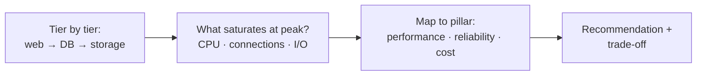

# Exercise 1 – Assessing and Optimizing Workloads – How To

> [!abstract] Goal
> A **paper exercise**. Assess an existing AWS web application that is **slow at peak**, **struggles to scale**, and **costs too much**. Then:
> 1. **Identify bottlenecks**
> 2. **Recommend optimizations** for performance, scalability, and cost
> 3. **Justify** each one, including trade-offs
>
> No AWS resources are needed. It takes about 45 minutes.

**Concepts:** [[AWS Well-Architected Tool]] (pillar-based review) · [[Serverless Modernization]] · [[Optimized Architectures and the Migration Lens]] (overprovisioning and underprovisioning) · [[AWS Purchasing Options and Rightsizing]]
**Sources:** the course repo `lesson-3-managed-services/exercise 1/`: `starter/optimizing_workloads_scenario.md` and `solution/optimizing_workloads_solution.md`.

---

## 1. The Scenario

| Tier | Current architecture |
|---|---|
| **Web** | **4 × t2.micro** EC2 running Node.js behind an **ALB**; Auto Scaling group **min 2 / max 6** |
| **Database** | **Single db.t2.micro** RDS MySQL; **no read replicas** |
| **Static content** | **S3** + **CloudFront** CDN |
| **Traffic** | Variable, **peaks during business hours** |

**Reported problems:** slow responses at peak (performance); can't handle peak traffic (scalability); not cost-optimized (cost).

---

## 2. How to Work It – A Pillar-Based Method

Use the [[AWS Well-Architected Tool]] mindset: walk each tier, ask what fails at peak, then map each finding to a pillar.



| Question | Where to look |
|---|---|
| What runs out first at peak? | CPU credits (t2), DB connections and CPU, scaling lag |
| What is a single point of failure? | The single-AZ, single DB instance |
| What runs (and costs) when idle? | Instances sized for peak running off-hours |
| What's already good? | S3 + CloudFront offloading static content |

---

## 3. Bottlenecks (Official Solution, Annotated)

| # | Bottleneck (repo solution) | Why it hurts | Pillar |
|---|---|---|---|
| B1 | **t2.micro web instances** may be insufficient at peak, causing **CPU throttling** | *Beyond the solution:* t2 instances are **burstable**. When CPU credits run out at peak they're throttled to a low baseline, exactly when traffic is highest. | Performance |
| B2 | **Auto Scaling policy too slow** for traffic spikes | New instances arrive after users already feel the slowdown | Performance, Reliability |
| B3 | **Single db.t2.micro**, no read replicas | All reads and writes hit one small burstable instance | Performance, Scalability |
| B4 | **Underutilized resources off-peak** | Paying for capacity sized for business hours around the clock | Cost |
| B5 *(added)* | DB is **single-AZ** (no Multi-AZ stated) | An AZ or instance failure takes the database, and the app, down | **Reliability** |

---

## 4. Recommendations and Justifications

### Official solution

| Area | Recommendation | Justification (repo) |
|---|---|---|
| Web | **Resize** to **t3.medium / t3.large** | More CPU and memory, less throttling, faster responses at peak |
| Web | **Faster auto scaling** on **CPU utilization or request count** | Handles spikes without degradation |
| DB | **Add read replicas** | Distributes read traffic and reduces load on the primary |
| DB | **Consider Amazon Aurora** | Scalability and performance benefits over standard RDS MySQL |
| Cost | **Spot Instances** for non-critical workloads | Large savings for interruption-tolerant work |
| Cost | **S3 lifecycle policies** | Move infrequently accessed data to cheaper classes |

### Strengthening the answer (*beyond the solution*)

| Recommendation | Why | Trade-off |
|---|---|---|
| **Scheduled scaling** before business hours, plus **target tracking** on `ALBRequestCountPerTarget` | Peaks are predictable, so pre-warm instead of reacting | Must maintain schedules if hours change |
| **RDS Multi-AZ** | Fixes the reliability gap (B5). Automatic failover. | Roughly doubles DB instance cost |
| **ElastiCache** for hot reads | Cuts DB read load more than replicas for repeated queries | Cache invalidation complexity |
| **Aurora Serverless** ([[Serverless Modernization#3. Three Serverless Swaps]]) | Capacity follows the business-hours curve automatically | Scaling latency; version constraints |
| **Mixed-instances ASG:** On-Demand base + Spot for burst | Spot discount on stateless web capacity above the baseline | 2-minute reclaim; needs multiple instance types |
| **Savings Plan** for the always-on baseline (min 2 instances, DB) | 30%+ off steady capacity ([[AWS Purchasing Options and Rightsizing]]) | 1–3 year commitment |
| **Rightsize from data** (Compute Optimizer) rather than guessing t3.large | Avoids replacing underprovisioning with overprovisioning | Needs 30+ hours of metrics |

> [!warning] Read replicas don't fix write bottlenecks
> Replicas offload **reads only**, and the app must send reads to the replica endpoint. If peak slowness comes from writes or connection limits, scale the primary up, move to Aurora, or add RDS Proxy (*beyond the solution*).

---

## 5. Example Answer Structure

Use this skeleton for your submission:

```markdown
## Identified Bottlenecks
1. Web tier – burstable t2.micro throttles at peak; reactive scaling too slow
2. Database tier – single small instance, no replicas, single-AZ
3. Cost – peak-sized capacity runs 24/7

## Recommended Optimizations
1. Web – t3.medium + target tracking on request count + scheduled scale-out at 08:00
2. Database – Multi-AZ + read replica (or Aurora / Aurora Serverless)
3. Cost – Savings Plan for baseline, Spot for burst capacity, S3 lifecycle rules

## Justification
- For each: the problem it solves, the pillar, and the trade-off
```

---

## 6. Self-Check

- [ ] Every bottleneck is tied to a **specific component** and a **pillar**
- [ ] Each recommendation has a **justification** and a **trade-off**
- [ ] Covers **performance**, **scalability**, and **cost**, the three stated challenges
- [ ] Notes what's **already good** (S3 + CloudFront) rather than changing it
- [ ] Bonus: catches the **reliability** gap (single-AZ database)
