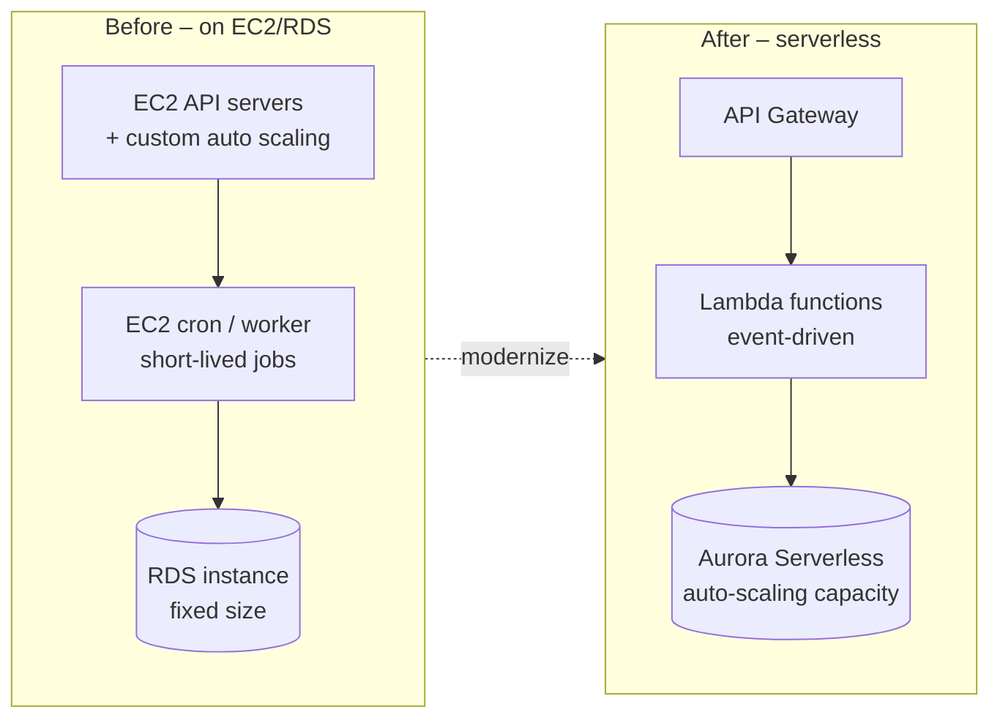

# Serverless Modernization

> [!abstract] TL;DR
> The **second modernization strategy** improves applications by **optimizing their architecture**, using one of three techniques: ==serverless==, ==application orchestration==, and ==container orchestration==.
>
> **Serverless** lets developers worry only about their application. AWS **scales automatically with load** and you **pay only for what you use**, which enables **event-driven** designs with no always-on servers. Three swaps:
> - an **API served directly on EC2** → **API Gateway**
> - **short-lived functions on EC2** → **Lambda**
> - a **relational database on RDS** with changing load → **Aurora Serverless**

**Lesson:** L3 – Determining New Architecture for Cloud Workloads · **Previous:** [[Enhancing Data Processing with Redshift, EMR, and Athena]] · **Next:** [[Application and Container Orchestration]]
**Section hub:** [[Designing AWS Architecture for Workloads]]
**Sources:** Video C2-L3-A08 (Modernizing Applications with Improved Application Architecture), en-us transcript. Lesson 1 already built a serverless replatform: [[Re-platforming to Serverless with AWS Lambda]]. Material marked *beyond the lecture* is my addition.

> [!todo]- Contents
> 1. [[#1. Three Architecture-Improvement Techniques]]
> 2. [[#2. What Serverless Means]]
> 3. [[#3. Three Serverless Swaps]]
> 4. [[#4. Worked Example – Always-On EC2 vs. Lambda]]
> 5. [[#5. Pitfalls and Failure Modes]]
> 6. [[#6. Key Takeaways]]
> 7. [[#7. Critical Analysis]]
> 8. [[#8. Self-Test]]
> 9. [[#9. Glossary]]
> 10. [[#10. Further Reading]]

---

## 1. Three Architecture-Improvement Techniques

The cloud's scalability and elasticity offer countless ways to optimize an application by changing its architecture. The lecture covers three:

| Technique | Definition (lecture) | Note |
|---|---|---|
| **Serverless** | An application that can be used, scaled, and provisioned **without the user managing servers** | This note |
| **Application orchestration** | **Automates complex connections and processes** between applications | [[Application and Container Orchestration#2. Application Orchestration with AWS Step Functions]] |
| **Container orchestration** | A key component of **accelerating the value of microservices** in the cloud | [[Application and Container Orchestration#3. Container Orchestration with Amazon ECS and Fargate]] |

---

## 2. What Serverless Means

> [!info]+ Definition – Serverless architecture
> An architectural approach where the developer ==only worries about creating the application==. The lecture's analogy: wireless phones free users from worrying about phone wires. ^def-serverless

| Property (lecture) | Effect |
|---|---|
| **Automatic scaling with load** | Prevents **overprovisioning** while ensuring **capacity at peak** |
| **Pay only for what you use** | Optimizes cost; no paying for idle servers |
| **Event-driven workflows** | Code and jobs **run when needed**, without the expense of always-on servers |

This is the same fixed-cost to variable-cost shift from Lesson 1 ([[Optimized Architectures and the Migration Lens]]): overprovisioning wastes money, and underprovisioning fails at peak.

---

## 3. Three Serverless Swaps

| Current state on AWS | Problem (lecture) | Serverless replacement | What it is (lecture) |
|---|---|---|---|
| **API served directly on EC2** | Needs custom **auto scaling** configuration and **API security** | **Amazon API Gateway** | Fully managed service to **create, publish, maintain, monitor, and secure APIs at any scale** |
| **Short-lived functions on EC2** (e.g. sending updates, monitoring a database) | An always-on server for occasional work | **AWS Lambda** | Serverless compute that **runs your code in response to events** and manages the underlying compute |
| **Relational database on RDS** with changing needs | Fixed instance size for variable load | **Amazon Aurora Serverless** | On-demand **auto-scaling** configuration of Aurora. Automatically **starts up, shuts down, and scales** capacity with the application's needs. |

^serverless-swaps

> [!note] Limits to know (*beyond the lecture*)
> - **Lambda** runs up to **15 minutes** per invocation. Longer jobs belong in Step Functions, Fargate, or EMR/Glue.
> - **API Gateway** adds throttling, authorization (IAM, Cognito, Lambda authorizers), and caching that EC2-hosted APIs build by hand.
> - **Aurora Serverless v2** scales in fine-grained capacity units, and newer versions can pause at zero capacity when idle. Check whether your engine version and workload suit it.

---

## 4. Worked Example – Always-On EC2 vs. Lambda

*Beyond the lecture, with illustrative us-east-1 prices.* Health Metrics' "appointment reminder" job runs **1 million times a month**, **200 ms** each, with **512 MB** of memory.

**Always-on EC2** (t3.medium at \$0.0416/h):

$$
0.0416 \times 730 \approx \$30.4/\text{month}
$$

**Lambda** (\$0.0000166667 per GB-second + \$0.20 per million requests):

$$
\underbrace{10^6 \times 0.2\text{ s} \times 0.5\text{ GB}}_{100{,}000 \text{ GB-s}} \times 0.0000166667 + 0.20 \approx 1.67 + 0.20 = \$1.87/\text{month}
$$

About **94% cheaper**, and it scales automatically if reminders spike. The comparison flips for **steady, high-throughput** work: a function busy 24/7 can cost more than a right-sized instance.

---

## 5. Pitfalls and Failure Modes

| Failure | Symptom | Mitigation |
|---|---|---|
| Moving long-running jobs to Lambda | Timeouts at 15 minutes | Step Functions, Fargate, or Glue/EMR for long work |
| Keeping custom auth and scaling on EC2 APIs | Security gaps; scaling incidents | API Gateway with managed auth and throttling |
| Aurora Serverless for steady, flat load | No savings over provisioned | Provisioned Aurora or RDS (plus Savings Plans) for flat load |
| Ignoring cold starts | Latency spikes after idle periods | Provisioned concurrency for latency-sensitive paths (*beyond the lecture*) |
| Serverless everywhere | Hard-to-trace distributed failures | Tracing and logging (X-Ray, CloudWatch) and orchestration ([[Application and Container Orchestration]]) |

---

## 6. Key Takeaways

- [ ] Modernization strategy 2 (improve application architecture) has three techniques: **serverless**, **application orchestration**, **container orchestration**.
- [ ] **Serverless:** focus only on the application; **auto scaling with load**; **pay for use**; **event-driven** without always-on servers.
- [ ] **API on EC2 → API Gateway** (create, publish, maintain, monitor, secure APIs at any scale).
- [ ] **Short-lived functions on EC2 → Lambda** (code runs in response to events).
- [ ] **RDS with changing needs → Aurora Serverless** (auto start, stop, and scale).

---

## 7. Critical Analysis

- **Serverless trades control for operations savings.** You give up OS access, long runtimes, and some performance predictability. In exchange, scaling, patching, and capacity planning disappear. The trade is best for **spiky, event-driven** workloads, and weakest for steady, compute-heavy ones (see the worked example's flip side).
- **Cost becomes per-request, so architecture affects cost directly.** Chatty function-to-function calls and oversized memory settings multiply the bill. Cost reviews must look at invocation patterns, not instance counts.
- **Database serverless is the hardest swap.** Connection behavior, scaling latency, and engine-version support make Aurora Serverless less "drop-in" than API Gateway or Lambda. Validate with load tests, using Lesson 2's validation discipline.

> [!question] Open discussion questions
> 1. Which Health Metrics component would you *not* move to serverless, and why?
> 2. How would a Well-Architected review's cost and performance findings change after these three swaps?

---

## 8. Self-Test

> [!question]- Q1. Name the three techniques for improving application architecture.
> **Serverless**, **application orchestration**, and **container orchestration**.

> [!question]- Q2. What are the three benefits of a serverless architecture according to the lecture?
> **Automatic scaling with load** (no overprovisioning, capacity at peak), **pay only for what you use**, and **event-driven workflows** without always-on servers.

> [!question]- Q3. Match each EC2/RDS pattern to its serverless replacement.
> API on EC2 → **API Gateway**. Short-lived functions on EC2 → **Lambda**. Relational DB on RDS with changing needs → **Aurora Serverless**.

> [!question]- Q4. (Quantitative) A function runs 3 million times a month at 100 ms with 1 GB of memory. Estimate the Lambda cost at \$0.0000166667/GB-s and \$0.20 per million requests.
> Compute: $3{\times}10^6 \times 0.1 \times 1 = 300{,}000$ GB-s × 0.0000166667 ≈ \$5.00. Requests: 3 × \$0.20 = \$0.60. Total ≈ **\$5.60/month**.

> [!question]- Q5. (Design) A 40-minute nightly data-cleanup script runs on a dedicated EC2 instance. Is Lambda a good fit?
> **Not directly.** Lambda's maximum runtime is 15 minutes. Split the job into steps coordinated by **Step Functions**, or run it as a scheduled **Fargate** task or **Glue** job.

> [!tip] Flashcards
> Review this lesson with [[Serverless Modernization - Flashcards]].

---

## 9. Glossary

| Term | Meaning |
|---|---|
| Serverless | Architecture where the provider manages servers, scaling, and capacity |
| Amazon API Gateway | Managed service to create, publish, maintain, monitor, and secure APIs |
| AWS Lambda | Event-driven serverless compute |
| Amazon Aurora Serverless | Auto-scaling, on-demand configuration of Aurora |
| Event-driven | Work triggered by events rather than running continuously |
| Cold start | Extra latency when a function instance initializes (*beyond the lecture*) |
| GB-second | Lambda billing unit: memory (GB) × duration (s) |

---

## 10. Further Reading

- [What is Amazon API Gateway](https://docs.aws.amazon.com/apigateway/latest/developerguide/welcome.html)
- [What is AWS Lambda](https://docs.aws.amazon.com/lambda/latest/dg/welcome.html)
- [Using Aurora Serverless v2](https://docs.aws.amazon.com/AmazonRDS/latest/AuroraUserGuide/aurora-serverless-v2.html)
