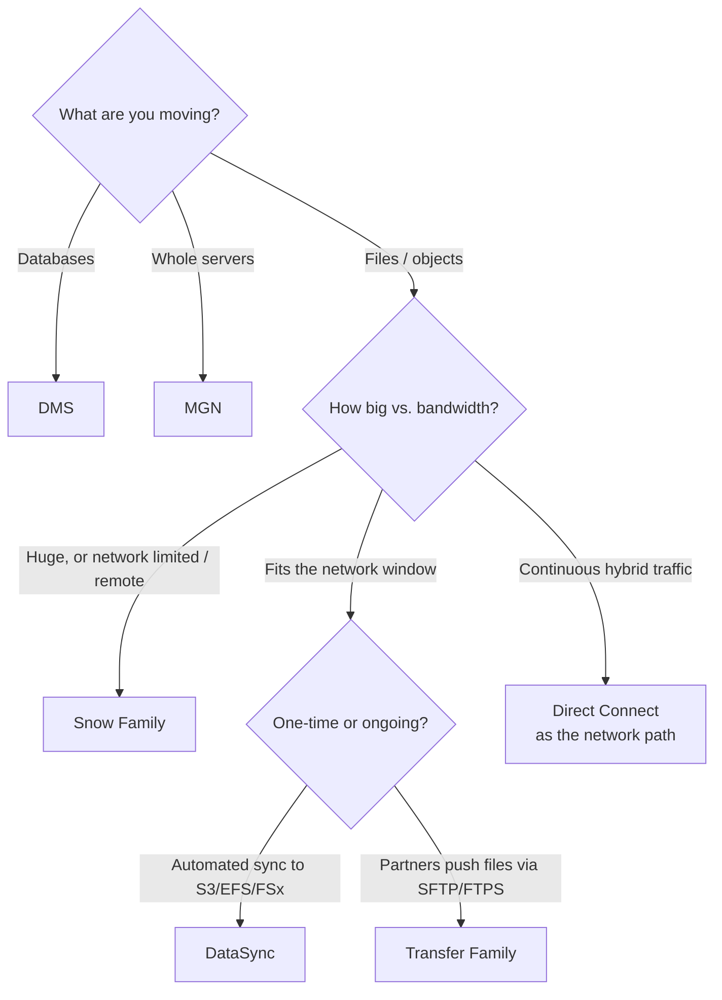

# AWS Data Transfer Services

> [!abstract] TL;DR
> Some jobs don't fit DMS or MGN: moving **whole data centers' worth of files**, or **dedicated transfers** of smaller volumes. For these, AWS has a data-transfer suite:
> - **Snow Family** (==offline, physical devices==): for very large datasets, where shipping beats bandwidth.
>   - **Snowcone**: small and rugged; 8 TB HDD or 14 TB SSD, 2 vCPU, 4 GB RAM; for edge and disaster recovery.
>   - **Snowball Edge**: terabytes to petabytes, with on-device compute.
> - **DataSync** (==online, managed==): moves data to S3, EFS, and FSx with encryption, validation, and bandwidth optimization; one-time or ongoing.
> - **Direct Connect** (==dedicated link==): consistent performance and lower transfer cost, for hybrid, ongoing sync.
> - **Transfer Family** (==managed SFTP/FTPS/FTP==): secure, standards-based file exchange.

**Lesson:** L2 – Migrating Workloads · **Previous:** [[Workload Migration with DMS and MGN]] · **Next:** [[Data Validation and Synchronization]]
**Section hub:** [[Designing AWS Architecture for Workloads]]
**Sources:** Videos C2-L2-A09 (AWS Data Transfer Tools) and C2-L2-A10 (AWS Virtual Transfer), en-us transcripts. A09 promises a Snow Family demo, which isn't in the bundle. Material marked *beyond the lecture* is my addition.

> [!warning] The two videos give different thresholds
> **A09** says Snow Family for **more than 8 TB** and DataSync for **under 8 TB**. **A10** says virtual transfer services apply once datasets are **smaller than 2 TB**. Treat both as rules of thumb. The real decision is **data size versus available bandwidth and deadline** ([[#2. Online vs. Offline – Do the Math]]). For a course quiz, expect the 8 TB figure from the tool-suite overview.

> [!todo]- Contents
> 1. [[#1. When Workload Migration Services Aren't the Right Fit]]
> 2. [[#2. Online vs. Offline – Do the Math]]
> 3. [[#3. AWS Snow Family]]
> 4. [[#4. AWS DataSync]]
> 5. [[#5. AWS Direct Connect]]
> 6. [[#6. AWS Transfer Family]]
> 7. [[#7. Choosing a Transfer Service]]
> 8. [[#8. Pitfalls and Failure Modes]]
> 9. [[#9. Key Takeaways]]
> 10. [[#10. Critical Analysis]]
> 11. [[#11. Self-Test]]
> 12. [[#12. Glossary]]
> 13. [[#13. Further Reading]]

---

## 1. When Workload Migration Services Aren't the Right Fit

| Edge case (lecture) | Tool |
|---|---|
| Large-scale transfers (**> 8 TB**), e.g. **entire data centers** | **Snow Family** |
| Moving data **under 8 TB**, automated and accelerated, on-prem ↔ AWS | **DataSync** |
| **Dedicated network connection** for high-speed, low-latency transfer | **Direct Connect** |
| Secure file transfer **into and out of AWS** using **standard protocols** | **Transfer Family** |

---

## 2. Online vs. Offline – Do the Math

The lecture's reason for physical devices: for **massive datasets, bandwidth limits make physical transfer faster**.

$$
t_{\text{online}} = \frac{\text{data (bits)}}{\text{bandwidth} \times \text{utilization}}
$$

At **80% utilization** (*beyond the lecture*, computed):

| Data | 1 Gbps link | 10 Gbps link |
|---|---|---|
| 10 TB | **1.2 days** | 2.8 hours |
| 100 TB | **11.6 days** | **1.2 days** |
| 500 TB | 58 days | **5.8 days** |

A Snowball Edge job takes roughly a week end to end (shipping, loading, return, import). So **100 TB over 1 Gbps (≈ 12 days) favors Snow**, while **the same 100 TB over 10 Gbps (≈ 1 day) favors DataSync or Direct Connect**. ^online-vs-offline

---

## 3. AWS Snow Family

> [!info]+ Definition – AWS Snow Family
> **Physical devices** for transferring large amounts of data **when network options are limited**. They also provide **edge computing** where data is generated. ^def-snow

| | **AWS Snowcone** | **AWS Snowball Edge** |
|---|---|---|
| Size | ==Smallest==, compact, rugged | Larger; **multiple models** to fit the requirement |
| Storage | **8 TB HDD** or **14 TB SSD** | Significantly more; **terabytes to petabytes** across devices |
| Compute | **2 vCPUs**, **4 GB RAM** | Significantly more processing power |
| Lecture use cases | **Edge computing** where space and power are limited (remote field office, construction site); **disaster recovery** (quick portable deployment to restore data) | **Relocating an entire data center**; **temporary storage** in remote locations; **industrial IoT** (immediate analysis); **remote media production** (on-site processing before cloud upload) |
| Distinguishing feature | Fits tight spaces | **Built-in compute**: process data where it's generated |

> [!note] Availability changes (*beyond the lecture*)
> AWS has been retiring Snow Family devices. Snowcone was discontinued for new orders in 2024. Confirm current device availability, and consider online options or AWS Data Transfer Terminal locations, before planning a Snow-based migration.

---

## 4. AWS DataSync

> [!info]+ Definition – AWS DataSync
> An **online data movement and discovery service** with built-in **security**, **automation**, and **network optimization**, for moving data between **on-premises** systems and **AWS storage services**. ^def-datasync

| Aspect | Detail (lecture) |
|---|---|
| Targets | **Amazon S3**, **Amazon EFS**, **Amazon FSx for Windows File Server** |
| Handles automatically | **Encryption**, **data validation**, **bandwidth optimization** |
| Modes | **One-time migration** or **ongoing synchronization** |

**Steps (lecture):**
1. Open DataSync in the console and **create a task**: select the **source** (on-prem storage) and the **target** (AWS storage service).
2. **Configure settings**: how the data should transfer, one-time or ongoing.
3. **Run the transfer.** DataSync moves the data quickly and securely.

> [!note] Beyond the lecture
> For on-prem sources, DataSync uses an **agent** (a VM deployed near the storage) that reads NFS, SMB, HDFS, or object storage and transfers to AWS over TLS.

---

## 5. AWS Direct Connect

> [!info]+ Definition – AWS Direct Connect
> A **dedicated network connection** from on-premises to AWS, giving **consistent network performance** and **reducing data transfer costs**. It's especially valuable for **hybrid architectures** that need **ongoing, real-time synchronization**. ^def-dx

**Setup (lecture):**
1. **Request a connection** in the console: specify your **data center location** and the **AWS Region**.
2. **AWS or a partner provider** contacts you to establish the **physical connection**.
3. **Configure the connection** for your data transfers.

See also [[Designing AWS Architecture for Organizations#^def-hybrid]] (Direct Connect vs. VPN) and [[Advanced VPC Connectivity#3. Transit Gateway]].

---

## 6. AWS Transfer Family

> [!info]+ Definition – AWS Transfer Family
> A **fully managed** service for **secure file transfers into and out of AWS storage**, using standard protocols such as **SFTP** and **FTPS** (and FTP). It ensures **secure, compliant** transfers in enterprise environments. ^def-transfer-family

**Setup (lecture):**
1. In the console, **configure the protocols** needed (e.g. SFTP, FTP).
2. **Set up user access**: which users can upload or download to the target storage.

AWS handles the complexity behind the scenes: securing the transfers and ensuring compliance.

> [!example] Typical fit (*beyond the lecture*)
> Partners, labs, or legacy systems that already send files over SFTP can keep doing so. Transfer Family lands the files directly in S3 or EFS, with no server to maintain.

---

## 7. Choosing a Transfer Service

| Situation | Service |
|---|---|
| 200 TB archive; 500 Mbps internet | **Snowball Edge** |
| 3 TB file share → S3, then nightly sync | **DataSync** |
| Ongoing hybrid replication with predictable latency | **Direct Connect** (DataSync or DMS can run over it) |
| External lab uploads results by SFTP | **Transfer Family** |
| Remote clinic with limited power, collecting data at the edge | **Snowcone** (if available) |

---

## 8. Pitfalls and Failure Modes

| Failure | Symptom | Mitigation |
|---|---|---|
| Choosing online transfer for huge datasets | Migration takes weeks; links saturated | Do the math ([[#^online-vs-offline]]); use Snow |
| Ordering Snow for small data | Shipping time dominates | DataSync for data that fits the bandwidth window |
| Expecting Direct Connect immediately | Project blocked waiting on the circuit | It needs a physical connection with partner lead time, so order early |
| Assuming every service validates data | Undetected corruption | DataSync validates. Transfer Family and Direct Connect need **checksums** ([[Data Validation and Synchronization]]). |
| Treating Direct Connect as encrypted | Compliance gap | Add encryption (VPN over DX, MACsec, or TLS) (*beyond the lecture*) |

---

## 9. Key Takeaways

- [ ] Data transfer tools cover edge cases that DMS and MGN don't: **whole data centers** or **dedicated transfers**.
- [ ] **Snow Family > 8 TB** (lecture rule of thumb). **DataSync < 8 TB.** The real test is **size versus bandwidth and deadline**.
- [ ] **Snowcone:** smallest and rugged, 8 TB HDD / 14 TB SSD, 2 vCPU / 4 GB; edge computing and disaster recovery.
- [ ] **Snowball Edge:** TB to PB, multiple models, **built-in compute**; data center moves, IoT, remote media.
- [ ] **DataSync:** online and managed; S3/EFS/FSx; encryption + validation + bandwidth optimization; one-time or ongoing. **Create task → configure → run.**
- [ ] **Direct Connect:** dedicated link, consistent performance, lower transfer cost; for hybrid ongoing sync. **Request → partner connects → configure.**
- [ ] **Transfer Family:** managed **SFTP/FTPS/FTP** into AWS storage. **Configure protocols → set user access.**

---

## 10. Critical Analysis

- **Size thresholds are proxies for time.** The lecture's 8 TB (and 2 TB) figures only make sense against an assumed bandwidth. With a 10 Gbps Direct Connect, 100 TB is a one-day online job. On a congested 100 Mbps office link at 80% use, even 2 TB takes over 2 days. Always compute the transfer time.
- **Physical transfer has its own risks:** chain of custody, device damage, and customs for cross-border shipments. Snow devices are encrypted and tamper-resistant, but the process still needs to be documented, especially for healthcare data like Health Metrics'.
- **Service portfolios churn.** Snowcone's retirement shows that study material ages fast. Learn the *decision logic* (offline vs. online, one-time vs. ongoing, push vs. pull) rather than device specs.
- **Direct Connect is infrastructure, not a migration tool.** It improves the path every other service uses, so its value is highest when the hybrid period is long.

> [!question] Open discussion questions
> 1. Health Metrics has 60 TB of imaging archives and a 1 Gbps link shared with clinics during business hours. Online or offline, and why?
> 2. When would you use DataSync over Direct Connect, rather than Direct Connect alone?

---

## 11. Self-Test

> [!question]- Q1. Which data transfer service does the lecture recommend for more than 8 TB, and which for less?
> **Snow Family** for more than 8 TB. **DataSync** for less than 8 TB.

> [!question]- Q2. Compare Snowcone and Snowball Edge.
> **Snowcone:** smallest and rugged, 8 TB HDD / 14 TB SSD, 2 vCPU / 4 GB; edge computing in tight spaces and disaster recovery.
> **Snowball Edge:** multiple models, TB to PB, much more compute; data center relocation, remote temporary storage, industrial IoT, remote media production.

> [!question]- Q3. Which storage services can DataSync target, and what does it handle automatically?
> **S3**, **EFS**, and **FSx for Windows File Server**. It handles **encryption**, **data validation**, and **bandwidth optimization**, for one-time or ongoing transfers.

> [!question]- Q4. What are Direct Connect's benefits, and how is it set up?
> A **dedicated connection** with **consistent performance** and **lower data transfer costs**, ideal for hybrid ongoing sync. Setup: **request** in the console (location + Region) → **AWS or a partner** establishes the physical link → **configure** it.

> [!question]- Q5. (Quantitative) How long does 40 TB take over 1 Gbps at 80% utilization? Online or Snow?
> $40 \times 10^{12} \times 8 / (0.8 \times 10^9) = 400{,}000$ s ≈ **4.6 days**. That's comparable to a Snowball round trip, so either works. Choose online if the link can be dedicated, Snow if it's shared.

> [!question]- Q6. (Design) A research partner must send nightly result files by SFTP into your S3 bucket. Which service?
> **AWS Transfer Family** (SFTP endpoint backed by S3), with user access configured per partner. Add **checksum validation**, since Transfer Family doesn't validate automatically.

> [!tip] Flashcards
> Review this lesson with [[AWS Data Transfer Services - Flashcards]].

---

## 12. Glossary

| Term | Meaning |
|---|---|
| Snow Family | Physical devices for offline bulk transfer and edge computing |
| Snowcone | Smallest Snow device: 8 TB HDD / 14 TB SSD, 2 vCPU, 4 GB |
| Snowball Edge | Larger Snow device with built-in compute, TB to PB |
| Edge computing | Processing data where it's generated rather than in the cloud |
| DataSync | Managed online transfer and sync to S3/EFS/FSx |
| DataSync agent | On-prem VM that reads local storage for DataSync (*beyond the lecture*) |
| Direct Connect | Dedicated private network link to AWS |
| Transfer Family | Managed SFTP/FTPS/FTP into AWS storage |
| SFTP / FTPS | Secure file transfer over SSH / FTP over TLS |

---

## 13. Further Reading

- [What is AWS DataSync](https://docs.aws.amazon.com/datasync/latest/userguide/what-is-datasync.html)
- [What is AWS Transfer Family](https://docs.aws.amazon.com/transfer/latest/userguide/what-is-aws-transfer-family.html)
- [What is AWS Direct Connect](https://docs.aws.amazon.com/directconnect/latest/UserGuide/Welcome.html)
- [AWS Snowball Edge Developer Guide](https://docs.aws.amazon.com/snowball/latest/developer-guide/whatisedge.html)
