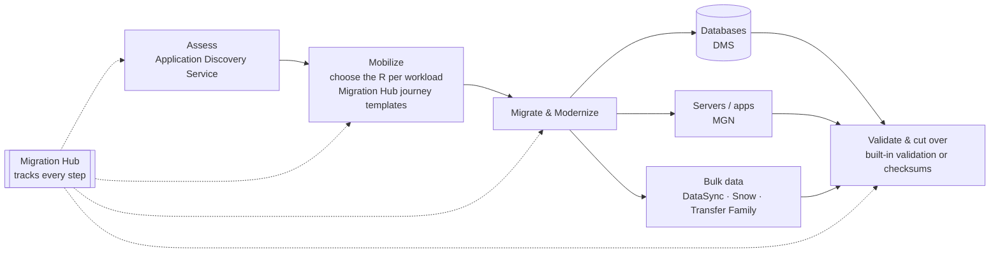

# AWS Migration Services Overview

> [!abstract] TL;DR
> Lesson 1 chose **what** to do with each workload (the [[Cloud Migration Strategies|4 Rs]]). This lesson covers the **AWS services that carry it out**, in three groups:
> 1. ==Assessment==: **Application Discovery Service** maps what you have and how it depends on other things.
> 2. ==Migration==: **Migration Hub** (track everything), **DMS** (databases), **MGN** (servers and applications, lift and shift).
> 3. ==Data transfer==: **DataSync**, **Transfer Family**, the **Snow Family** (physical devices), and **Direct Connect**.
>
> The **Emirates** case study shows the payoff: 30+ business-critical apps from 250+ servers migrated in under a year, during COVID, with **zero unplanned downtime**.

**Lesson:** L2 – Migrating Workloads · **Previous lesson:** [[Re-platforming to Serverless with AWS Lambda]] · **Next:** [[Migration Assessment and Tracking]]
**Section hub:** [[Designing AWS Architecture for Workloads]]
**Sources:** Videos C2-L2-A01 (AWS Migration & Synchronization) and C2-L2-A02 (AWS Migration Case Study), en-us transcripts. Material marked *beyond the lecture* is my addition.

> [!todo]- Contents
> 1. [[#1. The Service Map]]
> 2. [[#2. Where the Services Fit in a Migration]]
> 3. [[#3. Case Study – Emirates]]
> 4. [[#4. Pitfalls and Failure Modes]]
> 5. [[#5. Key Takeaways]]
> 6. [[#6. Critical Analysis]]
> 7. [[#7. Self-Test]]
> 8. [[#8. Glossary]]
> 9. [[#9. Further Reading]]

---

## 1. The Service Map

| Category | Service | Purpose (lecture) | Deep dive |
|---|---|---|---|
| **Assessment** | AWS Application Discovery Service | Analyze applications and their **dependencies**, giving a clear picture of what needs to move and how | [[Migration Assessment and Tracking#2. AWS Application Discovery Service]] |
| **Migration** (with built-in validation) | AWS Migration Hub | A **single location to track** migration progress | [[Migration Assessment and Tracking#3. AWS Migration Hub]] |
| | AWS Database Migration Service (**DMS**) | Move databases to and from AWS with **minimal downtime** | [[Workload Migration with DMS and MGN#2. AWS Database Migration Service (DMS)]] |
| | AWS Application Migration Service (**MGN**) | Move applications **without re-architecting** (rehost) | [[Workload Migration with DMS and MGN#3. AWS Application Migration Service (MGN)]] |
| **Data transfer** | AWS DataSync | Simplify and automate data movement between on-prem storage and AWS | [[AWS Data Transfer Services#4. AWS DataSync]] |
| | AWS Transfer Family | Secure file transfers into and out of AWS storage | [[AWS Data Transfer Services#6. AWS Transfer Family]] |
| | AWS Snow Family | **Physical devices** for large transfers when the network is limited | [[AWS Data Transfer Services#3. AWS Snow Family]] |
| | AWS Direct Connect | **Private network link** for ongoing transfers and hybrid environments | [[AWS Data Transfer Services#5. AWS Direct Connect]] |

> [!info]+ Definition – Migration vs. data transfer services
> **Migration services** move *workloads* (databases, servers, applications) and include **built-in validation**. **Data transfer services** move *data* (files, objects, bulk datasets), optimized for different sizes and types. ^migration-vs-transfer

---

## 2. Where the Services Fit in a Migration

This maps the services onto the Migration Lens phases from Lesson 1 ([[Optimized Architectures and the Migration Lens]]):

| R from Lesson 1 | Typical service (*beyond the lecture* mapping) |
|---|---|
| **Rehost** (lift and shift) | **MGN** |
| **Replatform** (e.g. database to RDS) | **DMS** (homogeneous) |
| **Refactor** (e.g. to a different engine or cloud-native) | **DMS** (heterogeneous) + code changes; Migration Hub refactor features |
| **Retire** | Discovery data shows what's unused; nothing to move |

---

## 3. Case Study – Emirates

| Aspect | Detail (lecture) |
|---|---|
| Organization | **Emirates**, one of the world's largest airlines |
| When | 2020 |
| What moved | Online **booking system**, customer-facing **website**, and **30+** other business-critical applications |
| From | **250+ servers**, starting with the core booking engine and Tier 1 apps in third-party facilities |
| Constraint | **COVID-19** delays and restrictions |
| Duration | **Under one year** |
| Approach | ==Region by region, starting with low-risk services== to build confidence before high-priority systems |
| Key tools | **DMS** (hundreds of on-prem SQL databases), **DataSync** (secure, efficient transfer of large files over the internet) |

**Outcomes (lecture):**
- ==Zero unplanned downtime==
- **Improved transparency**: CloudWatch gave better monitoring and visibility across the organization
- **Better decision-making** from more comprehensive logging and monitoring
- **Improved website performance and reliability** for customers

> [!tip] The transferable pattern
> **Phase by risk.** Start with low-risk workloads, prove the tooling and runbooks, then migrate critical systems. This is the same logic as the phased, validated migration in [[Data Validation and Synchronization#1. A Tale of Two Migrations]]. ^phase-by-risk

---

## 4. Pitfalls and Failure Modes

| Failure | Symptom | Mitigation |
|---|---|---|
| Migrating before assessing | Hidden dependencies break after cutover | Run Application Discovery Service first |
| Big-bang migration of critical systems | High-impact outage risk | Phase by risk, low-risk first ([[#^phase-by-risk]]) |
| Using a transfer service for a live database | Inconsistent data; long downtime | Use **DMS** for databases (it supports ongoing replication) |
| No single view of progress | Teams duplicate or miss workloads | Track everything in **Migration Hub** |
| Skipping validation | Silent data loss or corruption | Built-in validation or checksums ([[Data Validation and Synchronization]]) |

---

## 5. Key Takeaways

- [ ] Three service groups: **assessment** (Application Discovery), **migration** (Migration Hub, DMS, MGN), **data transfer** (DataSync, Transfer Family, Snow Family, Direct Connect).
- [ ] **Migration services** move workloads with built-in validation. **Transfer services** move data of varying size and type.
- [ ] **MGN** = applications without re-architecting. **DMS** = databases with minimal downtime. **Migration Hub** = one place to track.
- [ ] Emirates: 30+ apps, 250+ servers, under a year, during COVID, **zero unplanned downtime**, using **region-by-region, low-risk-first** phasing with DMS and DataSync.

---

## 6. Critical Analysis

- **Case studies are marketing evidence.** The Emirates story comes from AWS, and "zero unplanned downtime" doesn't say how much *planned* downtime there was. A rigorous review would ask for cutover windows, rollback events, and cost versus plan.
- **Tooling is the smaller half of a migration.** The case study credits the services, but the phasing decision (low-risk first) is an organizational choice. Discovery data, runbooks, and validation gates matter at least as much as the transfer tools.
- **The service map changes over time** (*beyond the lecture*). AWS has renamed and retired migration tools before: Server Migration Service was replaced by MGN, which came from CloudEndure. Check current availability before committing a plan to a specific service.

> [!question] Open discussion questions
> 1. Applying Emirates' "low-risk first" approach to Health Metrics Inc from Lesson 1, which workload would you migrate first, and why?
> 2. What evidence would convince you that a migration achieved "zero unplanned downtime"?

---

## 7. Self-Test

> [!question]- Q1. Name the three groups of AWS migration-related services and one service in each.
> **Assessment:** Application Discovery Service. **Migration:** Migration Hub, DMS, MGN. **Data transfer:** DataSync, Transfer Family, Snow Family, Direct Connect.

> [!question]- Q2. Which service would you use to rehost servers without changing the application? To move a database with minimal downtime?
> **MGN** (Application Migration Service) for rehosting. **DMS** (Database Migration Service) for databases.

> [!question]- Q3. What approach did Emirates use to manage risk, and what was the result?
> **Region by region, starting with low-risk services**, building confidence before high-priority systems. They moved 30+ apps from 250+ servers in under a year with **zero unplanned downtime**.

> [!question]- Q4. (Design) Map each Lesson 1 strategy to a Lesson 2 service: rehost a web server; move an on-prem PostgreSQL to RDS PostgreSQL; move 40 TB of archived scans.
> Rehost → **MGN**. PostgreSQL to RDS PostgreSQL → **DMS** (homogeneous). 40 TB of archives → **Snow Family** (large and offline-friendly) or **DataSync** if bandwidth allows (see [[AWS Data Transfer Services#7. Choosing a Transfer Service]]).

> [!tip] Flashcards
> Review this lesson with [[AWS Migration Services Overview - Flashcards]].

---

## 8. Glossary

| Term | Meaning |
|---|---|
| Application Discovery Service | Inventories on-prem servers, their dependencies, and their utilization |
| Migration Hub | Central place to plan, track, and manage migrations |
| DMS | Database Migration Service: database migration with minimal downtime |
| MGN | Application Migration Service: automated lift and shift (rehost) |
| DataSync | Managed online data movement between on-prem storage and AWS |
| Transfer Family | Managed SFTP/FTPS/FTP file transfer into and out of AWS storage |
| Snow Family | Physical devices for offline bulk transfer and edge computing |
| Direct Connect | Dedicated private network link to AWS |

---

## 9. Further Reading

- [AWS Migration Hub](https://docs.aws.amazon.com/migrationhub/latest/ug/whatishub.html)
- [AWS Prescriptive Guidance – migration strategies](https://docs.aws.amazon.com/prescriptive-guidance/latest/large-migration-guide/migration-strategies.html)
