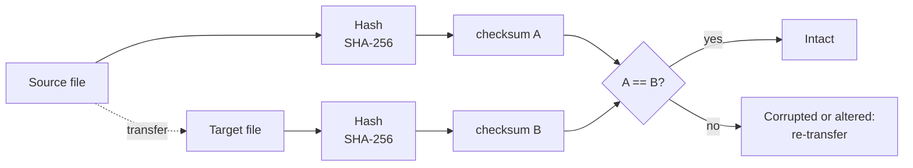

# Data Validation and Synchronization

> [!abstract] TL;DR
> ==Data validation is the most crucial part of any data migration==. It underpins customer trust, not just technical correctness.
> - **TechCorp** rushed, skipped testing, **didn't enable DMS validation**, and didn't verify afterwards. The result: mismatched orders, missing records, and financial discrepancies.
> - **DataSafe** planned, tested, **enabled DMS validation**, added **custom checksums** for critical data, and **phased** the migration. The result: 99.99% accuracy, compliance maintained, and customer trust preserved.
>
> **Built-in validation:** DMS, MGN, DataSync. **Manual checksums needed:** Transfer Family, Direct Connect.
>
> A **checksum** is a fingerprint of the data: ==any change produces a completely different value==.

**Lesson:** L2 – Migrating Workloads · **Previous:** [[AWS Data Transfer Services]] · **Next lesson:** [[AWS Well-Architected Tool]]
**Section hub:** [[Designing AWS Architecture for Workloads]]
**Sources:** Videos C2-L2-A11 (The Tale of Two Migrations), C2-L2-A12 (Intro to Data Synchronization), and C2-L2-A15 (Lesson Review), en-us transcripts. The review mentions exercises, but no exercise or demo videos (A04, A06–A07, A13–A14) were in the bundle. Material marked *beyond the lecture* is my addition.

> [!todo]- Contents
> 1. [[#1. A Tale of Two Migrations]]
> 2. [[#2. Checksums]]
> 3. [[#3. Which Services Validate for You]]
> 4. [[#4. Worked Example – Validating a Migrated Table]]
> 5. [[#5. Pitfalls and Failure Modes]]
> 6. [[#6. Key Takeaways]]
> 7. [[#7. Critical Analysis]]
> 8. [[#8. Self-Test]]
> 9. [[#9. Glossary]]
> 10. [[#10. Further Reading]]

---

## 1. A Tale of Two Migrations

Both companies migrated customer databases to **Amazon RDS** with **AWS DMS**.

| | **TechCorp** (e-commerce) ❌ | **DataSafe** (financial services) ✅ |
|---|---|---|
| Planning | **Rushed** to meet a tight deadline | **Careful planning** |
| Pre-migration testing | **Skipped** | **Comprehensive** testing beforehand |
| DMS data validation | ==**Not enabled**== | ==**Enabled**== for consistency throughout |
| Extra checks | None | **Custom checksums** for critical data |
| Rollout | One shot | **Phased**, validating at each stage |
| Post-migration verification | **None** | Built into each phase |
| Outcome | Orders **mismatched** with shipping addresses; customer records **missing or incomplete**; **financial discrepancies** between source and target | **99.99% data accuracy**; data integrity and **regulatory compliance** maintained; **customer trust** enhanced through uninterrupted service |

> [!important] The lesson
> Data validation ==isn't just a technical requirement. It's foundational for maintaining customer trust== and for the success of the migration. ^validation-trust

---

## 2. Checksums

> [!info]+ Definition – Checksum
> A long string of letters and numbers that acts as a **fingerprint** for a file or set of files, used to **verify data integrity**. If the data changes **in any way**, the checksum changes, revealing errors or tampering. ^def-checksum

> [!warning] Correction to the lecture's wording
> The video says a checksum indicates "the number of bits included in the transmission". That's not right. A checksum is computed from the data's **content**, not from its length. Two files of identical size but different content have different checksums. That content sensitivity is the whole point. (Cryptographic hashes such as **SHA-256** are the usual choice for migration validation.)

**The lecture's example, computed with SHA-256** (*beyond the lecture*, actual values):

| Input | SHA-256 |
|---|---|
| `hello world` | `b94d27b9934d3e08a52e52d7da7dabfac484efe37a5380ee9088f7ace2efcde9` |
| `hello world!` | `7509e5bda0c762d2bac7f90d758b5b2263fa01ccbc542ab5e3df163be08e6ca9` |

Adding one character (`!`) changes the fingerprint **entirely**, not just at the end. That's why comparing source and target checksums detects any alteration.

---

## 3. Which Services Validate for You

| Category | Services (lecture) | What you do |
|---|---|---|
| **Built-in validation** | **AWS DMS**, **AWS MGN**, **AWS DataSync** | Use the built-in feature. For DMS, ==turn validation on== in the task, since TechCorp's mistake was not enabling it. |
| **Manual validation** (checksums) | **AWS Transfer Family**, **AWS Direct Connect** | Compute and compare **checksums** yourself. These can be monitored in **Migration Hub**, but need extra configuration for checksum validation. |

^validation-by-service

> [!note] How "built-in" differs by service (*beyond the lecture*)
> - **DMS** compares source and target rows when validation is **enabled** on the task.
> - **DataSync** verifies data integrity during and after transfer.
> - **MGN**'s check is operational: you launch **test instances** and confirm the application works before cutover.
>
> Direct Connect is a **network link**, not a transfer tool, so validation happens in whatever tool or application sends the data over it.

---

## 4. Worked Example – Validating a Migrated Table

*Beyond the lecture.* Health Metrics' `appointments` table moves from on-prem PostgreSQL to RDS with DMS. These are layered checks, from cheap to thorough:

| Layer | Check | Catches |
|---|---|---|
| 1 | **Row counts** per table, source vs. target | Missing or duplicated rows |
| 2 | **DMS validation** enabled on the task | Row-level mismatches during full load and CDC |
| 3 | **Aggregate checksums**, e.g. `SUM`/`COUNT` per day, or a hash of each row's columns | Silent value changes (truncation, rounding, encoding) |
| 4 | **Application smoke test** against the target | Integration and behavior problems |
| 5 | **Ongoing replication check**: write a test row at the source and confirm it appears in the target | CDC lag or failures before cutover |

**What 99.99% accuracy means at scale:** for 10 million records, $10^7 \times (1 - 0.9999) = 1{,}000$ records are not accurate. For a financial institution, those 1,000 records still need to be found and reconciled. Accuracy targets must come with a **reconciliation plan**.

---

## 5. Pitfalls and Failure Modes

| Failure | Symptom | Mitigation |
|---|---|---|
| DMS validation not enabled | Mismatched and missing records discovered by customers (TechCorp) | Enable validation on every DMS task |
| No pre-migration testing | Surprises at cutover | Test runs on representative data |
| One-shot migration of critical data | No checkpoint to catch errors early | **Phase** and validate each stage (DataSafe) |
| Assuming Transfer Family or Direct Connect validate | Corrupted files go unnoticed | **Checksums** at source and target ([[#^validation-by-service]]) |
| No post-migration verification | Financial discrepancies surface later | Reconcile counts, sums, and samples after cutover |

---

## 6. Key Takeaways

- [ ] **Validation** is the most crucial step of data migration, and it's about **customer trust** ([[#^validation-trust]]).
- [ ] **TechCorp:** rushed, no testing, **DMS validation off**, no verification → mismatched orders, missing records, financial discrepancies.
- [ ] **DataSafe:** planning, testing, **DMS validation on**, **custom checksums**, **phased** → 99.99% accuracy, compliance, trust.
- [ ] A **checksum** is a fingerprint of the content. Any change produces a different value.
- [ ] **Built-in validation:** DMS, MGN, DataSync. **Manual checksums:** Transfer Family, Direct Connect (monitorable in Migration Hub with extra setup).
- [ ] Lesson review: **discover** (Application Discovery) → **track** (Migration Hub) → **migrate** (DMS/MGN) → **transfer** (DataSync, Snow, Transfer Family, Direct Connect) → **validate**.

---

## 7. Critical Analysis

- **"99.99% accuracy" is presented as success, but context matters.** For a regulated financial firm, 0.01% of records being inaccurate may be unacceptable without reconciliation. Better targets are "100% of records reconciled, with every discrepancy explained".
- **Checksums prove sameness, not correctness.** A faithful copy of bad source data passes every checksum. Validation should also include **semantic** checks (business rules, referential integrity) on the target.
- **Heterogeneous migrations break naive checksums.** When engines differ, values can be stored differently (precision, encoding, timestamp zones). Row hashes must be computed on **normalized** representations, or they'll report false mismatches.
- **Validation has a cost:** DMS validation adds load and time. The trade-off is clear for customer and financial data and weaker for disposable data, so match the validation depth to the data's value.

> [!question] Open discussion questions
> 1. Design a validation plan for Health Metrics' patient data that would satisfy a healthcare auditor.
> 2. When is a checksum insufficient evidence that a migration succeeded?

---

## 8. Self-Test

> [!question]- Q1. List TechCorp's four mistakes and three consequences.
> **Mistakes:** rushed without planning, skipped pre-migration testing, **didn't enable DMS validation**, no post-migration verification.
> **Consequences:** orders mismatched with shipping addresses, missing or incomplete customer records, financial discrepancies between source and target.

> [!question]- Q2. What did DataSafe do differently, and what were the outcomes?
> Careful **planning** and **testing**, **DMS validation enabled**, **custom checksums** for critical data, and a **phased** migration validated at each stage. Outcomes: **99.99%** accuracy, integrity and **regulatory compliance** maintained, **customer trust** enhanced.

> [!question]- Q3. What is a checksum, and why does it detect changes?
> A **fingerprint** of data, computed from its **content**. Any change, even one character, produces a **completely different** value, so differing checksums reveal errors or tampering.

> [!question]- Q4. Which services have built-in validation, and which need manual checksums?
> **Built-in:** DMS, MGN, DataSync. **Manual:** Transfer Family, Direct Connect.

> [!question]- Q5. (Quantitative) A migration of 2.5 million records is 99.98% accurate. How many records need reconciliation?
> $2{,}500{,}000 \times 0.0002 = $ **500 records**.

> [!question]- Q6. (Design) A lab sends daily files to S3 via Transfer Family. How do you prove each file arrived intact?
> The sender computes a **SHA-256** checksum for each file and sends it alongside (or in a manifest). After upload, recompute the checksum in AWS, for example in a Lambda function triggered by the S3 upload, and compare. Alert and request re-transfer on mismatch, because Transfer Family doesn't validate content automatically.

> [!tip] Flashcards
> Review this lesson with [[Data Validation and Synchronization - Flashcards]].

---

## 9. Glossary

| Term | Meaning |
|---|---|
| Data validation | Verifying migrated data matches the source in completeness and accuracy |
| Checksum | Content-derived fingerprint used to detect changes |
| SHA-256 | Common cryptographic hash used as a strong checksum |
| DMS data validation | Optional DMS task feature comparing source and target rows |
| Phased migration | Migrating in stages with validation gates between them |
| Reconciliation | Investigating and resolving discrepancies after validation (*beyond the lecture*) |

---

## 10. Further Reading

- [AWS DMS data validation](https://docs.aws.amazon.com/dms/latest/userguide/CHAP_Validating.html)
- [Verifying data transfers in AWS DataSync](https://docs.aws.amazon.com/datasync/latest/userguide/configure-data-verification-options.html)
