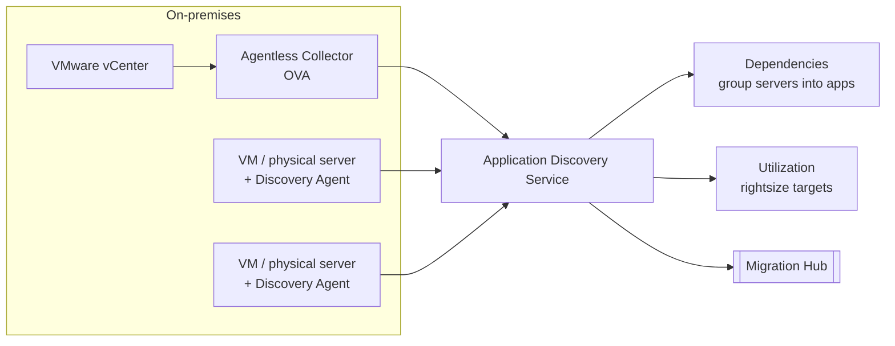

# Migration Assessment and Tracking

> [!abstract] TL;DR
> Before moving anything, get ==a clear picture of the current environment==.
>
> **AWS Application Discovery Service** has two modes:
> - ==Agentless==: an OVA collector deployed through VMware vCenter. It gathers configuration and utilization for VMs and databases.
> - ==Agent-based==: an agent on each VM or physical server. It captures performance, **network connections**, and **running processes**.
>
> Either way you get **dependencies** (to group servers into applications) and **utilization** (to rightsize in AWS).
>
> **AWS Migration Hub** is the single place to plan, track, and manage the migration. It has **journey templates** with runbooks, the **Migration Hub Orchestrator** (predefined workflows), a real-time **migration dashboard**, and **integrations** with AWS and partner tools.

**Lesson:** L2 – Migrating Workloads · **Previous:** [[AWS Migration Services Overview]] · **Next:** [[Workload Migration with DMS and MGN]]
**Section hub:** [[Designing AWS Architecture for Workloads]]
**Sources:** Videos C2-L2-A03 (AWS Application Discovery Service) and C2-L2-A05 (AWS Migration Services), en-us transcripts. A03 promises a demo (likely A04), which isn't in the bundle. Material marked *beyond the lecture* is my addition.

> [!todo]- Contents
> 1. [[#1. Why Assess First]]
> 2. [[#2. AWS Application Discovery Service]]
> 3. [[#3. AWS Migration Hub]]
> 4. [[#4. Worked Example – From Discovery Data to a Right-Sized Target]]
> 5. [[#5. Pitfalls and Failure Modes]]
> 6. [[#6. Key Takeaways]]
> 7. [[#7. Critical Analysis]]
> 8. [[#8. Self-Test]]
> 9. [[#9. Glossary]]
> 10. [[#10. Further Reading]]

---

## 1. Why Assess First

The lecture calls a clear picture of the current environment ==crucial before starting any migration==. Discovery answers two questions that the strategy choice from Lesson 1 depends on:

| Question | Discovery output | Used for |
|---|---|---|
| What talks to what? | **Application dependencies** | Grouping servers into applications that migrate **together** |
| How hard is each server working? | **Utilization data** | **Rightsizing** the AWS target ([[AWS Purchasing Options and Rightsizing]]) |

---

## 2. AWS Application Discovery Service

> [!info]+ Definition – AWS Application Discovery Service
> Helps you **understand your on-premises environment** before migrating. It offers **two approaches** suited to different environments. ^def-ads

| | **Agentless discovery** | **Agent-based discovery** |
|---|---|---|
| Best for | **VMware**-based environments | **VMs and physical servers** |
| How | Deploy the **Agentless Collector**, an **OVA** file deployed through **VMware vCenter** | Install the **Application Discovery Agent** on **each** VM or physical server |
| Collects | **Static configuration** and **utilization metrics** for VMs and **databases** | Detailed system data: **system performance**, **network connections**, **running processes** |
| Result | Catalog of applications and databases with performance, dependencies, and security/compliance needs | A more comprehensive view of the environment |
| Trade-off (*beyond the lecture*) | No software on each server, but limited to what vCenter (and the collector) can see | Deepest visibility, but software to deploy and approve on every host |

---

## 3. AWS Migration Hub

> [!info]+ Definition – AWS Migration Hub
> The ==central hub for planning, tracking, and managing application migrations== to AWS. It gives a **single location** to track progress, with features for planning, implementing, and even refactoring. ^def-migration-hub

### Four key features (lecture)

| Feature | What it gives you |
|---|---|
| **Journey templates** | **Step-by-step guidance** on recommended tasks for each migration phase, plus **runbooks** to execute them |
| **Migration Hub Orchestrator** | **Predefined workflows** for common strategies, e.g. **rehosting applications on EC2**, to speed up migration |
| **Migration dashboard** | **Real-time** status and metrics for **rehost and replatform** migrations |
| **Integrations** | Works with **other AWS migration tools and partner solutions** for a centralized view across every tool in use |

### Three use cases (lecture)

| Use case | How |
|---|---|
| **Discover** | With **Application Discovery Service**, find which applications can be migrated and modernized, and the best strategies |
| **Migrate and execute** (the lesson's focus) | **Journey templates** + tools like **MGN** let teams collaborate on execution against defined goals |
| **Modernize** (out of scope) | Fast-track **refactoring** applications after migration |

> [!tip] One pane of glass
> DMS and MGN do the moving, and Migration Hub shows where every workload stands ([[Workload Migration with DMS and MGN#2. AWS Database Migration Service (DMS)|DMS migration status appears in Migration Hub]]). ^one-pane

---

## 4. Worked Example – From Discovery Data to a Right-Sized Target

*Beyond the lecture.* Agent-based discovery on a Health Metrics Inc reporting server shows:

| Metric | Observed |
|---|---|
| vCPUs / RAM | 16 vCPU / 64 GiB |
| Peak CPU (p95) | 20% |
| Peak memory | 22 GiB |
| Network connections | Outbound to `db-01` (PostgreSQL, 5432) and `files-01` (SMB) |

**Rightsizing:** target 60% peak CPU after migration, to leave headroom:

$$
\text{vCPU}_{\text{needed}} = \frac{\text{cores} \times \text{peak util}}{\text{target util}} = \frac{16 \times 0.20}{0.60} \approx 5.3 \;\Rightarrow\; 8 \text{ vCPU}
$$

Memory needs about $22 / 0.8 \approx 28$ GiB with a 20% buffer, so an 8 vCPU / 32 GiB instance fits. That's half the original size.

**Dependency grouping:** the network connections show this server can't move alone. `reporting`, `db-01`, and `files-01` form one **migration wave**. That's the job Application Discovery Service's dependency data is for.

---

## 5. Pitfalls and Failure Modes

| Failure | Symptom | Mitigation |
|---|---|---|
| Migrating a server without its dependencies | Broken connections after cutover; latency across the hybrid link | Group by discovered dependencies; move as waves |
| Agentless-only discovery in a mixed estate | Physical servers missing from the inventory | Agent-based for physical servers and non-VMware VMs |
| Short discovery window | Missed month-end or batch peaks; undersized targets | Collect over a full business cycle (*beyond the lecture*) |
| Sizing targets 1:1 with on-prem hardware | Overprovisioned, expensive AWS bill | Rightsize from **utilization** data |
| Tracking in spreadsheets | No shared status; duplicated effort | **Migration Hub** dashboard ([[#^one-pane]]) |

---

## 6. Key Takeaways

- [ ] Assess **before** migrating. Discovery gives **dependencies** (grouping) and **utilization** (rightsizing).
- [ ] **Agentless** = OVA collector through **vCenter**, for **VMware**: configuration and utilization for VMs and databases.
- [ ] **Agent-based** = agent on **each VM or physical server**: performance, **network connections**, **running processes**.
- [ ] **Migration Hub** = single place to plan, track, and manage migrations.
- [ ] Its four features: **journey templates** (with runbooks), **Orchestrator** (predefined workflows, e.g. rehost to EC2), **dashboard** (real-time rehost/replatform status), **integrations**.
- [ ] Its three use cases: **discover**, **migrate and execute**, **modernize**.

---

## 7. Critical Analysis

- **Discovery is only as good as its observation window.** Utilization from a quiet week undersizes month-end workloads. For a healthcare reporting system, quarter-end and audit periods may dominate.
- **Dependency maps show network flows, not business coupling.** Two apps sharing a nightly file drop may never show a live connection. Pair the data with interviews with application owners.
- **Agent deployment is itself a change.** Regulated environments may need security review before installing agents, which can make agentless the only fast option even with less detail.
- **Tracking tools don't replace governance.** Migration Hub shows status, but someone still owns go/no-go decisions and the validation gates in [[Data Validation and Synchronization]].

> [!question] Open discussion questions
> 1. For a mostly VMware estate with a few legacy physical database servers, what discovery mix would you use?
> 2. How long would you run discovery for Health Metrics Inc, and what business events should the window include?

---

## 8. Self-Test

> [!question]- Q1. What two kinds of information does discovery give you, and what is each used for?
> **Application dependencies**, to group servers into applications that migrate together. **Utilization data**, to rightsize resources in AWS.

> [!question]- Q2. Compare agentless and agent-based discovery: environment, deployment, and data collected.
> **Agentless:** VMware environments. Deploy an OVA collector through vCenter. Collects static configuration and utilization for VMs and databases.
> **Agent-based:** VMs **and** physical servers. Install an agent on each. Collects performance, network connections, and running processes.

> [!question]- Q3. Name Migration Hub's four key features.
> **Journey templates** (step-by-step guidance plus runbooks), **Migration Hub Orchestrator** (predefined workflows), **migration dashboard** (real-time rehost/replatform status), and **integrations** with AWS and partner tools.

> [!question]- Q4. (Quantitative) A server has 8 vCPUs at 30% peak CPU. Targeting 60% peak after migration, how many vCPUs do you need?
> $8 \times 0.30 / 0.60 = 4$ vCPUs, so a 4-vCPU instance, half the original.

> [!question]- Q5. (Design) A company has VMware VMs plus 12 physical Oracle servers. How do you discover everything?
> **Agentless** collector through vCenter for the VMware VMs, plus the **agent-based** Discovery Agent on the 12 physical servers, since agentless discovery can't see them. View both in **Migration Hub**.

> [!tip] Flashcards
> Review this lesson with [[Migration Assessment and Tracking - Flashcards]].

---

## 9. Glossary

| Term | Meaning |
|---|---|
| Application Discovery Service | Inventories servers, their dependencies, and their utilization before migration |
| Agentless Collector | OVA appliance deployed through vCenter for VMware discovery |
| Discovery Agent | Software installed on each server for agent-based discovery |
| OVA | Open Virtual Appliance: a packaged virtual machine image |
| vCenter | VMware's management server for vSphere environments |
| Migration Hub | Central place to plan, track, and manage migrations |
| Journey template | Step-by-step migration guidance with runbooks |
| Migration Hub Orchestrator | Predefined migration workflows (e.g. rehost to EC2) |
| Migration wave | A group of dependent servers migrated together (*beyond the lecture*) |

---

## 10. Further Reading

- [What is AWS Application Discovery Service](https://docs.aws.amazon.com/application-discovery/latest/userguide/what-is-appdiscovery.html)
- [What is AWS Migration Hub](https://docs.aws.amazon.com/migrationhub/latest/ug/whatishub.html)
