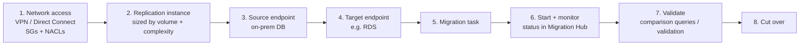

# Workload Migration with DMS and MGN

> [!abstract] TL;DR
> Migration Hub gives the holistic view. Two services do the moving:
>
> **AWS DMS (Database Migration Service)**
> - Migrates databases **fast and securely**, with the ==source fully operational throughout==, so there's no downtime.
> - Supports **homogeneous** moves (PostgreSQL → RDS PostgreSQL) and **heterogeneous** moves (PostgreSQL → RDS MySQL).
> - Flow: **network access → replication instance → source and target endpoints → migration task → monitor → validate → cut over**.
>
> **AWS MGN (Application Migration Service)**
> - ==Automated lift and shift (rehost) with no application changes==, from physical servers, on-prem hypervisors, other clouds, or other AWS accounts and Regions.
> - Flow: **staging subnet → install replication agent → continuous replication → launch test instances → cut over**.

**Lesson:** L2 – Migrating Workloads · **Previous:** [[Migration Assessment and Tracking]] · **Next:** [[AWS Data Transfer Services]]
**Section hub:** [[Designing AWS Architecture for Workloads]]
**Sources:** Video C2-L2-A08 (AWS Workload Migration Services), en-us transcript. The captions garble some names ("Amazon DS" = RDS, "Cloud and door" = CloudEndure, "MDM" = MGN). Material marked *beyond the lecture* is my addition.

> [!todo]- Contents
> 1. [[#1. Two Tools, Two Kinds of Workload]]
> 2. [[#2. AWS Database Migration Service (DMS)]]
> 3. [[#3. AWS Application Migration Service (MGN)]]
> 4. [[#4. DMS vs. MGN]]
> 5. [[#5. Worked Example – Downtime With and Without Ongoing Replication]]
> 6. [[#6. Pitfalls and Failure Modes]]
> 7. [[#7. Key Takeaways]]
> 8. [[#8. Critical Analysis]]
> 9. [[#9. Self-Test]]
> 10. [[#10. Glossary]]
> 11. [[#11. Further Reading]]

---

## 1. Two Tools, Two Kinds of Workload

| Workload | Tool | Typical R ([[Cloud Migration Strategies]]) |
|---|---|---|
| **Data** (databases) | **DMS** | Replatform (homogeneous) or refactor (heterogeneous) |
| **Applications** (servers) | **MGN** | Rehost |

The lecture's order: **databases first with DMS, then servers with MGN**.

---

## 2. AWS Database Migration Service (DMS)

> [!info]+ Definition – AWS DMS
> Migrates databases to AWS **quickly and securely**. The ==source database remains fully operational== during the migration, allowing **zero downtime**. ^def-dms

| Migration type | Meaning | Lecture example |
|---|---|---|
| **Homogeneous** | Same engine on both sides | On-prem **PostgreSQL** → **PostgreSQL on RDS** |
| **Heterogeneous** | Different engines | On-prem **PostgreSQL** → **MySQL on RDS** |

DMS works with the most popular **relational** databases and several **NoSQL** databases.

> [!note] Heterogeneous needs schema conversion (*beyond the lecture*)
> DMS moves **data**. Converting the **schema** and code (stored procedures, data types) between engines uses **AWS Schema Conversion Tool** or **DMS Schema Conversion**.

### The DMS migration steps (lecture)



| # | Step | Detail (lecture) |
|---|---|---|
| 1 | **Make the on-prem DB reachable from AWS** | **VPN** or **Direct Connect**, plus **security groups and NACLs** in your VPC that allow DMS ↔ database traffic (see [[Advanced VPC Connectivity]] and [[Secure and Private Connectivity]]) |
| 2 | **Create a replication instance** | The DMS **compute node** that performs the migration. Pick the instance size by **data volume and migration complexity**. |
| 3 | **Create a source endpoint** | Points to the on-prem database engine configured in step 1 |
| 4 | **Create a target endpoint** | The target database, e.g. **Amazon RDS** |
| 5 | **Create a migration task** | The job that runs the migration (created in the console) |
| 6 | **Start and monitor** | Status of each component is visible in **Migration Hub** |
| 7 | **Validate** | **Comparison queries** or **data validation tools**. With **ongoing replication**, check that new source changes appear in the target. |
| 8 | **Cut over** | Switch from the old database to the new cloud database |

> [!tip] Full load + ongoing replication (*beyond the lecture*, named)
> DMS tasks run as **full load**, **CDC** (change data capture, i.e. ongoing replication), or **full load + CDC**. Full load + CDC is what makes "source stays operational" possible: copy everything, then stream changes until cutover. ^full-load-cdc

---

## 3. AWS Application Migration Service (MGN)

> [!info]+ Definition – AWS MGN
> An ==automated lift-and-shift (rehost)== service that migrates applications to AWS **without changes to the application**. Formerly **CloudEndure Migration**. It **replaced** the deprecated **AWS Server Migration Service**. ^def-mgn

**Supported sources (lecture):**

| Source type | Examples |
|---|---|
| **Physical servers** | Any supported OS |
| **On-prem VMs** | **VMware vSphere**, **Microsoft Hyper-V**, **Oracle VM**, **KVM** |
| **Cloud VMs** | Other public clouds (**Azure**, **GCP**); private clouds (**VMware**, **Oracle**); **EC2 instances in other AWS accounts or Regions** |
| **Operating systems** | Popular OSes such as **Windows**, **RHEL**, **Debian**. Check the docs for the specific version. |

### How MGN works (lecture)

```mermaid
sequenceDiagram
    participant Src as Source server
    participant MGN as AWS MGN
    participant Stg as Staging subnet (VPC)
    participant Tgt as Target EC2
    Note over MGN,Stg: 1. Configure a staging subnet; point MGN at it
    Src->>MGN: 2. Install AWS Replication Agent (agentless option for VMware)
    Src-->>Stg: 3. Continuous real-time replication
    MGN->>Tgt: 4. Launch TEST instances from launch templates
    Note over Tgt: Verify the app works
    MGN->>Tgt: 5. Cutover: shift traffic to the new instances
    Note over Tgt: 6. Post-launch actions (optimize, automate updates)
```

1. **Configure a subnet** in your VPC for migration traffic, and set MGN to use it in the console.
2. **Install the AWS Replication Agent** on source servers. **VMware** environments can use **agentless** replication.
3. MGN **replicates continuously and in real time**, minimizing downtime and keeping AWS up to date.
4. **Launch test instances** from **launch templates** to confirm everything works before the final migration.
5. **Cut over:** shift traffic to the new AWS instances.
6. **Post-launch:** optional configuration, such as optimizing instances or automating updates.

> [!note] Network detail (*beyond the lecture*)
> Replication traffic flows from the source to lightweight replication servers in the staging subnet (by default over **TCP 1500**). The agent also needs **HTTPS (443)** to the MGN endpoints. Open these in firewalls and NACLs before installing agents.

---

## 4. DMS vs. MGN

| | DMS | MGN |
|---|---|---|
| Moves | **Databases** (data; schema needs conversion tools for heterogeneous) | **Whole servers** (OS + app + data, block-level) |
| Strategy | Replatform / refactor | **Rehost** |
| Changes engine? | Can (heterogeneous) | No. Same OS and app, on EC2. |
| Keeps source live? | Yes (ongoing replication) | Yes (continuous replication until cutover) |
| Test before cutover | Validation queries | **Test instances** from launch templates |
| Status visible in | Migration Hub | Migration Hub |

> [!important] When to use which
> Moving a database server **as-is** (e.g. PostgreSQL on EC2) can be done with MGN. Moving it to a **managed service (RDS)**, or to a **different engine**, needs **DMS**. ^dms-or-mgn

---

## 5. Worked Example – Downtime With and Without Ongoing Replication

*Beyond the lecture.* Health Metrics Inc must move a **2 TB** PostgreSQL database.

**Option A – offline dump and restore** at an effective 200 MB/s:

$$
t = \frac{2 \times 10^{12} \text{ B}}{200 \times 10^{6} \text{ B/s}} = 10{,}000 \text{ s} \approx 2.8 \text{ h of downtime}
$$

That excludes validation time.

**Option B – DMS full load + CDC** ([[#^full-load-cdc]]): the full load runs while the app stays live, and CDC keeps the target within seconds of the source. Cutover downtime ≈ stop writes + let CDC drain (seconds to minutes) + final validation + repoint the app. That's **minutes, not hours**.

---

## 6. Pitfalls and Failure Modes

| Failure | Symptom | Mitigation |
|---|---|---|
| On-prem DB not reachable | DMS endpoint test fails | VPN or Direct Connect + SG/NACL rules first (step 1) |
| Undersized replication instance | Slow full load; CDC lag grows | Size by volume and complexity; monitor lag |
| Heterogeneous move without schema conversion | Tables load but procedures and types fail | AWS SCT or DMS Schema Conversion |
| Skipping test launches in MGN | App fails on first real cutover | Launch test instances from templates and verify |
| Firewalls block replication | MGN agent installed but no replication progress | Open the replication and HTTPS ports to the staging subnet |
| Cutting over without validation | Silent data loss | Validate before cutover ([[Data Validation and Synchronization]]) |

---

## 7. Key Takeaways

- [ ] **Migration Hub** = holistic view. **DMS** moves **data**. **MGN** moves **applications**.
- [ ] **DMS:** source stays fully operational (zero downtime). **Homogeneous** (same engine) and **heterogeneous** (different engine). Relational plus several NoSQL.
- [ ] **DMS steps:** network access → replication instance → source endpoint → target endpoint → task → monitor (Migration Hub) → validate → cut over.
- [ ] **MGN:** automated lift and shift with **no app changes**. Formerly **CloudEndure**, replacing **Server Migration Service**.
- [ ] **MGN sources:** physical, VMware/Hyper-V/Oracle VM/KVM, Azure/GCP/private clouds, other AWS accounts and Regions.
- [ ] **MGN steps:** staging subnet → replication agent (agentless for VMware) → continuous replication → **test instances** → cutover → post-launch.

---

## 8. Critical Analysis

- **"Zero downtime" really means "near-zero cutover downtime".** Writes must pause briefly while replication drains and connections switch. Plan and rehearse the cutover window.
- **Heterogeneous migration is where the risk lives.** Data movement is the easy part; behavior differences between engines (collation, numeric precision, stored procedures) are hard. That's why validation (next notes) matters most for refactors.
- **Lift and shift moves technical debt.** MGN is fast, but an oversized, unpatched server is still oversized and unpatched on EC2. The Migration Lens expects rehosted workloads to be **optimized after** migration (rightsizing, managed services).
- **Network design comes first.** Both services depend on the hybrid connectivity from Section 1 (VPN or Direct Connect). Migration throughput is often limited by that link, not by DMS or MGN.

> [!question] Open discussion questions
> 1. Health Metrics' scheduling database is moving from on-prem PostgreSQL to Aurora PostgreSQL. Is that homogeneous? What would you validate?
> 2. When would you rehost a database server with MGN instead of moving to RDS with DMS?

---

## 9. Self-Test

> [!question]- Q1. What makes DMS migrations "zero downtime"?
> The **source database stays fully operational** during migration. With ongoing replication, changes keep flowing to the target until cutover.

> [!question]- Q2. Homogeneous or heterogeneous? (a) On-prem PostgreSQL → RDS PostgreSQL; (b) on-prem PostgreSQL → RDS MySQL.
> (a) **Homogeneous** (same engine). (b) **Heterogeneous** (different engines).

> [!question]- Q3. List the DMS steps in order.
> Make the on-prem DB reachable (VPN/Direct Connect, SGs, NACLs) → create a **replication instance** → **source endpoint** → **target endpoint** → **migration task** → start and **monitor** (Migration Hub) → **validate** → **cut over**.

> [!question]- Q4. What is MGN, what did it replace, and what was it formerly called?
> An automated **lift-and-shift (rehost)** service that needs no application changes. It **replaced AWS Server Migration Service** and was formerly **CloudEndure Migration**.

> [!question]- Q5. List the MGN steps.
> Configure a **staging subnet** → install the **Replication Agent** (or agentless for VMware) → **continuous replication** → launch **test instances** from launch templates → **cut over** traffic → optional post-launch actions.

> [!question]- Q6. (Quantitative) A 500 GB database dump and restore runs at 50 MB/s. How long is the outage, and how would DMS change it?
> $500 \times 10^9 / 50 \times 10^6 = 10{,}000$ s ≈ **2.8 hours**. DMS **full load + CDC** copies while the source stays live, cutting downtime to the cutover window (minutes).

> [!question]- Q7. (Design) A company wants to move a self-managed PostgreSQL server to Amazon RDS for PostgreSQL. DMS or MGN, and why?
> **DMS.** The target is a **managed service (RDS)**, not an EC2 copy of the server. MGN would only rehost the server as-is ([[#^dms-or-mgn]]).

> [!tip] Flashcards
> Review this lesson with [[Workload Migration with DMS and MGN - Flashcards]].

---

## 10. Glossary

| Term | Meaning |
|---|---|
| DMS | Database Migration Service |
| Replication instance | The DMS compute node that performs the migration |
| Source / target endpoint | DMS connection definitions for the source and target databases |
| Migration task | The DMS job that moves the data |
| Homogeneous / heterogeneous | Same engine / different engines on each side |
| CDC | Change data capture: ongoing replication of changes (*beyond the lecture*) |
| MGN | Application Migration Service: automated rehost |
| Replication Agent | MGN software on source servers that streams data to AWS |
| Staging subnet | VPC subnet that receives MGN replication traffic |
| Test instance | Non-production launch to verify the migrated server before cutover |
| Cutover | Switching production traffic to the migrated system |

---

## 11. Further Reading

- [What is AWS Database Migration Service](https://docs.aws.amazon.com/dms/latest/userguide/Welcome.html)
- [What is AWS Application Migration Service](https://docs.aws.amazon.com/mgn/latest/ug/what-is-application-migration-service.html)
- [Validating AWS DMS tasks](https://docs.aws.amazon.com/dms/latest/userguide/CHAP_Validating.html)
