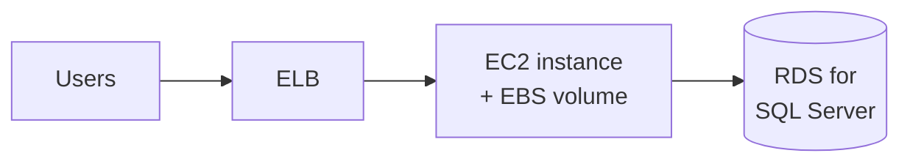
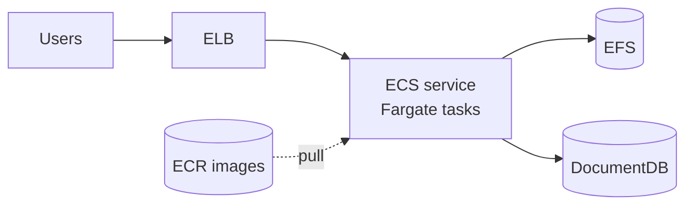
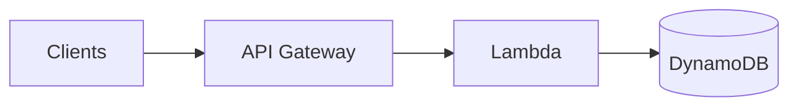
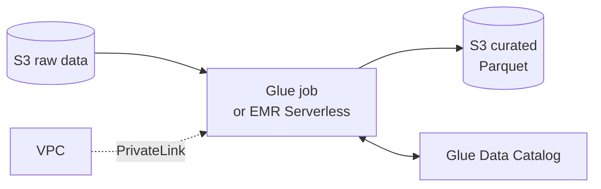

# Application Architectures and AWS Reference Architectures

> [!abstract] TL;DR
> Pick the migration path from ==what the app *is* today==. Three common architectures:
> - **Monolith**: one code base, tightly coupled, scales as one unit.
> - **Microservices**: small independent services, usually containers, scaled independently.
> - **Data processing services**: ETL and analytics on frameworks like Spark and Hadoop.
>
> Each maps to an **AWS reference architecture**:
> - Monolith **rehost**: ELB + EC2 + EBS + RDS.
> - Container **replatform**: ELB + ECS on Fargate + ECR + EFS + DocumentDB.
> - Peaky web app **serverless**: API Gateway + Lambda + DynamoDB.
> - Big data **refactor**: Glue (for Spark) or EMR Serverless (for Hadoop) + S3 + PrivateLink + Glue Data Catalog.

**Lesson:** L1 – Selecting Architecture for Workloads · **Previous:** [[Cloud Migration Strategies]] · **Next:** [[Refactoring Data Workloads with AWS Glue]]
**Section hub:** [[Designing AWS Architecture for Workloads]]
**Sources:** Videos C2-L1-A06, A07b, and A10, en-us transcripts. **A07a is missing** from the bundle. A07b refers back to "re-platforming applications to work with AWS managed services for microservices", so A07a presumably covered the monolith and microservices reference architectures. A10's PRS and CPE designs fill that gap here.

> [!todo]- Contents
> 1. [[#1. Why Identify the Current Architecture]]
> 2. [[#2. Monolithic Architecture]]
> 3. [[#3. Microservices Architecture]]
> 4. [[#4. Data Processing Services Architecture]]
> 5. [[#5. Rehost – Patient Records System]]
> 6. [[#6. Replatform – Claims Processing Engine]]
> 7. [[#7. Serverless Reference Architecture]]
> 8. [[#8. Big Data and Analytics Reference Architecture]]
> 9. [[#9. Worked Example – Mapping All Five Workloads]]
> 10. [[#10. Pitfalls and Failure Modes]]
> 11. [[#11. Key Takeaways]]
> 12. [[#12. Critical Analysis]]
> 13. [[#13. Self-Test]]
> 14. [[#14. Glossary]]
> 15. [[#15. Further Reading]]

---

## 1. Why Identify the Current Architecture

"A core part of migrating workloads successfully is accurately identifying the current architecture." The current shape decides both the **strategy** ([[Cloud Migration Strategies#^four-rs]]) and the **reference architecture**.

> [!note] Two different axes
> Monoliths and microservices describe ==how an application is built and deployed==. Data processing services describe ==what kind of work it does== (batch analytics over large datasets). A data pipeline can itself be monolithic or modular.

---

## 2. Monolithic Architecture

> [!info]+ Definition – Monolithic architecture
> The traditional model: ==one code base performs multiple business functions==. Modules are tightly coupled, so a small change in one part affects many functions, and **all components scale together**. ^def-monolith

**Consequence:** to scale one hot function you scale the whole app, which overuses hardware and raises cost.
**Usual migration:** **rehost** (when time is short) or **refactor** to meet business requirements, typically into microservices.

## 3. Microservices Architecture

> [!info]+ Definition – Microservices architecture
> Software composed of ==small, independent services in separate code bases==. Each does a single function and talks to others through a **well-defined interface** (API). ^def-microservices

> [!info]+ Definition – Container
> A lightweight, portable, self-sufficient unit that **packages an application with its dependencies** and runs on any system with a container runtime (e.g. Docker). ^def-container

Containers plus separation of concerns let each service **scale independently** on current load and predicted demand.

| | Monolith | Microservices |
|---|---|---|
| Code bases | One | Many, one per service |
| Coupling | Tight | Loose, via APIs |
| Scaling | Whole app together | Per service |
| Change blast radius | Large | Small |
| Ops complexity | Low (one thing to run) | High (many things, networking, observability) |
| Typical migration | Rehost or refactor | Replatform to managed containers |

## 4. Data Processing Services Architecture

> [!info]+ Definition – Data processing services
> ETL jobs and functions that process and analyze **datasets too large or complex for traditional software**, to find patterns, correlations, and insights. They use open-source frameworks such as **Apache Spark** and **Hadoop** to spread work across a **cluster** for parallel computing. ^def-data-processing

> [!info]+ Definition – ETL
> **Extract, transform, load**: read data from sources, reshape or clean it, and write it to a target store for analysis. ^def-etl

---

## 5. Rehost – Patient Records System

**Current:** monolith; networking, compute, and local storage tightly coupled on one server; serves records from **Microsoft SQL Server**.

| Layer | AWS service | Why |
|---|---|---|
| Networking | **Elastic Load Balancing (ELB)** | Distributes traffic. There's no load balancer on-prem. This "lift, *tinker*" element prepares for scaling later |
| Compute | **Amazon EC2** | One instance with specs similar to the on-prem server; can become an **Auto Scaling group** later |
| Local storage | **Amazon EBS** | Block storage that mimics the server's local disks |
| Database | **Amazon RDS for SQL Server** | Migrate the database as-is to a managed engine |

**Future steps the lecture names:** Auto Scaling groups and **Multi-AZ** deployments, to optimize further against the six pillars.

## 6. Replatform – Claims Processing Engine

**Current:** fully containerized microservices on **Docker Compose**; MongoDB database. Strategy: **replatform** to analogous AWS services, keeping the microservices design.

| Layer | AWS service | Why |
|---|---|---|
| Networking | **ELB** | Lets the app scale across multiple nodes |
| Orchestration | **Amazon ECS** | Chosen because the app **doesn't use Kubernetes** today (otherwise EKS) |
| Compute | **AWS Fargate** (ECS launch type) | Serverless containers that scale with traffic; useful because traffic volume is uncertain |
| Image registry | **Amazon ECR** | Stores the container images |
| Storage | **Amazon EFS** | Scalable shared file storage that integrates with Fargate tasks |
| Database | **Amazon DocumentDB** | **MongoDB-compatible**, so the data layer moves with little change |

> [!tip] The "analogous service" heuristic
> Replatforming works best when every on-prem component has a **compatible managed twin**: Docker Compose → ECS, Kubernetes → EKS, MongoDB → DocumentDB, SQL Server → RDS for SQL Server, Hive Metastore → Glue Data Catalog. Compatibility keeps the code change small. ^analogous-service

## 7. Serverless Reference Architecture

**When:** the app is **business-critical** with ==unpredictable, high-volume traffic== that on-prem would need peak capacity planning for, and it suffers **high latency at peak**.

| Layer | AWS service | Role |
|---|---|---|
| Front door | **Amazon API Gateway** | Fully managed: create, publish, manage, monitor, and secure APIs at any scale |
| Compute | **AWS Lambda** | Runs code in response to events with no servers to manage |
| Database | **Amazon DynamoDB** | Fully managed serverless NoSQL; scales automatically; consistently low latency |

Applied to the **Doctor Scheduling System** in [[Re-platforming to Serverless with AWS Lambda]].

## 8. Big Data and Analytics Reference Architecture

Re-architect big-data apps onto AWS managed data engineering services. As with replatforming, ==the compute choice follows the on-prem framework==:

| On-prem | AWS target | Notes |
|---|---|---|
| **Spark** | **AWS Glue** | Fully managed **serverless** data integration; automates much of ETL |
| **Hadoop** | **Amazon EMR Serverless** | Serverless runtime for big-data apps; "optimal target for on-prem Hadoop clusters" |
| HDFS / NAS / SAN | **Amazon S3** | Virtually unlimited, low-cost storage; **EMRFS** and Glue connectors make it a first-class data lake |
| Hive Metastore | **Glue Data Catalog** (optional) | Central metadata repository: data sources, schemas, properties |
| Private networking | **AWS PrivateLink** | Private connectivity between the VPC and AWS managed services, off the public internet |

^big-data-ref

The point of the pattern: ==cheap storage holds the data; serverless compute scales up to run the job and back down to zero==, which is the exact opposite of HTA's always-on cluster. Applied in [[Refactoring Data Workloads with AWS Glue]]. PrivateLink and VPC endpoints are covered in [[Secure and Private Connectivity]].

---

## 9. Worked Example – Mapping All Five Workloads

| Workload | Current architecture type | Strategy | Reference architecture |
|---|---|---|---|
| PRS | Monolith | Rehost | ELB + EC2 + EBS + RDS ([[#5. Rehost – Patient Records System]]) |
| CPE | Microservices (Docker Compose) | Replatform | ECS/Fargate stack ([[#6. Replatform – Claims Processing Engine]]) |
| DSS | Monolith web app with peaky load | Serverless | API Gateway + Lambda + DynamoDB ([[#7. Serverless Reference Architecture]]) |
| HTA | Data processing (Spark) | Refactor | Glue + S3 + Catalog + PrivateLink ([[#8. Big Data and Analytics Reference Architecture]]) |
| LRT | Monolith | Retire | — |

---

## 10. Pitfalls and Failure Modes

| Failure | Symptom | Mitigation |
|---|---|---|
| Rehosting with a single EC2 instance and stopping there | Same single point of failure as on-prem | Follow up with Auto Scaling and Multi-AZ, as the lecture recommends |
| Choosing EKS for a team with no Kubernetes | Steep ops and learning cost | ECS for non-Kubernetes container apps; EKS when Kubernetes already exists |
| "Compatible" database isn't identical | Feature gaps break the app (DocumentDB doesn't support every MongoDB feature) | Test against the target engine's compatibility list before cut-over |
| Microservices without observability | Failures hard to trace across services | Centralized logs, metrics, tracing from day one |
| Data lake with no catalog | "Data swamp": nobody knows what's in S3 | Glue Data Catalog; consistent prefixes and partitioning |

---

## 11. Key Takeaways

- [ ] **Monolith** = one tightly coupled code base, scales as a unit ([[#^def-monolith]]).
- [ ] **Microservices** = independent services with well-defined interfaces, usually containers, scaled independently ([[#^def-microservices]]).
- [ ] **Data processing services** = Spark/Hadoop-style ETL and analytics across a cluster ([[#^def-data-processing]]).
- [ ] Rehost stack: **ELB + EC2 + EBS + RDS for SQL Server**.
- [ ] Replatform containers: **ELB + ECS on Fargate + ECR + EFS + DocumentDB**. ECS because there's no Kubernetes today.
- [ ] Serverless stack: **API Gateway + Lambda + DynamoDB** for peaky, high-concurrency traffic.
- [ ] Big data: **Spark → Glue**, **Hadoop → EMR Serverless**, **S3** storage, **Glue Data Catalog** replaces Hive Metastore, **PrivateLink** for private access ([[#^big-data-ref]]).
- [ ] Replatform by choosing the **analogous managed service** ([[#^analogous-service]]).

---

## 12. Critical Analysis

- **Microservices aren't free.** The lecture presents microservices as the destination for refactored monoliths. Distributed systems add network failure modes, data consistency problems, and ops overhead. A "modular monolith" is often the better middle step (*beyond the lecture*).
- **Glue vs. EMR is more nuanced than "Spark vs. Hadoop".** EMR (and EMR Serverless) also runs Spark, and gives more control over versions, tuning, and libraries. Glue is simpler and more managed. A Spark shop with heavy tuning or custom dependencies might reasonably pick EMR.
- **Healthcare compliance is absent.** Patient records and claims data are regulated (HIPAA in the US). The reference architectures don't mention encryption with KMS, audit logging, or using only HIPAA-eligible services. That's a gap for the Health Metrics scenario.
- **DynamoDB is a data-model change.** Moving from PostgreSQL to DynamoDB means designing around access patterns, giving up ad hoc joins, and rethinking transactions. It's sound for a booking system with known queries, but it is not a drop-in swap.
- **Lock-in vs. velocity.** Fargate, Lambda, DynamoDB, and Glue maximize managed convenience and AWS lock-in. Compatible targets (RDS, EKS, DocumentDB) keep more portability. An architect should make that trade consciously.

> [!question] Open discussion questions
> 1. When would you rehost a monolith onto ECS (containerized) rather than EC2?
> 2. Is EMR Serverless or Glue the better default for a team with existing PySpark jobs? What would change your mind?
> 3. What would a HIPAA-aware version of the CPE architecture add?

---

## 13. Self-Test

> [!question]- Q1. Why does a monolith overuse hardware?
> All components live in one code base and **scale together**. To scale one busy function you must scale the whole application.

> [!question]- Q2. What makes a microservice architecture independently scalable?
> Services are separate code bases with well-defined interfaces, usually packaged as **containers**. Each can be scaled on its own load and predicted demand.

> [!question]- Q3. List the rehost stack for the Patient Records System and the role of each piece.
> **ELB** distributes traffic (prepares for scaling); **EC2** hosts the app on a similar-sized instance; **EBS** provides local block storage; **RDS for SQL Server** runs the database as-is on a managed engine.

> [!question]- Q4. Why ECS rather than EKS for the Claims Processing Engine, and why DocumentDB?
> ECS because the app runs on Docker Compose and **doesn't use Kubernetes**. DocumentDB because it's **MongoDB-compatible**, so the data layer moves with little change.

> [!question]- Q5. When does the serverless reference architecture fit, and what are its three components?
> A business-critical app with **unpredictable, high-volume traffic** that would otherwise be sized for peak and suffers latency at peak. **API Gateway** (front door), **Lambda** (compute), **DynamoDB** (database).

> [!question]- Q6. In the big-data reference architecture, what replaces each on-prem component: Spark, Hadoop, HDFS/NAS, Hive Metastore?
> Spark → **AWS Glue**; Hadoop → **EMR Serverless**; storage → **Amazon S3** (with EMRFS and Glue connectors); Hive Metastore → **Glue Data Catalog**. **PrivateLink** keeps traffic private.

> [!question]- Q7. (Design) A company runs a Kubernetes-based microservices app and a nightly Hadoop job on the same on-prem cluster. Propose targets for both.
> Microservices: **replatform to EKS** (existing Kubernetes). Nightly Hadoop job: **EMR Serverless** reading and writing **S3**, so it costs nothing between runs. Separating them also stops the batch job competing with the live services for capacity.

### Flashcards

> [!tip] Flashcards
> Review this note with [[Application Architectures and AWS Reference Architectures - Flashcards]].

---

## 14. Glossary

| Term | Meaning |
|---|---|
| Monolith | Single tightly coupled code base doing many functions |
| Microservice | Small independent service with a well-defined interface |
| Container | Portable package of an app plus its dependencies |
| ETL | Extract, transform, load |
| Apache Spark / Hadoop | Open-source frameworks for distributed data processing |
| Reference architecture | A vetted, reusable pattern of services for a workload type |
| ELB | Elastic Load Balancing |
| ECS / Fargate | AWS container orchestrator / serverless container compute |
| ECR | Elastic Container Registry: stores container images |
| EFS | Elastic File System: shared, scalable file storage |
| DocumentDB | MongoDB-compatible managed document database |
| API Gateway | Managed service for publishing and securing APIs |
| DynamoDB | Serverless NoSQL key-value and document database |
| AWS Glue | Serverless data integration and ETL service (Spark-based) |
| EMR Serverless | Serverless runtime for Spark/Hadoop-style big-data apps |
| EMRFS | EMR's file system connector for using S3 like HDFS |
| Glue Data Catalog | Central metadata store; Hive Metastore replacement |
| PrivateLink | Private connectivity from a VPC to AWS or partner services |

---

## 15. Further Reading

- [AWS Architecture Center](https://aws.amazon.com/architecture/)
- [What is Amazon ECS](https://docs.aws.amazon.com/AmazonECS/latest/developerguide/Welcome.html)
- [AWS Fargate for Amazon ECS](https://docs.aws.amazon.com/AmazonECS/latest/developerguide/AWS_Fargate.html)
- [What is Amazon EMR Serverless](https://docs.aws.amazon.com/emr/latest/EMR-Serverless-UserGuide/emr-serverless.html)
- [What is AWS Glue](https://docs.aws.amazon.com/glue/latest/dg/what-is-glue.html)
- [Amazon DocumentDB: MongoDB compatibility](https://docs.aws.amazon.com/documentdb/latest/developerguide/compatibility.html)
