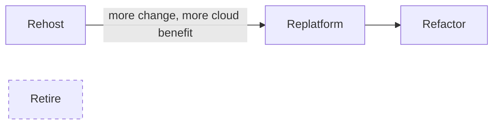
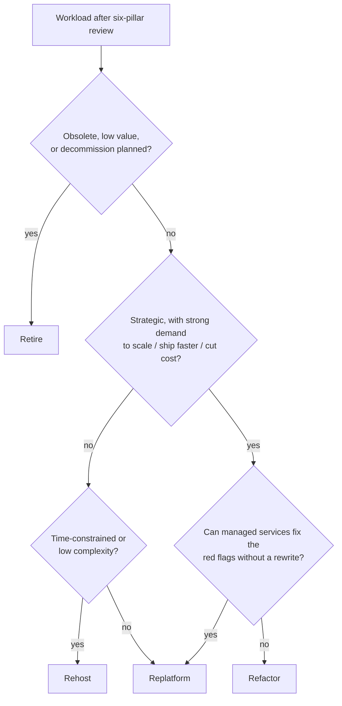

# Cloud Migration Strategies

> [!abstract] TL;DR
> A **migration strategy** is how a workload moves into AWS. The course's four Rs, from least to most change:
> - ==Rehost== ("lift & shift"): little or no change; for low-complexity, non-strategic apps.
> - ==Replatform== ("lift, tinker & shift"): move with key optimizations, usually swapping in managed services.
> - ==Refactor==: re-architect for cloud-native features; for strategic apps.
> - ==Retire==: decommission or archive.
>
> The **Mobilize** phase picks the R from the six-pillar review of the current system. For Health Metrics Inc: Spark analytics → **refactor**, obsolete reporting tool → **retire**, scheduling web app → **replatform to serverless**, on-prem Kubernetes → **replatform to EKS**.

**Lesson:** L1 – Selecting Architecture for Workloads · **Previous:** [[Optimized Architectures and the Migration Lens]] · **Next:** [[Application Architectures and AWS Reference Architectures]]
**Section hub:** [[Designing AWS Architecture for Workloads]]
**Sources:** Videos C2-L1-A05, A08b (two near-identical takes, V2 and V3), and A09 (Exercise 1 solution), en-us transcripts. **A08a is missing** from the bundle. It presumably assessed the Patient Records System and Claims Processing Engine, whose strategies (rehost, replatform) appear only in A10. The Exercise 1 **brief** isn't in the bundle either; its workload is reconstructed from the solution video.

> [!todo]- Contents
> 1. [[#1. The Four Rs]]
> 2. [[#2. The Example Company – Health Metrics Inc]]
> 3. [[#3. Assessing the Health Metrics Workloads]]
> 4. [[#4. Choosing a Strategy – Decision Flow]]
> 5. [[#5. Worked Example – Exercise 1, On-Prem Kubernetes]]
> 6. [[#6. Pitfalls and Failure Modes]]
> 7. [[#7. Key Takeaways]]
> 8. [[#8. Critical Analysis]]
> 9. [[#9. Self-Test]]
> 10. [[#10. Glossary]]
> 11. [[#11. Further Reading]]

---

## 1. The Four Rs

> [!info]+ Definition – Migration strategy
> The approach used to move a workload into the AWS cloud. AWS publishes **prescriptive guidance** for implementing each one. ^def-strategy

| R | Nickname | What changes | Typical candidate | Lecture's example service move |
|---|---|---|---|---|
| **Rehost** | Lift & shift | Little or nothing | Low-complexity, **non-strategic** apps where changing them isn't worth the effort | Server → EC2 |
| **Replatform** | Lift, tinker & shift | **Key optimizations**, often via AWS managed services | Apps that gain from managed infra without a rewrite | Fixed servers → **Auto Scaling groups** |
| **Refactor** | (Re-architect) | The **core application**, to fit its usage patterns using cloud-native features | **Strategic** apps with strong demand to scale, ship faster, cut cost | Spark cluster → AWS Glue |
| **Retire** | Decommission | The app is shut down or archived | Low-value, low-usage, costly, or insecure apps (unsupported OS/components) | — |

^four-rs

> [!info]+ Definition – The seven Rs (*beyond the lecture*)
> AWS's full list adds three strategies the course leaves out:
> - **Retain** (revisit): keep it on-prem for now, e.g. recently upgraded, or blocked by compliance.
> - **Relocate**: move at the hypervisor level without buying new hardware or rewriting, e.g. VMware Cloud on AWS.
> - **Repurchase** ("drop & shop"): replace with a different product, usually SaaS.
>
> ^seven-rs

> [!note] Why retiring is a strategy
> The lecture gives two reasons: eliminate hosting and maintenance cost, and **reduce security risk** from software on unsupported OS versions or components. Retirement is usually the highest-ROI decision in a portfolio, because it costs almost nothing and removes both spend and attack surface.

---

## 2. The Example Company – Health Metrics Inc

The running example is a healthcare company, **Health Metrics Inc**, with five on-prem workloads plus one exercise workload. Assembled from A08b, A09, A10, A11, and A14:

| Workload | Current architecture | Strategy | Target (covered in) |
|---|---|---|---|
| **Patient Records System (PRS)** | Monolith; networking, compute, storage on one server; MS SQL Server | **Rehost** | ELB + EC2 + EBS + RDS for SQL Server ([[Application Architectures and AWS Reference Architectures#5. Rehost – Patient Records System]]) |
| **Claims Processing Engine (CPE)** | Containerized microservices on Docker Compose; MongoDB | **Replatform** | ELB + ECS on Fargate + ECR + EFS + DocumentDB ([[Application Architectures and AWS Reference Architectures#6. Replatform – Claims Processing Engine]]) |
| **Health Trend Analysis (HTA)** | Spark cluster on physical servers; NAS/SAN; Hive Metastore | **Refactor** | Glue + S3 + PrivateLink + Glue Data Catalog ([[Refactoring Data Workloads with AWS Glue]]) |
| **Legacy Reporting Tool (LRT)** | Monolith with SQL Server; basic reports; little use | **Retire** | — |
| **Doctor Scheduling System (DSS)** | Apache web server; PostgreSQL; NAS | **Replatform** to serverless | API Gateway + Lambda + DynamoDB ([[Re-platforming to Serverless with AWS Lambda]]) |
| *Exercise 1 workload* | Kubernetes cluster on physical on-prem servers; VPN access | **Replatform** | Amazon EKS ([[#5. Worked Example – Exercise 1, On-Prem Kubernetes]]) |

^health-metrics

---

## 3. Assessing the Health Metrics Workloads

### Health Trend Analysis (HTA) – refactor

| Pillar | Finding |
|---|---|
| Operational excellence | Complex management of the on-prem Spark cluster adds overhead |
| Security | Data encryption in place; access controls could improve |
| Reliability | Some data redundancy from Spark; recovery is complicated |
| Performance efficiency | Powerful hardware, but often **underutilized** |
| Cost optimization | **High fixed costs** (infrastructure and operations) |
| Sustainability | Significant energy use from being **always on** |

**Why refactor:** the current architecture doesn't translate directly to efficient cloud use. AWS has **purpose-built big-data services (EMR, Glue)** that cut management complexity, improve scaling, and optimize cost.

### Legacy Reporting Tool (LRT) – retire

| Pillar | Finding |
|---|---|
| Operational excellence | Manual processes; hard to maintain; **already scheduled for decommission** |
| Security | Outdated practices; more vulnerable |
| Reliability | Frequent issues; downtime increasing |
| Performance efficiency | Poor performance; long-running queries |
| Cost optimization | Expensive to maintain; limited value |
| Sustainability | Old, energy-inefficient hardware |

**Why retire:** it's obsolete, costly, and low-value, and decommissioning is already scheduled, so migrating isn't worth the effort. Its features can be replaced by other systems or modern cloud reporting tools.

### Doctor Scheduling System (DSS) – replatform to serverless

The key fact: ==high volumes of concurrent reads and writes at peak==, when thousands of patients check availability and book slots at once.

| Pillar | Finding |
|---|---|
| Operational excellence | Basic monitoring; **manual** scaling and deploys |
| Security | Standard web security; room to improve |
| Reliability | **Single server, no automatic failover**; fails at peak |
| Performance efficiency | Adequate now; doesn't scale under high demand |
| Cost optimization | Resources often underutilized |
| Sustainability | Older hardware; moderate efficiency |

**Why replatform:** cloud-native features (auto scaling, managed infrastructure) fix the problems **without a complete rewrite**. A managed serverless platform improves scaling and reliability and reduces operational overhead.

> [!warning] Label inconsistency in the lecture
> A08b and A14 call the DSS move a **replatform**. But A14's title is "Refactoring an Application", A07b frames it as "re-architect to serverless", and the target swaps PostgreSQL (relational) for **DynamoDB** (key-value) and Apache for **Lambda** functions. Changing the data model and execution model is normally classed as **refactor**. Expect either label on exams. Justify the one you pick. See [[#8. Critical Analysis]].

---

## 4. Choosing a Strategy – Decision Flow

A decision flow distilled from the lecture's examples (my synthesis):

| Signal from the review | Points to |
|---|---|
| Already containerized / already on Kubernetes | Replatform (ECS/Fargate, EKS) |
| Monolith under time pressure | Rehost now, refactor later |
| Architecture itself is the bottleneck (always-on cluster, idle hardware) | Refactor |
| Peaky, unpredictable, high-concurrency traffic | Serverless (replatform or refactor) |
| Obsolete, insecure, scheduled for shutdown | Retire |

---

## 5. Worked Example – Exercise 1, On-Prem Kubernetes

From the A09 solution video. The workload is a Kubernetes application on physical on-prem servers, accessed over a VPN.

| Pillar | Finding |
|---|---|
| Operational excellence | Managing a Kubernetes cluster on physical infrastructure adds significant complexity |
| Security | VPN gives secure access, but on-prem infrastructure security is always a concern |
| Reliability | Kubernetes is resilient at the software level, but **hardware failures** could hit availability |
| Performance efficiency | Efficient at the software level; **manual hardware upgrades** are very hard |
| Cost optimization | Servers **provisioned for peak** → overprovisioned |
| Sustainability | An always-on, single-use cluster consumes significant energy |

**Strategy:** ==Replatform to Amazon EKS==. The Kubernetes application stays largely the same; AWS manages the underlying hardware (and the control plane).

> [!tip] Pattern to remember
> Every red flag in this review is about **hardware**, not the app. When the software layer is already cloud-friendly, **replatform**: keep the app, hand the infrastructure to a managed service. The step-by-step write-up is in [[Exercise 1 - Well-Architected Review and Migration Strategy - How To]].

---

## 6. Pitfalls and Failure Modes

| Failure | Symptom | Mitigation |
|---|---|---|
| Refactoring everything | Migration takes years; value delayed | Refactor only strategic apps; rehost or replatform the rest |
| Rehosting a peak-sized server as-is | Same overprovisioning, now billed hourly | Rightsize after rehosting; plan the replatform step |
| Migrating something that should be retired | Paying to move dead weight and its vulnerabilities | Include "retire" in every Assess pass; check usage data |
| Choosing a strategy without a review | Strategy reflects preference, not evidence | Six-pillar review first ([[Optimized Architectures and the Migration Lens#6. Worked Example – A Pillar Review Template]]) |
| Fuzzy replatform/refactor boundary | Scope creep: a "replatform" turns into a rewrite | Define the boundary up front: what code and data model changes are in scope |

---

## 7. Key Takeaways

- [ ] Four Rs: **rehost** (lift & shift), **replatform** (lift, tinker & shift), **refactor** (re-architect), **retire** ([[#^four-rs]]).
- [ ] Rehost suits low-complexity, non-strategic apps. Refactor suits **strategic** apps.
- [ ] Replatform usually means swapping in **managed services** (e.g. Auto Scaling, ECS, EKS).
- [ ] Retire cuts cost **and** security risk from unsupported software.
- [ ] AWS's full list is **seven Rs**: add retain, relocate, repurchase ([[#^seven-rs]]).
- [ ] Health Metrics: PRS rehost, CPE replatform, HTA refactor, LRT retire, DSS serverless ([[#^health-metrics]]).
- [ ] An on-prem Kubernetes app → replatform to **EKS**.

---

## 8. Critical Analysis

- **Boundaries are fuzzy.** The course draws replatform vs. refactor by intent, not by measurable criteria. A practical test (*beyond the lecture*): if the **data model** or **execution model** changes (relational → key-value, long-running server → event-driven function), it's a refactor; if only the hosting changes, it's a replatform. By that test DSS is a refactor.
- **Strategies are per component, not per app.** Real migrations mix them. The PRS rehost already includes a replatform element (RDS instead of self-managed SQL Server, plus a load balancer). Treating the Rs as exclusive labels hides that.
- **Missing cost of change.** The lecture compares end states. A real decision also weighs migration cost: engineering time, dual running, retraining, risk. Refactor is the best end state and the most expensive path.
- **Retain is missing.** Healthcare often has workloads that *can't* move yet: device integrations, data-residency rules, recently bought hardware. Leaving out **retain** makes the framework look more complete than it is.
- **Evaluation.** You'd check a strategy against outcome metrics after migration: cost per transaction, p95 latency at peak, deploy frequency, incident rate. The lecture states the expected benefits but doesn't measure them.

> [!question] Open discussion questions
> 1. Should DSS be labeled replatform or refactor? Defend your answer with the data-model test.
> 2. When is "rehost now, refactor later" a trap rather than a plan?
> 3. Which Health Metrics workload has the most regulatory risk during migration, and how does that change the strategy?

---

## 9. Self-Test

> [!question]- Q1. Order the four Rs from least to most change, with each one's nickname.
> Retire aside: **rehost** (lift & shift) → **replatform** (lift, tinker & shift) → **refactor** (re-architect). **Retire** removes the app.

> [!question]- Q2. What kind of application is the usual candidate for rehost, and for refactor?
> Rehost: **low-complexity, non-strategic** apps, where changing them isn't worth the effort. Refactor: **strategic** apps with strong business demand to scale, release faster, and cut cost.

> [!question]- Q3. Give two reasons to retire an application.
> Eliminate the cost of hosting and maintaining it, and reduce the security risk of running unsupported OS versions or components. (Low usage and poor performance are also triggers.)

> [!question]- Q4. Why was the Health Trend Analysis Spark cluster refactored rather than rehosted?
> The architecture itself was the problem: an always-on cluster with idle hardware, high fixed costs, and complex management. AWS has purpose-built managed big-data services (Glue, EMR) that remove that overhead, which rehosting onto EC2 wouldn't.

> [!question]- Q5. What are the three Rs the course omits?
> **Retain** (keep on-prem for now), **relocate** (hypervisor-level move, e.g. VMware Cloud on AWS), and **repurchase** (switch to a different product, usually SaaS).

> [!question]- Q6. (Design) A company runs a Docker Compose app on two on-prem servers, with traffic that varies unpredictably. Leadership wants it in AWS within a quarter, with minimal code change. Which R, and which compute target?
> **Replatform** to **ECS on Fargate**: the app is already containerized, so it moves with little change, and Fargate scales without managing servers. Choose ECS over EKS because there's no existing Kubernetes investment. This matches the CPE pattern.

> [!question]- Q7. (Quantitative, beyond the lecture) A portfolio has 40 apps: 6 are scheduled for decommission and 10 have under 5 users. Each app costs about $1,500/month to host. What is the monthly saving if you retire the first group and half the second?
> $(6 + 5) \times 1{,}500 = \$16{,}500$/month, before any migration work, and 11 fewer systems to secure.

### Flashcards

> [!tip] Flashcards
> Review this note with [[Cloud Migration Strategies - Flashcards]].

---

## 10. Glossary

| Term | Meaning |
|---|---|
| Rehost | Lift & shift: move with little or no change |
| Replatform | Lift, tinker & shift: move with key optimizations, e.g. managed services |
| Refactor | Re-architect the core app for cloud-native features |
| Retire | Decommission or archive |
| Retain / Relocate / Repurchase | The other three of AWS's seven Rs |
| Health Metrics Inc | The course's example healthcare company |
| EKS | Amazon Elastic Kubernetes Service: managed Kubernetes |
| Prescriptive guidance | AWS's published how-to guidance for migration strategies |

---

## 11. Further Reading

- [About the migration strategies (AWS Prescriptive Guidance)](https://docs.aws.amazon.com/prescriptive-guidance/latest/large-migration-guide/migration-strategies.html)
- [Migration Lens – AWS Well-Architected](https://docs.aws.amazon.com/wellarchitected/latest/migration-lens/migration-lens.html)
- [What is Amazon EKS](https://docs.aws.amazon.com/eks/latest/userguide/what-is-eks.html)
