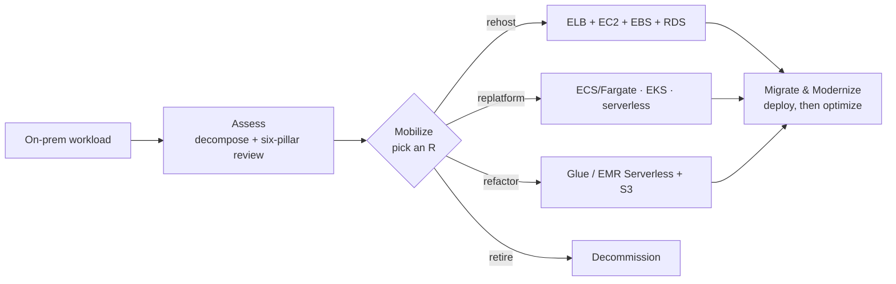

# Designing AWS Architecture for Workloads

> [!abstract] TL;DR
> This is the **hub** for the second major section of the AWS Cloud Architect course (course 2 in the transcripts' numbering). The first section designed for an *organization*. This one designs for ==individual workloads being migrated to AWS==. Every workload goes through one framework, the **Well-Architected Migration Lens**: a **six-pillar review** → a **migration strategy** (rehost / replatform / refactor / retire) → a **reference architecture** → deployment. The running example is the healthcare company **Health Metrics Inc**.

**Instructor:** Jonathan Dyer, technical director at an AI-first learning startup. His framing: what separates an AWS Solutions Architect Associate from a Professional is ==quickly analyzing a workload and applying the right framework, pattern, and service==.
**Previous section:** [[Designing AWS Architecture for Organizations]]. That section covered network connectivity, multi-account governance, and cost visibility, ending with the [[Project Overview|Excipient Technologies capstone]]. The organization-level ideas carry forward: PrivateLink and VPC endpoints ([[Secure and Private Connectivity]]), Direct Connect for hybrid transfer, and rightsizing and purchasing options ([[AWS Purchasing Options and Rightsizing]]).
**Sources:** en-us transcripts of the 22 videos in the Lesson 1 subtitle bundle, plus `iea-global-ev-data-2024.csv` (the Exercise 2 input).

> [!example]+ Lessons in this section
> **Lesson 1 – Selecting Architecture for Workloads**
> 1. [[Optimized Architectures and the Migration Lens]] (A01–A04): why optimize; overprovisioning, underprovisioning, security; sticker shock; six pillars; Assess → Mobilize → Migrate & Modernize ([[Optimized Architectures and the Migration Lens - Flashcards|flashcards]])
> 2. [[Cloud Migration Strategies]] (A05, A08b, A09): the 4 Rs (+ the 7 Rs); Health Metrics workload reviews; Kubernetes → EKS ([[Cloud Migration Strategies - Flashcards|flashcards]])
> 3. [[Application Architectures and AWS Reference Architectures]] (A06, A07b, A10): monolith, microservices, data processing; rehost, container, serverless, and big-data stacks ([[Application Architectures and AWS Reference Architectures - Flashcards|flashcards]])
> 4. [[Refactoring Data Workloads with AWS Glue]] (A11 + Glue demos, Ex 2): Spark → Glue, S3, Data Catalog; IAM service roles; workers and DPUs ([[Refactoring Data Workloads with AWS Glue - Flashcards|flashcards]])
> 5. [[Re-platforming to Serverless with AWS Lambda]] (A14 + E3 demos, Ex 3): API Gateway + Lambda + DynamoDB; event-driven S3 → Lambda → SNS ([[Re-platforming to Serverless with AWS Lambda - Flashcards|flashcards]])
>
> **Lesson 1 labs** (how-tos, no flashcards)
> - [[Exercise 1 - Well-Architected Review and Migration Strategy - How To|Exercise 1 – Well-Architected Review and Migration Strategy]] (paper exercise)
> - [[Exercise 2 - Convert a Spark ETL Job to AWS Glue - How To|Exercise 2 – Convert a Spark ETL Job to AWS Glue]] (EV dataset)
> - [[Exercise 3 - Event-Driven Notifications with Lambda and SNS - How To|Exercise 3 – Event-Driven Notifications with Lambda and SNS]]
>
> **Lesson 2 – Migrating Workloads** (AWS Migration and Synchronization)
> 1. [[AWS Migration Services Overview]] (A01–A02): assessment / migration / transfer service map; Emirates case study ([[AWS Migration Services Overview - Flashcards|flashcards]])
> 2. [[Migration Assessment and Tracking]] (A03, A05): Application Discovery Service (agentless vs. agent-based); Migration Hub ([[Migration Assessment and Tracking - Flashcards|flashcards]])
> 3. [[Workload Migration with DMS and MGN]] (A08): DMS homogeneous/heterogeneous steps; MGN rehost steps ([[Workload Migration with DMS and MGN - Flashcards|flashcards]])
> 4. [[AWS Data Transfer Services]] (A09–A10): Snow Family, DataSync, Direct Connect, Transfer Family ([[AWS Data Transfer Services - Flashcards|flashcards]])
> 5. [[Data Validation and Synchronization]] (A11–A12, A15): a tale of two migrations; checksums; built-in vs. manual validation ([[Data Validation and Synchronization - Flashcards|flashcards]])
>
> **Lesson 2 labs:** none, by design. The course repo says they need an on-premises environment. Reference videos: [MGN demo](https://www.youtube.com/watch?v=8w-Ks_GEGPw) · [DMS demo](https://www.youtube.com/watch?v=u7yKzYpbiLk) · [Snowcone](https://www.youtube.com/watch?v=X_8LM7E_hiE)
>
> **Lesson 3 – Determining New Architecture for Cloud Workloads** (managed services)
> 1. [[AWS Well-Architected Tool]] (A01–A03, A05 + repo demo): WA Tool process and outputs; Cox Automotive; from review to modernization ([[AWS Well-Architected Tool - Flashcards|flashcards]])
> 2. [[Enhancing Data Processing with Redshift, EMR, and Athena]] (A06 + Athena demo): MPP warehouse vs. managed Spark vs. serverless SQL on S3 ([[Enhancing Data Processing with Redshift, EMR, and Athena - Flashcards|flashcards]])
> 3. [[Serverless Modernization]] (A08): API Gateway, Lambda, Aurora Serverless; when serverless costs more ([[Serverless Modernization - Flashcards|flashcards]])
> 4. [[Application and Container Orchestration]] (A09, A11): Step Functions; ECS + Fargate + ECR + EFS; ECS vs. EKS ([[Application and Container Orchestration - Flashcards|flashcards]])
>
> **Lesson 3 labs** (how-tos, no flashcards; from the [course repo](https://github.com/udacity/cd13808-Designing-AWS-Architecture-for-Workloads-public))
> - [[Exercise 1 - Assessing and Optimizing Workloads - How To|Exercise 1 – Assessing and Optimizing Workloads]] (paper exercise)
> - [[Exercise 2 - Query S3 Data with Amazon Athena - How To|Exercise 2 – Query S3 Data with Amazon Athena]] (Netflix titles; skip the broken CloudFormation)
> - [[Exercise 3 - Deploy FastAPI on Amazon ECS with Fargate - How To|Exercise 3 – Deploy FastAPI on Amazon ECS with Fargate]]

---

## The Framework in One Picture

## Health Metrics Inc at a Glance

| Workload | Today | Strategy | AWS target |
|---|---|---|---|
| Patient Records System | Monolith + SQL Server | Rehost | ELB, EC2, EBS, RDS for SQL Server |
| Claims Processing Engine | Docker Compose + MongoDB | Replatform | ELB, ECS on Fargate, ECR, EFS, DocumentDB |
| Health Trend Analysis | Spark cluster + Hive Metastore | Refactor | Glue, S3, Glue Data Catalog, PrivateLink |
| Legacy Reporting Tool | Obsolete monolith | Retire | — |
| Doctor Scheduling System | Apache + PostgreSQL, peaky | Replatform (serverless) | API Gateway, Lambda, DynamoDB |
| Exercise 1 workload | On-prem Kubernetes + VPN | Replatform | EKS |

Details: [[Cloud Migration Strategies#^health-metrics]].

---

## Lesson 2 – Migration and Synchronization Services

The service map that was parked here as a preview now lives in [[AWS Migration Services Overview#1. The Service Map]], with a note for each group: [[Migration Assessment and Tracking|assessment and tracking]], [[Workload Migration with DMS and MGN|workload migration]], [[AWS Data Transfer Services|data transfer]], and [[Data Validation and Synchronization|validation]].

---

## Gaps in the Source Bundle

> [!warning] Missing or duplicated videos
> - **A07a** (reference architectures, part a) and **A08a** (Assess & Mobilize, part a) are missing. The PRS and CPE assessments, and the monolith and microservices reference architectures, are reconstructed from A10.
> - The **Health Metrics Inc introduction** that A04 promises isn't in the bundle.
> - The **exercise sheets** for Exercises 1–3 weren't provided. The how-tos are built from the solution videos.
> - **A08b** appears twice (V2 and V3, near-identical). V3 was used.
> - Exercise 3: the demo says SES, the solution uses SNS. The how-to follows the solution and has an SES variant.

---

## Key Takeaways

- [ ] Every workload: **decompose → six-pillar review → R → reference architecture → deploy**.
- [ ] Strategy follows the review's red flags: hardware problems → replatform; architecture problems → refactor; obsolete → retire.
- [ ] Replatform by choosing the **analogous managed service** ([[Application Architectures and AWS Reference Architectures#^analogous-service]]).
- [ ] Serverless and managed services turn **fixed, peak-sized cost** into **variable, demand-tracking cost**.

## Further Reading

- [Migration Lens – AWS Well-Architected](https://docs.aws.amazon.com/wellarchitected/latest/migration-lens/migration-lens.html)
- [AWS Prescriptive Guidance – migration strategies](https://docs.aws.amazon.com/prescriptive-guidance/latest/large-migration-guide/migration-strategies.html)
- [AWS Architecture Center](https://aws.amazon.com/architecture/)

%% Study hint: Lesson 2 notes live in 'Migrating Workloads'; Lesson 3 notes and labs live in 'Determining new Architecture for Cloud Workloads'. %%
