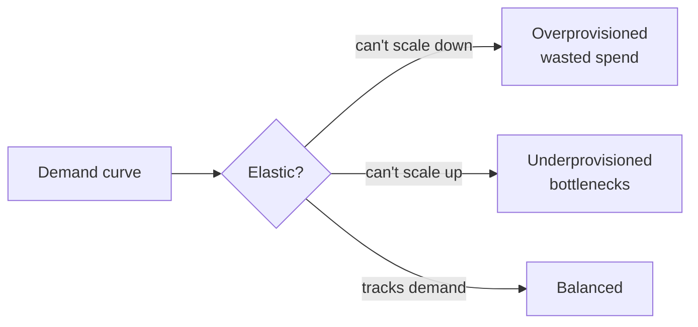
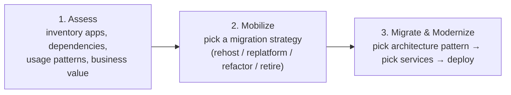

# Optimized Architectures and the Migration Lens

> [!abstract] TL;DR
> An optimized architecture ==balances scalability, performance, and cost while meeting business requirements==. Too little elasticity going down means overprovisioning (inflated cost). Too little going up means underprovisioning (bottlenecks). Weak security design means vulnerabilities. The course's evaluation framework is the ==Well-Architected **Migration Lens**==: review each workload against the **six pillars**, then walk it through three phases, **Assess → Mobilize → Migrate & Modernize**.

**Lesson:** L1 – Selecting Architecture for Workloads · **Next:** [[Cloud Migration Strategies]]
**Section hub:** [[Designing AWS Architecture for Workloads]]
**Sources:** Videos C2-L1-A01 (Meet the Instructor), A02 (Migrating & Deploying), A03 (Review of Optimized AWS), A04 (Developing an Evaluation Framework), en-us transcripts. A04 says "in the next video we'll introduce our example company". That intro video **isn't in the transcript bundle**. Health Metrics Inc's workloads are reconstructed from later videos in [[Cloud Migration Strategies#2. The Example Company – Health Metrics Inc]].

> [!todo]- Contents
> 1. [[#1. Why Optimization Matters]]
> 2. [[#2. The Two Retailers – A Case Study]]
> 3. [[#3. The AWS Well-Architected Framework and the Migration Lens]]
> 4. [[#4. The Six Pillars]]
> 5. [[#5. The Three Migration Phases]]
> 6. [[#6. Worked Example – A Pillar Review Template]]
> 7. [[#7. Pitfalls and Failure Modes]]
> 8. [[#8. Key Takeaways]]
> 9. [[#9. Critical Analysis]]
> 10. [[#10. Self-Test]]
> 11. [[#11. Glossary]]
> 12. [[#12. Further Reading]]

---

## 1. Why Optimization Matters

The course opens (A02) with a business case for data-processing skills. The instructor's figures:

| Claim (as stated in A02) | Figure |
|---|---|
| Businesses investing in data analytics | 97.2% |
| Data analytics projects that fail | 85% |
| …of those failures, never reach production | 87% |
| Growth of organizations that deliver successfully | 25% above market average |
| Enterprises investing in cloud to boost data engineering | 94% |

> [!warning] Unsourced statistics
> The video gives no sources for these numbers. Treat them as motivation, not evidence. (The "85% fail" figure circulates widely and is usually traced to a 2017 Gartner analyst remark, not a study. That attribution is *beyond the lecture*.)

The instructor's framing of the course (A01): the difference between a Solutions Architect **Associate** and **Professional** is ==the ability to quickly analyze a workload and apply the right framework, design pattern, and service==. This lesson builds that framework.

> [!info]+ Definition – Optimized architecture
> An architecture whose cloud resources ==satisfy business requirements while minimizing expense==, balancing scalability, performance, and cost efficiency, with security built in. ^def-optimized

### The three failure modes of a non-optimal architecture

| Failure | Cause | Effect |
|---|---|---|
| **Overprovisioning** | Not elastic enough to **scale down** in low demand | Inflated cost: paying for idle capacity |
| **Underprovisioning** | Not elastic enough to **scale up** for peak demand | Performance bottlenecks; critical operations slow |
| **Security vulnerabilities** | Robust security measures not designed in | More exposure to attacks |

^three-failures

Quantifying the waste (*beyond the lecture*): if a fixed fleet is sized for peak demand $P$ but average demand is $\bar{D}$, utilization is

$$
U = \frac{\bar{D}}{P}
$$

A system that peaks at 10× its average runs at 10% utilization, so 90% of what you pay for is idle. Elastic capacity charges roughly for $\bar{D}$ instead of $P$. That is the economic argument behind every refactor and re-platform in this lesson.

---

## 2. The Two Retailers – A Case Study

| | **Digital Cloud Depot** (success) | **Whimsical Cloud Wares** (struggle) |
|---|---|---|
| Starting point | One **monolithic** on-prem system | **Various** on-prem services |
| Approach | **Deliberate migration planning**, working with AWS | **Rushed** to the cloud to meet deadlines |
| Target | Monolith → **microservices** | Multiple dev environments, inconsistent approaches |
| Outcome | 20% faster checkout; 60% fewer errors booking delivery slots; higher conversion and sales | ==Sticker shock==; post-migration spending on tools for workload placement, data movement, and financial tracking |

> [!info]+ Definition – Sticker shock
> A sharp rise in operating cost once applications run in the cloud. It is common when moving from a **fixed-cost** model (owned on-prem hardware) to a **variable-cost** model (pay per use) without changing how cost is managed. ^def-sticker-shock

The lesson: cloud adoption needs ==a different mindset and management strategy to control cost==. This connects straight to the FinOps tooling in [[AWS Cost and Usage Monitoring Tools]] and [[Tagging Strategies and Cost Allocation]].

---

## 3. The AWS Well-Architected Framework and the Migration Lens

> [!info]+ Definition – AWS Well-Architected Framework
> AWS's guide to designing and operating systems that are **reliable, secure, efficient, and cost-effective** in the cloud, organized as six pillars. ^def-waf

> [!info]+ Definition – Migration Lens
> A Well-Architected **lens** (a domain-specific extension of the framework) with best practices for ==migrating on-premises or hybrid workloads into fully cloud-based environments==. It applies the six pillars to each migration phase. ^def-migration-lens

The course uses the migration lens as its **evaluation framework**: every workload gets a six-pillar review of its *current* state, then a migration strategy, then a target architecture.

---

## 4. The Six Pillars

| Pillar | Focus | Example given in the lecture |
|---|---|---|
| **Operational excellence** | Running and monitoring systems to deliver business value | CloudWatch for monitoring performance |
| **Security** | Protecting information, systems, and assets | Least privilege; **AWS KMS**; **AWS Secrets Manager** |
| **Reliability** | The workload performs its intended function consistently and correctly | Backups, load balancers, replicas for redundancy |
| **Performance efficiency** | Using computing resources efficiently | The central theme of this course |
| **Cost optimization** | Avoiding unnecessary expense | "Performance efficiency directly impacts costs" |
| **Sustainability** | Minimizing environmental impact | Rightsizing, shared infrastructure, reducing redundancy where possible |

^six-pillars

> [!tip] Mnemonic
> **"O-S-R-P-C-S"**: *Our Systems Rarely Perform Cheaply & Sustainably.*

> [!note] Pillar tensions (*beyond the lecture*)
> The pillars pull against each other. **Reliability** wants redundancy (replicas, multi-AZ). **Sustainability** and **cost** want less of it. A good review states the trade-off explicitly instead of maximizing every pillar.

---

## 5. The Three Migration Phases

| Phase | Output | Where this vault covers it |
|---|---|---|
| **Assess** | A comprehensive inventory: applications, dependencies, usage patterns, business value. "The basis for our migration planning." | Six-pillar review of current state, in [[Cloud Migration Strategies#3. Assessing the Health Metrics Workloads]] |
| **Mobilize** | The **migration strategy**: what changes, if any, you make while moving | [[Cloud Migration Strategies#1. The Four Rs]] |
| **Migrate & Modernize** | An **architecture pattern**, the **AWS services** that implement it, and the **deployment** | [[Application Architectures and AWS Reference Architectures]], [[Refactoring Data Workloads with AWS Glue]], [[Re-platforming to Serverless with AWS Lambda]] |

^three-phases

> [!note] The 7 Rs vs. the 4 Rs
> The lecture says AWS defines **seven Rs** but only **four** (rehost, replatform, refactor, retire) are "part of the migration lens". The other three (retain, relocate, repurchase) are covered *beyond the lecture* in [[Cloud Migration Strategies#^seven-rs]].

---

## 6. Worked Example – A Pillar Review Template

The lecture applies the same six questions to every workload. As a reusable template (my structuring of the lecture's method):

| Pillar | Question to ask of the current system | Red flag that points toward change |
|---|---|---|
| Operational excellence | How is it deployed, scaled, and monitored? | Manual scaling and deploys; complex cluster management |
| Security | How are access and data protected? | Outdated practices; unsupported OS or components |
| Reliability | What happens when a component fails? | Single server; no automatic failover; complicated recovery |
| Performance efficiency | Does it handle peak load? Is hardware used well? | Fails at peak, or powerful hardware sits idle |
| Cost optimization | Fixed or variable cost? Sized for what? | Provisioned for peak; high fixed costs |
| Sustainability | Is it always on? How old is the hardware? | Always-on cluster; old, inefficient hardware |

Fill one row per pillar, then let the *pattern* of red flags drive the strategy:
- Few red flags, low strategic value → **rehost**
- Red flags fixable by managed services → **replatform**
- Red flags rooted in the architecture itself → **refactor**
- Red flags everywhere and low value → **retire**

---

## 7. Pitfalls and Failure Modes

| Failure | Symptom | Mitigation |
|---|---|---|
| Rushing migration to meet a deadline | Inconsistent environments; sticker shock ([[#^def-sticker-shock]]) | Do the Assess phase; set cost controls before go-live |
| Sizing cloud resources like on-prem servers | Paying peak capacity 24/7 ([[#^three-failures]]) | Use elastic and managed services; rightsize after migration |
| Treating the review as a checkbox | Every pillar marked "fine"; no strategy emerges | Record concrete evidence per pillar (incident counts, utilization, cost) |
| Optimizing one pillar in isolation | E.g. maximum redundancy, ballooning cost | State trade-offs explicitly |
| Fixed-cost budgeting habits | Surprise bills | Budgets, anomaly detection, tagging ([[AWS Cost and Usage Monitoring Tools]]) |

---

## 8. Key Takeaways

- [ ] An optimized architecture meets business requirements at minimum cost, with security built in ([[#^def-optimized]]).
- [ ] Non-optimal architectures fail three ways: **overprovisioning**, **underprovisioning**, **security vulnerabilities** ([[#^three-failures]]).
- [ ] **Sticker shock** comes from moving fixed-cost habits into a variable-cost model.
- [ ] The **Migration Lens** applies the Well-Architected Framework to migrations.
- [ ] Six pillars: operational excellence, security, reliability, performance efficiency, cost optimization, sustainability ([[#^six-pillars]]).
- [ ] Three phases: **Assess** (inventory) → **Mobilize** (strategy) → **Migrate & Modernize** (pattern, services, deploy) ([[#^three-phases]]).
- [ ] The course's four Rs: rehost, replatform, refactor, retire.

---

## 9. Critical Analysis

- **Evidence quality.** The opening statistics are unsourced and the retailer case studies are anonymized (likely composites). They illustrate the argument but don't prove that planning causes success. Survivorship bias is likely: we hear about the planned migration that worked.
- **Qualitative reviews.** The six-pillar review as taught is a list of adjectives ("room for improvement", "adequate"). At the Professional level you would attach **measurements**: p95 latency at peak, CPU utilization, incident counts, monthly cost, RTO/RPO. Without them two architects can review the same system and reach different strategies.
- **Assess is under-weighted.** The lecture covers Assess in one sentence. In real migrations, dependency discovery is where projects fail (hidden batch jobs, hard-coded IPs, shared databases). Lesson 2 previews the **Application Discovery Service** for this.
- **Sustainability as a pillar.** It is often the weakest-measured pillar. The [AWS Customer Carbon Footprint Tool](https://aws.amazon.com/aws-cost-management/aws-customer-carbon-footprint-tool/) gives coarse data, so in practice sustainability tracks utilization: fewer idle resources means less energy.
- **Security at migration time.** Migration is a moment of elevated risk: data in transit, temporary broad IAM permissions, duplicated environments. The lecture's demos grant `FullAccess` policies "to start". The [[Refactoring Data Workloads with AWS Glue#10. Critical Analysis|Glue note]] critiques that.

> [!question] Open discussion questions
> 1. How would you turn the six-pillar review into a scored rubric so two architects reach the same strategy?
> 2. Whimsical Cloud Wares started with *many* services. Is a portfolio of small services inherently harder to migrate than one monolith? Why?
> 3. Which pillar would you sacrifice first under a hard deadline, and how would you pay that debt back?

---

## 10. Self-Test

> [!question]- Q1. What are the three consequences of a non-optimal architecture?
> **Overprovisioning** (can't scale down → inflated cost), **underprovisioning** (can't scale up → bottlenecks), and **security vulnerabilities** (security not designed in).

> [!question]- Q2. Name the six Well-Architected pillars, with one example practice for each.
> Operational excellence (CloudWatch monitoring), security (least privilege, KMS, Secrets Manager), reliability (backups, load balancers, replicas), performance efficiency (efficient use of compute), cost optimization (avoiding unnecessary spend), sustainability (rightsizing, shared infrastructure).

> [!question]- Q3. What is the output of each migration phase?
> **Assess:** an inventory of applications, dependencies, usage patterns, and business value. **Mobilize:** a migration strategy (one of the Rs). **Migrate & Modernize:** an architecture pattern, the AWS services to implement it, and a deployment.

> [!question]- Q4. What is sticker shock and what causes it?
> A sharp rise in operating cost after moving to the cloud. It comes from carrying fixed-cost (on-prem) habits into a variable-cost (pay-per-use) model without new cost management.

> [!question]- Q5. (Quantitative, beyond the lecture) An on-prem fleet is sized for a peak of 400 vCPUs. Average demand is 60 vCPUs. What is the utilization, and roughly what fraction of spend is idle?
> $U = 60/400 = 15\%$. About **85%** of capacity, and so roughly 85% of spend, is idle. An elastic design pays for something close to 60 vCPUs on average, plus headroom.

> [!question]- Q6. (Design) Two teams want to migrate the same app. One wants it live in three weeks. The other wants a three-month plan. Using the retailer case study, what would you insist on even under the short timeline?
> At least a minimal **Assess** (inventory and dependencies), **one consistent environment** rather than many ad hoc ones, and **cost controls before go-live** (budgets, tags, anomaly alerts). Those are exactly what Whimsical Cloud Wares skipped and had to buy afterwards.

### Flashcards

> [!tip] Flashcards
> Review this note with [[Optimized Architectures and the Migration Lens - Flashcards]].

---

## 11. Glossary

| Term | Meaning |
|---|---|
| Optimized architecture | Meets business needs at minimum cost, balancing scale, performance, cost, security |
| Overprovisioning | Allocating more resources than demand needs |
| Underprovisioning | Allocating fewer resources than peak demand needs |
| Elasticity | Ability to scale capacity up and down with demand |
| Sticker shock | Cost spike after moving from fixed-cost to variable-cost infrastructure |
| Well-Architected Framework | AWS's six-pillar guide to good cloud architecture |
| Lens | A domain-specific extension of the Well-Architected Framework |
| Migration Lens | The lens for moving on-prem or hybrid workloads to the cloud |
| Assess / Mobilize / Migrate & Modernize | The three migration phases |

---

## 12. Further Reading

- [AWS Well-Architected Framework](https://docs.aws.amazon.com/wellarchitected/latest/framework/welcome.html)
- [Migration Lens – AWS Well-Architected](https://docs.aws.amazon.com/wellarchitected/latest/migration-lens/migration-lens.html)
- [AWS Well-Architected Tool](https://aws.amazon.com/well-architected-tool/)

%% Study hint: memorize the pillars in order and the three phases; every other note in this lesson is an application of section 6's template. %%
