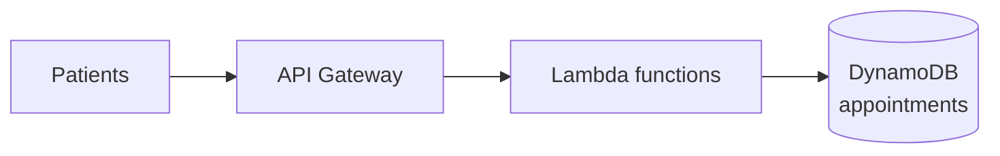
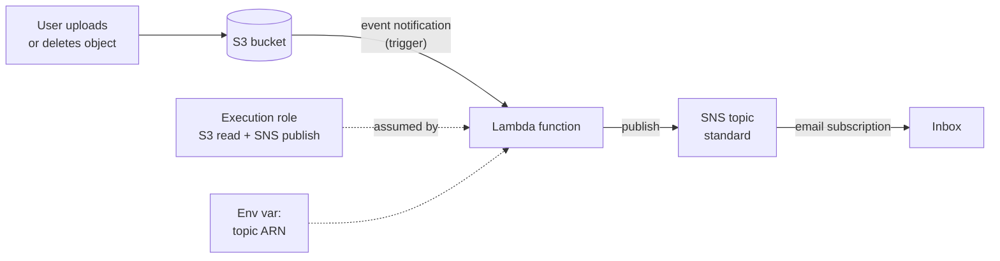

# Re-platforming to Serverless with AWS Lambda

> [!abstract] TL;DR
> The **Doctor Scheduling System** (Apache + PostgreSQL + NAS) has small but ==unpredictable, highly concurrent== load. It moves to the serverless pattern: **API Gateway** (networking), **Lambda** (application), **DynamoDB** (key-value storage).
>
> The lab practises the core shift on a small scale. A polling loop that watches a directory becomes an ==event-driven Lambda function==: **S3 events trigger it**, it reads the bucket and key from the **event**, and it publishes an **SNS** notification through **boto3**. It runs under an **IAM execution role**, takes the topic ARN from an **environment variable**, and is tested with an **S3 test event** before real uploads.

**Lesson:** L1 – Selecting Architecture for Workloads · **Previous:** [[Refactoring Data Workloads with AWS Glue]] · **Next lesson:** [[AWS Migration Services Overview]] (L2 – Migrating Workloads)
**Section hub:** [[Designing AWS Architecture for Workloads]]
**Sources:** Video C2-L1-A14 (which also contains the code-conversion demo), L1 E3 Demo Parts 1–2, and L1 E3 Solution, en-us transcripts. The demo's on-screen code isn't in the transcripts, so the handler in [[#4. From Polling Loop to Event-Driven Function]] is a reconstruction of the steps described. **Inconsistency:** the end of Demo Part 2 says the exercise uses **SES** (email), but the solution video uses **SNS** with an email subscription and **delete** events. These notes follow the solution.

> [!todo]- Contents
> 1. [[#1. The Doctor Scheduling System]]
> 2. [[#2. Serverless and Event-Driven – Core Concepts]]
> 3. [[#3. The Pieces of the Lab]]
> 4. [[#4. From Polling Loop to Event-Driven Function]]
> 5. [[#5. Recursive Invocation]]
> 6. [[#6. Testing a Lambda Function]]
> 7. [[#7. Lab Walkthrough]]
> 8. [[#8. Pitfalls and Failure Modes]]
> 9. [[#9. Key Takeaways]]
> 10. [[#10. Critical Analysis]]
> 11. [[#11. Self-Test]]
> 12. [[#12. Glossary]]
> 13. [[#13. Further Reading]]

---

## 1. The Doctor Scheduling System

| Layer | On-prem | Serverless target | Why |
|---|---|---|---|
| Networking | Routers and switches; API on **Apache** server | **API Gateway** | Scales automatically with requests |
| Application | Apache-hosted API | **AWS Lambda** | Fits a ==small yet unpredictable== workload |
| Storage | **PostgreSQL** + NAS | **DynamoDB** | Key-value store suits the unpredictable load on the database |

The driver: thousands of patients check availability and book slots **at the same time** at peak. The single on-prem server has no failover and fails at peak ([[Cloud Migration Strategies#Doctor Scheduling System (DSS) – replatform to serverless]]).



---

## 2. Serverless and Event-Driven – Core Concepts

> [!info]+ Definition – AWS Lambda
> A **serverless compute** service that ==runs your code in response to events== with no servers to provision or manage. Functions can be invoked through HTTP endpoints (e.g. API Gateway) or triggered by many AWS services. ^def-lambda

> [!info]+ Definition – Event-driven function
> Code that **runs only when an event arrives** (an upload, a request, a message) and then exits. It replaces long-running processes that loop and poll. You pay only while it runs. ^def-event-driven

> [!info]+ Definition – Amazon SNS
> **Simple Notification Service**: pub/sub messaging. Publishers send to a **topic**. **Subscriptions** (email, SMS, SQS, Lambda, HTTP…) receive each message. Topics are **standard** or **FIFO**. ^def-sns

> [!info]+ Definition – boto3
> The official **AWS SDK for Python**. It lets code create, configure, and call AWS services programmatically, e.g. an SNS client that publishes messages. ^def-boto3

> [!info]+ Definition – Lambda execution role
> The IAM role a Lambda function assumes when it runs. Its policies decide which AWS APIs the function's code may call. ^def-exec-role

| | Polling process (on-prem) | Event-driven Lambda |
|---|---|---|
| Runs | Continuously (`while True` + sleep) | Only when triggered |
| Detects new files | Lists a directory repeatedly | **S3 sends an event** |
| Cost | A server running 24/7 | Per invocation and duration |
| Scaling | One process | Concurrent invocations scale automatically |
| Failure handling | Process crashes, nobody notices | Retries, logs in CloudWatch |

---

## 3. The Pieces of the Lab



| Piece | Demo | Exercise solution |
|---|---|---|
| S3 trigger event type | All **object create** events | All **object delete** events (create **unticked**) |
| Execution role policies | S3 (demo says it started with full access; the console later showed **read-only** Get/List/Describe) + **SNS full access** | **AmazonS3ReadOnlyAccess** + **AmazonSNSFullAccess** |
| SNS topic | Standard topic + email subscription (confirmed) | Standard topic + email subscription (confirmed) |
| Message | "New file has been uploaded…" | "A file has been deleted from…" (subject: *File deleted*) |
| Runtime | Python 3.9 | Python 3.9 |

> [!warning] Python 3.9 is past end of support (*beyond the lecture*)
> AWS deprecated the Python 3.9 Lambda runtime in late 2025. In a new function pick the **latest Python runtime** the console offers. The handler code is unchanged.

> [!note] Why SNS full access and S3 read-only
> The function only needs to *read* event metadata about S3 and *publish* to SNS. SNS read-only wouldn't allow publish, so the instructor picked the smallest **managed** policy that includes it. Better still is a custom policy allowing only `sns:Publish` on the one topic ARN ([[#10. Critical Analysis]]).

---

## 4. From Polling Loop to Event-Driven Function

The conversion has three changes:

1. **Remove the continuous loop**; make the code an event-driven **handler**.
2. **Replace file-system calls** with S3 event handling: get the bucket and key **from the event**.
3. **Publish an SNS notification** through boto3. The topic ARN comes from an **environment variable**.

The handler has three parts: extract the bucket and key, send the notification, return.

```python
import os
import urllib.parse
import boto3

sns_client = boto3.client("sns")                 # created once, reused across invocations
TOPIC_ARN = os.environ["SNS_TOPIC_ARN"]          # set in the function's configuration

def lambda_handler(event, context):
    record = event["Records"][0]
    bucket = record["s3"]["bucket"]["name"]
    key = urllib.parse.unquote_plus(record["s3"]["object"]["key"])

    sns_client.publish(
        TopicArn=TOPIC_ARN,
        Subject="File deleted",
        Message=f"A file has been deleted from {bucket}: {key}",
    )
    return {"statusCode": 200, "body": f"Notification sent for {key}"}
```

> [!tip] Reading the event
> S3 event payloads contain a `Records` list with the bucket, object key, and event name (e.g. `ObjectCreated:Put`, `ObjectRemoved:Delete`). The instructor's tip: if you need more fields, **print the event** in a test run and read it in the logs. Object keys arrive **URL-encoded** (spaces become `+`), so decode them before use. That last detail is *beyond the lecture*.

> [!note] Environment variables decouple config from code
> Putting the topic ARN in an environment variable means the same code works with any topic, and nothing account-specific is hard-coded.

---

## 5. Recursive Invocation

When you add an S3 trigger, the console makes you **acknowledge that recursive invocation is possible**.

> [!danger] Recursive invocation
> If a function triggered by writes to a bucket **writes back to the same bucket** (and prefix), each write triggers the function again, in an infinite loop, and ==you pay for every invocation==. ^recursion

Mitigations:
- Trigger only on the **event types** you need. The exercise selects **delete** events and **unticks create** events.
- Write outputs to a **different bucket** or a prefix outside the trigger's filter.
- (*Beyond the lecture*) Lambda has built-in recursive-loop detection for some services. It stops loops after a number of repeats, but don't design around it.

---

## 6. Testing a Lambda Function

| Action | What it does |
|---|---|
| **Deploy** | Publishes the edited code. The console shows *undeployed changes* until you do |
| **Test** | Invokes the function with a **simulated event**, before any real file changes |

Test events come from **templates**. The demo uses **S3 Put**; the exercise uses **S3 Delete**. Edit the template's bucket name/ARN to your bucket. A good run returns "Notification sent for…" and an email arrives. Then do the **real** test: upload (demo) or upload-then-delete (exercise) a file in the console.

---

## 7. Lab Walkthrough

1. **IAM:** create a **service role** for Lambda with S3 read-only + SNS publish permissions.
2. **SNS:** create a **standard** topic → copy its **ARN** → create an **email** subscription → **confirm** it from the inbox.
3. **Lambda:** create the function (Python runtime, **existing role**).
4. Add an **S3 trigger**: bucket, event type, acknowledge recursion.
5. Add the **environment variable** for the topic ARN.
6. Paste the code → **Deploy** → **Test** with an S3 event → check the email.
7. Real test: act on an object in the bucket → check the email.

Full click-path, checks, troubleshooting, and cleanup: [[Exercise 3 - Event-Driven Notifications with Lambda and SNS - How To]].

---

## 8. Pitfalls and Failure Modes

| Failure | Symptom | Mitigation |
|---|---|---|
| Subscription not confirmed | Test succeeds but no email arrives | Click the confirmation link; subscription status must be *Confirmed* |
| Env var name doesn't match code | `KeyError` on the topic ARN | Copy the variable name from the code exactly |
| Edited code not deployed | Old behavior persists | **Deploy** after every edit |
| Test event still points to the example bucket | Notification names `example-bucket` | Edit the template's bucket name and ARN |
| Trigger on create + function writes to the bucket | Runaway invocations and cost ([[#^recursion]]) | Narrow event types; separate output bucket |
| Delete trigger but testing with uploads | No notification on upload (expected) | Upload, then **delete** to fire the event |
| FIFO topic chosen | Email subscriptions unavailable | Use a **standard** topic |
| Email arrives late | Looks like a failure | SNS email can lag by minutes; check CloudWatch logs for the invocation |

---

## 9. Key Takeaways

- [ ] DSS serverless stack: **API Gateway → Lambda → DynamoDB**, for small, unpredictable, high-concurrency load.
- [ ] Lambda runs code **in response to events**; you don't manage servers ([[#^def-lambda]]).
- [ ] Converting a polling loop: remove the loop, read bucket/key **from the event**, publish via **boto3**.
- [ ] A Lambda function needs an **execution role** with only the permissions its code uses.
- [ ] Configuration (topic ARN) belongs in **environment variables**, not code.
- [ ] SNS: **standard** topic, **email subscription**, which must be **confirmed**.
- [ ] Beware **recursive invocation** on S3 triggers ([[#^recursion]]).
- [ ] **Deploy** publishes code; **Test** simulates an event.

---

## 10. Critical Analysis

- **The lab isn't the architecture.** The DSS design is API Gateway + Lambda + DynamoDB. The lab exercises S3 → Lambda → SNS. It teaches the event-driven mindset but not the hard parts of DSS: API design, DynamoDB key design, and **concurrency control for double-booking** (conditional writes or transactions).
- **Cold starts and concurrency limits.** Lambda scales fast, but accounts have a default regional concurrency limit, and cold starts add latency. For a booking spike, consider reserved or provisioned concurrency and API Gateway throttling to protect DynamoDB and downstream systems.
- **Least privilege again.** `AmazonSNSFullAccess` lets the function create and delete topics, change subscriptions, and publish anywhere. A one-statement policy (`sns:Publish` on one topic ARN) is enough. S3 permissions aren't even needed for this handler, because the event already carries the bucket and key.
- **Delivery semantics.** S3 event notifications are **at-least-once**: duplicates are possible and ordering isn't guaranteed. A real notifier should tolerate duplicates (idempotency). For durability, put SQS between S3 and Lambda, or use EventBridge.
- **PHI in notifications.** In a healthcare setting, object keys can leak patient information into email. Notifications should carry an identifier, not the data.

> [!question] Open discussion questions
> 1. How would you stop two patients booking the same slot in the DynamoDB design?
> 2. When would you put SQS or EventBridge between S3 and Lambda instead of a direct trigger?
> 3. Is DSS a replatform or a refactor? (See [[Cloud Migration Strategies#8. Critical Analysis]].)

---

## 11. Self-Test

> [!question]- Q1. Why does the Doctor Scheduling System fit the serverless pattern?
> Its load is **small but unpredictable and highly concurrent** at peak. The single on-prem server has no failover and fails at peak. API Gateway, Lambda, and DynamoDB all scale automatically and charge per use.

> [!question]- Q2. What three changes turn the on-prem directory watcher into a Lambda function?
> Remove the continuous loop and make it an **event-driven handler**; replace file-system calls with **S3 event data** (bucket and key from the event); **publish to SNS** through boto3.

> [!question]- Q3. What is recursive invocation and how does the exercise avoid it?
> A triggered function writes to the bucket that triggers it, so it re-invokes itself endlessly and you pay for each call. The exercise triggers only on **delete** events, with create events unticked, and never writes to the bucket.

> [!question]- Q4. Why put the SNS topic ARN in an environment variable?
> It separates **configuration from code**: the same code can be pointed at any topic or account without editing it, and nothing account-specific is hard-coded.

> [!question]- Q5. The test succeeds but no email arrives. What do you check first?
> That the email subscription is **confirmed**. Then that the env var holds the right topic ARN, and the CloudWatch logs for errors. SNS email can also lag by a few minutes.

> [!question]- Q6. (Quantitative, beyond the lecture) A polling script on a small always-on server costs about \$15/month. A Lambda doing the same work runs 2,000 times a month for 200 ms at 128 MB. Roughly what does Lambda cost?
> Compute: $2{,}000 \times 0.2\,\text{s} \times 0.125\,\text{GB} = 50$ GB-seconds, far inside the monthly free tier, and even at list price (about \$0.0000167/GB-s) under a cent. Requests: 2,000 is also inside the free tier. Effectively **\$0** versus \$15. This is why event-driven designs win for sparse workloads. Check current pricing.

> [!question]- Q7. (Design) Write the least-privilege policy idea for the exercise function.
> Allow **`sns:Publish`** on the **one topic ARN**, plus basic Lambda logging (`logs:CreateLogGroup`, `logs:CreateLogStream`, `logs:PutLogEvents`). No S3 permissions are needed, because the bucket and key arrive in the event.

### Flashcards

> [!tip] Flashcards
> Review this note with [[Re-platforming to Serverless with AWS Lambda - Flashcards]].

---

## 12. Glossary

| Term | Meaning |
|---|---|
| Serverless | Managed compute or storage with no servers to provision; pay per use |
| AWS Lambda | Event-driven serverless functions |
| Handler | The function's entry point that receives the event and context |
| Trigger | The event source that invokes a Lambda function |
| Execution role | IAM role a Lambda function assumes at runtime |
| Environment variable | Configuration value injected into the function at runtime |
| Recursive invocation | A function re-triggering itself through its own output |
| Amazon SNS | Pub/sub notification service: topics and subscriptions |
| Standard vs. FIFO topic | Best-effort ordering and high throughput vs. strict ordering, deduplication |
| ARN | Amazon Resource Name, the unique ID of an AWS resource |
| boto3 | AWS SDK for Python |
| Amazon SES | Simple Email Service, for sending email directly |
| API Gateway | Managed front door for APIs |
| DynamoDB | Serverless key-value / document database |

---

## 13. Further Reading

- [What is AWS Lambda](https://docs.aws.amazon.com/lambda/latest/dg/welcome.html)
- [Using Lambda with Amazon S3](https://docs.aws.amazon.com/lambda/latest/dg/with-s3.html)
- [Lambda recursive loop detection](https://docs.aws.amazon.com/lambda/latest/dg/invocation-recursion.html)
- [Lambda runtimes and deprecation](https://docs.aws.amazon.com/lambda/latest/dg/lambda-runtimes.html)
- [What is Amazon SNS](https://docs.aws.amazon.com/sns/latest/dg/welcome.html)
- [Boto3 documentation](https://boto3.amazonaws.com/v1/documentation/api/latest/index.html)
