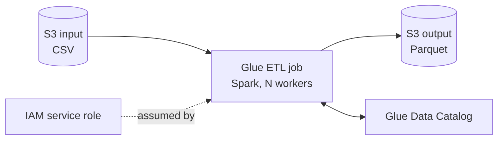

# Refactoring Data Workloads with AWS Glue

> [!abstract] TL;DR
> The Health Trend Analysis (HTA) Spark cluster is **refactored** onto the big-data reference architecture:
> - **AWS Glue**, a fully managed, serverless ==ETL service==, replaces the always-on cluster.
> - **S3** is both source and target.
> - **Glue Data Catalog** replaces the Hive Metastore.
> - **PrivateLink** keeps traffic private.
>
> Converting a Spark job is mostly mechanical: ==swap the SparkSession for a GlueContext plus job init/commit, and swap local paths for S3 URIs==. Glue needs an **IAM service role** to reach S3. Capacity is set in **workers** (DPUs), not servers.

**Lesson:** L1 – Selecting Architecture for Workloads · **Previous:** [[Application Architectures and AWS Reference Architectures]] · **Next:** [[Re-platforming to Serverless with AWS Lambda]]
**Section hub:** [[Designing AWS Architecture for Workloads]]
**Sources:** Video C2-L1-A11, the three Glue demo videos (IAM Roles, The AWS Glue Console, Glue), and the Exercise 2 solution video, en-us transcripts. The demo's source code is shown on screen but not in the transcripts. The code in [[#5. Converting a Spark Job – What Changes]] is my reconstruction of the pattern described, not a copy. The exercise dataset is `iea-global-ev-data-2024.csv`, which you supplied ([[#6. The Exercise Dataset – IEA Global EV Data]]).

> [!todo]- Contents
> 1. [[#1. The HTA Refactor]]
> 2. [[#2. AWS Glue – Core Concepts]]
> 3. [[#3. IAM Service Roles]]
> 4. [[#4. Glue Job Capacity – Workers and DPUs]]
> 5. [[#5. Converting a Spark Job – What Changes]]
> 6. [[#6. The Exercise Dataset – IEA Global EV Data]]
> 7. [[#7. Lab Walkthrough]]
> 8. [[#8. Pitfalls and Failure Modes]]
> 9. [[#9. Key Takeaways]]
> 10. [[#10. Critical Analysis]]
> 11. [[#11. Self-Test]]
> 12. [[#12. Glossary]]
> 13. [[#13. Further Reading]]

---

## 1. The HTA Refactor

On-prem, ==scalability, resiliency, and hardware are managed by hand==. The refactor applies [[Application Architectures and AWS Reference Architectures#^big-data-ref|the big-data reference architecture]]:

| On-prem component | AWS target | What you gain |
|---|---|---|
| Spark cluster on physical servers | **AWS Glue** | No cluster to run; pay per job run |
| NAS / SAN | **Amazon S3** | Scalable, durable, secure object storage; Glue's native source **and** target |
| Hive Metastore | **AWS Glue Data Catalog** | Managed metadata; integrates with Glue jobs, Athena, EMR |
| Physical routers and switches | **AWS PrivateLink** (VPC endpoints) | Private networking between the VPC and managed services |



---

## 2. AWS Glue – Core Concepts

> [!info]+ Definition – AWS Glue
> A fully managed, **serverless data integration** service that simplifies discovering, preparing, moving, and integrating data from many sources. It ==automates much of the ETL process== so users can focus on analysis. Glue ETL jobs run on **Apache Spark** under the hood. ^def-glue

> [!info]+ Definition – Glue Data Catalog
> A centralized **metadata repository** for data sources, schemas, and properties. It is a migration target for on-prem **Hive metastores**. ^def-catalog

Ways to author a job in **Glue Studio** (from the console demo):

| Authoring mode | Best for |
|---|---|
| **Visual** (GUI) | Simple pipelines; non-programmers |
| **Notebook** | Interactive development and exploration |
| **Script editor** (code) | Porting existing Spark code. **Used in the demo** |

The script editor pre-fills the boilerplate: Glue imports, argument parsing, Spark and Glue contexts, `Job` init, and `job.commit()`. ==You add your own imports and the transformation logic between init and commit.==

---

## 3. IAM Service Roles

> [!info]+ Definition – IAM service role
> An IAM role that an **AWS service** (Glue, Lambda, EC2…) assumes so it can call **other** AWS services on your behalf. No long-lived keys are involved: the service gets temporary credentials. ^def-service-role

Demo steps (summary; full click-path in the how-to):
1. IAM → Roles → **Create role** → trusted entity **AWS service** → use case **Glue**.
2. Attach **AmazonS3FullAccess**, because Glue must read the input, write the output, and touch temporary objects.
3. Name it, e.g. `AWS-Glue-S3Role` (no spaces).

> [!warning] "Start broad, then tighten" – handle with care
> The instructor's stated practice: start from AWS managed policies, then apply **least privilege** to remove what's not needed. That's fine in a throwaway lab. In production, the role should be scoped to the **specific buckets and prefixes** (plus the Glue service policy for logs and the catalog). See [[#10. Critical Analysis]].

---

## 4. Glue Job Capacity – Workers and DPUs

Like EC2, Glue has compute tiers. But a Glue job runs on a **cluster of workers**, not one instance.

> [!info]+ Definition – DPU (Data Processing Unit)
> Glue's unit of capacity and billing. One standard **DPU = 4 vCPUs + 16 GB memory**. A **G.1X** worker = 1 DPU, **G.2X** = 2 DPUs. (*DPU sizes are beyond the lecture; check the Glue docs for current worker types.*) ^def-dpu

| Job setting | Demo value | Real-world guidance |
|---|---|---|
| Worker type | Smallest available | Size to data volume and transform complexity |
| Number of workers | **2** (minimum; Udacity limits this) | "Spec out the number of workers your job requires" |
| Retries | 0 | Increase for production jobs |
| Glue version | Latest | Follows the Spark functions you use; best practice is the latest |

### Cost of a Run

*Beyond the lecture.* Glue bills per DPU-hour, per second, with a short minimum. At an illustrative \$0.44 per DPU-hour, for $W$ workers of $d$ DPUs each running for $t$ minutes:

$$
\text{cost} = W \cdot d \cdot \frac{t}{60} \cdot 0.44
$$

The exercise run (2 × G.1X, about 2 minutes) costs $2 \cdot 1 \cdot \tfrac{2}{60} \cdot 0.44 \approx \$0.03$. An always-on 2-node on-prem cluster costs its full fixed price whether or not anything runs. That gap is the refactor's cost argument. *Check current regional pricing before relying on the rate.*

---

## 5. Converting a Spark Job – What Changes

The demo job (Netflix titles): read CSV → upper-case the `type` column → keep movies → write Parquet. The exercise job (EV data): read CSV → **drop a column** → write Parquet.

| Concern | On-prem Spark | Glue |
|---|---|---|
| Entry point | `SparkSession.builder…getOrCreate()` | `GlueContext(SparkContext)`, then `Job.init(...)` |
| Imports | PySpark | Glue libraries (pre-filled) **plus** any PySpark functions you use |
| Paths | Local or HDFS paths | **S3 URIs** (input = the **file**; output = a **folder**) |
| End of job | `spark.stop()` | `job.commit()` |
| Infrastructure | Your cluster | Glue workers, IAM role |

Pattern (illustrative reconstruction):

```python
import sys
from awsglue.utils import getResolvedOptions
from awsglue.context import GlueContext
from awsglue.job import Job
from pyspark.context import SparkContext
from pyspark.sql.functions import col, upper     # <- your own imports

args = getResolvedOptions(sys.argv, ["JOB_NAME"])
sc = SparkContext()
glueContext = GlueContext(sc)
spark = glueContext.spark_session
job = Job(glueContext)
job.init(args["JOB_NAME"], args)

# --- your transformation logic goes between init and commit ---
df = spark.read.csv("s3://<bucket>/input/<file>.csv", header=True, inferSchema=True)
out = df.withColumn("type", upper(col("type"))).filter(col("type") == "MOVIE")
out.write.mode("overwrite").parquet("s3://<bucket>/output/")

job.commit()
```

> [!note] Glue DynamicFrames (*beyond the lecture*)
> Glue also has its own **DynamicFrame** abstraction, which tolerates inconsistent schemas and integrates with the Data Catalog and job bookmarks. The demo keeps plain Spark DataFrames, which is the fastest way to port existing code. Converting between them is a single call either way.

> [!tip] Why Parquet
> Both jobs write **Parquet**: columnar, compressed, and splittable. Analytics engines (Athena, Redshift Spectrum, Spark) read only the columns a query needs, which cuts both scan time and per-TB-scanned cost compared with CSV.

---

## 6. The Exercise Dataset – IEA Global EV Data

The file you supplied, `iea-global-ev-data-2024.csv`, is the Exercise 2 input ("our transformed global EV data" in the solution video). It is from the International Energy Agency's *Global EV Outlook 2024* data.

| Property | Value |
|---|---|
| Rows | 12,654 (plus header) |
| Columns | `region`, `category`, `parameter`, `mode`, `powertrain`, `year`, `unit`, `value` |
| Shape | **Long / tidy**: one measurement per row, so `value` changes meaning with `parameter` and `unit` |
| `region` | 54 values, including aggregates (`World`, `Europe`, `Rest of the world`) next to countries |
| `category` | `Historical`, `Projection-STEPS`, `Projection-APS` |
| `parameter` | 8, e.g. EV stock, EV sales, sales share, stock share, charging points, oil displacement |
| `mode` | Cars, Buses, Vans, Trucks, EV (used for charging rows) |
| `powertrain` | EV, BEV, PHEV, FCEV, plus charger types (publicly available slow / fast) |
| `year` | 17 distinct years, historical plus projections |
| `unit` | Vehicles, percent, charging points, GWh, oil displacement units |

> [!warning] Data traps for any downstream analysis (*beyond the lecture*)
> - **Don't sum `value` blindly.** It mixes vehicles, percentages, GWh, and barrels per day. Always filter on `parameter` and `unit` first.
> - **Aggregates double-count.** `World` and `Europe` already include the countries listed beside them.
> - **Projections aren't history.** Filter `category = Historical` unless you want scenario data.
> - A dropped column is gone from the Parquet output. If you drop `unit`, `value` becomes ambiguous. The column dropped in the exercise is the one the sheet specifies; use that.

---

## 7. Lab Walkthrough

**Demo (Netflix titles)** and **Exercise 2 (EV data)** follow the same flow:

1. Create the IAM service role for Glue with S3 access ([[#3. IAM Service Roles]]).
2. Glue → **ETL jobs** → **Script editor** → create a script.
3. Add your PySpark imports; paste the transformation between `job.init` and `job.commit`.
4. Set the S3 input (copy the **object's** S3 URI) and output (a **folder** URI).
5. **Job details:** name, IAM role, smallest worker type, **2** workers → Save → **Run**.
6. Watch **Runs** until *Succeeded*, then check the output folder in S3 for Parquet files.

Step-by-step with checks, troubleshooting, and cleanup: [[Exercise 2 - Convert a Spark ETL Job to AWS Glue - How To]].

---

## 8. Pitfalls and Failure Modes

| Failure | Symptom | Mitigation |
|---|---|---|
| Input URI points at the folder or bucket, not the file | Job reads nothing or the wrong objects | Copy the S3 URI of the **object** itself (the instructor's "click down to the actual file") |
| Missing PySpark imports | `NameError` for `col`/`upper` | The editor pre-fills Glue imports only; add your own |
| Role lacks S3 access, or wrong role selected | `AccessDenied` in the run log | Check the role on the **Job details** tab |
| Output path outside buckets the role can write | Write fails at the end of the run | Write within the lab bucket |
| Leftover `spark.stop()` | Job ends oddly or errors | Replace with `job.commit()` |
| Too many workers in a sandbox | Job won't start (account quota) | Minimum worker count in the Udacity account |
| Forgotten scheduled or re-run jobs | Recurring DPU charges | Delete demo jobs; no schedules in the lab |

---

## 9. Key Takeaways

- [ ] HTA refactor: Spark cluster → **Glue**, NAS/SAN → **S3**, Hive Metastore → **Glue Data Catalog**, plus **PrivateLink**.
- [ ] Glue is **serverless Spark-based ETL**: no cluster, pay per run ([[#^def-glue]]).
- [ ] Porting a Spark job = **GlueContext + job init/commit** and **S3 paths**. The transformation logic barely changes.
- [ ] Glue needs an **IAM service role** to call S3 on your behalf ([[#^def-service-role]]).
- [ ] Capacity = **worker type × number of workers** (DPUs); the minimum is 2 workers.
- [ ] Input URI = the **file**; output URI = a **folder**.
- [ ] Write **Parquet** for cheaper, faster analytics.

---

## 10. Critical Analysis

- **"Refactor" here is light.** The code change is boilerplate. The real refactor is operational: no cluster, S3 as the system of record, catalog-driven metadata. For heavily tuned Spark jobs (custom JARs, specific Spark versions, long-running streaming), Glue's managed constraints may push you to **EMR or EMR Serverless** instead.
- **Least privilege, actually.** Both demos grant `AmazonS3FullAccess` (and `AmazonSNSFullAccess` in the Lambda lab). That is account-wide S3 access. For patient-adjacent health data, a compromised job role could read every bucket. Production scoping: `s3:GetObject` on the input prefix, `s3:PutObject` on the output prefix, the Glue service policy, and nothing else. Use IAM Access Analyzer's policy generation from CloudTrail activity to tighten.
- **Cost model shift.** Glue turns fixed cluster cost into variable per-run cost. That's a win for bursty batch work. For a cluster that's genuinely busy 24/7, per-DPU pricing can exceed an EMR cluster on Savings Plans or Spot ([[AWS Purchasing Options and Rightsizing]]). Model it.
- **Data quality isn't addressed.** The ETL drops a column and writes Parquet, with no schema checks or validation. The EV dataset shows why that matters: mixed units, aggregates next to their parts. Glue Data Quality rules or simple assertions in the job close the gap.
- **Evaluation.** Compare runtime, cost per run, and failure rate before and after. Verify output row counts against the input (12,654 rows in, 12,654 out for a column drop).

> [!question] Open discussion questions
> 1. What evidence would make you choose EMR Serverless over Glue for HTA?
> 2. How would you write a least-privilege policy for the exercise job?
> 3. Should the transformed EV data be partitioned (by `year`? by `region`?), and how does that interact with typical queries?

---

## 11. Self-Test

> [!question]- Q1. Map each HTA on-prem component to its AWS target.
> Spark cluster → **Glue**; NAS/SAN → **S3**; Hive Metastore → **Glue Data Catalog**; physical networking → **PrivateLink** / VPC.

> [!question]- Q2. What are the minimum code changes to run an on-prem PySpark job in Glue?
> Replace the SparkSession setup with a **GlueContext** and **Job.init**; add any PySpark imports you use; change local paths to **S3 URIs**; replace `spark.stop()` with **`job.commit()`**.

> [!question]- Q3. Why does a Glue job need an IAM role, and what kind?
> Glue must call S3 (and logging and catalog services) on your behalf. You give it an **IAM service role** whose trusted entity is the Glue service. It receives temporary credentials, never stored keys.

> [!question]- Q4. In the exercise, which S3 URI must point at an object and which at a folder?
> The **input** must be the object (the CSV file itself). The **output** is a **folder**: Spark writes one or more part files into it.

> [!question]- Q5. (Quantitative, beyond the lecture) A nightly Glue job uses 10 G.1X workers for 12 minutes. At \$0.44/DPU-hour, what's the monthly cost (30 runs)?
> Per run: $10 \times 1 \times \tfrac{12}{60} \times 0.44 = \$0.88$. Monthly: $30 \times 0.88 = \$26.40$.

> [!question]- Q6. (Design) A downstream analyst sums the `value` column of the transformed EV data by region and gets nonsense. What went wrong and how should the pipeline prevent it?
> `value` mixes units (vehicles, percent, GWh, oil displacement) and regions include aggregates like `World`. The pipeline should keep `parameter` and `unit`, document the grain, and optionally publish **separate curated tables** per parameter (e.g. historical EV sales in vehicles, countries only), with row-count and unit checks.

> [!question]- Q7. Why write the output as Parquet instead of CSV?
> Parquet is **columnar and compressed**. Query engines read only the needed columns and skip data, so queries run faster and per-byte-scanned costs drop.

### Flashcards

> [!tip] Flashcards
> Review this note with [[Refactoring Data Workloads with AWS Glue - Flashcards]].

---

## 12. Glossary

| Term | Meaning |
|---|---|
| AWS Glue | Serverless, Spark-based data integration and ETL service |
| Glue Studio | Glue's console for authoring jobs (visual, notebook, script) |
| GlueContext | Glue's wrapper around the Spark context |
| Job init / commit | Start and finish markers of a Glue job run (commit also records bookmark state) |
| DynamicFrame | Glue's schema-flexible alternative to a Spark DataFrame |
| Glue Data Catalog | Managed metadata store; replaces Hive Metastore |
| Hive Metastore | On-prem metadata store for Hive/Spark tables |
| Worker / DPU | Unit of Glue compute; 1 DPU = 4 vCPU + 16 GB |
| IAM service role | Role a service assumes to act on your behalf |
| S3 URI | `s3://bucket/key` address of an object or prefix |
| Parquet | Columnar, compressed file format for analytics |

---

## 13. Further Reading

- [What is AWS Glue](https://docs.aws.amazon.com/glue/latest/dg/what-is-glue.html)
- [AWS Glue job parameters and worker types](https://docs.aws.amazon.com/glue/latest/dg/add-job.html)
- [Program AWS Glue ETL scripts in PySpark](https://docs.aws.amazon.com/glue/latest/dg/aws-glue-programming-python.html)
- [AWS Glue pricing](https://aws.amazon.com/glue/pricing/)
- [IEA Global EV Data Explorer](https://www.iea.org/data-and-statistics/data-tools/global-ev-data-explorer)
