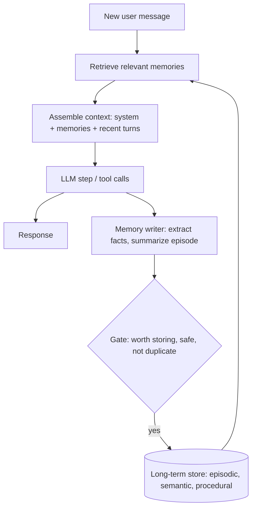

# AI Memory

> [!abstract] TL;DR
> LLMs are stateless: each call only "remembers" what is in its context window. Agent memory is ==the engineering that decides what to store, what to retrieve, and what to put back into the context== so an agent can keep state within a task and learn across sessions. Memory is usually split into short-term (the working context) and long-term (external stores — episodic, semantic, procedural), retrieved with the same machinery as [[Retrieval-Augmented Generation|RAG]].

**Prerequisites:** [[Large Language Models]] · [[AI Agents]]
**Related:** [[Retrieval-Augmented Generation]] · [[Vector Databases]] · [[Knowledge Graphs]] · [[LLM Feedback Loops]] · [[Multi-Agent Systems]]

> [!note] Source scope
> Concept hub. The taxonomy (episodic/semantic/procedural) borrows from cognitive science as used in the agent literature. All content is *beyond the lecture*.

> [!todo]- Contents
> - [[#1. Core Concepts]]
> - [[#2. Memory Architecture]]
> - [[#3. Write, Retrieve, Forget]]
> - [[#4. Worked Example – Support Agent That Remembers]]
> - [[#5. Pitfalls and Failure Modes]]
> - [[#6. Key Takeaways]]
> - [[#7. Critical Analysis]]
> - [[#8. Self-Test]]
> - [[#9. Glossary]]
> - [[#Further Reading]]

## 1. Core Concepts

> [!info]+ Definition – Agent memory
> Mechanisms outside the model weights that persist information across model calls, and select what to re-insert into the context window.

^def-memory

| Memory type | Holds | Lifetime | Typical store |
|---|---|---|---|
| Short-term / working | Current conversation, scratchpad, tool results | One task | Context window |
| Episodic | Past events and interactions ("last week the user asked…") | Across sessions | Vector store with timestamps |
| Semantic | Facts and preferences ("user prefers Python") | Long | Key–value, profile, [[Knowledge Graphs]] |
| Procedural | How to do things: learned instructions, skills, examples | Long | Prompt files, skill libraries |
| Parametric | Knowledge in the weights | Until retraining | The model itself |

## 2. Memory Architecture

The context window is a budget. If $C$ is the window, then

$$C \geq T_{\text{system}} + T_{\text{memories}} + T_{\text{recent turns}} + T_{\text{tools}} + T_{\text{output}}$$

Memory management is choosing what earns a place in that budget.

## 3. Write, Retrieve, Forget

| Operation | Techniques | Design question |
|---|---|---|
| Write | Store raw turns; LLM-extracted facts; episode summaries; reflections (as in [[LLM Feedback Loops]]) | What is worth remembering? |
| Retrieve | Similarity search ([[Vector Databases]]), recency, importance score, key lookup | What's relevant *now*? |
| Consolidate | Merge duplicates, update changed facts | "Moved to Denver" should replace "lives in Austin" |
| Forget | TTL, decay, user deletion requests | What must expire, legally or practically? |
| Compress | Rolling summaries of older turns | What detail can be lost? |

A common retrieval score (from Generative Agents, Park et al. 2023) mixes three signals:

$$\text{score} = \alpha \cdot \text{recency} + \beta \cdot \text{importance} + \gamma \cdot \text{relevance}$$

## 4. Worked Example – Support Agent That Remembers

Session 1: user says "I'm on the Pro plan and I use the Windows client."
- Memory writer extracts semantic facts: `{plan: "Pro", os: "Windows"}` with source = session 1, date.
- Episode summary: "Reported sync error E-17; fixed by clearing cache."

Session 2 (a week later): "Sync broke again."
- Retrieve: profile facts + the E-17 episode (high relevance).
- Context gets 3 short memories, not the full old transcript.
- Agent: "Last time, clearing the cache fixed E-17 on your Windows client. Is it the same error?"
- If the user says "I switched to Mac", consolidation updates `os` and records the change.

## 5. Pitfalls and Failure Modes

| Failure | Symptom | Mitigation |
|---|---|---|
| Context overflow | Old turns push out instructions | Rolling summaries; retrieval instead of full history |
| Stale memory | Agent uses outdated facts | Timestamps; consolidation; prefer recent |
| Wrong recall | Irrelevant memories distract the model | Relevance threshold; fewer memories |
| False memory | Model "remembers" things never stored | Only insert stored memories, with provenance ([[LLM Hallucinations]]) |
| Memory poisoning | Injected text saved as a "fact" and reused later | Gate what's written; tag source; don't store instructions from untrusted content ([[Prompt Injection]]) |
| Privacy leaks | One user's memory appears for another | Partition by user/tenant; deletion support |
| Unbounded growth | Cost and noise grow | Decay, TTL, consolidation |

## 6. Key Takeaways

- [ ] I can explain why LLMs are stateless and what memory adds.
- [ ] I can tell short-term, episodic, semantic, procedural and parametric memory apart.
- [ ] I can design write, retrieve, consolidate and forget policies.
- [ ] I treat the context window as a budget.
- [ ] I know memory is a persistent injection and privacy risk.

## 7. Critical Analysis

- **Memory is RAG over yourself.** It inherits RAG's failure modes (retrieval misses, stale data) plus a new one: the agent writes its own corpus, so errors can reinforce themselves.
- **Evaluation is hard.** Benefits appear over many sessions. You need long-horizon tests: does the agent recall the right fact after 50 sessions, and forget what it should?
- **At scale.** Per-user stores, deletion requests (e.g. GDPR "right to erasure") and cross-tenant isolation become the main engineering work.
- **Security.** Memory turns a one-time injection into a persistent one. An attacker who gets a malicious "preference" stored affects every future session.
- **Open questions:** Should memory be user-visible and editable by default? When do longer context windows remove the need for memory, and when do they just delay it?

## 8. Self-Test

> [!question]- Q1. Why is an LLM "stateless"?
> The model doesn't retain anything between calls; only the tokens in the current context affect its output. Continuity must be supplied by the application.

> [!question]- Q2. Classify: "User's timezone is CET", "On 3 Sept the deploy failed", "Always run tests before committing".
> Semantic, episodic, procedural.

> [!question]- Q3. Quantitative – 128k window, system 4k, tools 6k, output reserve 8k, recent turns 30k. How many tokens are left for memories?
> $128 - 4 - 6 - 8 - 30 = 80$k tokens (though using fewer, more relevant memories usually works better).

> [!question]- Q4. Design – how do you stop memory poisoning in an email agent?
> Don't store content from untrusted emails as instructions or preferences; store only facts extracted with a strict schema, tagged with source; require user confirmation for preference changes; allow users to review and delete memories.

> [!question]- Q5. What does consolidation solve?
> Duplicates and contradictions: it merges or replaces facts so the store reflects the current truth.

> [!tip] Flashcards
> Review this topic with [[AI Memory - Flashcards]].

## 9. Glossary

| Term | Meaning |
|---|---|
| Context window | Maximum tokens the model can attend to in one call |
| Episodic memory | Records of specific past events |
| Semantic memory | General facts and preferences |
| Procedural memory | Stored know-how: instructions, skills |
| Consolidation | Merging and updating stored memories |
| Memory poisoning | Malicious content saved into memory |

## Further Reading

- [Packer et al. (2023) – MemGPT: Towards LLMs as Operating Systems](https://arxiv.org/abs/2310.08560)
- [Park et al. (2023) – Generative Agents: Interactive Simulacra of Human Behavior](https://arxiv.org/abs/2304.03442)
- [Shinn et al. (2023) – Reflexion: Language Agents with Verbal Reinforcement Learning](https://arxiv.org/abs/2303.11366)
- [Sumers et al. (2023) – Cognitive Architectures for Language Agents (CoALA)](https://arxiv.org/abs/2309.02427)
