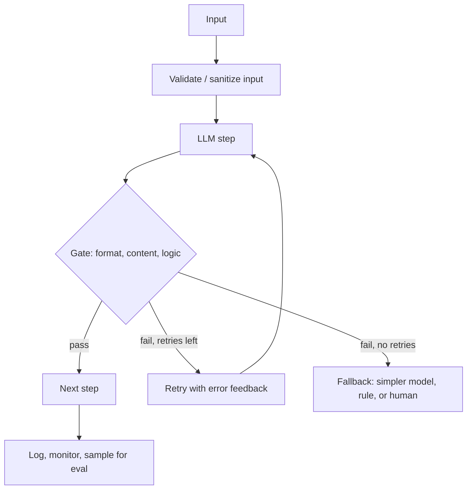

# AI Reliability

> [!abstract] TL;DR
> Reliability is the probability that an AI system does the right thing, every time, under real conditions. LLMs are stochastic and fail silently, so ==reliability is a property of the system around the model, not of the model alone==. Errors compound across steps ($p^n$), so reliable systems keep chains short, validate between steps, retry with feedback, degrade gracefully, and monitor in production.

**Prerequisites:** [[Large Language Models]] · [[LLM Hallucinations]]
**Related:** [[Gate Checks]] · [[LLM Evaluation]] · [[LLM Feedback Loops]] · [[Output Validation]] · [[Pydantic for Structured LLM Output - Study Guide]]

> [!note] Source scope
> Concept hub for the vault. It pulls together reliability ideas that recur in [[Gate Checks]], [[Sequential Prompting]] and [[LLM Feedback Loops]]; the general engineering material is *beyond the lecture*.

> [!todo]- Contents
> - [[#1. Core Concepts]]
> - [[#2. The Compounding Problem]]
> - [[#3. Reliability Patterns]]
> - [[#4. Worked Example – Hardening a 4-Step Chain]]
> - [[#5. Pitfalls and Failure Modes]]
> - [[#6. Key Takeaways]]
> - [[#7. Critical Analysis]]
> - [[#8. Self-Test]]
> - [[#9. Glossary]]
> - [[#Further Reading]]

## 1. Core Concepts

> [!info]+ Definition – Reliability
> The probability that a system produces an acceptable result for a given input distribution, over time. For LLM systems it includes correctness, consistency (the same input gives an equally good result), robustness (small input changes don't break it) and availability.

^def-reliability

| Dimension | Question | LLM-specific threat |
|---|---|---|
| Correctness | Is the answer right? | [[LLM Hallucinations]] |
| Consistency | Same input, same quality? | Sampling randomness, model version changes |
| Robustness | Survives rephrasing, noise, attacks? | Prompt sensitivity, [[Prompt Injection]] |
| Format reliability | Parses every time? | Malformed JSON — see [[Pydantic for Structured LLM Output - Study Guide]] |
| Availability | Responds in time? | Rate limits, timeouts, provider outages |
| Calibration | Knows when it's unsure? | Overconfident wrong answers |

> [!warning] Silent failure
> Traditional software usually fails loudly (an exception). ==LLMs fail silently: the wrong answer looks exactly like a right one.== That's why validation must be explicit.

^silent-failure

## 2. The Compounding Problem

If each of $n$ independent steps succeeds with probability $p$:

$$P(\text{chain succeeds}) = p^n$$

^error-compounding

| $p$ per step | 3 steps | 5 steps | 10 steps |
|---|---|---|---|
| 0.99 | 0.970 | 0.951 | 0.904 |
| 0.95 | 0.857 | 0.774 | 0.599 |
| 0.90 | 0.729 | 0.590 | 0.349 |

Adding a gate with detection rate $d$ and a single retry of success rate $p$ raises the effective per-step success to about $p + (1-p)\,d\,p$. With $p=0.90$, $d=0.8$: $0.90 + 0.1 \cdot 0.8 \cdot 0.9 = 0.972$. Over 5 steps: $0.59 \to 0.87$.

## 3. Reliability Patterns

| Pattern | What it does | Where in the vault |
|---|---|---|
| Decompose | Short, focused steps have higher $p$ | [[Sequential Prompting]], [[Task Decomposition]] |
| Structured output | Removes parse failures | [[Pydantic for Structured LLM Output - Study Guide]] |
| Gates | Catch errors before they spread | [[Gate Checks]], [[Output Validation]] |
| Retry with feedback | Turns detected errors into fixes | [[LLM Feedback Loops]] |
| Self-consistency / voting | Majority of $k$ samples | [[Tree-of-Thought]] |
| Grounding | Reduces made-up facts | [[Retrieval-Augmented Generation]] |
| Fallbacks and circuit breakers | Graceful degradation | — |
| Human in the loop | Final check for high stakes | [[Gate Checks]] |
| Idempotent tools | Safe retries of actions | [[Tool Use]] |
| Monitoring and evals | Detect drift and regressions | [[LLM Evaluation]] |
| Pin model versions | Stop silent behavior changes | — |

## 4. Worked Example – Hardening a 4-Step Chain

Chain: extract → classify → draft reply → send. Measured per-step: 0.95, 0.92, 0.97, 1.0 (sending is deterministic).

- Baseline: $0.95 \times 0.92 \times 0.97 \approx 0.848$.
- Add a Pydantic gate + 1 retry on extract (detect 0.9) → $0.95 + 0.05 \cdot 0.9 \cdot 0.95 \approx 0.993$.
- Add a logic gate on classify (detect 0.6) → $0.92 + 0.08 \cdot 0.6 \cdot 0.92 \approx 0.964$.
- New end-to-end: $0.993 \times 0.964 \times 0.97 \approx 0.929$.
- Remaining ~7%: route low-confidence classifications to a human before *send*, because sending can't be undone.

## 5. Pitfalls and Failure Modes

| Failure | Symptom | Mitigation |
|---|---|---|
| Correlated errors | Retries repeat the same mistake | Add feedback to the retry; vary the prompt or model |
| Retry storms | Cost and latency spike | Cap retries; exponential backoff; circuit breaker |
| Model update drift | Quality changes with no code change | Pin versions; run the regression eval on upgrade |
| Gates that only check format | Well-formed but wrong output passes | Add content and logic gates |
| Non-idempotent retries | Duplicate emails or charges | Idempotency keys; separate "plan" from "act" |
| No production monitoring | Failures found by users | Log, sample, and evaluate live traffic |

## 6. Key Takeaways

- [ ] I can list the dimensions of reliability and the LLM threat to each.
- [ ] I can compute $p^n$ and the effect of adding a gate and retry.
- [ ] I know why silent failure makes explicit validation mandatory.
- [ ] I can pick reliability patterns for a given chain and justify them.
- [ ] I know retries can make things worse when errors are correlated.

## 7. Critical Analysis

- **The independence assumption is optimistic and pessimistic at once.** Real step errors are correlated: a hard input makes every step fail, which concentrates failures, while an easy input makes all steps pass. $p^n$ is a planning heuristic, not a law.
- **Measuring $p$ is itself an eval problem.** Per-step rates come from an [[LLM Evaluation]] with its own confidence interval; small eval sets give false precision.
- **At scale.** "99% reliable" means 1 in 100 users hits a failure. Service-level targets for LLM features need error budgets like any other service.
- **Security.** Reliability and security overlap: an attacker aims to find inputs where $p$ collapses. Robustness testing should include [[Prompt Injection]].
- **Open questions:** Can we get software-style guarantees from a stochastic component, or only statistical ones? When is a deterministic rule a better choice than an LLM step?

## 8. Self-Test

> [!question]- Q1. Quantitative – 6 steps at 0.93 each. End-to-end?
> $0.93^6 \approx 0.647$.

> [!question]- Q2. Why can retrying without feedback fail to help?
> If the error comes from the input or the prompt (a correlated error), the same call tends to repeat it. Feedback, a changed prompt, or a different model breaks the correlation.

> [!question]- Q3. Design – an agent issues refunds. Which reliability controls are essential?
> Structured output with schema validation; a logic gate (amount ≤ order total, policy rules); idempotency keys on the refund tool; a human-approval threshold for large amounts; audit logs and monitoring.

> [!question]- Q4. What is "silent failure" and why does it matter?
> The wrong output looks like a correct one with no error raised. Without explicit gates and evals, the failure spreads unnoticed.

> [!question]- Q5. Quantitative – per-step $p=0.8$, a gate detects 75% of failures, one retry. New per-step rate?
> $0.8 + 0.2 \cdot 0.75 \cdot 0.8 = 0.92$.

> [!tip] Flashcards
> Review this topic with [[AI Reliability - Flashcards]].

## 9. Glossary

| Term | Meaning |
|---|---|
| Error compounding | End-to-end success falls as $p^n$ with chain length |
| Idempotent | Repeating an action has the same effect as doing it once |
| Circuit breaker | Stop calling a failing dependency for a while |
| Graceful degradation | Fall back to a simpler, safer behavior on failure |
| Error budget | Allowed failure rate under a service target |
| Calibration | Confidence matches actual accuracy |

## Further Reading

- [Amodei et al. (2016) – Concrete Problems in AI Safety](https://arxiv.org/abs/1606.06565)
- [Guo et al. (2017) – On Calibration of Modern Neural Networks](https://arxiv.org/abs/1706.04599)
- [NIST AI Risk Management Framework](https://www.nist.gov/itl/ai-risk-management-framework)
- [Anthropic – Building Effective Agents](https://www.anthropic.com/research/building-effective-agents)
