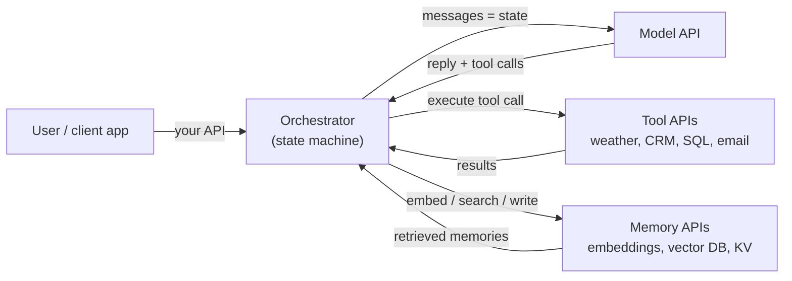
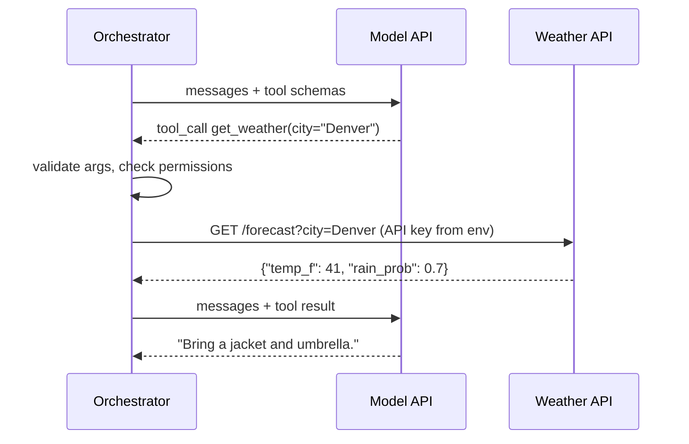
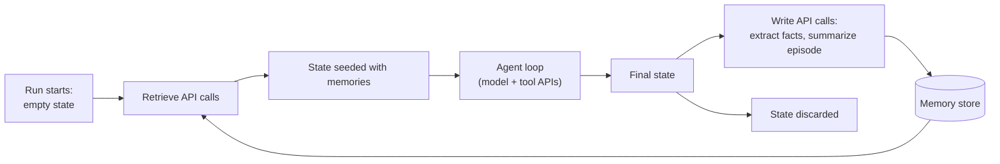
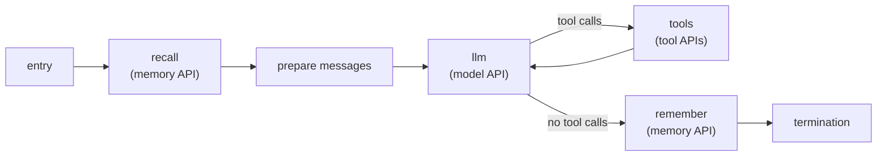

# APIs in AI Systems

> [!abstract] TL;DR
> APIs are the connective tissue of every AI application. They appear in three roles: **the model API** you call to get completions, **tool APIs** the model asks you to call, and **memory APIs** (embedding, vector and key–value stores) that persist knowledge between runs. ==Because the model API is stateless, every request must carry the agent's state: the state machine assembles that state, API calls fill it in, and memory APIs decide what survives after the run ends.== Most of the engineering in an agent is managing those API boundaries: authentication, cost, latency, retries, validation and trust.

**Prerequisites:** [[Large Language Models]] · [[Agent State Management]] · [[AI Memory]]
**Related:** [[Tool Use]] · [[Building Agents with Tools in Python]] · [[Implementing Agent State Management with Python]] · [[Model Context Protocol]] · [[Vector Databases]] · [[Runtime or Orchestration Layer]] · [[AI Reliability]]

> [!note] Source scope
> Concept hub with no dedicated lecture. It ties together material from [[Agent State Management]], [[AI Memory]], [[Tool Use]] and [[Building Agents with Tools in Python]]. Everything here is *beyond the lecture* (standard engineering practice). Provider-specific features are described generically. Check your provider's docs for exact behaviour.

> [!todo]- Contents
> - [[#1. Core Concepts]]
> - [[#2. Three Roles APIs Play]]
> - [[#3. The Model API – Stateless by Design]]
> - [[#4. Tool APIs – How Agents Act]]
> - [[#5. Memory APIs – Persistence Beyond the Run]]
> - [[#6. Putting It Together – APIs on the State Machine]]
> - [[#7. Operational Concerns]]
> - [[#8. Worked Example – Support Agent Turn]]
> - [[#9. Pitfalls and Failure Modes]]
> - [[#10. Key Takeaways]]
> - [[#11. Critical Analysis]]
> - [[#12. Self-Test]]
> - [[#13. Glossary]]
> - [[#Further Reading]]

---

## 1. Core Concepts

> [!info]+ Definition – API
> An Application Programming Interface: a defined contract (endpoints or functions, input/output formats, errors, auth) through which one piece of software uses another without knowing its internals. In AI systems, most APIs are HTTP + JSON.

^def-api

> [!info]+ Definition – Model API
> A hosted endpoint that takes a list of messages (plus options such as tools, output schema, temperature) and returns the model's next message. It is the only way most applications reach an LLM.

^def-model-api

> [!info]+ Definition – Stateless API
> An API that keeps no memory of earlier requests. Every request must contain all the context needed to answer it.

^def-stateless-api

> [!tip] Why APIs matter for AI specifically
> A model on its own can only map text to text, with knowledge frozen at training time. APIs give it three things it lacks: **access** (the model itself is behind an API), **fresh data and actions** (tools), and **persistence** (memory stores). An agent is, in practice, an LLM orchestrating API calls.

---

## 2. Three Roles APIs Play



^three-roles

| Role | Who calls it | Purpose | Connects to |
|---|---|---|---|
| Model API | Orchestrator | Reasoning: choose the next message or tool call | [[Large Language Models]], [[Structured Outputs]] |
| Tool APIs | Orchestrator, *on the model's request* | Fresh data and real-world actions | [[Tool Use]], [[Model Context Protocol]] |
| Memory APIs | Orchestrator (or the model, via a memory tool) | Persist and retrieve knowledge across runs | [[AI Memory]], [[Vector Databases]], [[Retrieval-Augmented Generation]] |
| Your own API | External clients | Expose the agent as a service | [[Runtime or Orchestration Layer]] |

The key point: **the model never calls an API itself.** It proposes calls as structured output, and your orchestrator decides whether to make them ([[Tool Use#^def-tool-use]]).

---

## 3. The Model API – Stateless by Design

The lecture point "LLMs are stateless" ([[Agent State Management#^def-stateless]]) is, concretely, a property of the model API. Each request is independent, so the client resends the conversation every time.

```python
# Each call carries the full state. The API remembers nothing in between.
request = {
    "model": "<model-id>",
    "messages": state["messages"],      # system + user + assistant + tool turns
    "tools": TOOL_SCHEMAS,              # what the model is allowed to request
}
reply = post("/chat", request)
state["messages"].append(reply.message)
```

^model-api-request

**This is where state management meets the API.** The `messages` field in agent state ([[Agent State Management#^state-fields]]) is literally the payload of the next request. Managing state largely means deciding *what goes into that payload*.

| State design decision | API consequence |
|---|---|
| Keep full history | Every call grows; cost and latency rise each turn |
| Summarize old turns | Smaller payload; risk of losing detail |
| Store tool output by reference | Payload stays small; model sees a summary, not the raw blob |
| Inject retrieved memories | Payload includes memory text, competing for the context window |

> [!note] Server-side conversation state
> Some providers offer endpoints that store conversation history on their side and let you reference a previous response or thread by ID. That moves *where* state lives, not *whether* it exists. The tradeoffs: less payload to send, but less control over what the model sees, and your data is retained by the provider.

### 3.1 Cost of a stateless API

If each turn adds about $m$ tokens and the base prompt is $T_0$, then $n$ calls send

$$\text{input tokens} = \sum_{i=1}^{n} \big(T_0 + (i-1)\,m\big) = nT_0 + m\,\frac{n(n-1)}{2}$$

so cost grows **quadratically** with conversation length. Prompt caching (offered by several providers) discounts the repeated prefix, which is why stable content (system prompt, tool schemas) should go *first* in the payload.

^quadratic-cost

---

## 4. Tool APIs – How Agents Act

A tool is usually a thin wrapper around an external API. The model sees only the tool's **name, description and JSON schema** ([[Tool Descriptions in Agentic Systems]]). Your code holds the credentials and makes the real HTTP call.



^tool-sequence

Design rules for wrapping an API as a tool:

| Rule | Why |
|---|---|
| Expose the *task*, not the raw endpoint (`get_forecast(city)`, not `http_get(url)`) | Smaller attack surface; easier for the model to use correctly |
| Validate arguments before calling | Model output is untrusted input ([[Output Validation]]) |
| Trim and normalize responses | Raw API JSON can be huge; every token goes into state and the next request |
| Return errors as data (`{"error": "city not found"}`) | The model can recover; the loop doesn't crash ([[Building Agents with Tools in Python#^agent-loop]]) |
| Keep keys in code or env, never in prompts or state | State is sent to the model API and written to logs |
| Separate read tools from write tools | Write actions (email, payments) need confirmation or a human gate |

[[Model Context Protocol]] standardizes this wrapping: one protocol for exposing tools, resources and prompts, so any compatible client can use any compatible server without custom glue.

---

## 5. Memory APIs – Persistence Beyond the Run

[[Agent State Management]] stresses that agent state is **ephemeral**: it disappears when the run ends. Memory is how selected parts of it survive, and in practice memory is a set of API calls.

| Memory operation ([[AI Memory#3. Write, Retrieve, Forget]]) | Typical API calls |
|---|---|
| Write | Embedding API → vector DB `upsert`; or KV/SQL `insert` for facts and preferences |
| Retrieve | Embedding API on the query → vector DB `query(top_k)`; KV lookup by user ID |
| Consolidate | Read existing record → LLM decides merge → `update` |
| Forget | `delete` by ID or TTL; user data-deletion requests |

^memory-api-ops



^state-memory-bridge

**The bridge in one sentence:** retrieval APIs *seed* ephemeral state at the start of a run, and write APIs *harvest* durable facts from it at the end.

Two ways to wire memory in:

| Approach | How | Tradeoff |
|---|---|---|
| Orchestrator-driven | A fixed step retrieves before the LLM call and writes after the run | Predictable and testable; may retrieve irrelevant memories |
| Model-driven (memory as a tool) | Expose `remember(fact)` / `recall(query)` tools | Model decides what matters; less predictable, and memory writes become an injection target |

---

## 6. Putting It Together – APIs on the State Machine

Mapping onto the engine from [[Implementing Agent State Management with Python]]: **each external API call is a step**, and its result is written into state.



^api-state-machine

| Step | API | Reads from state | Writes to state |
|---|---|---|---|
| recall | Embeddings + vector DB | `user_query`, `user_id` | `memories` |
| prepare | none | `instructions`, `memories`, `user_query` | `messages` |
| llm | Model API | `messages` | `messages`, `tool_calls` |
| tools | Tool APIs | `tool_calls` | `messages` (results), clears `tool_calls` |
| remember | LLM extraction + DB write | `messages` | nothing (side effect only) |

Treating each API call as a step gives you a snapshot before and after every call, which is the trace you need when an external service misbehaves.

---

## 7. Operational Concerns

These matter more for AI workloads than typical apps because model calls are slow, expensive and non-deterministic.

| Concern | What it means | Handle it in |
|---|---|---|
| Authentication | API keys / OAuth tokens per service | Environment or secret manager; never state or prompts |
| Rate limits | Requests or tokens per minute; HTTP 429 | Backoff + retry step; queueing; fewer, larger calls |
| Transient errors | Timeouts, 5xx | Bounded retries with exponential backoff |
| Idempotency | Retrying a write might do it twice | Idempotency keys; retry only safe (read) calls automatically |
| Latency | Model calls take seconds; sequential calls add up | Parallelize independent tool calls; stream responses |
| Cost | Billed per token (model) or per call (tools) | Trim state; cache; step and token budgets |
| Versioning | Models and APIs change behaviour over time | Pin model versions; log versions in snapshots |
| Structured responses | Need parseable output | Schema-constrained output ([[Structured Outputs]]) |

**Retries and reliability.** If one call succeeds with probability $p$ and you allow $r$ retries on independent failures, per-call success becomes

$$p_{\text{call}} = 1 - (1-p)^{r+1}$$

For a chain of $n$ calls the run succeeds with $p_{\text{call}}^{\,n}$ ([[AI Reliability#^error-compounding]]). Example: $p = 0.95$, $n = 10$: no retries gives $0.95^{10} \approx 0.60$. With 2 retries, $p_{\text{call}} = 1 - 0.05^3 = 0.999875$, and $0.999875^{10} \approx 0.9988$.

^retry-math

> [!warning] Retries fix transient errors, not wrong answers
> The formula assumes independent failures such as timeouts. A model that consistently misreads a tool schema fails the same way on every retry. That needs better descriptions or validation feedback, not more attempts.

---

## 8. Worked Example – Support Agent Turn

User (returning customer): *"Is my replacement router shipped yet?"*

| # | Step | API call | State change |
|---|---|---|---|
| 1 | recall | Embed query → vector DB search for `user_id=482` | `memories = ["Customer opened RMA #7731 on 2026-09-28", "Prefers SMS updates"]` |
| 2 | prepare | none | `messages = [system, memories, user]` |
| 3 | llm | Model API | Model requests `get_rma_status(rma_id="7731")` |
| 4 | tools | Validate arg format → `GET /rma/7731` on the CRM API (key from env) | Appends `{"status": "shipped", "tracking": "1Z…"}` |
| 5 | llm | Model API | Final answer with tracking number; `tool_calls = []` |
| 6 | remember | LLM extracts "RMA #7731 shipped 2026-10-04" → vector DB upsert | No state change; memory store updated |
| 7 | termination | none | State discarded |

What each API contributed: memory supplied the RMA number the user didn't mention, the tool API supplied live status, and the model API turned it into an answer. Without memory the model would have had to ask; without the tool it would have guessed.

---

## 9. Pitfalls and Failure Modes

| Failure | Symptom | Mitigation |
|---|---|---|
| API keys in prompts or state | Keys leaked to the model provider, logs, or via injection | Keys only in code/env; tools resolve credentials themselves |
| Raw API responses dumped into state | Context bloat, high cost, model distracted by noise | Trim to the fields the model needs |
| Unbounded history in requests | Quadratic cost; context-length errors | Summarize or window history ([[#^quadratic-cost]]) |
| Auto-retrying non-idempotent writes | Duplicate emails, orders or tickets | Idempotency keys; human gate on writes |
| No timeouts | One slow API hangs the whole run | Per-call timeouts; error as a tool result |
| Treating tool responses as trusted | Injected instructions in a web page or ticket body steer the agent | Mark tool output as data; keep authorization in code ([[Prompt Injection]]) |
| Memory writes from untrusted content | Poisoned "facts" persist and resurface in later sessions | Gate memory writes; store provenance; allow deletion |
| Unpinned model version | Behaviour changes overnight | Pin versions; regression-test before upgrading |
| Over-broad tools (`http_get(url)`) | Model can reach anything, including exfiltration endpoints | Narrow, task-specific tools; allow-lists |

---

## 10. Key Takeaways

- [ ] APIs play three roles: model access, tools, memory ([[#^three-roles]]).
- [ ] The model never calls APIs itself; it proposes calls and your code executes them.
- [ ] The model API is stateless, so agent state *is* the request payload ([[#^model-api-request]]).
- [ ] Resending history makes cost grow quadratically; trim, summarize and cache ([[#^quadratic-cost]]).
- [ ] Tools wrap APIs behind narrow, validated, task-shaped interfaces with credentials kept out of state.
- [ ] Memory APIs seed ephemeral state at the start and harvest durable facts at the end ([[#^state-memory-bridge]]).
- [ ] Each API call is naturally a state-machine step, giving a snapshot around every external interaction ([[#^api-state-machine]]).
- [ ] Retries help transient failures, not systematic ones ([[#^retry-math]]).

---

## 11. Critical Analysis

**Statelessness is a deliberate tradeoff.** Stateless model APIs are simple to scale (any server can handle any request) and give the client full control of context. The cost is moved to the client: payload size, token spend, and the burden of state management that the [[Agent State Management|lecture]] addresses. Server-side state features reduce payload but trade away transparency and data control.

**The model is the least reliable API in the system.** Weather or CRM APIs are deterministic and documented. The model API is stochastic and its behaviour shifts across versions. Good architecture puts deterministic code at every boundary around it: validate its tool calls, constrain its output schema, and keep routing decisions in code.

**Latency stacks.** A ReAct-style loop with $k$ model calls and $k$ sequential tool calls has latency of roughly $\sum (\text{model}_i + \text{tool}_i)$. At 2–5 s per model call, a 5-step agent can take 10–25 s. Parallel tool calls, streaming and fewer, better-designed tools matter more than micro-optimizing any single API.

**Security is mostly an API-boundary problem.** Every API response is an untrusted input that will be pasted into the next prompt. Every tool is a capability an attacker can try to trigger through injected text. Every memory write is a chance to persist an attack across sessions. The defences (least privilege, argument validation, confirmation for writes, provenance on memories) are all enforced at API boundaries, in code.

**What changes at scale.** Rate limits become the binding constraint, so you need queues, batching and prioritization. Many agents share memory stores, which raises access control (whose memories can this agent read?). Observability across many APIs requires a consistent trace ID passed through every call.

**How to evaluate an API-heavy agent.** Measure per-API error rates, retry counts, p95 latency, tokens per run, tool-selection accuracy (right tool, right arguments), and memory precision (were retrieved memories relevant?).

> [!question] Discussion questions
> - When is server-side conversation state worth giving up control over what the model sees?
> - Should memory writes be orchestrator-driven or model-driven for a customer-facing agent?
> - How would you design a tool so that a successful prompt injection still can't cause harm?
> - What belongs in agent state versus what should be fetched from an API on demand?

---

## 12. Self-Test

> [!question]- Q1. Name the three roles APIs play in an AI agent and give one example of each
> Model API (a chat completion endpoint), tool APIs (a weather or CRM endpoint wrapped as a tool), memory APIs (an embeddings endpoint plus a vector database for long-term memory).

> [!question]- Q2. Why does a stateless model API make state management necessary
> The API remembers nothing between calls, so the client must send all relevant context every time. The agent's state (instructions, history, tool results) is assembled by the orchestrator and becomes the request payload.

> [!question]- Q3. The model "calls" a weather API. What actually happens
> The model returns a structured tool call (name + JSON arguments). The orchestrator validates it, makes the HTTP request with its own credentials, appends the result to state, and sends the updated messages back to the model API.

> [!question]- Q4. How do memory APIs connect ephemeral agent state to long-term memory
> At the start of a run, retrieval calls (embedding + vector search, or key lookup) seed state with relevant memories. At the end, write calls extract and store durable facts from the final state before it is discarded.

> [!question]- Q5. Quantitative – Base prompt 2,000 tokens, each turn adds 400 tokens, 8 model calls. Total input tokens
> $8 \times 2000 + 400 \times \frac{8 \times 7}{2} = 16{,}000 + 11{,}200 = 27{,}200$ tokens.

> [!question]- Q6. Quantitative – A tool API succeeds 90% of the time. With 2 retries, what is per-call success, and what is success for 5 such calls in a row
> $1 - 0.1^3 = 0.999$ per call. Five in a row: $0.999^5 \approx 0.995$. Without retries: $0.9^5 \approx 0.59$.

> [!question]- Q7. Design – Wrap a company's ticketing REST API as tools for a support agent. What tools would you expose and what safeguards would you add
> Narrow tools such as `get_ticket(id)`, `search_tickets(customer_id, status)`, `add_comment(id, text)`, not a generic HTTP tool. Safeguards: credentials held by the tool code; argument validation (ID formats, allowed statuses); responses trimmed to needed fields; read tools auto-executed, write tools (`add_comment`, `close_ticket`) require confirmation; idempotency keys on writes; ticket bodies marked as untrusted data because customers can write injection text into them; per-call timeouts and errors returned as data.

> [!question]- Q8. Why shouldn't API keys ever be placed in agent state
> State is serialized into model API requests and written to snapshots and logs. Keys there leak to the provider and to anyone reading traces, and injected instructions could make the model echo them out.

> [!question]- Q9. Why might retries fail to improve an agent that keeps calling a tool with wrong arguments
> Retries help independent, transient failures. A systematic misunderstanding (unclear schema or description) repeats on every attempt. Fix the tool description or feed the validation error back so the model can correct itself.

### Flashcards

> [!tip] Flashcards
> Review this topic with [[APIs in AI Systems - Flashcards]] (Spaced Repetition plugin → **Review flashcards**).

---

## 13. Glossary

| Term | Meaning |
|---|---|
| API | Contract for one program to use another (endpoints, formats, errors, auth) |
| Model API | Hosted endpoint returning the next model message for a list of messages |
| Stateless API | Keeps no memory between requests; each request is self-contained |
| Tool API | External service the agent reaches through a tool wrapper |
| Memory API | Embedding, vector DB or KV service used to persist and retrieve knowledge |
| Embedding API | Turns text into vectors for similarity search |
| Rate limit | Cap on requests or tokens per time window (HTTP 429 when exceeded) |
| Exponential backoff | Waiting progressively longer between retries |
| Idempotency key | Token that makes a retried write take effect only once |
| Prompt caching | Provider discount for a repeated request prefix |
| MCP | Open protocol standardizing how tools and resources are exposed to models |

---

## Further Reading

- [Anthropic – Tool use documentation](https://docs.anthropic.com/en/docs/build-with-claude/tool-use)
- [OpenAI – Function calling guide](https://platform.openai.com/docs/guides/function-calling)
- [Model Context Protocol](https://modelcontextprotocol.io/)
- [Anthropic – Building effective agents](https://www.anthropic.com/research/building-effective-agents)
- [Schick et al. (2023) – Toolformer: Language Models Can Teach Themselves to Use Tools](https://arxiv.org/abs/2302.04761)

%%
Study hint: draw the three-roles diagram from memory, then label which state field each API reads from and writes to.
%%
