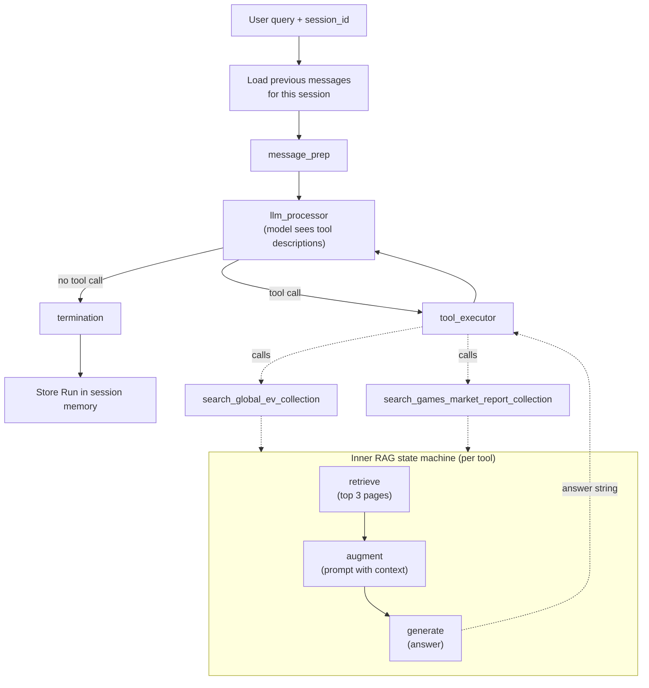
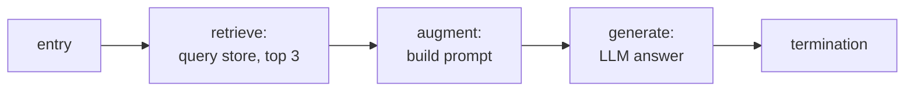

# Agent Based RAG

> [!abstract] TL;DR
> The M08 exercise builds agentic RAG in two layers. **Inside**, each document collection gets its own *passive* RAG pipeline, a three-step state machine (retrieve → augment → generate) over a Chroma vector store. **Outside**, each pipeline is wrapped as a **tool** whose description names the source, publisher and date, and a tool-calling agent decides which tool to call, or none. ==The result is agentic RAG at the *router* level: the agent picks the knowledge source and rewrites the query, while retrieval itself stays a black box that returns a finished answer.== The runs show correct routing and correct abstention. They also show the limits: no observed retry, no evidence inspection, no citations, no loop cap.

**Prerequisites:** [[Agentic RAG]] · [[Retrieval-Augmented Generation]] · [[Implementing Agent State Management with Python]]
**Related:** [[Vector Databases]] · [[Tool Use]] · [[Tool Descriptions in Agentic Systems]] · [[Building Agents with Tools in Python]] · [[Implementing Agentic Workflows/Routing Workflow|Routing Workflow]] · [[AI Memory]]

> [!note] Source scope
> Based on `python notebooks/Agent RAG/M08_solution_exercise.ipynb` (code and recorded outputs) and its `lib/` modules (`rag.py`, `agents.py`, `vector_db.py`, `loaders.py`, `tooling.py`, `memory.py`, `state_machine.py`). Sections on gaps, improvements and the agentic-RAG comparison are my analysis (*beyond the notebook*). Library behaviour not visible in the project source (e.g. Chroma's defaults) is marked *unverified*. Concepts are covered in [[Agentic RAG]]. This note shows how the exercise implements them.

> [!todo]- Contents
> - [[#1. Core Concepts]]
> - [[#2. Architecture – Two Nested State Machines]]
> - [[#3. Layer 1 – Indexing PDFs into Chroma]]
> - [[#4. Layer 2 – The Passive RAG Pipeline]]
> - [[#5. Layer 3 – Wrapping RAG as Tools]]
> - [[#6. Layer 4 – The Routing Agent]]
> - [[#7. What the Runs Show]]
> - [[#8. Where It Sits on the Agentic Spectrum]]
> - [[#9. Gaps and How to Close Them]]
> - [[#10. Pitfalls and Failure Modes]]
> - [[#11. Key Takeaways]]
> - [[#12. Critical Analysis]]
> - [[#13. Self-Test]]
> - [[#14. Glossary]]
> - [[#Further Reading]]

---

## 1. Core Concepts

> [!info]+ Definition – RAG as a tool
> Wrapping a complete retrieval pipeline behind a tool interface, so an agent can call it like any other function: `search_x(query) → answer`.

^def-rag-as-tool

> [!info]+ Definition – Collection routing
> The simplest form of agentic RAG: the agent chooses *which* knowledge source to query (or none) based on the question and the tool descriptions.

^def-collection-routing

> [!info]+ Definition – Nested state machine
> A workflow that runs inside a single step of another workflow. Here, the RAG pipeline's state machine executes inside the agent's tool-execution step.

^def-nested-sm

The notebook's own framing (from its Tools section): in a simple form, agentic RAG acts like a router, choosing between external sources, and those sources aren't limited to databases. They could be web search or APIs such as Slack or email. In this exercise, it chooses between two collections.

---

## 2. Architecture – Two Nested State Machines

^architecture

| Layer | Component | Role | Agentic |
|---|---|---|---|
| Storage | Chroma collections `electric_vehicles`, `games_market` | One vector store per PDF | No |
| Retrieval pipeline | `RAG` class | Fixed retrieve → augment → generate | No (passive) |
| Tool | `@tool`-decorated search functions | Expose each pipeline with a descriptive docstring | No |
| Agent | `Agent` class | Chooses tool or none; rewrites the query; composes the final answer | **Yes** |
| Memory | `ShortTermMemory` | Keeps each session's message history across invocations | No |

The recorded logs make the nesting visible. In run 2, the agent's `llm_processor` step is followed by a full inner `Starting → retrieve → augment → generate → Terminating` sequence, then `tool_executor`. The tool runs a whole state machine before the outer step finishes.

---

## 3. Layer 1 – Indexing PDFs into Chroma

| Step | What the code does | Notes |
|---|---|---|
| Client | `VectorStoreManager` creates an **in-memory** Chroma client with an OpenAI embedding function | Data disappears when the kernel restarts |
| Collection | `get_or_create_store(name)`: one collection per source | Separate collections are what make routing possible |
| Loading | `PDFLoader` uses pdfplumber; **each page becomes one document** (`id` = page number) | Page-level chunking; empty pages skipped |
| Metadata | `Document.metadata` defaults to `None`, and the loader sets none | No source, page or date metadata to filter or cite by |
| Embedding | Chroma embeds automatically on `add` | Embedding model is the library default (*unverified*) |

> [!warning] Page-as-chunk is a design choice with costs
> Pages are convenient but arbitrary: a table split across pages loses half its context, and a dense page mixes many topics into one embedding. See chunking trade-offs in [[Retrieval-Augmented Generation#3. Design Choices]].

---

## 4. Layer 2 – The Passive RAG Pipeline

The `RAG` class is a three-step state machine with a `RAGState` of `question`, `documents`, `distances`, `messages` and `answer`.

| Step | Reads | Writes | Detail |
|---|---|---|---|
| `retrieve` | `question` | `documents`, `distances` | Vector query with the default `n_results = 3` |
| `augment` | `question`, `documents` | `messages` | System: QA assistant. User: "Use the following pieces of retrieved context… If you don't know the answer, just say that you don't know", then question and context |
| `generate` | `messages` | `answer`, `messages` | LLM (`gpt-4o-mini`, temperature 0.3) |

Two library details worth knowing:
- **`Resource` injection.** The state machine passes a `Resource` (holding the LLM and vector store) to steps that accept a second parameter, so clients stay **out of state**. This is the fix suggested in [[Implementing Agent State Management with Python#7. Pitfalls and Failure Modes]] for keeping non-copyable objects out of deep-copied snapshots.
- **`distances` are computed but never used.** No relevance threshold, no "nothing relevant found" path. The pipeline always generates from whatever three pages came back.

This inner pipeline is exactly the **passive RAG** of [[Agentic RAG#^def-passive-rag]]: retrieve once, no assessment, no retry.

---

## 5. Layer 3 – Wrapping RAG as Tools

Each pipeline is exposed through a tool function that runs the pipeline and returns only the final answer string. The docstring becomes the tool description the model sees, and it carries **provenance**:

| Tool | Source in description | Publisher | Release |
|---|---|---|---|
| `search_global_ev_collection` | Global EV Outlook 2025 | International Energy Agency | May 2025 |
| `search_games_market_report_collection` | The Gaming Industry in 2024 – Trends, Technologies & Predictions | Ixie Gaming | 2024 |

^tool-descriptions

Both descriptions start with the same generic line ("Search the vector database for relevant information"). **The source block is the only thing that tells them apart**, so it is doing all the routing work. This is a practical demonstration of [[Tool Descriptions in Agentic Systems]]: a vague description would make the router guess.

> [!tip] Descriptions as metadata (*analysis*)
> Putting publisher and release date in the description also lets the model reason about scope ("a 2024 report can't answer a 2026 question"). It's the same idea as metadata filtering, done in natural language at the routing layer.

The tool returns a *generated answer*, not retrieved passages. That one choice shapes what the agent can and can't do ([[#9. Gaps and How to Close Them]]).

---

## 6. Layer 4 – The Routing Agent

The `Agent` is the standard tool-calling loop from [[Building Agents with Tools in Python#^agent-loop]], built on the state machine:

| Step | Behaviour |
|---|---|
| `message_prep` | If there's no history, start with the system message; append the user query |
| `llm_processor` | Call the LLM with all tool schemas; store any tool calls in `current_tool_calls` |
| Router | Tool calls present → `tool_executor`; otherwise → termination |
| `tool_executor` | Look up each tool by name, run it, append a tool message, clear `current_tool_calls`; loop back to the LLM |

The agent's instructions ask it to choose tools intelligently, **reason about the response, change the query and call the tool again if needed**, and explain its tool selection.

**Session memory.** `invoke(query, session_id)` loads the final messages of the session's last run and continues from them, so follow-up questions in the same session keep context. Each run is stored whole in `ShortTermMemory`. This is session-scoped working memory, not long-term memory ([[AI Memory#1. Core Concepts]]).

---

## 7. What the Runs Show

### 7.1 Inner pipelines alone

| Query | Collection | Result |
|---|---|---|
| "What's the state of virtual reality" | games_market | Multi-sentence summary (immersion, *Half-Life: Alyx*, education and therapy uses) |
| Electric car sales and market share in Brazil, 2024 | electric_vehicles | Nearly 125,000 sales, 6.5% market share |

### 7.2 Agent runs

| Run | Query | Agent decision | Outcome |
|---|---|---|---|
| 1 | Who won the 2025 Oscar for International Movie? | **No tool call.** Answered that it lacks information past its training cutoff | Correct abstention: neither collection covers film awards. But there was no web tool to fall back on |
| 2 | Which two countries led Asia Pacific (excl. China) electric car exports in 2024? | Called the EV tool with a **rewritten keyword query**: "electric car exports Asia Pacific region 2024 excluding China" | Japan and Korea; nearly 640,000 exports, +15% on 2023 |
| 3 | How games are revolutionizing education? | Called the games tool with "games revolutionizing education" | Structured answer: educational games, simulations, gamification, VR |

^run-results

What this demonstrates:
- **Routing works** when descriptions are distinct and questions map cleanly to one source.
- **Abstention works**: the model didn't force an irrelevant tool call for the Oscar question.
- **Query rewriting happens**: run 2 turned a natural-language question into a retrieval-friendly keyword query, one of the [[Agentic RAG#^retry-strategies|reformulation strategies]].
- **No retry was observed.** Each run made at most one tool call, despite the instruction to retry. The first answer was good enough each time, so this demo doesn't show whether retry would work when needed.
- **Instruction-following isn't guaranteed.** The system prompt asks the agent to explain its tool selection. The recorded final answers don't. Prompt instructions are requests, not guarantees.

---

## 8. Where It Sits on the Agentic Spectrum

Mapping the exercise onto [[Agentic RAG#^autonomy-spectrum]]:

| Capability ([[Agentic RAG]]) | In the exercise |
|---|---|
| Decide **whether** to retrieve | ✅ Run 1 skipped retrieval |
| Choose **which** source | ✅ Two collections, chosen by description |
| Reformulate the query | ✅ Keyword rewrite in run 2 |
| Inspect retrieved evidence | ❌ The agent only sees the inner pipeline's answer, not the passages or distances |
| Retry with a new query | ⚠️ Possible in the loop and requested in instructions; not observed |
| Pivot to another tool type (web, SQL) | ❌ Only two vector collections; no web tool, so the Oscar question had no path |
| Decompose into sub-questions | ❌ Not shown |
| Cite sources | ❌ No page or source IDs reach the answer |
| Stop conditions / budget | ❌ No loop cap in this version of the state machine |

^spectrum-mapping

**Verdict:** a **router** with query rewriting, on the low-cost end of the spectrum. That is a sensible starting point: it's cheap and predictable, and every step up the spectrum can be added on this structure.

---

## 9. Gaps and How to Close Them

*Beyond the notebook: suggested improvements.*

| Gap | Why it matters | Fix |
|---|---|---|
| Tool returns a finished answer, not evidence | The agent can't judge relevance, so reflection is blind; two generation layers can drop or distort facts | Return top passages with page numbers and distances (or both answer and passages) so the agent can inspect and cite |
| `distances` unused | Irrelevant pages still produce a confident answer | Threshold on distance; return "no relevant passages" when nothing is close |
| No metadata | No citations, no filtering by page or date | Store `source`, `page`, `publisher`, `year` per document; include them in tool output |
| Page-level chunks | Topic mixing; tables split | Structure-aware or overlapping chunks |
| No web or other fallback | Out-of-corpus questions dead-end (run 1) | Add a guarded web-search tool ([[Web Search and Browsing for AI Agents]]) or a SQL tool ([[Agents and Databases]]) |
| No loop cap | A model that keeps calling tools never stops | Add a max-steps guard to the run loop, as the earlier engine had ([[Implementing Agent State Management with Python#^budget-counting]]) |
| Unknown tool names silently skipped | The tool call gets no matching tool message, which typically makes the next model request fail | Return an error tool message for unknown tools |
| Retry depends on the prompt alone | Behaviour is unreliable | Add an explicit reflect step and router: score the evidence, then reformulate or answer ([[Agentic RAG#^rag-state-machine]]) |
| In-memory Chroma | Re-indexes on every restart | Persistent client for real use |

^gaps

---

## 10. Pitfalls and Failure Modes

| Failure | Symptom | Mitigation |
|---|---|---|
| Overlapping tool descriptions | Agent picks the wrong collection, or calls both unnecessarily | Distinct source, scope and date in each description ([[#^tool-descriptions]]) |
| Answer-of-answers drift | Final answer adds or loses details compared with the passages | Pass passages through; require the agent to quote |
| Confident answer from irrelevant pages | Generic summary when the corpus doesn't cover the question | Distance threshold; "don't know" path in the inner pipeline |
| Stale corpus presented as current | 2024 report used for a 2026 question | Dates in descriptions and answers; freshness check |
| Session bleed | Follow-up in the wrong `session_id` loses context, or reuse mixes topics | One session per conversation; reset when the topic changes |
| Runaway tool loop | Repeated tool calls with no exit | Loop cap in code |
| Out-of-scope questions | No tool fits (run 1) | Fallback tool, or a clear "outside my sources" response |
| Retrieved text as instructions | A PDF containing injected text steers the agent | Treat tool output as data ([[Prompt Injection]]) |

---

## 11. Key Takeaways

- [ ] Agentic RAG can be built by wrapping passive RAG pipelines as tools and letting an agent choose among them ([[#^architecture]]).
- [ ] One collection per source makes routing possible; the tool description (source, publisher, date) is the routing signal ([[#^tool-descriptions]]).
- [ ] Clients go in a `Resource`, not in state, which keeps snapshots copyable.
- [ ] The exercise shows correct routing, abstention and query rewriting, but no observed retry ([[#^run-results]]).
- [ ] Returning answers instead of passages makes the agent unable to inspect evidence or cite it ([[#^gaps]]).
- [ ] On the agentic spectrum this is a router; reflection, pivots and citations are the next steps ([[#^spectrum-mapping]]).
- [ ] Prompt instructions (explain, retry) are requests; code-level steps and caps are guarantees.

---

## 12. Critical Analysis

**The design choice that matters most is the tool's return value.** Returning a generated answer keeps the outer agent's context small and the interface simple, but it hides the evidence. The agent can't tell a well-supported answer from one the inner model padded. True agentic RAG ([[Agentic RAG#6. Inspecting Results – Reflection Heuristics]]) needs the passages. A balanced design returns a short answer *plus* the top passages with page IDs.

**Two LLM layers, two chances to err.** The inner model summarizes three pages; the outer model rephrases that summary. Each step can drop qualifiers or numbers. In run 3 the outer agent reorganized the inner answer into a numbered list, which is harmless here but could distort a nuanced finding. Faithfulness should be judged against the *passages*, not the tool's answer.

**The demo is easy mode.** Two topically distant collections (EVs vs games) make routing nearly trivial. The real test is overlapping sources, such as two EV reports from different years or a question spanning both collections ("How might EV battery tech affect handheld gaming?"). The exercise challenge mentions combining sources when needed, but no recorded run does this.

**Abstention without a fallback is half a feature.** Run 1 shows the agent knows when its tools don't apply, which is valuable. But the right behaviour for a user is usually "here's how I'd find it" or a guarded web search, not a dead end.

**Evaluation.** To test this system properly: a labelled set of questions per collection, plus out-of-scope and cross-collection questions. Measure routing accuracy, abstention precision/recall, answer correctness against the PDFs, faithfulness to retrieved passages, and tool calls per question. Then compare against a baseline that queries *both* collections every time. If routing doesn't beat that on cost at equal accuracy, it isn't earning its complexity.

**Security.** PDFs are untrusted input. A report containing injected instructions would flow through the inner prompt and the tool message into the agent's context. Keeping tool choice and loop limits in code, and treating tool output as data, are the minimum defences.

> [!question] Discussion questions
> - Should the RAG tool return answers, passages, or both? What changes for cost, accuracy and citation?
> - How would you route a question that needs both collections?
> - Where should the "nothing relevant found" decision live: inner pipeline, tool wrapper, or agent?
> - What would a fair evaluation set for this router contain?

---

## 13. Self-Test

> [!question]- Q1. How does the exercise turn passive RAG into agentic RAG
> Each collection has a passive retrieve → augment → generate pipeline. Each pipeline is wrapped as a tool with a descriptive docstring, and a tool-calling agent decides which tool to call (or none) and with what query, then composes the final answer.

> [!question]- Q2. Why does each PDF get its own collection and tool
> Separate collections let the agent route: the model chooses a source by comparing the question with each tool's description. With one merged collection there would be nothing to route between, and retrieval would mix unrelated sources.

> [!question]- Q3. The two tool descriptions start with the same sentence. What makes routing work anyway
> The source block: title, publisher, release date and summary. It is the only distinguishing information, so it carries the routing decision.

> [!question]- Q4. Why did the agent call no tool for the Oscar question, and what was missing
> Neither tool's description covers film awards, so the model correctly answered without retrieval and said it lacked current information. What was missing was a fallback such as a guarded web-search tool to actually find the answer.

> [!question]- Q5. What evidence of query reformulation appears in the runs
> In run 2 the agent passed "electric car exports Asia Pacific region 2024 excluding China" instead of the user's full question: a keyword-style rewrite suited to retrieval.

> [!question]- Q6. Why can't this agent perform true reflection on retrieved evidence
> The tool returns only the inner pipeline's generated answer. The agent never sees the passages or similarity distances, so it can't judge relevance, detect gaps in evidence, or cite pages.

> [!question]- Q7. Design – Upgrade this exercise toward a reflective agentic RAG. What do you change
> Return the top passages with page numbers and distances from each tool. Add page and source metadata at indexing time. Add a distance threshold with a "no relevant passages" result. Add an explicit reflect step that scores evidence and lists gaps, routing to reformulate-and-retry, pivot (to a guarded web or SQL tool), or answer. Require citations by page. Add a loop cap and an error message for unknown tools. Evaluate on routing, cross-collection and out-of-scope questions.

> [!question]- Q8. Quantitative – Each agent run uses one outer LLM call per loop turn, and each tool call adds one inner LLM call. How many LLM calls did run 2 make? How many would a run with two tool calls in separate turns make
> Run 2: outer call (decides on the tool) + inner RAG generate + outer call (final answer) = 3. With two tool calls in separate turns: 3 outer calls + 2 inner calls = 5. Each retry costs two LLM calls plus a retrieval.

> [!tip] Flashcards
> Review this topic with [[Agent Based RAG - Flashcards]] (Spaced Repetition plugin → **Review flashcards**).

---

## 14. Glossary

| Term | Meaning |
|---|---|
| Collection | A named set of embedded documents in a vector store (one per PDF here) |
| Passive RAG pipeline | Fixed retrieve → augment → generate with no evaluation or retry |
| RAG as a tool | A retrieval pipeline exposed through a tool interface |
| Collection routing | Agent choosing which knowledge source to query |
| Tool description | Docstring the model reads to decide when to call a tool |
| `Resource` | Container for shared clients (LLM, vector store) injected into steps, kept out of state |
| Nested state machine | A workflow run inside one step of another workflow |
| Session memory | Per-session message history carried across agent invocations |
| Distance | Vector-space dissimilarity between query and document; lower means more similar |
| Abstention | Declining to retrieve or answer when no source fits |

---

## Further Reading

- [Chroma documentation](https://docs.trychroma.com/)
- [IEA – Global EV Outlook 2025](https://www.iea.org/reports/global-ev-outlook-2025)
- [Anthropic – Building effective agents](https://www.anthropic.com/research/building-effective-agents)
- [Yan et al. (2024) – Corrective Retrieval Augmented Generation](https://arxiv.org/abs/2401.15884)
