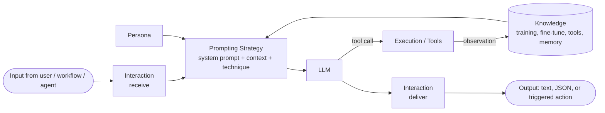
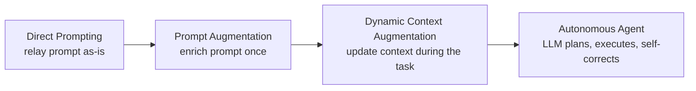

# Agent Components and Agent Types

> [!abstract] TL;DR
> An agent can be taken apart into ==five building blocks: Persona, Knowledge, Prompting Strategy, Execution/Tools, and Interaction==. Agents also sit on a **spectrum of types**: Direct Prompting → Prompt Augmentation → Dynamic Context Augmentation → Autonomous. What moves an agent along that spectrum is ==how it manages the LLM's context and who decides the next step==. The more autonomous the agent, the more complex the workflow it can run, and the higher its cost, variance, and risk.

**Prerequisite:** [[AI Agents]] (definitions, agent loop) · [[Large Language Models]] · [[Prompt Engineering]]
**Next:** [[Agentic Workflow Modeling]] → [[Implementing Agentic Workflows in Python]]
**Related:** [[Agentic AI#3. Levels of Autonomy]] · [[AI Agents#2. Anatomy of an Agent]] · [[Tool Use]] · [[AI Memory]] · [[Retrieval-Augmented Generation]] · [[Chain-of-Thought and ReAct]] · [[Multi-Agent Systems]]

**Sources:** Course reading "Deconstructing the AI Agent" and "Agent Types and Their Role in Workflows", plus the agent-type comparison table (image). The mappings to other vault notes, the reliability math, and the critical analysis are *beyond the lecture*.

> [!todo]- Contents
> 1. [[#1. Core Concepts]]
> 2. [[#2. The Five Components of an Agent]]
> 3. [[#3. The Agent Type Spectrum]]
> 4. [[#4. How Components Scale Across Agent Types]]
> 5. [[#5. Worked Example – One Task at Four Levels]]
> 6. [[#6. Pitfalls and Failure Modes]]
> 7. [[#7. Key Takeaways]]
> 8. [[#8. Critical Analysis]]
> 9. [[#9. Self-Test]]
> 10. [[#10. Glossary]]

---

## 1. Core Concepts

> [!info]+ Definition – Agent component
> One of the five building blocks that together give an agent its capabilities: **Persona** (who it is), **Knowledge** (what it can know), **Prompting Strategy** (how it is instructed), **Execution/Tools** (what it can do), and **Interaction** (how it exchanges information with users, the workflow, and other agents).

^def-agent-components

> [!info]+ Definition – Agent type
> A category of agent defined by ==how it interacts with its LLM "brain"==: whether and how it changes the context before calling the LLM, and whether the LLM plans its own steps. The reading presents the types as a **spectrum of capability**, not as separate kinds of agent.

^def-agent-type

> [!note] How this relates to the vault's anatomy table
> [[AI Agents#^agent-anatomy]] breaks an agent into *system* parts (model, runtime, guardrails). The five components here are a *design* view: what you specify when you build one agent for one step of a workflow. Mapping: Persona ≈ Instructions · Knowledge ≈ Model + Memory + Knowledge · Prompting Strategy ≈ Instructions + Planning · Execution/Tools ≈ Tools + Runtime · Interaction ≈ the I/O contract (not a separate row there).

---

## 2. The Five Components of an Agent



### 2.1 Persona – the job title

The Persona defines the agent's **role in the workflow**. It is usually set in the **system prompt** (e.g. "Formal Business Analyst" vs. "Friendly Customer Support Bot"). It controls:

| Aspect | What it sets | Example |
|---|---|---|
| Function | What the agent is for | "You reconcile invoices against POs." |
| Tone and style | How it talks | Formal, concise, no emojis |
| Expertise boundaries | What it must *not* attempt | "Do not give legal advice; escalate." |
| Output format | Shape of the output, so the **next step can parse it** | JSON matching a schema, or bullet points |

> [!tip] Key idea
> A persona ==focuses the LLM's broad capabilities into a consistent identity for one task==. The output-format part is what connects the persona to the workflow; see [[Pydantic for Structured LLM Output - Study Guide]] and [[Output Validation]].

^persona

### 2.2 Knowledge – what the agent can know

| Source | When it is fixed | Freshness | Vault link |
|---|---|---|---|
| Foundational LLM training | Pre-training time | Stale after the cutoff | [[Large Language Models]] |
| Fine-tuning | Training time (your data) | Stale until you retrain | [[Large Language Models]] |
| External info via tools | ==Retrieved at runtime== (DBs, APIs, web search) | Current | [[Tool Use]], [[Retrieval-Augmented Generation]] |
| Memory | Current or past interactions | Current within the session / store | [[AI Memory]], [[Vector Databases]] |

The combination ==grounds decisions in relevant, specific, up-to-date information==. The first two are *parametric* (inside the weights). The last two are *non-parametric* (injected into the context). Only non-parametric knowledge can be updated without retraining, which is why it matters for dynamic workflows.

^knowledge-sources

### 2.3 Prompting Strategy – the blueprint

| Element | Purpose | Vault link |
|---|---|---|
| System prompt | Defines persona and overall goal | [[Prompt Engineering]] |
| Context incorporation | Adds memory and outputs from earlier workflow steps into the current prompt | [[Sequential Prompting]], [[Prompt Chaining for Agentic Reasoning - Study Guide]] |
| Prompt engineering techniques | Guides reasoning with Chain-of-Thought, ReAct, few-shot examples | [[Chain-of-Thought and ReAct]], [[Few-Shot Prompting]] |
| Structured instructions | Clear objective + required output format for the next stage | [[Prompt Instruction Refinement]] |

A good prompting strategy is what makes results **reliable and well-reasoned** rather than merely plausible.

### 2.4 Execution/Tools – the hands and feet

Tools let an agent **act**, and that is what turns a chatbot into an active system that moves a workflow forward.

| Capability | Example |
|---|---|
| Interact with the external world | Call a weather API for real-time data |
| Manipulate data | Run a calculation; query a database |
| Connect with other systems | Send an email; update a CRM record |
| Orchestrate | Call another specialized agent as a tool ([[Multi-Agent Systems]]) |

See [[Tool Use]], [[Tool Descriptions in Agentic Systems]], and [[Model Context Protocol]] for how tools are described and connected.

^execution-tools

### 2.5 Interaction – the I/O contract

| Aspect | Question it answers |
|---|---|
| Receiving input | How does the agent get its instructions and data for this task? |
| Delivering output | Does it return text, structured JSON, or trigger another action? |
| Inter-agent communication | What protocol do agents use to talk to each other? |

Interaction is what lets an agent plug into its environment, whether that environment is humans or other software agents. In multi-agent systems it is the component that most often breaks (see [[#6. Pitfalls and Failure Modes]]).

---

## 3. The Agent Type Spectrum

| Agent type | LLM role | Context handling | Autonomy | Typical use case |
|---|---|---|---|---|
| **Direct Prompting** | Responder / Generator | Static (within the prompt) | Low | Simple Q&A, basic text generation |
| **Prompt Augmentation** | Guided Responder / Generator | Pre-augmented static context (e.g. RAG) | Low–Medium | RAG-based Q&A, few-shot tasks |
| **Dynamic Context Augmentation** | Adaptive Responder / Processor | Dynamically updated via memory/tools | Medium | Multi-turn conversations, tool use |
| **Autonomous Agent** | Planner / Executor / Reasoner | Dynamic, internal/external memory-driven | High | Complex task completion, independent problem solving |

^agent-type-table



### 3.1 Direct Prompting agents

- **What it does:** Acts as a relay. It sends the user's prompt to the LLM **unmodified** and returns the response.
- **Workflow role:** Simple, **single-task** workflows, such as answering a question or generating text from one instruction.

### 3.2 Prompt Augmentation agents

- **What it does:** ==Enhances the prompt before the LLM call== by adding a predefined persona, few-shot examples, or retrieved documents.
- **Workflow role:** Creates **specialized steps**. For example, a "Financial Analyst" agent augments its prompts with financial data, so its output is clearly different from a "Creative Writer" agent in the same workflow.
- The context is still **static**: it is assembled once, before the call.

> [!note] Narrower definition in a later reading
> The "Agentic Workflow Modeling" reading calls this type **Augmented Prompting** and defines it narrowly as ==adding a system message to define a persona==. It then splits knowledge-adding variants into separate building blocks: the **Knowledge Augmented Prompt Agent** (curated knowledge base) and the **RAG Knowledge Prompt Agent** (dynamic retrieval). See [[Agentic Workflow Modeling#5. Building-Block Agents]].

### 3.3 Dynamic Context Augmentation agents

- **What it does:** Adapts **during** the interaction, using tools (web search, API calls) and memory to ==update the LLM's context in real time==.
- **Workflow role:** The key to **dynamic, multi-step** workflows. Act (search real-time stock prices) → process the result → use it to inform the next action (make a recommendation), all in one continuous process.
- This is essentially the ReAct loop from [[Chain-of-Thought and ReAct]].

### 3.4 Autonomous agents

- **What it does:** Uses the LLM for **planning, decision-making, and multi-step execution** with minimal human intervention.
- **Workflow role:** The orchestrator or primary executor of the most sophisticated workflows. It takes a high-level goal → creates a plan of sub-tasks → executes it with tools → ==self-corrects on errors==, driving the workflow from start to finish.
- See [[Planning Agents]] and [[AI Agents#3. The Agent Loop]].

> [!note] Mapping to the autonomy ladder (beyond the lecture)
> | Agent type | Closest level in [[Agentic AI#^autonomy-levels]] |
> |---|---|
> | Direct Prompting | L0 – single call |
> | Prompt Augmentation | L0–L1 – single call with a fixed pre-processing step |
> | Dynamic Context Augmentation | L2–L3 – tool loop, often supervised |
> | Autonomous Agent | L4–L5 – bounded or open-ended autonomy |

> [!tip] From types to building blocks
> The four types describe *how an agent manages context*. To design a workflow you also need *roles*: routing, evaluation, action planning, and so on. The catalogue of building-block agents and how to compose them is in [[Agentic Workflow Modeling#^building-blocks]].

---

## 4. How Components Scale Across Agent Types

The two frameworks connect: moving right on the spectrum means **more of the five components become active and dynamic** (synthesis, *beyond the lecture*).

| Component | Direct Prompting | Prompt Augmentation | Dynamic Context Aug. | Autonomous |
|---|---|---|---|---|
| Persona | Optional / none | Predefined in system prompt | Predefined | Predefined + role in the plan |
| Knowledge | Training data only | + retrieved docs / examples (once) | + tool results + memory (per step) | + long-term memory, self-directed retrieval |
| Prompting Strategy | User's raw prompt | Template + few-shot | ReAct-style loop | Planning + reflection / self-critique |
| Execution/Tools | None | Retrieval only (pre-call) | Tool calls during the task | Tool calls + delegation to sub-agents |
| Interaction | Text in / text out | Text or structured out | Multi-turn; structured I/O | Inter-agent protocols; triggers actions |

^component-scaling

### 4.1 Reliability and cost across the spectrum

Let each LLM step succeed independently with probability $p$. A task needing $n$ sequential steps succeeds end to end with probability

$$
P_{\text{success}} = p^{\,n}
$$

| Type | Typical LLM calls $n$ | With $p = 0.95$ |
|---|---|---|
| Direct Prompting | 1 | 0.95 |
| Prompt Augmentation | 1 (+ retrieval) | 0.95 × retrieval quality |
| Dynamic Context Aug. | ~3–5 | 0.86–0.77 |
| Autonomous | ~10–20 | 0.60–0.36 |

This is why autonomous agents **need** self-correction (which raises the effective $p$ per step) and hard stop conditions ([[AI Agents#^stop-conditions]]). Cost and latency grow roughly linearly in $n$, and token use grows faster because the context gets longer each step. The numbers are illustrative; real steps are not independent.

---

## 5. Worked Example – One Task at Four Levels

**Task:** "Should our team switch our cloud region to reduce latency for EU customers?"

| Type | What happens | Output quality |
|---|---|---|
| Direct Prompting | Question sent as-is | Generic pros/cons; may hallucinate provider details ([[LLM Hallucinations]]) |
| Prompt Augmentation | Persona "Cloud Infrastructure Analyst" + retrieved internal architecture doc + two few-shot recommendation examples | Specific to the company, but based on a static snapshot |
| Dynamic Context Aug. | Calls a latency-metrics API → sees EU p95 = 310 ms → queries pricing API for the EU region → adds both to context → recommends | Grounded in current data; human reviews it |
| Autonomous | Plans: (1) pull metrics, (2) price options, (3) estimate migration effort from the repo, (4) draft migration plan, (5) open a ticket. Re-plans when the pricing API fails | End-to-end, but needs approval gates before step 5 |

Component view of the Dynamic Context Augmentation version:

```text
Persona:      Cloud Infrastructure Analyst; formal; outputs JSON {recommendation, evidence[], risks[]}
Knowledge:    training + internal arch doc (RAG) + live metrics/pricing (tools) + chat memory
Prompting:    system prompt + ReAct (Thought → Action → Observation) + 2 few-shot examples
Tools:        get_latency(region), get_pricing(region, sku)
Interaction:  receives question from ops dashboard; returns JSON to a reviewer queue
```

---

## 6. Pitfalls and Failure Modes

| Failure | Symptom | Mitigation |
|---|---|---|
| Persona drift | Tone or role changes over a long conversation | Re-inject the system prompt; keep the persona short and explicit |
| Persona without boundaries | Agent answers outside its expertise | Spell out out-of-scope topics and an escalation path |
| Unparseable output | Next workflow step crashes | Schema-enforced output ([[Pydantic for Structured LLM Output - Study Guide]]), [[Output Validation]] |
| Stale knowledge | Confident but outdated answers | Use tools/RAG for time-sensitive facts; show the date of sources |
| Retrieval noise | Irrelevant docs mislead the LLM | Rerank, filter, cap top-k ([[Retrieval-Augmented Generation]]) |
| Over-engineering | Autonomous agent used for simple Q&A; slow and expensive | Pick the lowest type that solves the task ([[Agentic AI#5. When Is Agency Worth It]]) |
| Tool misuse / loops | Repeated or wrong tool calls | Clear tool descriptions ([[Tool Descriptions in Agentic Systems]]), step caps |
| Injected instructions via tools | Agent follows text in a web page or document | Treat tool output as data; least privilege ([[Prompt Injection]]) |
| Inter-agent miscommunication | Agents pass ambiguous or mismatched messages | Typed message contracts; validation at each handoff ([[Gate Checks]]) |

---

## 7. Key Takeaways

- [ ] I can name and explain the five components: Persona, Knowledge, Prompting Strategy, Execution/Tools, Interaction.
- [ ] I know the persona is usually set in the **system prompt** and covers function, tone, boundaries, and output format.
- [ ] I can list the four knowledge sources and say which are parametric vs. runtime-injected.
- [ ] I can place the four agent types on the spectrum and fill in LLM role, context handling, autonomy, and use case for each.
- [ ] I can explain the difference between **static pre-augmentation** (Prompt Augmentation) and **dynamic in-task updates** (Dynamic Context Augmentation).
- [ ] I can use $p^n$ to argue why more autonomy needs more verification.
- [ ] I apply the rule: choose the **least autonomous** type that solves the task.

---

## 8. Critical Analysis

- **The taxonomy is a teaching device, not a standard.** The four types are not formally defined in the literature, and the boundaries blur. A RAG system that re-retrieves after a follow-up question is between types 2 and 3. Similar ladders exist elsewhere (workflow vs. agent in Anthropic's guidance; the vault's L0–L5 ladder), and they don't line up exactly.
- **The spectrum mixes two axes.** "Context handling" (static → dynamic) and "who controls the flow" (code → LLM) are separate. You can have a *dynamic-context* system with *code-controlled* flow, e.g. a fixed chain where step 2 always calls an API. Treating them as one axis hides that useful middle ground ([[Prompt Chaining for Agentic Reasoning - Study Guide#3. The Spectrum – Chain to Agent]]).
- **Persona effects on accuracy are mixed.** A persona reliably shapes *format and tone*. Whether role-play ("You are an expert…") improves *factual accuracy* is less clear, and results vary by model and task. Treat the persona mainly as a format and scope control, and evaluate it rather than assuming it helps.
- **"Minimal human intervention" is an evaluation problem.** Autonomous agents are hard to evaluate because the trajectories differ each run. You need task-level success rates, trajectory audits, and cost per success, not just final-answer grading ([[LLM Evaluation]]).
- **What changes at scale:** token cost grows with context length on every step; memory stores need retention and privacy policies ([[AI Memory]]); many interacting agents need protocols (e.g. [[Model Context Protocol]] for tools) and observability.
- **Security:** every step to the right adds attack surface. Direct Prompting is exposed only to the user's input. Dynamic and autonomous agents read untrusted tool output and can take actions, which is the setup for indirect [[Prompt Injection]]. Execution/Tools and Interaction are the components that need least privilege and approval gates.

> [!question] Discussion questions
> 1. Is a Dynamic Context Augmentation agent with a human approval gate on every action still "medium autonomy", or is it effectively low?
> 2. Should Interaction be a component of the agent or of the orchestration layer ([[Runtime or Orchestration Layer]])?
> 3. When does fine-tuning beat prompt augmentation for encoding persona and knowledge?

---

## 9. Self-Test

> [!question]- Q1. List the five components of an agent and give a one-line purpose for each.
> Persona: role, tone, boundaries, output format. Knowledge: all information the agent can access (training, fine-tuning, tools, memory). Prompting Strategy: how the LLM is instructed (system prompt, context, CoT/ReAct/few-shot, output structure). Execution/Tools: lets the agent act (APIs, code, systems, other agents). Interaction: how it receives input, delivers output, and talks to other agents.

> [!question]- Q2. What is the key difference between Prompt Augmentation and Dynamic Context Augmentation?
> Prompt Augmentation adds context **once, before** the LLM call (static: persona, few-shot, retrieved docs). Dynamic Context Augmentation **updates the context during** the task, using tools and memory, so the result of one action informs the next.

> [!question]- Q3. Why does the persona include output format, and why does it matter in a workflow?
> Because the output is consumed by the **next step** of the workflow. A consistent format (e.g. JSON) lets downstream code or agents parse it reliably; free text breaks the pipeline.

> [!question]- Q4. Which knowledge sources can be updated without retraining the model?
> External information via tools (including RAG) and memory. Both are injected into the context at runtime. Pre-training and fine-tuning knowledge live in the weights and need retraining to change.

> [!question]- Q5. (Quantitative) Each step succeeds with p = 0.9. Compare a Dynamic Context agent needing 4 steps with an Autonomous agent needing 12 steps.
> $0.9^4 \approx 0.66$ versus $0.9^{12} \approx 0.28$. The autonomous agent fails about 72% of the time without self-correction, so it needs verification, retries, or checkpoints to be usable.
> > [!tip] Follow-up
> > If self-correction raises the effective per-step success to 0.98, then $0.98^{12} \approx 0.78$.

> [!question]- Q6. (Design) A company wants a bot that answers HR policy questions from the employee handbook. Which agent type, and which components matter most?
> **Prompt Augmentation** (RAG over the handbook). It is enough because the knowledge is a stable document and each question is single-step. Key components: Persona (HR assistant, boundaries: no legal advice, escalate personal cases), Knowledge (retrieved handbook sections), Prompting Strategy (cite the section used). No tools that take actions, so the attack surface stays small. Move up to Dynamic Context only if it must look up personal data such as leave balances.

> [!question]- Q7. Give the LLM role for each agent type from the comparison table.
> Direct Prompting: Responder/Generator. Prompt Augmentation: Guided Responder/Generator. Dynamic Context Augmentation: Adaptive Responder/Processor. Autonomous: Planner/Executor/Reasoner.

### Flashcards

> [!tip] Flashcards
> Review cards for this note are in [[Agent Components and Agent Types - Flashcards]].

---

## 10. Glossary

| Term | Meaning |
|---|---|
| Persona | The agent's role, tone, boundaries, and output format, usually set in the system prompt |
| Parametric knowledge | Knowledge stored in model weights (pre-training, fine-tuning) |
| Non-parametric knowledge | Knowledge injected into the context at runtime (RAG, tools, memory) |
| Prompt augmentation | Enriching a prompt with persona, examples, or retrieved documents before the call |
| Dynamic context | Context that is updated during a task from tool results and memory |
| Autonomous agent | An agent whose LLM plans, executes, and self-corrects with minimal human input |
| Inter-agent communication | Protocols and message formats agents use to exchange information |

---

## Further Reading

- [ReAct: Synergizing Reasoning and Acting in Language Models (Yao et al., 2022)](https://arxiv.org/abs/2210.03629)
- [Retrieval-Augmented Generation for Knowledge-Intensive NLP Tasks (Lewis et al., 2020)](https://arxiv.org/abs/2005.11401)
- [Building Effective Agents (Anthropic)](https://www.anthropic.com/research/building-effective-agents)
- [Reflexion: Language Agents with Verbal Reinforcement Learning (Shinn et al., 2023)](https://arxiv.org/abs/2303.11366)

%% Study hint: memorize the table in section 3 column by column. The "context handling" column is the fastest way to tell the types apart: static → pre-augmented static → dynamically updated → memory-driven. %%
