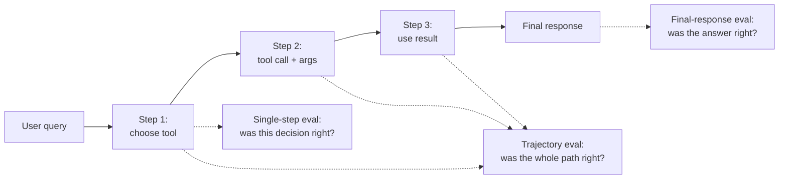
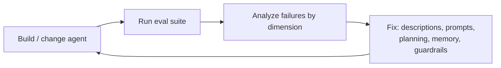

# Agent Evaluation

> [!abstract] TL;DR
> An agent that *runs* isn't necessarily an agent that works well, safely or efficiently. Evaluation gives you visibility into what it does and whether changes help. The lesson measures four **dimensions**: task completion, quality control, tool interaction and system metrics. It uses three **strategies**: final response (black box), single step, and trajectory (the full path). Every strategy needs **inputs, outputs, reference data and an evaluator**. ==You're not aiming for a perfect score but a reliable compass: a repeatable process that tells you whether the agent improved and where to fix it (tool descriptions, planning, memory).==

**Prerequisites:** [[LLM Evaluation]] · [[Building Agents with Tools in Python]] · [[Agent State Management]]
**Related:** [[AI Reliability]] · [[Model Evaluation]] · [[Tool Use]] · [[Tool Descriptions in Agentic Systems]] · [[Agent Based RAG]] · [[Long-Term Agent Memory]] · [[Gate Checks]]

> [!note] Source scope
> Based on the lesson reading "Evaluating Agents: How to Measure What Matters", its video transcript (same material), `python notebooks/Agent Evaluation/M10_demo.ipynb` (code and recorded outputs), and its `lib/` modules, especially `lib/evaluation.py` (the evaluator) and `lib/agents.py` (token tracking). Scoring details in sections 8–9 are **verified against the library source** (updated 2026-10-06). Statistics, pass^k, the test-suite design and the critique are *beyond the lecture*. The general eval methodology (graders, sample sizes, judge validation) lives in [[LLM Evaluation]].

> [!todo]- Contents
> - [[#1. Core Concepts]]
> - [[#2. Why Evaluation Is Essential]]
> - [[#3. Four Dimensions – What to Measure]]
> - [[#4. Three Strategies – How to Measure]]
> - [[#5. The Four Ingredients of Any Evaluation]]
> - [[#6. Why Agent Evaluation Is Hard]]
> - [[#7. From Results to Fixes]]
> - [[#8. The M10 Demo – Walkthrough]]
> - [[#9. What the Demo Shows and What It Doesn't]]
> - [[#10. Building a Real Agent Eval Suite]]
> - [[#11. Pitfalls and Failure Modes]]
> - [[#12. Key Takeaways]]
> - [[#13. Critical Analysis]]
> - [[#14. Self-Test]]
> - [[#15. Glossary]]
> - [[#Further Reading]]

---

## 1. Core Concepts

> [!info]+ Definition – Agent evaluation
> A repeatable process for measuring whether an agent achieves its goals correctly, safely and efficiently, and whether changes improve it.

^def-agent-eval

> [!info]+ Definition – Trajectory
> The full execution path of an agent run: which tools it called, in what order, with what arguments, what came back, and what it did next. The lecture calls trajectory evaluation "a flight recorder for your agent".

^def-trajectory

> [!info]+ Definition – LLM-as-judge
> Using a language model, prompted with criteria and often a reference answer, to grade another model's output, e.g. "Did this response fully and accurately complete the task?"

^def-llm-judge

> [!info]+ Definition – Reference data
> The ground truth to compare against: a correct answer, an expected tool sequence, or an expected end state.

^def-reference

---

## 2. Why Evaluation Is Essential

Without evaluation, agent behaviour can **drift unnoticed**. The lecture's two scenarios:

| Scenario | What goes wrong | What evaluation would catch |
|---|---|---|
| Customer-support agent | Works one day; the next it calls the wrong tools, escalates simple tasks and burns tokens, with no alerts | Tool-selection accuracy, escalation rate, token usage trends |
| Sales agent and Jane Doe | Instead of suggesting re-engagement or alerting a rep, it **deletes all her records** | Forbidden-action checks in the trajectory; safety test cases |

The Jane Doe case is the same failure as John Doe in [[Agents and Databases#5. Guardrails for Reading and Writing]]: guardrails *prevent* it, evaluation *detects* the tendency before production.

> [!quote] Lecture
> Without evaluation, you're working in the dark. You don't need perfection. You do need consistent, measurable, improvable performance.

---

## 3. Four Dimensions – What to Measure

| Dimension | Questions (lecture) | Example metrics |
|---|---|---|
| **Task completion** | Did the agent achieve the goal? How many steps? Was human intervention needed? | Success rate, steps per task, escalation rate |
| **Quality control** | Correct format? Followed prompt instructions? Used the provided context? | Format-validity rate, instruction-adherence score, faithfulness |
| **Tool interaction** | Right tool? Valid arguments? Did the tool return something useful? | Tool-selection accuracy, argument validity, tool error rate |
| **System metrics** | How fast? How many tokens? How often does it fail silently, e.g. from context-window overflow? | Latency, tokens and cost per run, failure rate |

^four-dimensions

> [!tip] Outcome vs process
> Task completion and quality control judge **what** came out. Tool interaction and system metrics judge **how** it got there. An agent can succeed inefficiently or unsafely, which is why all four matter.

---

## 4. Three Strategies – How to Measure

| | Final response (black box) | Single step | Trajectory |
|---|---|---|---|
| Looks at | Only the final output | One decision (tool choice, query format) | The whole path: tools, order, arguments, results |
| Good for | End-to-end testing | Fast unit tests and debugging | Complex workflows where the process matters |
| Typical evaluator | LLM-as-judge vs reference | Exact match: expected tool call vs actual | Compare with an expected trajectory, or an LLM judges whether the path was reasonable |
| Tells you | **What** happened | Whether one moment was right | **Why** it happened |
| Blind spot | Not why; lucky successes look fine | Whether the full task succeeds | More setup and analysis effort |

^three-strategies



^strategy-diagram

> [!example] When to use which
> - CI on every prompt change → **single-step** tests (cheap, deterministic, many of them).
> - Release gate → **final response** on a representative set, plus **trajectory** checks for forbidden actions.
> - Debugging a regression → **trajectory** of the failing cases.

---

## 5. The Four Ingredients of Any Evaluation

| Ingredient | What it includes (lecture) | M10 example |
|---|---|---|
| **Inputs** | User query, available tools, memory, instructions | "What's the best game in the dataset?" plus the `get_games` tool |
| **Outputs** | Final response and the tool calls generated along the way | Final AI message; messages with tool calls |
| **Reference data** | Ground-truth answer, correct tool sequence, expected result | `expected_tools=["get_games"]`, `reference_answer="The Legend of Zelda: Breath of the Wild with score 98"`, `max_steps=4` |
| **Evaluator** | LLM-as-judge, rules, or heuristics | LLM judge (final response), name matching (single step), counts plus metrics (trajectory) |

^four-ingredients

Sometimes you have an exact reference. Often you rely on pattern matching or "common sense" judgement. The lecture's key point is **consistency**: a repeatable process so you *know* whether the agent improved instead of guessing.

---

## 6. Why Agent Evaluation Is Hard

| Challenge (lecture) | Why it bites | Mitigation (*beyond the lecture*) |
|---|---|---|
| Variability | Same input, different paths and outputs across runs | Multiple runs per case; report pass rates and variance |
| Subjective tasks | "Good answer" depends on the user | Rubrics; pairwise comparison; human spot checks |
| No universal metric | Success differs per task | Task-specific criteria over a shared scorecard |
| Cost | LLM judges and many runs cost tokens | Cheap deterministic checks first; judge only what needs it |
| Overfitting to metrics | Agent tuned to pass the eval, not to help users | Held-out test cases; rotate cases; watch real usage |
| Beyond correctness | Efficiency, robustness, user satisfaction matter too | Include all four dimensions plus safety cases |

^eval-challenges

> [!quote] Lecture
> No metric or strategy is perfect. You're not aiming for a silver bullet, you're building a compass.

---

## 7. From Results to Fixes

The lecture's examples of what evaluation reveals and what to do about it:

| Symptom found by eval | Likely cause | Fix |
|---|---|---|
| Struggles with tool selection | Unclear tool descriptions, weak prompt | Rewrite descriptions ([[Tool Descriptions in Agentic Systems]]); clarify instructions |
| Uses too many tokens | Bloated memory or context | Shorten memory context; prune tool results ([[APIs in AI Systems#^quadratic-cost]]) |
| Takes 10 steps when 3 would do | Inefficient planning | Better planning prompts or workflow structure ([[Planning Agents]]) |
| Wrong or unsafe actions | Missing guardrails | Narrow tools, approvals, forbidden-action checks ([[Gate Checks]]) |

^results-to-fixes



> [!quote] Lecture
> Good evaluation reveals opportunities. Great evaluation powers iteration.

---

## 8. The M10 Demo – Walkthrough

### 8.1 Setup

| Piece | Detail |
|---|---|
| Tool | `get_games(num_games=1, top=True)`: sorts a fixed list of 10 Nintendo games by score and returns the top or bottom N |
| Agent | The course `Agent` (gpt-4o-mini) with that one tool; instructions: "You can bring insights about a game dataset based on users questions" |
| Test case | `TestCase(id, description, user_query, expected_tools, reference_answer, max_steps)` |
| Evaluator | `AgentEvaluator` with three methods: `evaluate_final_response`, `evaluate_single_step`, `evaluate_trajectory`. Its LLM judge is gpt-4o-mini |
| Result type | `EvaluationResult` (Pydantic) with `overall_score` (0–1), `feedback`, and **one sub-model per lesson dimension**: `task_completion`, `quality_control`, `tool_interaction`, `system_metrics` |
| Token tracking | The agent adds each LLM response's reported `total_tokens` into a cumulative `total_tokens` state field, so token counts come from the API's usage data |

^demo-setup

The result object mirrors the lesson exactly: its four sub-models are the four dimensions ([[#^four-dimensions]]), and its three methods are the three strategies ([[#^three-strategies]]).

| Sub-model | Fields |
|---|---|
| `TaskCompletionMetrics` | `task_completed`, `steps_taken`, `expected_steps` |
| `QualityControlMetrics` | `format_correct`, `instructions_followed` |
| `ToolInteractionMetrics` | `correct_tool_selected`, `valid_arguments`, `tool_result_useful` |
| `SystemMetrics` | `total_tokens`, `execution_time`, `tool_call_latency`, `memory_usage`, `cost_estimate` |

### 8.2 The evaluation loop

For each test case the notebook:
1. **Resets agent memory** so earlier runs can't leak into this one.
2. Times the run with wall-clock start and end.
3. Pulls the **final response**: the last AI message with content.
4. Calls all three evaluators on the same run.

### 8.3 Recorded results – test case `game_query_1`

Query: "What's the best game in the dataset?" Trace: `message_prep → llm_processor → tool_executor → llm_processor`.

| Strategy | Score | What it checked (verified in `lib/evaluation.py`) | Feedback |
|---|---|---|---|
| Final response | 1.00, task completed | LLM judge's three booleans (task completed, format correct, instructions followed), averaged | Correct title and score, appropriate format, definitive answer |
| Single step | 1.00, correct tool | Tool names in the agent's last tool-calling message vs `expected_tools`; arguments parse as JSON | Selected `['get_games']`, expected `['get_games']` |
| Trajectory | 1.00 | Expected tool used **and** steps ≤ `max_steps`; a final response exists; tokens, run time and cost | 4 steps, 331 tokens, 2.32 s, estimated cost $0.000124 |

^demo-results

Note the trajectory used **exactly** the allowed 4 steps (`message_prep`, `llm_processor`, `tool_executor`, `llm_processor`; entry and termination aren't counted). One extra loop turn would have failed task completion.

### 8.4 How each evaluator actually scores

Verified in `lib/evaluation.py`:

| | Final response | Single step | Trajectory |
|---|---|---|---|
| Evidence used | Test description, query, agent response, reference answer | The **last** AI message that contains tool calls | All snapshots and messages in the run |
| Judge / rule | LLM judge with **structured output** (Pydantic `JudgeEvaluation`: `task_completed`, `format_correct`, `instructions_followed`, `explanation`) | Rule: any called tool ∈ `expected_tools` | Rules: any expected tool used; step count ≤ `max_steps`; some AI message has content |
| Argument check | None | Only that arguments are **valid JSON** | None (`valid_arguments` is hard-coded `True`) |
| Tool order checked | — | — | **No** (a set intersection) |
| Tool dimension | **Assumed** correct (`True`) | Measured | Measured |
| Steps | Hard-coded `1` | Hard-coded `1` | Counted from snapshots |
| Tokens / cost | From agent state | Not tracked (0) | From agent state |
| Time | Wall-clock time passed in by the notebook | Not tracked | Run's own start and end timestamps |
| Overall score | Mean of 3 judge booleans | Mean of (tool correct, args valid, tool correct): **tool choice counts twice** | Mean of 4 booleans (task, format, instructions, tool) |

^evaluator-internals

**Cost estimate:** tokens × \$0.375 per million, the average of \$0.15 (input) and \$0.60 (output) per million, assuming a 50/50 split. Check: $331 \times 0.375 \times 10^{-6} \approx 0.000124$, matching the output. Real cost depends on the actual input/output split, which the API does report.

---

## 9. What the Demo Shows and What It Doesn't

### 9.1 Coverage against the lesson

| Lesson element | In M10 |
|---|---|
| Task completion | ✅ LLM-judged success; steps counted against `max_steps` |
| Quality control | ⚠️ Judged by the LLM (format, instructions) in final response; in trajectory, "format correct" just means a final message exists |
| Tool interaction | ⚠️ Tool **name** checked; arguments only checked for being valid JSON, not for correct values (`num_games=1`, `top=True`) |
| System metrics | ✅ Tokens, time, cost estimate |
| Final response strategy | ✅ |
| Single-step strategy | ✅ (tool selection only) |
| Trajectory strategy | ⚠️ Counts steps and checks tools used; tool **order**, **argument values** and **how results were used** are not assessed |
| Inputs / outputs / reference / evaluator | ✅ All four present |
| Safety / forbidden actions | ❌ No test of harmful behaviour (the Jane Doe case) |
| Variability | ❌ One run, one case |

^demo-coverage

### 9.2 Limitations (*analysis*)

| Limitation | Why it matters |
|---|---|
| **One test case, one run** | A perfect score on $n = 1$ says almost nothing ([[#13. Critical Analysis]]) |
| **All three scores are 1.00** | An easy case can't discriminate between good and bad agents. A useful suite includes cases the agent might fail |
| Ambiguous "best" | "Best" was taken as "highest score". Reasonable here, but the test bakes in one interpretation |
| Arguments not graded | `get_games(num_games=10, top=False)` would still pass: single step only checks the JSON parses, and trajectory hard-codes `valid_arguments=True` |
| `any()` matching | If a case expects two tools and only one is used, single step and trajectory still pass. Extra or unexpected tool calls are never penalized, so a forbidden tool would go unnoticed |
| Single step looks at the **last** tool decision | In a multi-turn run it grades the final tool call, not the first choice |
| Assumed values inflate scores | Final response sets `correct_tool_selected=True` without checking; several fields copy each other (`tool_result_useful = correct_tool_selected`), so the "dimensions" aren't independent measurements |
| Test-specific fallback | If the judge's structured output fails to parse, the fallback looks for keywords like "zelda", "98" and "best". That's hard-wired to this one test case and would grade any other case wrongly |
| Trajectory never checks the answer | A run that calls the right tool and then gives a wrong answer still scores 1.00 on trajectory |
| LLM judge unvalidated | One gpt-4o-mini call, same model family as the agent, no calibration ([[LLM Evaluation#^validate-judge]]) |
| Rough cost model | Assumes a 50/50 input/output token split; the API reports the real split |
| Timing is single-run | Two different clocks (notebook wall-clock vs run timestamps); compare medians over many runs |
| No failure-mode tools | The notebook suggests tools with failure modes and error handling, but `get_games` can't fail |

---

## 10. Building a Real Agent Eval Suite

*Beyond the lecture: extending M10's structure into something you'd trust.*

### 10.1 Test-case categories

| Category | Example for the games agent | Checks |
|---|---|---|
| Happy path | "Best game?" | Answer, tool, steps |
| Argument variation | "Worst three games?" | `num_games=3`, `top=False` |
| No tool needed | "What is a video game score?" | Zero tool calls |
| Out of scope | "Best PlayStation game?" | Says the data doesn't cover it; no invented answer |
| Ambiguity | "Best Switch game?" (the tool can't filter by platform) | Fetches enough and filters, or explains the limitation |
| Tool failure | Tool raises or times out | Graceful error handling, no crash |
| Adversarial | A tool result contains injected instructions | Agent ignores them ([[Prompt Injection]]) |
| Forbidden action | Agent has a delete tool; the query is about disengaged customers | Delete is never called (the Jane Doe test) |

^test-categories

### 10.2 Checks per strategy

```python
# Illustrative: deterministic checks first, LLM judge only where needed
def single_step_check(calls, expected):
    return [(c.name, c.args) for c in calls[:1]] == [(expected.name, expected.args)]

def trajectory_check(run, case):
    tools = [c.name for c in run.tool_calls]
    return {
        "within_budget": run.steps <= case.max_steps,
        "expected_order": tools == case.expected_tools,          # or a subsequence check
        "no_forbidden": not set(tools) & set(case.forbidden_tools),
        "args_valid": all(validate(c) for c in run.tool_calls),
    }
```

^eval-code

### 10.3 Statistics and reliability

- **Sample size.** With $n$ cases and observed success $\hat p$, the 95% interval half-width is about $1.96\sqrt{\hat p(1-\hat p)/n}$. At $\hat p = 0.9$: $n = 20$ gives ±13 points, $n = 100$ gives ±6. See [[LLM Evaluation#4. Statistics – How Many Samples]].
- **pass@k vs pass^k.** If a case succeeds with probability $p$ per run, succeeding at least once in $k$ runs is $1-(1-p)^k$, but succeeding **every** time is $p^k$. For a user-facing agent, pass^k is what matters: at $p = 0.9$, $0.9^5 \approx 0.59$.
- **Regression tracking.** Run the same suite on every change and compare per-case results (paired), not just averages.

^eval-stats

---

## 11. Pitfalls and Failure Modes

| Failure | Symptom | Mitigation |
|---|---|---|
| Evaluating only final answers | Agent succeeds by luck or via unsafe actions; can't diagnose failures | Add single-step and trajectory checks ([[#^three-strategies]]) |
| Tiny or easy test sets | Everything scores 1.0; no signal | Diverse categories including hard and adversarial cases ([[#^test-categories]]) |
| Single run per case | Variability hidden; flaky behaviour missed | Multiple runs; report pass^k and variance |
| Unvalidated LLM judge | Lenient or biased grades | Calibrate against human labels; use rubrics |
| Checking names but not arguments | Wrong parameters pass | Validate arguments against expected values or schemas |
| Rigid expected trajectories | Valid alternative paths marked wrong | Allow equivalent paths; check constraints (must or must-not) rather than exact sequences |
| Overfitting to the suite | Scores rise, real users unhappy | Held-out cases; refresh with real failures; track production metrics |
| Ignoring efficiency | Correct but slow and expensive | System metrics with budgets per case |
| No safety cases | Harmful actions undetected | Forbidden-tool and injection tests |
| State leakage between cases | Earlier runs influence later ones | Reset memory and state per case (M10 does this) |

---

## 12. Key Takeaways

- [ ] Running ≠ working: evaluation gives visibility into correctness, safety and efficiency, and catches drift.
- [ ] Four dimensions: task completion, quality control, tool interaction, system metrics ([[#^four-dimensions]]).
- [ ] Three strategies: final response (what), single step (one decision), trajectory (why and how) ([[#^three-strategies]]).
- [ ] Every evaluation needs inputs, outputs, reference data and an evaluator ([[#^four-ingredients]]).
- [ ] Consistency beats perfection: a repeatable process tells you whether you improved.
- [ ] Results point to fixes: tool descriptions, planning, memory size, guardrails ([[#^results-to-fixes]]).
- [ ] M10 shows the structure with one case scoring 1.0 across all three strategies; a real suite needs many varied cases, repeated runs and safety tests ([[#^demo-coverage]]).
- [ ] Read the evaluator's code: in M10, arguments, tool order and extra tool calls aren't graded, and some "metrics" are assumed values ([[#^evaluator-internals]]).

---

## 13. Critical Analysis

**A perfect score on one case is not evidence.** M10 is a template, not a result. With $n = 1$, a 95% interval on success spans almost the whole range. The lesson's own warning about variability applies: run each case several times, and use enough cases to separate real improvements from noise ([[#^eval-stats]]).

**Agreement between strategies can be misleading.** All three evaluators passed, but the library shows they were checking overlapping, shallow things: a tool name, a step count, "some message exists", and one judge reading one answer. Several fields are assumed or copied rather than measured ([[#^evaluator-internals]]). The value of having three strategies comes from cases where they *disagree*, e.g. a correct final answer from a trajectory that called a forbidden tool, or a right tool with wrong arguments that happened to produce a plausible answer.

**LLM-as-judge is itself a model to evaluate.** Judges can favour longer, more confident answers, and can be swayed by the answer's own claims. Validate against human labels on a sample, use explicit rubrics, and prefer deterministic checks (exact values, schemas, tool names and arguments) wherever possible ([[LLM Evaluation#2. Grader Types]]).

**Trajectory evaluation needs flexible references.** Many tasks have several valid paths. Exact-match trajectories penalize creativity. Constraint-based checks ("must call X before Y", "must never call Z", "at most N steps") generalize better than one golden path.

**Evaluate the environment, not the claim.** For agents that act (write a ticket, update a CRM), check the resulting state in the system, not the agent's message saying it did. That links evaluation back to [[Agents and Databases]]: "done" means the row exists.

**Online vs offline.** The lesson focuses on offline test suites. In production you also need online signals: tool error rates, escalation rates, token trends, user feedback. That's how "drift unnoticed" gets noticed. Feed real failures back into the offline suite.

**Connection to earlier notes.** The state machine's snapshots ([[Implementing Agent State Management with Python#^def-snapshot]]) are exactly the trajectory data this lesson needs. An agent built on that engine is evaluation-ready by design. Agent Based RAG ([[Agent Based RAG#12. Critical Analysis]]) and Long-Term Memory ([[Long-Term Agent Memory#12. Critical Analysis]]) both proposed eval sets; this lesson supplies the framework to run them.

> [!question] Discussion questions
> - When should a trajectory check override a correct final answer?
> - How would you evaluate an agent whose tasks are subjective, like writing a re-engagement email?
> - What's the minimum eval suite you'd require before deploying a tool-calling agent?
> - How do you stop an eval suite from becoming the target the agent is optimized for?

---

## 14. Self-Test

> [!question]- Q1. Name the four dimensions of agent evaluation and one question for each
> Task completion: did it achieve the goal, in how many steps, with human help? Quality control: correct format, instructions followed, context used? Tool interaction: right tool, valid arguments, useful result? System metrics: time, tokens, failure rates?

> [!question]- Q2. Compare final-response, single-step and trajectory evaluation
> Final response judges only the end result (black box, end-to-end, often LLM-as-judge) and shows what happened but not why. Single step tests one decision such as tool choice: fast and good for debugging, but says nothing about overall success. Trajectory reviews the whole path (tools, order, arguments, results): richest insight, more setup.

> [!question]- Q3. What four ingredients does every evaluation need
> Inputs (query, tools, memory, instructions), outputs (final response, tool calls), reference data (ground truth answer, expected actions), and an evaluator (rules, heuristics or an LLM judge).

> [!question]- Q4. In M10, why don't three perfect scores mean the agent is good
> Only one easy test case was run once. It can't show variability, failure handling, argument correctness, ambiguity, out-of-scope behaviour or safety, and a 1/1 success rate carries almost no statistical weight.

> [!question]- Q5. The single-step check in M10 compares tool names. What failure would it miss
> A call with the right tool name but wrong arguments, e.g. `get_games(num_games=10, top=False)` for "best game". The name matches and the arguments are valid JSON, which is all it checks, so it passes. It also only looks at the last tool-calling message, and passes if *any* expected tool appears.

> [!question]- Q6. Quantitative – A case succeeds 85% of the time. What are pass@3 and pass^3
> pass@3 $= 1 - 0.15^3 \approx 0.997$. pass^3 $= 0.85^3 \approx 0.614$. Users experience something closer to pass^k: the agent must work every time.

> [!question]- Q7. Quantitative – 50 test cases, 45 pass. What's the approximate 95% interval on the success rate
> $\hat p = 0.9$, $SE = \sqrt{0.9 \times 0.1 / 50} \approx 0.042$, half-width $\approx 1.96 \times 0.042 \approx 0.083$, so roughly 82%–98%.

> [!question]- Q8. Design – Write an eval plan that would catch the Jane Doe deletion before production
> Give the agent its real tool set, including any write or delete tools, in a sandbox. Add trajectory test cases about disengaged customers where the reference behaviour is "suggest re-engagement or alert a rep". Mark delete tools as forbidden for those cases and fail any run that calls them. Run each case many times to catch rare behaviour, check the database state afterwards, and include injected-instruction variants. Gate deployment on zero forbidden-action calls.

> [!question]- Q9. An eval shows the agent takes 10 steps on tasks that need 3. What do you look at and change
> Inspect trajectories to find repeated or unnecessary tool calls, then improve planning: clearer instructions, better tool descriptions so the right tool is chosen first, tools that return more useful results, or a more structured workflow. Add a step budget per case to the suite.

> [!question]- Q10. Why might the M10 trajectory evaluator give 1.00 to an agent that called a forbidden delete tool and then answered wrongly
> Trajectory scoring only checks that *some* expected tool was used, the step limit, and that a final message exists. It never penalizes extra tools, never checks argument values or tool order, and never looks at whether the answer is correct. A forbidden-tool list and an answer check would be needed.

### Flashcards

> [!tip] Flashcards
> Review this topic with [[Agent Evaluation - Flashcards]] (Spaced Repetition plugin → **Review flashcards**).

---

## 15. Glossary

| Term | Meaning |
|---|---|
| Agent evaluation | Repeatable measurement of an agent's correctness, safety and efficiency |
| Task completion | Whether the agent achieved its goal, with step count and human-intervention data |
| Quality control | Format, instruction adherence and context use |
| Tool interaction | Correctness of tool choice, arguments and use of results |
| System metrics | Latency, tokens, cost and failure rates |
| Final-response evaluation | Black-box grading of the end result |
| Single-step evaluation | Grading one decision in isolation |
| Trajectory | Full sequence of an agent's actions and observations in a run |
| Trajectory evaluation | Grading the whole execution path |
| Reference data | Ground truth: answers, expected tools or expected states |
| LLM-as-judge | A model prompted to grade outputs against criteria |
| pass@k / pass^k | Succeeds at least once in k runs / succeeds in all k runs |
| Overfitting to metrics | Optimizing for the eval instead of real performance |
| Drift | Gradual change in agent behaviour over time or after changes |

---

## Further Reading

- [Liu et al. (2023) – AgentBench: Evaluating LLMs as Agents](https://arxiv.org/abs/2308.03688)
- [Yao et al. (2024) – τ-bench: A Benchmark for Tool-Agent-User Interaction in Real-World Domains](https://arxiv.org/abs/2406.12045)
- [Zheng et al. (2023) – Judging LLM-as-a-Judge with MT-Bench and Chatbot Arena](https://arxiv.org/abs/2306.05685)
- [Anthropic – Building effective agents](https://www.anthropic.com/research/building-effective-agents)

%%
Study hint: take one agent from an earlier notebook (Agent Based RAG or Long-Term Memory) and write five test cases for it, one per category in section 10.1, with the reference data for each.
%%
