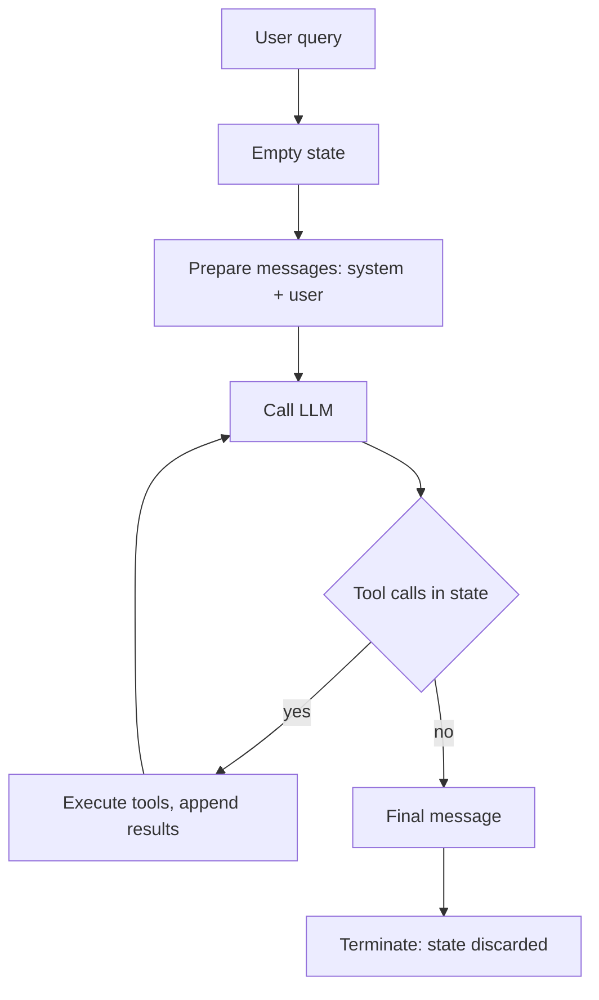

# Agent State Management

> [!abstract] TL;DR
> LLMs are stateless: every call is a blank slate. Agents need **state**, meaning everything they must track while working through a task (query, instructions, messages, tool calls, intermediate results). ==Model the agent as a state machine: each step receives a typed state object and returns an updated one, and transitions are chosen by inspecting that state.== This state is **ephemeral working memory**. It vanishes when the run ends unless you persist it on purpose.

**Prerequisites:** [[Large Language Models]] · [[AI Agents]] · [[Building Agents with Tools in Python]]
**Related:** [[AI Memory]] · [[Runtime or Orchestration Layer]] · [[Tool Use]] · [[Directed Acyclic Graph (DAG)]] · [[Implementing Agentic Workflows/Agentic Workflow Modeling|Agentic Workflow Modeling]] · [[Structured Outputs]]

> [!note] Source scope
> Based on the lecture video transcript and the lesson reading "Managing Agent State with State Machines". Both cover the same material. The reducer pattern, persistence/checkpointing, the token-growth math, framework mapping and the security discussion are *beyond the lecture* and flagged where they appear. The companion code lesson lives in `python notebooks/Implementing Agent State Management with Python` and isn't covered here.

> [!todo]- Contents
> - [[#1. Core Concepts]]
> - [[#2. What Goes in Agent State]]
> - [[#3. Agents as State Machines]]
> - [[#4. The Execution Loop]]
> - [[#5. Defining the State Schema]]
> - [[#6. Conditional Transitions]]
> - [[#7. Worked Example – Weather Question with One Tool Call]]
> - [[#8. Pitfalls and Failure Modes]]
> - [[#9. Key Takeaways]]
> - [[#10. Critical Analysis]]
> - [[#11. Self-Test]]
> - [[#12. Glossary]]
> - [[#Further Reading]]

---

## 1. Core Concepts

> [!info]+ Definition – Stateless system
> A system that keeps no record of earlier interactions. Each request stands alone. A bare LLM call works this way: it "knows" only what is in the current prompt.

^def-stateless

> [!info]+ Definition – Stateful system
> A system that carries a history of what it has done, at least for the duration of a task, and uses that history to decide what happens next.

^def-stateful

> [!info]+ Definition – Agent state
> Everything an LLM-based agent needs to track as it works through a task: the original query, system instructions, message history, pending or completed tool calls, and intermediate results.

^def-agent-state

> [!info]+ Definition – Ephemeral state
> State that exists only during execution and is discarded when the task ends, unless explicitly persisted. Functionally it is **working memory**, not long-term memory.

^def-ephemeral

| | Stateless | Stateful |
|---|---|---|
| Memory between requests | None | Carried for the task (or longer) |
| Example | A single LLM prompt → reply | Online checkout: cart → checkout → payment |
| Asking "what did I do earlier" | Can't answer | Can answer from state |
| Fit for multi-step tool use | Poor | Required |

**The checkout analogy (lecture).** The cart remembers items you added. Checkout uses those items to compute a total. The system tracks *what you chose*, *where you are in the process*, and *payment details*. An agent's state plays the same role: data, position in the workflow, and context needed for the next step.

> [!tip] Statelessness is a feature of the model, not the system
> An LLM API "remembers" a conversation only because the client resends the history every call. Statefulness is something **your code** builds around the model. See [[AI Memory#1. Core Concepts]].

---

## 2. What Goes in Agent State

| Field | Purpose | Lifetime |
|---|---|---|
| User query | The goal; anchors every step | Whole run |
| System instructions | Persona, rules, output format | Whole run |
| Message history | The conversation so far (system, user, assistant, tool) | Grows each step |
| Tool calls | Calls the LLM selected and has not yet executed | Set by LLM step, cleared by tool step |
| Intermediate results | Tool outputs, partial answers | Appended as produced |

^state-fields

**Ephemeral vs persistent.** The lecture stresses that this state is gone once the task ends. That is deliberate: it keeps the agent focused on the *current* execution. Remembering across sessions is a separate concern ([[AI Memory]]), deferred to a later lesson.

| | Ephemeral state (this note) | Long-term memory |
|---|---|---|
| Analogy | Working memory | Long-term memory |
| Scope | One run | Across runs and sessions |
| Storage | In-process object | DB, vector store, profile |
| Main risk | Grows too large within a run | Stale, wrong or poisoned facts |

---

## 3. Agents as State Machines

> [!info]+ Definition – State machine
> A system that moves between well-defined steps, updating internal variables as it goes. Each transition can depend on the current values of those variables.

^def-state-machine

Applied to agents, each **step** is a function with the same contract:

$$\text{step}: S \rightarrow S'$$

It receives the current state $S$ and returns an updated state $S'$. A **transition function** looks at $S'$ and picks the next step.

^step-contract

Typical steps from the lecture:

| Step | Reads from state | Writes to state |
|---|---|---|
| Prepare messages | query, instructions | messages (system + user) |
| Call LLM | messages | assistant message, tool calls |
| Execute tools | tool calls | tool results appended to messages; tool calls cleared |
| Decide next step | tool calls | nothing (it only routes) |
| Terminate | messages | final answer |

**Why this design (lecture's claims):** predictable, testable, modular, debuggable. Each step can be unit-tested with a hand-built state object, and the whole run can be replayed as a sequence of state snapshots.

> [!example] Connection to earlier notes
> This is the same loop as [[Building Agents with Tools in Python#^agent-loop|the agent loop]], made explicit. The state machine is how the [[Runtime or Orchestration Layer]] is structured internally ([[Runtime or Orchestration Layer#^runtime-loop|runtime loop]]). Unlike a [[Directed Acyclic Graph (DAG)|DAG]], an agent state machine **has a cycle** (LLM → tools → LLM), so it needs an explicit stop condition.

---

## 4. The Execution Loop



^execution-loop

Step by step (lecture):

1. The user sends a query. The agent starts with an **empty state**.
2. The system message and user message are combined into a prompt.
3. The prompt goes to the LLM, which generates a response.
4. Check whether the LLM chose to call tools.
   - **Yes:** execute them, add results to state, return to step 3.
   - **No:** produce the final message and terminate.

The loop is "receive state → take a step → produce new state", repeated until a terminal step.

> [!warning] The lecture loop has no step budget
> As drawn, a model that keeps requesting tools loops forever. Production loops add a maximum iteration count or token budget as a second exit (*beyond the lecture*; see [[Runtime or Orchestration Layer#5.1 Budgets]]).

---

## 5. Defining the State Schema

The lecture uses a typed dictionary (Python `TypedDict`) to define the shape of state. Every step accepts and returns an object matching that schema, so data flows predictably between steps.

```python
from typing import TypedDict, Any

class AgentState(TypedDict):
    user_query: str            # the goal
    instructions: str          # system guidance
    messages: list[dict]       # chat history, all roles
    tool_calls: list[Any]      # selected by the LLM, not yet executed
```

Illustrative step signature:

```python
def call_llm(state: AgentState) -> AgentState:
    response = llm(state["messages"])
    return {
        **state,
        "messages": state["messages"] + [response.message],
        "tool_calls": response.tool_calls or [],
    }
```

Design notes (*beyond the lecture*):

- **Return a new object rather than mutating in place.** Then every intermediate state is a snapshot you can log, diff or replay.
- **`TypedDict` is a static hint only.** It doesn't validate at runtime. For untrusted data (LLM output, tool results), validate with Pydantic. See [[Pydantic for Structured LLM Output - Study Guide]].
- **Keep state minimal and serializable.** Plain JSON-friendly types make checkpointing and tracing trivial. Avoid putting clients, sockets or open files in state.
- **Reducers.** Frameworks such as LangGraph let each field declare how updates merge (e.g. "append to messages" vs "overwrite tool_calls"), so steps return only the fields they change.

---

## 6. Conditional Transitions

Transitions are **dynamic**: a router function inspects the state and names the next step.

```python
def route_after_llm(state: AgentState) -> str:
    return "execute_tools" if state["tool_calls"] else "finish"
```

^router

- The tool step should run **only** if the LLM selected tools.
- The tool step writes results back into state, so the next LLM call sees them.
- The lecture calls this "a lightweight form of self-awareness": the agent's own output steers its process.

> [!important] Who decides, who enforces
> The **LLM** decides *whether* tools are needed by writing tool calls into state. **Code** decides *what happens next*, by reading state. That split keeps control flow inspectable even when the model is driving ([[Runtime or Orchestration Layer#^control-spectrum|control spectrum]]).

---

## 7. Worked Example – Weather Question with One Tool Call

Query: *"Should I bring an umbrella in Seattle today?"* Tool available: `get_weather(city)`.

| # | Step | State after the step (changed fields) |
|---|---|---|
| 0 | Start | `user_query` set; `instructions` set; `messages = []`; `tool_calls = []` |
| 1 | Prepare messages | `messages = [system, user]` |
| 2 | Call LLM | `messages += [assistant(tool_call get_weather("Seattle"))]`; `tool_calls = [get_weather]` |
| 3 | Router | `tool_calls` non-empty → go to tools |
| 4 | Execute tools | `messages += [tool: {"rain_prob": 0.8}]`; `tool_calls = []` |
| 5 | Call LLM | `messages += [assistant("Yes, 80% chance of rain…")]`; `tool_calls = []` |
| 6 | Router | `tool_calls` empty → finish |
| 7 | Terminate | Final answer returned; state discarded |

If you logged the state after each step, you could reproduce exactly why the agent answered as it did. That is the debuggability claim made concrete.

---

## 8. Pitfalls and Failure Modes

| Failure | Symptom | Mitigation |
|---|---|---|
| No loop cap | Agent calls tools forever; runaway cost | Max iterations / token budget as an extra exit |
| Stale `tool_calls` | Tools re-run on every loop | Tool step clears `tool_calls` after executing |
| Unbounded message history | Context overflow, rising cost and latency | Trim or summarize old turns; store large tool outputs by reference |
| In-place mutation | Snapshots in logs change after the fact; hard-to-reproduce bugs | Return new state objects; deep-copy for logs |
| Schema drift between steps | `KeyError`, or a step silently reads a missing field | One shared schema; runtime validation at step boundaries |
| Unvalidated tool/LLM data in state | Bad values propagate to later steps | Validate and type-check at the boundary ([[Output Validation]]) |
| Assuming state survives a crash | Long run fails at step 9, restarts from zero | Checkpoint state after each step if runs are long or costly |
| Confusing working state with memory | Agent "forgets" the user next session | Persist deliberately via a memory layer ([[AI Memory]]) |

---

## 9. Key Takeaways

- [ ] LLMs are stateless; any statefulness is built by the surrounding code.
- [ ] Agent state = query, instructions, messages, tool calls, intermediate results ([[#^state-fields]]).
- [ ] State is ephemeral working memory: it exists for one run unless persisted.
- [ ] A state machine models the agent as steps of the form $S \rightarrow S'$ ([[#^step-contract]]).
- [ ] The core loop: prepare → LLM → tools? → (execute, loop) or finish ([[#^execution-loop]]).
- [ ] A typed schema (`TypedDict`) gives every step the same contract.
- [ ] Router functions read state to choose the next step; tools run only when selected ([[#^router]]).
- [ ] Payoff: more deterministic, testable, debuggable, reliable agents.

---

## 10. Critical Analysis

**"Deterministic" is overstated.** The state machine makes *control flow* deterministic given the state, but the LLM step is still stochastic. Two runs with the same query can take different paths (one tool call vs three). What you gain is *traceability*, not determinism. Reproducing a run requires recording LLM outputs, not just re-executing.

**The cost of carrying full history (*beyond the lecture*).** If each loop iteration adds about $m$ tokens and the full message list is resent each LLM call, the input tokens over $n$ calls are

$$\sum_{i=1}^{n} (T_0 + i\,m) = n T_0 + m\,\frac{n(n+1)}{2} = O(n^2)$$

So total input cost grows quadratically with loop length. State design (what to keep, summarize or drop) is a cost lever, not just a correctness one. Compare the context budget in [[AI Memory#2. Memory Architecture]].

**"Ephemeral" is a design choice, not a law.** For short chat tasks, discarding state is fine. For long-running or human-in-the-loop agents, ephemeral state is a liability: a crash or a pause loses everything. Checkpointing (persisting $S$ after every step, keyed by a run ID) turns the same state machine into a durable, resumable workflow ([[Runtime or Orchestration Layer#^def-durable|durable execution]]). The state-machine framing is exactly what makes this cheap.

**Evidence quality.** The lecture's reliability claims are engineering arguments, not measured results. They are plausible and match standard software practice (finite-state machines, pure functions, typed interfaces), but the lecture gives no comparison against an unstructured loop. To evaluate: compare failure rate, mean steps-to-answer, and time-to-diagnose on a bug corpus for structured vs ad-hoc implementations.

**What changes at scale.** Many tools and many agents mean state becomes shared and concurrent. Questions the lecture doesn't address: which step owns which field, how parallel tool results merge (reducers), and how sub-agents get a *scoped* slice of state rather than all of it ([[Multi-Agent Systems]]).

**Security.** Everything in state ends up in a prompt. Tool outputs written into `messages` are an injection channel: a web page returned by a tool can carry instructions the next LLM step obeys ([[Prompt Injection]]). Mitigations: mark tool content as data, keep authorization decisions in code (the router), and avoid putting secrets in state that gets logged or sent to the model.

> [!question] Discussion questions
> - Where exactly is the line between "state" and "memory" once you add checkpointing?
> - Should the router ever be an LLM call itself? What do you lose?
> - Which state fields should a sub-agent be allowed to read and write?
> - How would you test that a step is a pure function of its input state?

---

## 11. Self-Test

> [!question]- Q1. Why is a bare LLM call called stateless, and where does chat "memory" really come from
> Each call is processed independently with no stored history. Chat apps appear to remember because the client resends the message history in every request. The state lives in the application, not the model.

> [!question]- Q2. List the five kinds of information typically held in agent state
> Original user query, system instructions, message history, tool calls (pending/completed), intermediate results.

> [!question]- Q3. What does "ephemeral" mean for agent state, and why is it a reasonable default
> The state exists only during execution and is discarded at the end unless persisted. It keeps the agent focused on the current task, avoids accumulating stale or sensitive data, and keeps short-term working memory separate from long-term memory.

> [!question]- Q4. What is the common contract every step in the state machine follows
> It receives a state object matching the schema and returns an updated state object matching the same schema ($S \rightarrow S'$).

> [!question]- Q5. Design – Add a human approval step before any tool that sends email. Where does it go in the state machine and what state does it need
> Add a router branch after the LLM step: if `tool_calls` contains a send-email call, go to an `await_approval` step instead of `execute_tools`. State needs a field such as `pending_approval` (the call details) and `approval_status`. Because the run now pauses, state must be **persisted** (checkpointed by run ID) so it can resume after the human responds. Approved → `execute_tools`. Rejected → append a tool message saying "rejected by user" and go back to the LLM.
> > [!tip] Key insight
> > Human-in-the-loop forces ephemeral state to become durable.

> [!question]- Q6. Quantitative – A run makes 6 LLM calls. The initial prompt is 1,000 tokens and each loop adds 500 tokens of messages. Roughly how many input tokens are sent in total
> Call $i$ sends $1000 + 500(i-1)$ tokens. Sum for $i = 1..6$: $6 \times 1000 + 500 \times (0+1+2+3+4+5) = 6000 + 7500 = 13{,}500$ input tokens. Doubling the loop count to 12 gives $12000 + 500 \times 66 = 45{,}000$, more than 3× the cost: quadratic growth.

> [!question]- Q7. Why must the tool-execution step clear the pending tool calls
> Otherwise the router still sees tool calls after the next LLM step and re-executes the same tools, causing duplicated side effects or an infinite loop.

> [!question]- Q8. In what sense is the state-machine agent more deterministic, and in what sense isn't it
> Given a particular state, the next step is determined by code, so control flow is predictable and testable. But the LLM's output is stochastic, so different runs can produce different states and therefore different paths.

### Flashcards

> [!tip] Flashcards
> Review this topic with [[Agent State Management - Flashcards]] (Spaced Repetition plugin → **Review flashcards**).

---

## 12. Glossary

| Term | Meaning |
|---|---|
| Stateless | Keeps no record between interactions |
| Stateful | Tracks history and position during (at least) a task |
| Agent state | All data an agent tracks during a run |
| Ephemeral state | State that lives only for the run's duration |
| Working memory | Task-scoped context; the role ephemeral state plays |
| State machine | System moving between defined steps, updating variables, with state-dependent transitions |
| Step / node | Function that takes state and returns updated state |
| Transition / router | Function that inspects state and chooses the next step |
| State schema | Typed definition of state fields (e.g. `TypedDict`) |
| Checkpoint | Persisted snapshot of state, enabling resume (*beyond the lecture*) |
| Reducer | Rule for merging a step's update into a field (*beyond the lecture*) |

---

## Further Reading

- [Python `typing.TypedDict` documentation](https://docs.python.org/3/library/typing.html#typing.TypedDict)
- [LangGraph documentation – state, nodes and edges](https://langchain-ai.github.io/langgraph/)
- [Anthropic – Building effective agents](https://www.anthropic.com/research/building-effective-agents)
- [Yao et al. (2022) – ReAct: Synergizing Reasoning and Acting in Language Models](https://arxiv.org/abs/2210.03629)

%%
Study hint: draw the execution loop from memory, then label which state fields each box reads and writes. If you can do that, you understand the lesson.
%%
