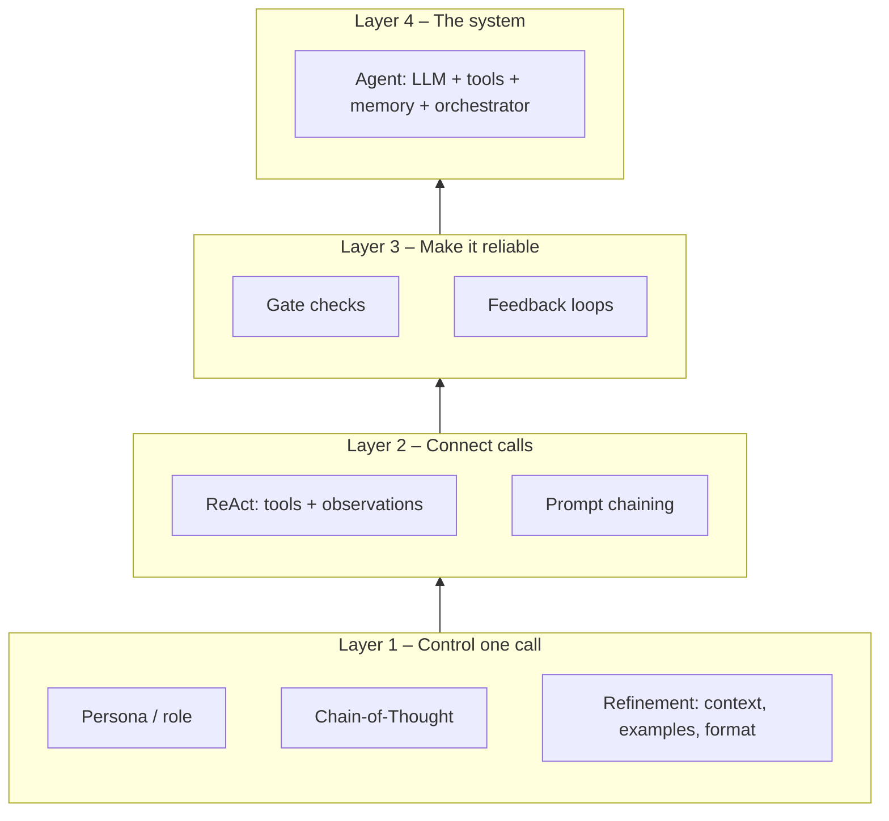
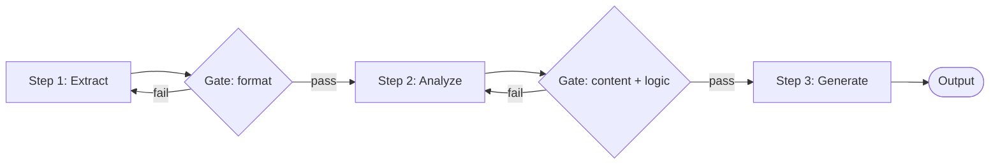
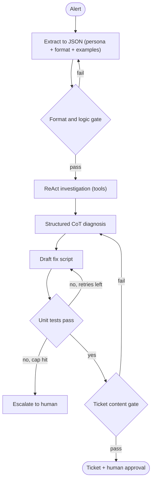

# Agentic AI Skills Scorecard

> [!abstract] TL;DR
> This is the end-of-course review for Agentic AI Course 1. It takes each skill on the course's **Skills Scorecard**, explains it briefly, and points to the vault notes that cover it in depth. The skills stack: ==prompting controls one LLM call, patterns connect calls into workflows, and loops and gates make those workflows reliable==. The last section puts all eight skills into one agent so you can see how they fit together.

**Prerequisites:** [[AI Agents]] · [[Prompt Engineering]]
**Related:** [[Agentic AI]] · [[Chain-of-Thought and ReAct]] · [[Prompt Chaining for Agentic Reasoning - Study Guide]] · [[LLM Feedback Loops]]

> [!note] Source scope
> The skill list is the course's own scorecard. The explanations summarize existing vault notes (linked in each section). The persona section is expanded here because no dedicated note covers it. The skill-stack diagram, the capstone example, and the critical analysis are *beyond the course* (my synthesis).

> [!todo]- Contents
> - [[#1. The Scorecard at a Glance]]
> - [[#2. Agent Design and Theory]]
> - [[#3. Core Prompting Techniques]]
> - [[#4. Advanced Agentic Patterns]]
> - [[#5. Worked Example – One Agent Using Every Skill]]
> - [[#6. Pitfalls and Failure Modes]]
> - [[#7. Key Takeaways – Self-Assessment]]
> - [[#8. Critical Analysis]]
> - [[#9. Self-Test]]
> - [[#10. Glossary]]
> - [[#Further Reading]]

---

## 1. The Scorecard at a Glance

| Area | Skill | One-line meaning | Primary notes | Lab |
|---|---|---|---|---|
| Design & theory | **Agent architecture** | LLM "brain" + tools + memory + instructions, run by an orchestrator | [[AI Agents#2. Anatomy of an Agent]] · [[Agentic AI]] | — |
| Design & theory | **CoT vs ReAct** | CoT = reason with what you know; ReAct = reason *and act* to get new information | [[Chain-of-Thought and ReAct#Chain-of-Thought vs ReAct]] | [[Chain-of-Thought and ReACT Prompting]] |
| Core prompting | **Specialized personas** | A role sets tone, style, expertise and perspective | [[#3.1 Craft Specialized Personas]] · [[Prompt Instruction Refinement]] | — |
| Core prompting | **Guide complex reasoning** | Chain-of-Thought prompts break a problem into ordered steps | [[CoT prompt Samples]] · [[Chain-of-Thought and ReAct#Chain-of-Thought]] | [[Chain-of-Thought and ReACT Prompting#^structured-cot-prompt]] |
| Core prompting | **Refine for precision** | Add context, examples and output format; change one thing at a time | [[Prompt Instruction Refinement#5. The Refinement Loop]] · [[Few-Shot Prompting]] | — |
| Agentic patterns | **ReAct** | Thought → Action (tool) → Observation loop | [[Chain-of-Thought and ReAct#The ReAct Loop]] · [[Tool Use]] · [[ReAct prompt Samples]] | — |
| Agentic patterns | **Prompt chaining + gate checks** | One step's output feeds the next; code-level gates check each step | [[Prompt Chaining for Agentic Reasoning - Study Guide]] · [[Gate Checks]] | [[Implementing Gate Checks]] |
| Agentic patterns | **Self-correcting systems** | Feedback loops evaluate output (e.g. unit tests) and iterate | [[LLM Feedback Loops]] | [[Implementing LLM Feedback Loops]] |

^scorecard-map

### How the skills stack



^skill-stack

---

## 2. Agent Design and Theory

### 2.1 Agent Architecture – Brain, Tools, Memory

> [!info]+ Definition – LLM agent
> A system in which an LLM **decides the next action in a loop**, using tools to act and observe, and memory to keep state, until a goal or stop condition is reached. See [[AI Agents#^def-llm-agent]].

^def-agent

| Component | Role | Deep dive |
|---|---|---|
| **LLM (brain)** | Reasons and picks the next action | [[Large Language Models]] |
| **Instructions** | Goal, rules, **persona**, stop criteria | [[Prompt Engineering]] |
| **Tools** | Act on the world and fetch information | [[Tool Use]] · [[Tool Descriptions in Agentic Systems]] |
| **Memory** | Short-term (context window) and long-term (stores) | [[AI Memory]] · [[Vector Databases]] |
| **Orchestrator / runtime** | Runs tools, enforces budgets, permissions, stop conditions | [[Chaining prompts for Agentic Reasoning#7. Runtime or Orchestration Layer – What Runs the Chain]] |

Full table (including knowledge, planning and guardrails): ![[AI Agents#^agent-anatomy]]

> [!tip] What to be able to say in an interview
> "The LLM is only the policy. The **orchestrator** decides what the LLM is allowed to do: it executes the tools, holds the memory, and enforces stop conditions. Most reliability work happens in the orchestrator, not the prompt."

### 2.2 Chain-of-Thought vs ReAct – When to Use Which

| Question to ask | If yes → | Why |
|---|---|---|
| Does the model already have all the information it needs? | **CoT** | Pure reasoning; no tools needed; cheaper and faster |
| Does it need **new or live information** (APIs, databases, search)? | **ReAct** | Observations ground the reasoning in real data |
| Does it need to **take an action** (create a ticket, run code)? | **ReAct** | Actions need tools |
| Is the risk mainly *reasoning errors* (maths, logic, multi-step rules)? | **CoT** (± self-consistency) | More reasoning steps, not more data |
| Is the risk mainly *stale or hallucinated facts*? | **ReAct** | Verifies against live data |

^cot-vs-react

> [!important] The key distinction
> CoT makes the model **think more**. ReAct lets the model **know more**, by acting and observing. ==CoT can't fix missing information; ReAct can't fix bad reasoning.== Most agents use both: CoT-style *Thoughts* inside a ReAct loop.

Deep dive: [[Chain-of-Thought and ReAct#Chain-of-Thought vs ReAct]] · Lesson 2 lab: [[Chain-of-Thought and ReACT Prompting#7. Where ReAct Comes In]]

---

## 3. Core Prompting Techniques

### 3.1 Craft Specialized Personas

> [!info]+ Definition – Role-based prompting
> Assigning the model an identity ("You are a senior network reliability engineer…") that sets its **expertise, tone, style, audience and point of view**. It is the *Role* component of the five-part prompt ([[Prompt Instruction Refinement#1. Anatomy of a Prompt (A05a)]]).

^def-persona

A persona is more than a job title. The strong ones specify four things:

| Element | Weak | Strong |
|---|---|---|
| **Expertise** | "You are an expert." | "You are a senior NOC engineer with 10 years on Juniper and Cisco WAN." |
| **Audience** | — | "You write for Tier-1 technicians who are not network specialists." |
| **Tone and style** | "Be professional." | "Calm, direct, no jargon without a one-line explanation. Bullets, not paragraphs." |
| **Boundaries** | — | "You never recommend config changes without a rollback step. If unsure, say so." |

^persona-elements

```text
# Role
You are a senior NOC engineer (10+ years, Cisco/Juniper WAN).
Audience: Tier-1 technicians; explain any jargon in one line.
Tone: calm, direct, bulleted.
Boundaries: never propose a change without a rollback step; say "unknown" rather than guess.
```

**What personas do well, and what they don't** *(beyond the course)*:
- ✅ Reliably change **tone, register, format and vocabulary**. The course's pirate-ship and New Orleans demos show this ([[Prompt Instruction Refinement#2. How Changing Each Component Changes Output (A05b)]]).
- ✅ **Boundaries** in a persona act as soft policy (e.g. "always include a rollback step").
- ⚠️ Evidence that "You are an expert" improves *accuracy* is mixed across models and tasks ([[Prompt Engineering#9. Critical Analysis]]). Don't rely on a persona for correctness. Use context, examples, tools and gates for that.
- ⚠️ A persona is *not* a security boundary. Injected text can override it ([[Prompt Injection]]).

> [!example]- Personas in multi-agent systems
> In [[Multi-Agent Systems]], each agent gets a different persona (planner, researcher, critic). A **critic persona** with an explicit rubric is how the course's self-correction feedback source is usually built ([[LLM Feedback Loops#3.1 Self-correction – useful but overrated]]).

### 3.2 Guide Complex Reasoning – Chain-of-Thought

- **Zero-shot CoT:** "Think step by step." Cheap, and often enough.
- **Few-shot CoT:** show worked examples of the *reasoning*, not just answers ([[CoT prompt Samples#3. Sample 2 – Few-Shot CoT – Billing Proration]]).
- **Structured CoT:** give the steps explicitly plus an output format. This was the best-performing prompt in the Lesson 2 lab ([[Chain-of-Thought and ReACT Prompting#5. Prompt 3 – Structured CoT with Output Format]]).
- **Self-consistency:** sample several reasoning paths and vote ([[CoT prompt Samples#5. Sample 4 – Self-Consistency]]).
- For search over branching reasoning, see [[Tree-of-Thought]].

> [!warning] CoT limits
> Reasoning shown in the output is not guaranteed to be the reasoning the model used, and it adds tokens and latency. Built-in reasoning models may not need explicit CoT prompts. See [[Chain-of-Thought and ReAct#Limitations of Chain-of-Thought]].

### 3.3 Refine for Precision

The five components: **Role, Task, Output format, Examples, Context** ([[Prompt Engineering#2. The Five Components]]). The refinement method is the scientific method applied to prompts: change **one component at a time**, compare the outputs, and explain the difference ([[Prompt Instruction Refinement#5. The Refinement Loop]]).

| Symptom in the output | Component to add or fix |
|---|---|
| Generic, could apply to anyone | **Context** (facts, data, environment) |
| Wrong tone | **Role / persona** |
| Right content, wrong shape; parser breaks | **Output format** (JSON schema, [[Pydantic for Structured LLM Output - Study Guide\|Pydantic]]) |
| Inconsistent style or labels | **Examples** ([[Few-Shot Prompting]]) |
| Does the wrong job | **Task** (explicit goal + constraints) |

^refinement-map

> [!tip] Generic → reliable
> "Reliable, structured" means **the output can be checked by code**. The last refinement step is usually an output format that a [[Gate Checks|gate]] can validate. That is the bridge from prompting to agentic patterns.

---

## 4. Advanced Agentic Patterns

### 4.1 Enable Action with ReAct

```text
Thought: I need the current error rate on link X.
Action: get_interface_stats(device="edge-rtr-2", interface="xe-0/0/1")
Observation: {"crc_errors": 18422, "utilization": 0.41}
Thought: CRC errors are high with low utilization → physical layer, not congestion.
Action: create_ticket(queue="field-ops", summary="...")
Observation: {"ticket_id": "INC-4412"}
Final Answer: ...
```

- The **orchestrator** parses `Action`, runs the real tool, and appends the `Observation`. The model never executes anything itself ([[Tool Use#2. The Tool-Calling Loop]]).
- Good tool descriptions matter as much as the prompt ([[Tool Descriptions in Agentic Systems]]).
- Stop conditions: final answer, step cap, or budget ([[AI Agents#^stop-conditions]]).
- Prompt blueprints: [[ReAct prompt Samples]].

### 4.2 Build Robust Workflows – Prompt Chaining and Gate Checks



- **Chaining** trades one big, unreliable call for several small, testable ones. The cost is latency, and errors compound across steps ([[Prompt Chaining for Agentic Reasoning - Study Guide#^error-compounding]]).
- **Gate checks** are the three core types (format, content, logic) run *in code* between steps ([[Gate Checks#2. The Three Core Gate Types]]). A failed gate → retry with feedback, reroute, or stop ([[Gate Checks#^failure-strategies]]).
- Implementation: [[Implementing Gate Checks]]. Worked example: [[Chaining prompts for Agentic Reasoning#9. Worked Example – Lesson 4 Claim Triage]].

### 4.3 Engineer Self-Correcting Systems – Feedback Loops

Generate → evaluate (unit tests, validators) → feed the failures back → revise → stop on success or at a cap ([[LLM Feedback Loops#^loop-diagram]]).

- Feedback must be **specific**: inputs, expected, actual ([[LLM Feedback Loops#4.2 Making feedback actionable]]).
- External evaluators (tests, validators) beat self-critique ([[LLM Feedback Loops#^feedback-sources]]).
- Lab: `process_data` went from 8/12 → 12/12 tests in one revision ([[Implementing LLM Feedback Loops#^my-trace]]).

> [!tip] Gate check vs feedback loop
> A gate with retry-with-feedback **is** a small feedback loop. The difference is emphasis: a gate asks "may this pass?"; a loop asks "how do we make it pass?"

---

## 5. Worked Example – One Agent Using Every Skill

*(Beyond the course: an integrated design exercise.)* **Goal:** an outage-triage agent that reads a monitoring alert, investigates, and files a correctly routed ticket with a draft fix script. Related real-world work: [[Sonar Ticket and Outage Classification - How-To]].

| Stage | Skill used | What it looks like |
|---|---|---|
| 0. Setup | **Agent architecture** | LLM + tools (`get_interface_stats`, `get_recent_changes`, `create_ticket`, `run_tests`) + memory (past incidents via RAG) + orchestrator with a 10-step cap |
| 1. Persona | **Specialized persona** | Senior NOC engineer; audience = Tier-1; boundary = "rollback step required" |
| 2. Extract | **Refine for precision** + **chaining** | Alert → JSON `{device, interface, symptom, severity}` with a schema and two few-shot examples |
| 3. Gate | **Gate checks** | Pydantic format gate; logic gate: `device` must exist in inventory |
| 4. Investigate | **ReAct** | Thought/Action/Observation over the stats and change-log tools |
| 5. Diagnose | **Chain-of-Thought** | Structured CoT: symptoms → candidate causes → evidence for/against → most likely cause |
| 6. Draft fix | **Self-correcting loop** | Generate the remediation script → run unit tests against a lab config → feed failures back → max 3 retries |
| 7. File | **Chaining** + **gate** | Content gate (ticket has cause, evidence, rollback) → `create_ticket` → a human approves before execution |

^capstone



> [!example] Why each skill is needed here
> Remove the **persona** and Tier-1 staff get unreadable tickets. Without **ReAct** the diagnosis is guessed from the alert text alone. Without **CoT** the evidence isn't weighed. Without **gates** a malformed extraction silently poisons every later step. Without the **feedback loop** an untested script reaches production. Without the **architecture** (orchestrator, caps, approval) nothing stops a runaway loop.

---

## 6. Pitfalls and Failure Modes

| Failure | Symptom | Mitigation | Skill area |
|---|---|---|---|
| Using ReAct where CoT suffices | Slow, costly, tool calls that add nothing | Decision table [[#^cot-vs-react]] | Design |
| Using CoT where data is missing | Confident answers built on stale facts | Add tools (ReAct) or RAG | Design |
| Persona trusted for accuracy | Fluent, expert-sounding, wrong | Ground with context, tools, gates | Prompting |
| Changing many prompt parts at once | Can't tell which change helped | One component at a time; eval set | Prompting |
| Unstructured outputs between steps | Downstream parser breaks | Output format + format gate | Prompting → Patterns |
| No step cap in ReAct | Loops, runaway cost | Orchestrator caps and budgets | Patterns |
| Errors compounding along a chain | Late steps built on bad early output | Gate after every risky step | Patterns |
| Self-critique without external signal | Loop "approves" wrong output | Tests and validators as the evaluator | Patterns |
| Tool output treated as instructions | Prompt injection via observations | Treat observations as data; least-privilege tools | All |

---

## 7. Key Takeaways – Self-Assessment

Tick each one only if you could **explain it and build it** without notes.

**Agent design & theory**
- [ ] I can draw an agent's architecture: LLM, instructions, tools, memory, orchestrator, guardrails.
- [ ] I can choose CoT vs ReAct for a given task and justify the choice.

**Core prompting**
- [ ] I can write a persona with expertise, audience, tone and boundaries.
- [ ] I can write zero-shot, few-shot and structured CoT prompts.
- [ ] I can refine a generic prompt into a structured one by adding context, examples and an output format, one change at a time.

**Advanced agentic patterns**
- [ ] I can implement a ReAct loop in Python where the orchestrator executes the tools.
- [ ] I can build a multi-step chain with format, content and logic gates.
- [ ] I can build a feedback loop that runs unit tests, feeds back the failures, and stops on success or at a cap.

^self-assessment

---

## 8. Critical Analysis

**What the scorecard claims vs. what the labs showed.** The labs used small, clean tasks (one function, 12 tests; single-ticket triage). Being "able to build" a pattern is not the same as knowing it works **reliably**: that needs an evaluation set, repeated runs, and failure-rate numbers ([[LLM Evaluation]]). The honest scorecard line is "can build"; "can build *reliably*" is the next course.

**Reliability math.** Chaining and agent loops multiply per-step reliability. With $n$ steps each succeeding with probability $p$, end-to-end success is roughly $p^n$. For example, $0.95^{8} \approx 0.66$ for the 8-stage capstone *before* gates. Gates and loops exist to raise the effective $p$ at each step. That's why Layer 3 in [[#^skill-stack]] matters more than Layer 1 as systems grow ([[AI Agents#5. Reliability and Cost Math]]).

**Where prompting stops helping.** Personas and CoT change *how* the model answers. Only tools, retrieval and evaluators change *what it knows* and *whether it's checked*. A mature agent moves reliability out of the prompt and into code (gates, schemas, tests) and the orchestrator.

**Security.** Every skill that adds capability adds attack surface. ReAct gives the model tools, chaining passes untrusted text between steps, and feedback loops `exec` generated code. See [[Prompt Injection]] and the sandboxing notes in [[Implementing LLM Feedback Loops#9. Critical Analysis]].

**Agency is a cost, not a goal.** [[Agentic AI#5. When Is Agency Worth It]]: use the least autonomous pattern that solves the task. A fixed chain with gates is often better than a free-roaming ReAct agent.

> [!question] Discussion questions
> 1. For your own work (e.g. network operations), which task would you build first, and at which autonomy level?
> 2. Which of the eight skills is hardest to *evaluate*, as opposed to implement? Why?
> 3. If you could only keep one reliability mechanism (gates or feedback loops), which would you keep, and for what kind of system?

---

## 9. Self-Test

> [!question]- Q1. Name the core components of an AI agent and the role of each.
> LLM (reasoning / next-action policy), instructions (goal, rules, persona, stops), tools (act and observe), memory (short- and long-term state), and the orchestrator/runtime (executes tools, enforces budgets and stop conditions). Knowledge (RAG), planning and guardrails are often added. See [[#2.1 Agent Architecture – Brain, Tools, Memory]].

> [!question]- Q2. A user asks "What is 17% of our Q3 budget of $2.4M, and is that above the $400k threshold?" CoT or ReAct?
> CoT. All the information is in the question. It's a pure reasoning and arithmetic task: 0.17 × 2.4M = $408k, which is above $400k. ReAct would add cost without new information.

> [!question]- Q3. A user asks "Is edge-rtr-2 currently dropping packets?" CoT or ReAct?
> ReAct. The answer needs **live** data the model doesn't have. It must call a monitoring tool and reason over the observation.

> [!question]- Q4. Rewrite the weak persona "You are a helpful expert" for a change-management reviewer.
> "You are a senior change-advisory-board reviewer for a regional ISP. Audience: engineers submitting change requests. Tone: concise and specific; cite the exact line of the request you are commenting on. Boundaries: reject any change without a tested rollback plan and a maintenance window; if information is missing, list what's missing rather than assuming."

> [!question]- Q5. (Quantitative) A 5-step chain has per-step success 0.9. What is end-to-end success? If a gate + one retry raises each step to $1-0.1^2$, what is it now?
> Without gates: $0.9^5 \approx 0.59$. With gate + retry (assuming independent retries): per-step $0.99$, so $0.99^5 \approx 0.95$. Retries are rarely fully independent, so the real gain is smaller.

> [!question]- Q6. What's the difference between a gate check and a feedback loop?
> A gate is a checkpoint that decides pass / retry / reroute / stop for one step's output. A feedback loop is the iterative cycle of generate → evaluate → feed back → revise. A gate that retries with its failure reason is the smallest feedback loop.

> [!question]- Q7. (Design) Which skills would you combine to build an agent that writes and validates SQL for analysts? Sketch it.
> > [!example] Answer sketch
> > **Persona:** a careful analytics engineer; boundary "SELECT only". **Refinement:** schema in context, few-shot question→SQL pairs, output format = SQL block + one-line explanation. **Chain:** clarify the question → generate SQL → **gates** (parse, allow-list tables, `EXPLAIN` cost) → execute on a read replica with `LIMIT`. **Feedback loop:** parse, plan, or type errors go back to the generator, max 3 retries. **ReAct:** a tool to inspect table samples when a column's meaning is unclear. **CoT:** reason about joins and grain before writing. **Architecture:** orchestrator enforces read-only credentials and caps.

> [!question]- Q8. Why does "reliable, structured output" connect prompting to agentic patterns?
> A structured output (JSON, schema) can be validated by code. That is what makes gate checks and feedback loops possible. Without structure, the next step and the evaluator can't reliably parse or check the output.

### Flashcards

> [!tip] Flashcards
> Review the scorecard in [[Agentic AI Skills Scorecard - Flashcards]]. Topic decks: [[AI Agents - Flashcards]] · [[Chain-of-Thought and ReACT Prompting - Flashcards]] · [[Prompt Engineering - Flashcards]] · [[Gate Checks - Flashcards]] · [[LLM Feedback Loops - Flashcards]] · [[Implementing LLM Feedback Loops - Flashcards]]

---

## 10. Glossary

| Term | Meaning |
|---|---|
| Agent | LLM choosing actions in a loop with tools and memory, until a goal or stop |
| Orchestrator | Code that runs the loop: executes tools, holds state, enforces limits |
| Persona / role prompt | An identity that sets expertise, audience, tone and boundaries |
| Chain-of-Thought (CoT) | Prompting the model to reason in explicit steps |
| ReAct | Reason + Act: Thought → Action → Observation loop |
| Prompt chaining | Multi-step workflow where each step's output feeds the next |
| Gate check | A programmatic check between steps: pass, retry, reroute, or stop |
| Feedback loop | Generate → evaluate → feed back → revise, until success or a cap |
| Self-correcting system | A system that uses objective evaluation to iteratively improve its own output |
| Structured output | Output in a machine-checkable format (JSON, schema) |

---

## Further Reading

- [Wei et al., 2022 – Chain-of-Thought Prompting Elicits Reasoning in Large Language Models](https://arxiv.org/abs/2201.11903)
- [Yao et al., 2022 – ReAct: Synergizing Reasoning and Acting in Language Models](https://arxiv.org/abs/2210.03629)
- [Anthropic – Building effective agents](https://www.anthropic.com/engineering/building-effective-agents)
- [Shinn et al., 2023 – Reflexion: Language Agents with Verbal Reinforcement Learning](https://arxiv.org/abs/2303.11366)
- [Schulhoff et al., 2024 – The Prompt Report: A Systematic Survey of Prompting Techniques](https://arxiv.org/abs/2406.06608)

%%
Review order before an exam: §1 table → §2.2 decision table → §5 capstone (explain each row aloud) → §9 self-test.
%%
