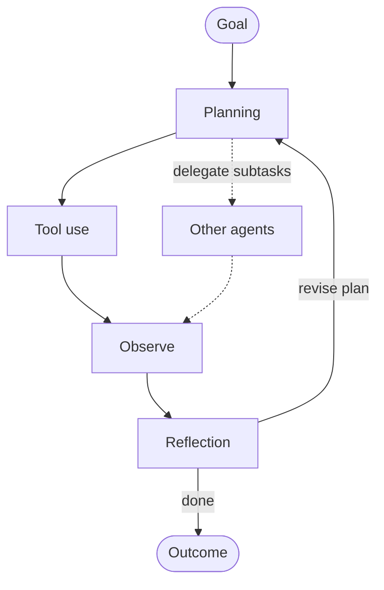

# Agentic AI

> [!abstract] TL;DR
> **Agentic AI** is the paradigm of AI systems that ==pursue goals over multiple steps with limited direct supervision==. They plan, use tools, observe results, and adapt. [[AI Agents]] are the *systems*. "Agentic" is a *property*, and it comes in degrees: ==agency is a spectrum, not a binary==. The engineering question is how much autonomy a task justifies. The governance question is how to keep that autonomy **legible, bounded, interruptible, and accountable**. The four canonical design patterns are **reflection, tool use, planning, and multi-agent collaboration**.

**Prerequisite:** [[Large Language Models]] · [[AI Agents]] (components and the loop)
**Related:** [[Chain-of-Thought and ReAct]] · [[Prompt Chaining for Agentic Reasoning - Study Guide]] · [[Tool Use]] · [[Planning Agents]] · [[Multi-Agent Systems]] · [[AI Memory]] · [[Prompt Injection]] · [[AI Reliability]]

**Sources:** Synthesis note. The progression from LLM to agentic AI and the chain-to-agent spectrum come from the vault's lecture-based notes. The agenticness dimensions, autonomy levels, design patterns, and governance practices are *beyond the lecture* (see [[#Further Reading]]). The autonomy-level table is an **illustrative framework**, not a formal standard.

> [!todo]- Contents
> 1. [[#1. Core Concepts]]
> 2. [[#2. From LLM to Agentic AI]]
> 3. [[#3. Levels of Autonomy]]
> 4. [[#4. The Four Agentic Design Patterns]]
> 5. [[#5. When Is Agency Worth It]]
> 6. [[#6. Governance and Safety]]
> 7. [[#7. Worked Example – Choosing the Autonomy Level]]
> 8. [[#8. Pitfalls and Failure Modes]]
> 9. [[#9. Key Takeaways]]
> 10. [[#10. Critical Analysis]]
> 11. [[#11. Self-Test]]
> 12. [[#12. Glossary]]

---

## 1. Core Concepts

> [!info]+ Definition – Agentic AI
> AI systems that **autonomously pursue goals** over multi-step tasks. They decompose the goal, take actions through tools, observe the outcomes, and adapt their plan, with the model directing a meaningful part of the control flow.

^def-agentic-ai

> [!info]+ Definition – Agenticness
> The *degree* to which a system can **adaptably achieve complex goals in complex environments with limited direct supervision** (after Shavit et al., 2023). It's a matter of degree along several dimensions, not a yes/no label.

^def-agenticness

| Dimension | Low agenticness | High agenticness |
|---|---|---|
| **Goal complexity** | Single, well-specified output | Open-ended, multi-part objectives |
| **Environment complexity** | Static input text | Live systems, many tools, other agents |
| **Independence** | Human approves every step | Runs for hours with sparse check-ins |
| **Adaptability** | Fixed sequence | Re-plans after surprises and errors |
| **Action impact** | Read-only, text output | Writes, spends money, affects people |

> [!tip] AI Agents vs. Agentic AI
> [[AI Agents]] = *what it's made of* (model, tools, memory, loop). Agentic AI = *how much autonomy it exercises, and when and how to govern it*.

---

## 2. From LLM to Agentic AI

The progression from the CoT/ReAct note:

![[Chain-of-Thought and ReAct#Key Concept]]

Each step adds a capability that addresses an LLM limitation ([[Large Language Models#^limits-to-scaffolding]]):

| Step | Adds | Addresses |
|---|---|---|
| CoT | Intermediate reasoning | One-shot jumps to conclusions |
| RAG | External knowledge | Knowledge cutoff, private data |
| ReAct | Actions plus observations in a loop | Can't verify against, or act on, the world |
| Agentic AI | Planning, memory, adaptation, multi-agent coordination | Long-horizon, open-ended goals |

---

## 3. Levels of Autonomy

An *illustrative* ladder that lines up with the chain-to-agent spectrum in [[Prompt Chaining for Agentic Reasoning - Study Guide#3. The Spectrum – Chain to Agent]]:

| Level | Name | Who decides the next step | Human role | Example |
|---|---|---|---|---|
| **L0** | Single call | n/a | Uses the output | Summarize a document |
| **L1** | Fixed chain | Code | Designs the pipeline | Extract → validate → format |
| **L2** | Routed workflow | Code, with LLM branching | Designs the branches | Ticket router → specialist chains |
| **L3** | Supervised agent | LLM, with approval on key actions | Approves plans or high-risk actions | Coding agent that opens PRs for review |
| **L4** | Bounded autonomous agent | LLM, within hard limits | Monitors; handles escalations | Refund agent under a dollar cap ([[AI Agents#6. Worked Example – Refund Agent]]) |
| **L5** | Open-ended autonomy | LLM(s), which set sub-goals themselves | Sets high-level objectives only | Multi-day research or operations agents (still experimental) |

^autonomy-levels

> [!important] Design principle
> ==Grant the minimum autonomy that solves the task.== Each level adds flexibility and also adds cost, variance, attack surface, and evaluation difficulty ([[Prompt Chaining for Agentic Reasoning - Study Guide#^design-principle]]).

---

## 4. The Four Agentic Design Patterns

A widely used framing, popularized by Andrew Ng in 2024:

| Pattern | Idea | Where it's covered in the vault |
|---|---|---|
| **Reflection** | The model critiques and revises its own output or trajectory | [[Prompt Chaining for Agentic Reasoning - Study Guide#4.7 Evaluator–Optimizer (Reflection)]] |
| **Tool use** | The model calls external functions for data and actions | [[Tool Use]], [[Tool Descriptions in Agentic Systems]] |
| **Planning** | The model decomposes goals into steps and re-plans | [[Planning Agents]], [[Tree-of-Thought]], [[Prompt Chaining for Agentic Reasoning - Study Guide#4.8 Plan-and-Execute]] |
| **Multi-agent collaboration** | Specialized agents coordinate (orchestrator–workers, debate, handoffs) | [[Multi-Agent Systems]] |

^four-patterns

Supporting capabilities: **memory** ([[AI Memory]]), **retrieval** ([[Retrieval-Augmented Generation]]), and **standardized tool access** ([[Model Context Protocol]]).

---

## 5. When Is Agency Worth It

| Favors more agency | Favors less agency (workflow/chain) |
|---|---|
| Steps can't be known in advance | Steps are known and stable |
| Open-ended exploration (research, debugging) | High-volume, repetitive processing |
| Feedback is verifiable (tests pass, query returns rows) | Success is hard to verify automatically |
| Errors are cheap and reversible | Errors are costly or irreversible |
| Latency and cost are secondary | Tight latency or cost budgets |
| A human reviews the final outcome | No review before impact |

^when-agency

> [!example] Expected-value framing
> Autonomy pays off when $\text{value of tasks solved} - \text{cost of runs} - \text{expected cost of errors}$ exceeds the same quantity for the simpler design.
> With error rate $e$ and cost per error $C_e$, the error term is $e \cdot C_e$ per task. For an irreversible action with $C_e = 10{,}000$ dollars, even $e = 0.5\%$ adds **50 dollars of expected loss per task**. That usually justifies a human approval step, which costs far less.

---

## 6. Governance and Safety

Practices for keeping agentic systems safe and accountable, adapted from *Practices for Governing Agentic AI Systems* (Shavit et al., 2023):

| Practice | What it means in engineering terms |
|---|---|
| **Evaluate suitability** | Test the agent on the actual task distribution before granting autonomy |
| **Constrain the action space** | Least-privilege tools and credentials; approval for high-impact actions |
| **Set default behaviors** | E.g. ask for clarification when a request is ambiguous; prefer reversible actions |
| **Legibility** | Log the reasoning, actions, and tool arguments so humans can inspect them |
| **Automatic monitoring** | A second system (rules or an LLM) watches for policy violations and anomalies |
| **Attributability** | Know which agent and which principal is responsible for each action |
| **Interruptibility** | A kill switch that stops the agent cleanly at any point, with a graceful fallback |

^governance-practices

> [!danger] Security multiplies with autonomy
> Higher autonomy means more untrusted content read, more tools, and fewer human checkpoints, so ==prompt-injection impact scales with agency==. Check every agentic design against the [[Prompt Injection#^lethal-trifecta|lethal trifecta]].

> [!info] Capability trend (reported, beyond the lecture)
> METR (2025) measured the length of tasks, in human-expert time, that frontier agents complete with 50% reliability. They reported that this horizon has been **doubling roughly every 7 months**. If the trend holds, the autonomy levels in [[#^autonomy-levels]] will shift, and governance needs to keep pace. It's a reported trend, not a law. Scrutinize the task selection and the 50% threshold.

---

## 7. Worked Example – Choosing the Autonomy Level

| Use case | Chosen level | Why |
|---|---|---|
| Extract fields from 10k invoices/day | **L1 fixed chain** | Steps known; high volume; verifiable with schema checks; an agent adds cost and variance for nothing |
| Customer support triage | **L2 routed workflow** + L3 agent for complex tickets | Most tickets fit known categories; exceptions need flexible handling |
| Competitive-landscape research report | **L3 supervised agent** | Open-ended search; errors are reversible; a human reviews the final report |
| Production database migrations | **L3 with strict gates**, never L4 | Irreversible, high impact: the agent proposes, a human approves every write |
| Nightly log triage with auto-ticketing | **L4 bounded** | Low-impact actions (create ticket), verifiable, sandboxed, monitored |

> [!success] Pattern
> The chosen level follows from **reversibility, verifiability, volume, and step predictability** ([[#^when-agency]]), not from what's technically possible.

---

## 8. Pitfalls and Failure Modes

| Failure | Symptom | Mitigation |
|---|---|---|
| **Over-autonomy** | Agent used where a chain would do; high cost and variance | Start at the lowest level; escalate only with eval evidence |
| **Under-specified goals** | Agent optimizes the wrong thing (specification gaming) | Explicit success criteria and constraints; plan review |
| **Illegible behavior** | No one can explain what happened | Structured logs and traces ([[#^governance-practices]]) |
| **Accountability gaps** | "The agent did it" | Attributability; named human owners |
| **Approval fatigue** | Humans rubber-stamp | Risk-based gating; clear action previews |
| **Compounding errors on long horizons** | Plausible but wrong end states | Verification steps, checkpoints, re-planning ([[AI Reliability]]) |
| **Agent-washing** | Workflows sold as "autonomous agents" | Ask: who decides the next step? |
| **Security blind spots** | Injection through tools and content | [[Prompt Injection#4. Defenses – Defense in Depth]] |

---

## 9. Key Takeaways

- [ ] Agentic AI = goal-directed, multi-step, adaptive AI with limited supervision. **Agency is a spectrum.**
- [ ] Agenticness dimensions: goal complexity, environment complexity, independence, adaptability, action impact.
- [ ] Four patterns: **reflection, tool use, planning, multi-agent collaboration**.
- [ ] Grant the **minimum autonomy** the task needs, based on reversibility, verifiability, volume, and predictability.
- [ ] Governance: suitability evals, constrained actions, defaults, legibility, monitoring, attributability, interruptibility.
- [ ] Injection risk and evaluation difficulty grow with autonomy.

---

## 10. Critical Analysis

- **Hype vs. deployed reality.** Most production "agentic" systems today sit at L1–L3. Fully open-ended autonomy (L5) is mostly research and demos. Claims should be checked against *reliability at a stated cost* on *realistic tasks*.
- **Evidence quality.** Much of the agentic-AI discourse comes from vendor blogs and demos. Peer-reviewed evaluations are fewer, and they often show a big gap between benchmark and real-world performance (see [[AI Agents#9. Critical Analysis]]). Capability-trend claims (like METR's doubling) depend on task-suite design.
- **Economics.** Agentic runs cost more per task than workflows ([[AI Agents#^agent-cost-model]]). The case for agents rests on tasks that are *impossible* for workflows, not on tasks that are merely more convenient.
- **At scale.** Multi-agent systems add new failure classes: coordination errors, agents amplifying each other's mistakes, and injection spreading between agents. Monitoring has to work at the system level, not per agent.
- **Governance and ethics.** Delegated action raises questions of liability, consent (acting on behalf of users toward third parties), and labor displacement. The practices in [[#6. Governance and Safety]] are necessary but not sufficient. Regulatory frameworks are still forming.

> [!question] Open questions
> 1. What evidence should be required before moving a system from L3 to L4?
> 2. How do you evaluate an agent whose correct trajectories are highly varied?
> 3. Who is accountable when an agent acting within its permissions causes harm?

---

## 11. Self-Test

> [!question]- Q1. How does "agentic AI" differ from "AI agent"?
> An AI agent is a *system* (model plus tools plus memory plus loop). Agentic AI is the *paradigm and property*: the degree of autonomous, goal-directed, adaptive behavior, and how to design and govern it.

> [!question]- Q2. Name the four agentic design patterns.
> Reflection, tool use, planning, multi-agent collaboration.

> [!question]- Q3. Name four factors that decide how much autonomy to grant.
> Step predictability, reversibility and cost of errors, verifiability of outcomes, volume and latency/cost constraints (and whether a human reviews the outcome).

> [!question]- Q4. Quantitative: an agent takes irreversible actions with a 1% error rate, and each error costs 2,000 dollars. A human review costs 5 dollars per task and catches 90% of errors. Is review worth it?
> Without review, the expected loss is $0.01 \times 2{,}000 = \$20$ per task. With review: $5 + 0.01 \times 0.1 \times 2{,}000 = 5 + 2 = \$7$ per task. Review saves about **13 dollars per task**, so it's worth it.

> [!question]- Q5. Design: which autonomy level for an agent that manages cloud-cost optimization (shutting down idle resources)? Justify.
> L3 at first, or L4 limited to reversible actions only. Shutting down resources can be disruptive, so: the agent proposes, a human approves deletions; auto-execute only reversible actions (e.g. stopping, not deleting) on tagged non-production resources; log everything; provide a kill switch. Move up only after the evals and incident history support it.

> [!question]- Q6. Name four governance practices for agentic systems.
> Evaluate suitability, constrain the action space / require approval, set default behaviors, legibility, automatic monitoring, attributability, interruptibility (any four).

### Flashcards
> [!tip] Spaced repetition deck
> The flashcards for this note are in [[Agentic AI - Flashcards]]. Review them with the **Review flashcards** ribbon icon (or the command palette → *Spaced Repetition: Review flashcards*).

---

## 12. Glossary

| Term | Definition |
|---|---|
| **Agenticness** | The degree to which a system achieves complex goals adaptively with limited supervision |
| **Autonomy level** | How much of the control flow and which actions are delegated to the model |
| **Specification gaming** | Optimizing the literal objective in unintended ways |
| **Legibility** | The ability of humans to inspect and understand agent behavior |
| **Interruptibility** | The ability to stop an agent safely at any time |
| **Attributability** | Tracing each action to a responsible agent and principal |
| **Time horizon** | The length of tasks (in human time) an agent can complete at a given reliability |

---

## Further Reading
- [Building Effective Agents](https://www.anthropic.com/engineering/building-effective-agents), Anthropic
- [Practices for Governing Agentic AI Systems](https://openai.com/index/practices-for-governing-agentic-ai-systems/), Shavit et al. (OpenAI), 2023
- [Measuring AI Ability to Complete Long Tasks](https://arxiv.org/abs/2503.14499), METR, 2025
- [A Survey on Large Language Model based Autonomous Agents](https://arxiv.org/abs/2308.11432), Wang et al., 2023
- [AI Agents That Matter](https://arxiv.org/abs/2407.01502), Kapoor et al., 2024
- [Artificial Intelligence: A Modern Approach](https://aima.cs.berkeley.edu/), Russell & Norvig

%% Study hint: for any "design an agentic system" exam question, answer in order: autonomy level → patterns used → tools and permissions → governance practices → evals. %%
