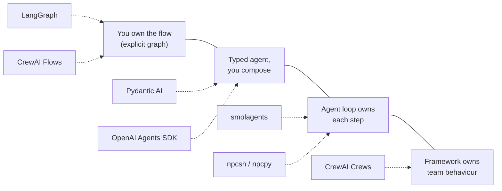

# Agentic Frameworks Compared

> [!abstract] TL;DR
> This note compares six Python agent frameworks against the concepts in this vault: **smolagents**, **Pydantic AI**, **npcsh / npcpy**, **LangGraph**, **CrewAI**, and the **OpenAI Agents SDK**. They sit at different points on one axis: ==how much control flow the framework owns versus how much you own==. smolagents is minimal and code-first. Pydantic AI is typed and production-oriented. npcsh is a shell-first agent environment. LangGraph is an explicit state machine. CrewAI is role-based teams. The OpenAI Agents SDK is a lightweight handoff and guardrail runtime. None removes the need for the course fundamentals: typed handoffs, owned state, enforced limits, and evaluation.

**Builds on:** [[Smolagents Framework]] · [[Multi-Agent Systems Skills Scorecard - Study Guide]] · [[Pydantic for Structured LLM Output - Study Guide]]
**Related:** [[Runtime or Orchestration Layer]] · [[State Management in Multi-Agent Systems]] · [[Multi-Agent State Coordination]] · [[Model Context Protocol]]

> [!warning] Snapshot, 2026-10-11
> Versions and feature claims below were checked on 2026-10-11 against PyPI and each project's official README or docs (see [[#Sources]]). These frameworks release every week or two, so re-check before relying on a detail. Claims that come only from third-party reviews are marked *(third-party)*. My own assessments are marked *(assessment)*.

> [!todo]- Contents
> - [[#1. The Frameworks at a Glance]]
> - [[#2. The Control Spectrum]]
> - [[#3. Mapped to the Course Concepts]]
> - [[#4. SWOT – smolagents]]
> - [[#5. SWOT – Pydantic AI]]
> - [[#6. SWOT – npcsh and npcpy]]
> - [[#7. SWOT – LangGraph]]
> - [[#8. SWOT – CrewAI]]
> - [[#9. SWOT – OpenAI Agents SDK]]
> - [[#10. Python Environment Considerations]]
> - [[#11. The Course Exercises Through Each Framework]]
> - [[#12. Choosing a Framework]]
> - [[#13. Critical Analysis]]
> - [[#Sources]]

## 1. The Frameworks at a Glance

| Framework | Maintainer | Latest (PyPI, 2026-10-11) | Python | Core abstraction | License |
|---|---|---|---|---|---|
| **smolagents** | Hugging Face | 1.26.0 (2026-05-29) | ≥ 3.10 | `CodeAgent` / `ToolCallingAgent` loop | Apache-2.0 |
| **Pydantic AI** | Pydantic | 2.55.0 | **≥ 3.11** | Typed `Agent` + capabilities | MIT |
| **npcsh / npcpy** | NPC-Worldwide | npcsh 2.1.1 (PyPI); npcpy 2.1.24 | ≥ 3.10 | NPCs (YAML/Markdown agents) + Jinx templates, in a shell | MIT |
| **LangGraph** | LangChain | 1.2.14 | ≥ 3.10 | Graph of nodes over a typed shared state | MIT |
| **CrewAI** | CrewAI Inc. | 1.15.27 | **≥ 3.10, < 3.14** | Role-based Crews + Flows | MIT |
| **OpenAI Agents SDK** | OpenAI | **0.23.1** | ≥ 3.10 | Agents + handoffs + guardrails | MIT |

*Licenses are from the projects' repos as I know them; verify before redistributing.*

**Also notable, not analysed here:** Microsoft Agent Framework reached 1.0 GA in April 2026 as the successor to AutoGen and Semantic Kernel, with Python and .NET SDKs. Google's ADK is another option.

## 2. The Control Spectrum

The most useful lens from the course is **who owns the control flow** ([[Runtime or Orchestration Layer#3. Where Control Lives – Chain to Agent]]):

*(assessment)* Moving right gives you faster prototypes but less determinism, and makes debugging harder. Moving left gives you auditability, at the cost of more code. The course's recurring advice ("[[Orchestrating Agent Activities#8. Critical Analysis|use code when the flow is known]]", "[[Penguin and Scientist Agents#5. Takeaways|LLM proposes, code disposes]]") pushes production systems leftward.

## 3. Mapped to the Course Concepts

How each framework supports the concepts the course taught (✅ first-class, 🟡 possible with your own code or add-ons, ❌ not provided):

| Course concept | smolagents | Pydantic AI | npcsh/npcpy | LangGraph | CrewAI | OpenAI SDK |
|---|---|---|---|---|---|---|
| Tool definitions from docstrings and types ([[Tool Descriptions in Agentic Systems]]) | ✅ `@tool` | ✅ validated args | ✅ Jinx templates + Python tools | ✅ via LangChain tools | ✅ | ✅ function tools |
| Typed or validated outputs ([[Structured Outputs]]) | 🟡 | ✅ core design | 🟡 `format=` JSON or Pydantic schema | 🟡 via the model layer | ✅ Pydantic task outputs | ✅ output types |
| Sequential, parallel, conditional ([[Orchestrating Agent Activities#3. The Three Execution Patterns]]) | 🟡 in your Python | 🟡 + Pydantic Graph (separate package) | 🟡 team orchestration | ✅ edges, fan-out, conditional edges | ✅ Flows | 🟡 handoffs + your code |
| Routing ([[Routing and Data Flow in Agentic Systems]]) | 🟡 manager agent | 🟡 delegation | ✅ coordinator NPC routes to team | ✅ conditional edges | ✅ hierarchical process / Flows router | ✅ handoffs |
| Multi-agent hierarchy ([[Orchestrator-Workers Workflow]]) | ✅ multi-agent hierarchies | ✅ sub-agents via the Harness | ✅ teams, a coordinator NPC | ✅ supervisor / subgraphs | ✅ core | ✅ handoffs, agents-as-tools |
| Durable state and resume ([[State Management in Multi-Agent Systems]]) | ❌ | ✅ Temporal, DBOS, Prefect, Restate, … | 🟡 | ✅ checkpointers | 🟡 Flow state persistence | 🟡 sessions |
| Long-term memory ([[Long-Term Agent Memory]]) | ❌ | 🟡 Harness memory capability | ✅ knowledge-graph memory in npcpy | 🟡 store API | ✅ built-in memory | 🟡 sessions |
| Human-in-the-loop ([[Gate Checks]]) | 🟡 | ✅ tool approval | 🟡 approve-before-run mode | ✅ interrupts | 🟡 human input | 🟡 |
| MCP tools ([[Model Context Protocol]]) | ✅ | ✅ | ✅ (npcpy, configured per team) | ✅ via adapters | ✅ | ✅ |
| Sandboxed code execution | ✅ E2B, Blaxel, Modal, Docker | 🟡 | ❌ code agent auto-executes | ❌ | 🟡 | ✅ native sandbox (2026 update) |
| Observability | 🟡 OpenTelemetry instrumentation | ✅ OTel + Logfire | 🟡 | ✅ LangSmith (commercial) | 🟡 | ✅ built-in tracing |
| Evals ([[Agent Evaluation]]) | ❌ | ✅ Pydantic Evals (separate package) | ❌ (shell benchmark suite) | 🟡 LangSmith | 🟡 | 🟡 |
| Local models (Ollama etc.) | ✅ | ✅ | ✅ first-class | ✅ | ✅ | 🟡 via LiteLLM/compatible |

*(assessment)* Some 🟡/✅ cells come from my knowledge of these libraries rather than from the 2026-10-11 snapshot. Verify any single cell before depending on it.

## 4. SWOT – smolagents

The framework used throughout Course 4 ([[Smolagents Framework]]).

| | |
|---|---|
| **Strengths** | Tiny, readable core; easy to learn and to read the source. Two agent styles: code-writing (`CodeAgent`) and JSON tool calls (`ToolCallingAgent`). Broad model support (transformers, Ollama, Hugging Face providers, LiteLLM, OpenAI-compatible, Azure, Bedrock). Managed sandboxes (E2B, Blaxel, Modal) plus self-hosted Docker. MCP, LangChain and Hub tools. Agents and tools shareable on the Hub. Large community (~30k GitHub stars) |
| **Weaknesses** | No durable state, checkpointing or resume. The agent's memory is an in-process step list. Getting structured decisions out meant **digging through step logs**, as both exercises did ([[Penguin and Scientist Agents#2. The Two Agents]], [[Skate Park Orchestration#2. Patterns Carried Over From Earlier Notes]]). No built-in evals or HITL gates. Agents can loop until the step cap, e.g. the classifier that burned 62% of tokens ([[Skate Park Orchestration#^diagnoser-loop]]). The local executor is explicitly **not a security sandbox** |
| **Opportunities** | Code agents for multi-step tool composition. Hub sharing for teaching and demos. Pair it with Pydantic models for validation at the boundaries |
| **Threats** | Security: the 1.25.0 release (May 2026) fixed a high-impact remote-executor vulnerability, and 1.26.0 removed the remote Wasm executor. Release cadence slowed: no PyPI release between 2026-05-29 and this snapshot *(assessment: watch, not alarm)*. Heavier frameworks are absorbing its niche |

## 5. SWOT – Pydantic AI

The agent framework from the team behind the validation library in [[Pydantic for Structured LLM Output - Study Guide]].

| | |
|---|---|
| **Strengths** | **Typed end to end:** validated outputs, validated tool arguments, and dependency injection via `RunContext`. This turns "LLM proposes, code disposes" into types. Many model providers, switched by string. **Capabilities** bundle tools, instructions, hooks and settings into reusable units. **Durable execution** on Temporal, DBOS, Prefect, Restate, AWS Lambda and others. HITL tool approval. OTel observability with Logfire. Pydantic Evals and Pydantic Graph as companion packages. MCP and web search built in |
| **Weaknesses** | Requires **Python ≥ 3.11**. Fast-moving: already at major version 2 with 50+ minor releases (2.55.0), so pin versions. Multi-agent orchestration is less opinionated than CrewAI's or LangGraph's: you compose agents yourself or reach for the separate Graph package. No code-writing agent style like smolagents' |
| **Opportunities** | The best fit for the course's typed-handoff advice ([[Routing and Data Flow in Agentic Systems#4. Data Flow Management]]). Durable backends answer the "resume after crash" problem from [[State Management in Multi-Agent Systems#8. Critical Analysis]]. Evals support the per-layer testing the course kept recommending |
| **Threats** | API churn as the 2.x surface expands. The commercial Logfire and Gateway products may shape the roadmap *(assessment)*. Third-party sources disagree on the 2.x release timeline, so read the official changelog rather than blog summaries |

## 6. SWOT – npcsh and npcpy

**npcsh** is "the composable multi-agent shell": bash and natural language in one terminal, with agents (NPCs) defined as files. **npcpy** is the Python library behind it, and is what you'd import in a Python project.

| | |
|---|---|
| **Strengths** | **Agents as files:** `.npc` YAML, an `agents.md`, or an `agents/` folder inside an `npc_team/` directory. That makes them versionable and readable, like personas in Course 1. **Jinxes** (Jinja Execution templates) define tools, prompts and skills. A team coordinator ("forenpc") delegates to teammates, which is the orchestrator pattern out of the box. **Local-first:** Ollama, LM Studio, llama.cpp, MLX, plus LiteLLM providers. npcpy adds knowledge-graph memory (incremental growth, "sleep" consolidation, hybrid search), parallel NPC arrays, MCP, structured output via `format=` (JSON or a Pydantic schema), and fine-tuning (SFT, DPO, diffusion). The shell auto-detects bash vs natural language and can run Claude Code, Codex or Gemini CLI as team members. A published 100-task shell benchmark across models |
| **Weaknesses** | **Small community:** ~490 GitHub stars, so a high bus factor and fewer answered questions *(assessment)*. **Architecture in transition:** npcsh is now installed as **Rust binaries** (install script or `cargo`), and it spawns npcpy as a local Python server. The README calls that Python dependency temporary. PyPI's `npcsh` (2.1.1) lags the versions the README benchmarks (v2.1.5 and v2.1.7). The `CodingAgent` **auto-executes generated code**, with no sandbox mentioned. Shell-first design makes it less natural to embed in a web service than a library-first framework *(assessment)* |
| **Opportunities** | Personal and ops automation in the terminal (e.g. a NOC engineer's shell). Experimenting with local models and fine-tuning in one toolkit. Its knowledge-graph memory is a hands-on way to explore [[Long-Term Agent Memory]] and [[Knowledge Graphs]] |
| **Threats** | Moving from Python to Rust may break Python-centric workflows. Feature breadth (agents, KGs, fine-tuning, image and video generation) can outpace documentation and tests *(assessment)*. Running agents with shell access without isolation is risky ([[Prompt Injection]]) |

> [!tip] npcsh vs npcpy in a Python environment
> In a notebook or app, `pip install npcpy` and use its `NPC` and `Team` classes. Install **npcsh** separately, through its install script or `cargo`, when you want the interactive shell. Don't expect `pip install npcsh` alone to give you the current shell.

## 7. SWOT – LangGraph

| | |
|---|---|
| **Strengths** | Explicitly models an agent as a **state machine over a typed shared state**, the exact model from [[Agent State Management#3. Agents as State Machines]] and [[Implementing Agent State Management with Python]]. Checkpointing (durable state, resume, time travel), HITL interrupts, and parallel and conditional edges, which map cleanly onto [[Orchestrating Agent Activities#3. The Three Execution Patterns]]. 1.x **LTS policy**: no breaking changes within 1.x, and at least a year of maintenance after 2.0 |
| **Weaknesses** | More boilerplate and steeper learning curve than smolagents. Coupled to the LangChain ecosystem. The best observability (LangSmith) is commercial *(assessment)* |
| **Opportunities** | The natural home for the course's production advice: deterministic routing in edges, re-verification before writes ([[Multi-Agent State Coordination#^re-verification]]), and checkpointed workflows |
| **Threats** | Abstraction fatigue with LangChain layers. Simpler typed frameworks compete for the "just an agent" use case *(assessment)* |

## 8. SWOT – CrewAI

| | |
|---|---|
| **Strengths** | The **role-based team** metaphor (agents with role, goal and backstory, plus tasks and a process) maps directly onto the course's restaurant and hospital analogies. It is often called the fastest way to prototype a multi-agent system *(third-party)*. **Flows** add deterministic ordering and state alongside autonomous **Crews**. Built-in memory. Large community |
| **Weaknesses** | **Python capped below 3.14** (`>=3.10,<3.14`). Debugging opacity: it's hard to tell whether a failure came from the model, the prompt or the data *(third-party)*. Token-heavy multi-agent runs, estimated at 8k–25k tokens per task for a 4-agent workflow *(third-party)*. A history of breaking changes *(third-party)*. Reported problems with hierarchical delegation *(third-party)* |
| **Opportunities** | Business-process automation where the work truly splits into roles. Flows for the deterministic backbone, Crews for the judgement steps |
| **Threats** | Several 2026 CVEs were reported and patched *(third-party; verify against advisories)*. Cost surprises at scale. The role abstraction is a poor fit for work that doesn't decompose into roles *(third-party)* |

## 9. SWOT – OpenAI Agents SDK

| | |
|---|---|
| **Strengths** | A small set of primitives: agents, **handoffs** (routing between agents), **guardrails** (input and output checks), sessions, and built-in tracing. The April 2026 update added a **model-native harness** for working across files and tools, plus **native sandboxed execution**, available in Python first |
| **Weaknesses** | Still **0.x** (0.23.1), so expect API changes. OpenAI-centric defaults: other models work through compatible endpoints or LiteLLM, but OpenAI models get the most attention *(assessment)*. Limited durable workflow support compared with LangGraph or Pydantic AI's backends |
| **Opportunities** | Teams already on OpenAI models who want handoffs, guardrails and sandboxed code with little ceremony |
| **Threats** | Vendor lock-in through tracing, hosted tools and harness features *(assessment)*. Rapid change in OpenAI's surrounding APIs |

## 10. Python Environment Considerations

| Concern | Guidance |
|---|---|
| **Python version** | Your course notebooks run Python 3.12, which all six support. Pydantic AI needs ≥ 3.11. CrewAI excludes 3.14, so check before upgrading the interpreter |
| **Isolation** | Give each framework its **own virtual environment**. They pull large, overlapping dependency trees (LLM SDKs, Pydantic, OpenTelemetry), and version clashes are common *(assessment)* |
| **Pinning** | Pin exact versions in `requirements.txt`. Pydantic AI (2.55 minor releases), smolagents (fortnightly releases) and the 0.x OpenAI SDK all move quickly |
| **Notebooks** | All work in Jupyter. Async-first APIs (Pydantic AI, OpenAI SDK, LangGraph) need `await` in cells, which Jupyter supports at the top level |
| **Local models** | npcpy and smolagents treat Ollama as first-class. Pydantic AI, LangGraph and CrewAI also connect to Ollama or OpenAI-compatible servers |
| **Non-Python pieces** | npcsh is now a Rust binary with a Python backend. smolagents sandboxes need Docker or a cloud account (E2B, Modal, Blaxel). Pydantic AI durable execution needs a backend such as a Temporal server or DBOS with Postgres |
| **Secrets** | Every framework reads API keys from the environment. Keep them in `.env` files outside notes and version control, as the course code did with `dotenv` |

## 11. The Course Exercises Through Each Framework

*(assessment)* How the problems found in this vault's exercise reviews would play out in each framework:

| Problem found | Where | Framework feature that helps |
|---|---|---|
| Decisions dug out of step logs | [[Penguin and Scientist Agents]], [[Skate Park Orchestration]] | Typed outputs: **Pydantic AI** output types, **CrewAI** Pydantic task outputs, **OpenAI SDK** output types |
| A classifier loop wasting 62% of tokens | [[Skate Park Orchestration#^diagnoser-loop]] | A single typed call instead of an agent loop (**Pydantic AI**), or a deterministic classify node (**LangGraph**) |
| Routing that lives only in a prompt | [[Skate Park Orchestration#^soft-routing]] | Conditional edges (**LangGraph**), Flows routers (**CrewAI**), handoffs with guardrails (**OpenAI SDK**) |
| History records intent, not outcome | [[Penguin and Scientist Agents#4. Issues in the Starter]] | Not solved by any framework. It's a design choice: write state after the action is confirmed |
| No resume after a crash | [[State Management in Multi-Agent Systems#8. Critical Analysis]] | Checkpointers (**LangGraph**), durable backends (**Pydantic AI**) |
| Lost updates on shared records | [[Multi-Agent State Coordination#3.3 Optimistic concurrency control]] | Not solved by any framework. It belongs in the database layer (versions, transactions) |
| Code executing without isolation | [[Smolagents Framework#3. The ToolCallingAgent Loop]] (code agent) | Managed sandboxes (**smolagents**), native sandbox (**OpenAI SDK**). Avoid auto-execution (**npcpy** `CodingAgent`) without isolation |

The last two rows matter most: ==frameworks package the agent loop, not your consistency guarantees==.

## 12. Choosing a Framework

| If you need… | Start with | Why |
|---|---|---|
| To learn agent mechanics, or a small demo | **smolagents** | Readable core; matches the course |
| Typed, validated agents in a production Python service | **Pydantic AI** | Typed I/O, durable execution, evals, observability |
| A terminal-native agent team on local models | **npcsh** (with **npcpy** for scripting) | Agents as files, shell integration, local-first |
| Explicit, auditable, resumable workflows | **LangGraph** | State machine plus checkpoints, LTS |
| A quick role-based team prototype | **CrewAI** | The role, goal and task metaphor; Flows for structure |
| OpenAI-model agents with handoffs, guardrails and a sandbox | **OpenAI Agents SDK** | A small set of primitives, native sandbox |

## 13. Critical Analysis

**Frameworks converge.** By late 2026, every major framework offers MCP, multi-agent delegation, tracing and some form of persistence. The real differences are the **default control model** ([[#2. The Control Spectrum]]) and **maturity guarantees** (LangGraph's LTS policy versus 0.x and fast-moving 2.x lines).

**Lock-in is mostly in the edges.** Tool functions and prompts port easily between frameworks. Checkpoint formats, tracing backends, hosted tools and durable-execution integrations don't *(assessment)*. Keep business logic in plain Python modules, and let the framework call them.

**Maturity signals to check.** For any framework: release cadence, open security advisories, a stated stability or LTS policy, issue response times, and whether its Python version window fits your environment. On these, npcsh is the riskiest choice for production, LangGraph the most conservative, and Pydantic AI the strongest typed middle ground *(assessment)*.

**Evaluation is still your job.** Only Pydantic AI ships an evals package, and LangGraph's best tooling is commercial. The per-layer evaluation plans in [[Multi-Agent RAG#8. Critical Analysis]] and [[Routing and Data Flow in Agentic Systems#8. Critical Analysis]] apply whichever framework you choose.

**Security posture differs sharply.** Frameworks that execute model-written code (smolagents `CodeAgent`, npcpy `CodingAgent`, the OpenAI harness) need real sandboxes. smolagents' own README says its local executor isn't one. Tool-only frameworks still need least-privilege tools and gates ([[Gate Checks]], [[Prompt Injection]]).

> [!question] Open discussion questions
> - Would you rebuild the Course 4 project in Pydantic AI, LangGraph, or keep smolagents, and what would you gain or lose?
> - Is a shell-first agent environment like npcsh a better fit for operations work than a library-first one?
> - How much framework lock-in is acceptable in exchange for durable execution?

## Sources

Checked 2026-10-11:

- PyPI: [smolagents](https://pypi.org/project/smolagents/) · [pydantic-ai](https://pypi.org/project/pydantic-ai/) · [npcsh](https://pypi.org/project/npcsh/) · [npcpy](https://pypi.org/project/npcpy/) · [langgraph](https://pypi.org/project/langgraph/) · [crewai](https://pypi.org/project/crewai/) · [openai-agents](https://pypi.org/project/openai-agents/)
- [smolagents – GitHub README](https://github.com/huggingface/smolagents) · [smolagents release index](https://releases.sh/hugging-face/smolagents)
- [Pydantic AI – GitHub README](https://github.com/pydantic/pydantic-ai) · [Pydantic AI docs](https://ai.pydantic.dev/) · [Pydantic AI v1 announcement](https://pydantic.dev/articles/pydantic-ai-v1) · [Pydantic AI releases](https://github.com/pydantic/pydantic-ai/releases)
- [npcsh – GitHub README](https://github.com/NPC-Worldwide/npcsh) · [npcpy – GitHub README](https://github.com/NPC-Worldwide/npcpy) · [npcrs (Rust core)](https://github.com/NPC-Worldwide/npcrs)
- [LangChain release policy](https://docs.langchain.com/oss/python/release-policy) · [LangChain and LangGraph 1.0](https://www.langchain.com/blog/langchain-langgraph-1dot0) · [LangGraph releases](https://github.com/langchain-ai/langgraph/releases)
- [CrewAI – Wikipedia](https://en.wikipedia.org/wiki/CrewAI) · *(third-party)* [Atlan – What is CrewAI](https://atlan.com/know/ai-agent/what-is-crewai/) · [Enterprise DNA – CrewAI in production](https://enterprisedna.co/resources/blog/practitioner-crewai-production) · [aiagentrank – CrewAI review 2026](https://aiagentrank.io/blog/crewai-review-2026)
- [OpenAI – The next evolution of the Agents SDK](https://openai.com/index/the-next-evolution-of-the-agents-sdk/) · [TechCrunch – OpenAI updates its Agents SDK (2026-04-15)](https://techcrunch.com/2026/04/15/openai-updates-its-agents-sdk-to-help-enterprises-build-safer-more-capable-agents/) · [Help Net Security – harness and sandbox update](https://www.helpnetsecurity.com/2026/04/16/openai-agents-sdk-harness-and-sandbox-update/)
- [Microsoft Agent Framework at Build 2026](https://devblogs.microsoft.com/agent-framework/microsoft-agent-framework-at-build-2026-announce/) · [InfoQ – Agent Framework harness GA](https://www.infoq.com/news/2026/08/agent-framework-harness-ga/)

%% Study hint: one sentence per framework. smolagents = readable loop; Pydantic AI = types plus durability; npcsh = agents as files in your shell; LangGraph = explicit state machine; CrewAI = role-play teams; OpenAI SDK = handoffs plus guardrails plus sandbox. %%
