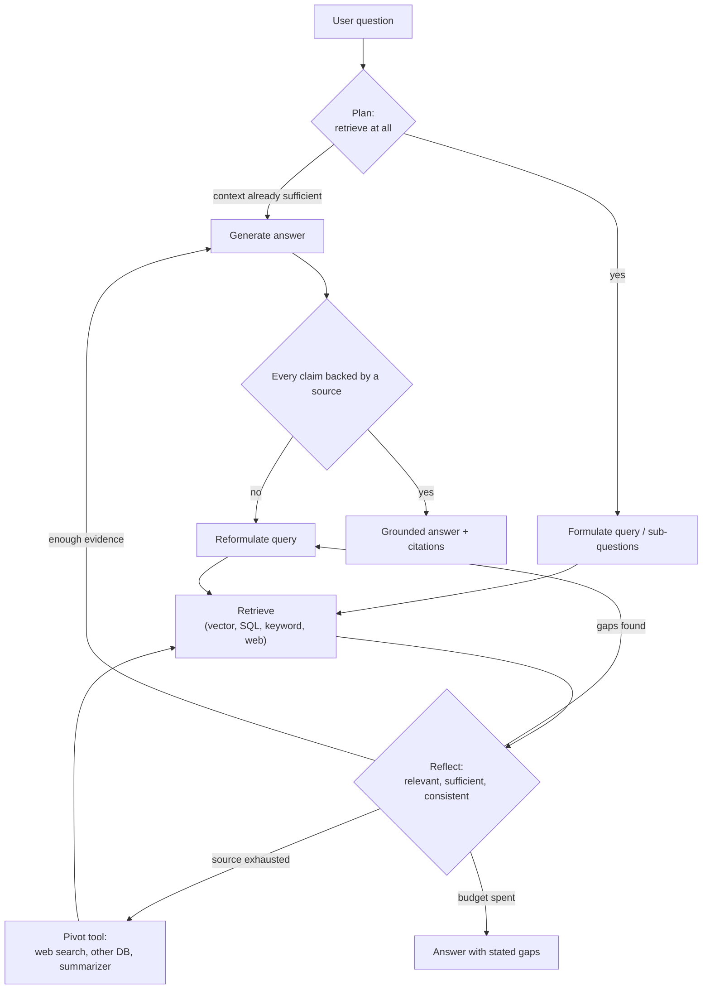
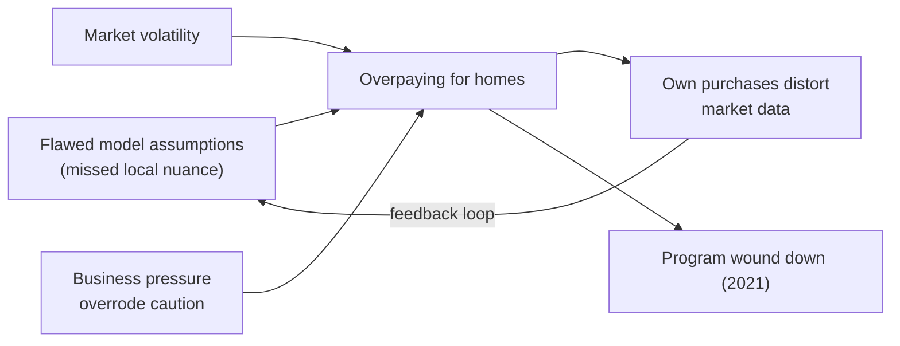

# Agentic RAG

> [!abstract] TL;DR
> Basic RAG is **passive**: take a query, retrieve a few chunks once, summarize them, with no check on whether the chunks were any good. Agentic RAG makes retrieval **part of the agent's reasoning loop**. The agent decides whether and what to retrieve, inspects what came back, notices gaps, reformulates the query, switches tools if needed, and only then answers. ==The core pattern is *retrieve → reflect → retry*: the agent isn't just retrieving, it's thinking about how to retrieve.== The payoff is deeper, better-grounded answers. The cost is extra latency and tokens, and the loop needs stop conditions.

**Prerequisites:** [[Retrieval-Augmented Generation]] · [[Vector Databases]] · [[Agents and Databases]]
**Related:** [[Agent Based RAG]] · [[Web Search and Browsing for AI Agents]] · [[LLM Feedback Loops]] · [[Implementing Agentic Workflows/Evaluator-Optimizer Workflow|Evaluator-Optimizer Workflow]] · [[Implementing Agentic Workflows/Routing Workflow|Routing Workflow]] · [[Planning Agents]] · [[Chain-of-Thought and ReAct]] · [[LLM Evaluation]]

> [!note] Source scope
> Based on the lesson reading "From Passive Lookup to Active Reasoning: Building Agentic RAG" and its video transcript, which cover the same material and the same Zillow Offers case study. This note expands the short section [[Retrieval-Augmented Generation#4. Agentic RAG]]. The state-machine design, retry math, stop conditions, research-paper connections and security analysis are *beyond the lecture* and flagged where they appear. Zillow details are limited to what the lesson states; see its linked resources in [[#Further Reading]] for specifics.

> [!todo]- Contents
> - [[#1. Core Concepts]]
> - [[#2. Passive RAG vs Agentic RAG]]
> - [[#3. The Retrieve–Reflect–Retry Loop]]
> - [[#4. Case Study – Why Did Zillow Offers Fail]]
> - [[#5. Planning – When and What to Retrieve]]
> - [[#6. Inspecting Results – Reflection Heuristics]]
> - [[#7. Retry Strategies and Tool Pivots]]
> - [[#8. Building It – Agentic RAG as a State Machine]]
> - [[#9. The Autonomy Spectrum – Router to Planner]]
> - [[#10. Pitfalls and Failure Modes]]
> - [[#11. Key Takeaways]]
> - [[#12. Critical Analysis]]
> - [[#13. Self-Test]]
> - [[#14. Glossary]]
> - [[#Further Reading]]

---

## 1. Core Concepts

> [!info]+ Definition – Passive (basic) RAG
> A fixed pipeline: query → retrieve top-k chunks once → generate. No assessment of whether the retrieved content is relevant or sufficient, no retry.

^def-passive-rag

> [!info]+ Definition – Agentic RAG
> RAG in which an agent controls retrieval as part of its reasoning: it decides when and what to retrieve, evaluates the results, identifies missing information, reformulates queries, and repeats or changes strategy before answering.

^def-agentic-rag

> [!info]+ Definition – Reflection
> The agent's self-assessment step: comparing what it has retrieved against what the question needs ("what do I know, what's still unclear") to decide whether to answer, retry or pivot.

^def-reflection

> [!info]+ Definition – Query reformulation
> Rewriting a search query after a weak retrieval: making it more specific, extracting keywords, simplifying it, or splitting it into sub-questions.

^def-reformulation

> [!important] The lecture's big shift
> Agentic RAG isn't mainly about new tools. It's about **behavior**: the agent self-monitors. Retrieval stops being a black box and becomes something the agent checks, questions and improves.

---

## 2. Passive RAG vs Agentic RAG

| Dimension | Passive RAG | Agentic RAG |
|---|---|---|
| Retrieval count | Once, always | Zero, one or many, as needed |
| Decides *whether* to retrieve | No (always hits the store) | Yes; may skip if the input already has enough context |
| Inspects results | No; retrieval is a black box | Yes: relevance, coverage, contradictions, staleness |
| Handles gaps | Summarizes whatever came back | Notices what's missing and searches for it |
| Query | User's text as-is | Reformulated, decomposed into sub-questions |
| Sources | One retriever | Can pivot: vector store, SQL, web search, summarizer |
| Output | Surface-level summary of visible text | Layered explanation grounded in targeted evidence |
| Cost / latency | Low, predictable | Higher, variable |

^passive-vs-agentic

> [!quote] Lecture framing
> One agent repeats what's visible. The other asks better questions, refines its retrieval, and builds a real explanation.

---

## 3. The Retrieve–Reflect–Retry Loop



^rrr-loop

The lesson's feedback loop, step by step:

1. **Assess** whether the documents are relevant.
2. **Identify** missing information.
3. **Reformulate** the query if needed.
4. **Repeat** retrieval and adjust strategy before answering.

This is an [[LLM Feedback Loops|LLM feedback loop]] applied to retrieval: the "draft" being improved is the evidence set, and the evaluator is the agent's reflection step ([[Implementing Agentic Workflows/Evaluator-Optimizer Workflow#^eo-loop|evaluator–optimizer loop]]).

---

## 4. Case Study – Why Did Zillow Offers Fail

The lesson's example: a user asks *"Why did Zillow's home-buying algorithm fail?"* Zillow Offers was Zillow's home-buying (iBuying) program, run from 2018 to 2021. The lesson attributes its failure to several factors: flawed algorithmic assumptions, unpredictable market behaviour, and internal business pressures.

### 4.1 The passive RAG answer

| Retrieved doc | Content |
|---|---|
| 1 | Zillow shutting down its iBuying program |
| 2 | Blames housing-market volatility |
| 3 | Public statement from Zillow's CEO about unpredictability |

**Answer:** *"Zillow's algorithm failed due to unpredictable housing market conditions."* Not wrong, but shallow: it repeats the most visible explanation.

### 4.2 The agentic RAG answer

| Step | What the agent does |
|---|---|
| Assess | Same three documents. None explains *what the algorithm was actually doing* |
| Identify gaps | No mention of feedback loops, or of how Zillow's own purchases influenced the market. Unclear whether the cause was bad data, flawed assumptions or external shocks |
| Reflect | *"This answer is shallow. I need more on model behaviour and strategic decisions."* |
| Reformulate | *"What technical and strategic flaws led to Zillow's iBuying failure?"* and *"How did Zillow's pricing algorithm affect its own housing purchases?"* |
| Re-retrieve | Analysis from financial analysts, data scientists and investigative business reporting |
| New evidence | The model couldn't adapt to local market nuances; Zillow overpaid based on inflated predictions; a **feedback loop** in which its own aggressive pricing distorted the data it relied on |
| Answer | A structured, multi-factor explanation (below) |

**Final answer (lecture):** the algorithm's assumptions didn't hold up under real-world complexity, market volatility exposed its brittleness, and Zillow's business incentives overrode its caution mechanisms.



^zillow-factors

> [!example] Why this case is a good teaching example
> The shallow answer is **plausible and supported** by the retrieved documents, so a faithfulness check alone wouldn't flag it. Only a *coverage* check ("does this explain *why*, mechanistically?") reveals the gap. Agentic RAG adds that second kind of check. *(Analysis.)*

> [!tip] A meta-lesson (*analysis*)
> The Zillow failure is itself a story about a model acting on its own outputs in a loop without enough self-correction, which is exactly what an agentic RAG loop must avoid in its own design. See [[#10. Pitfalls and Failure Modes]].

---

## 5. Planning – When and What to Retrieve

Agentic RAG agents don't retrieve blindly. The lesson lists three planning decisions:

| Decision | Options | Example |
|---|---|---|
| **When** to retrieve | Skip (input already has the context), retrieve once, or retrieve as step 1 of a plan | User pastes the full document: no retrieval needed |
| **What** to retrieve first | Definitions → background → evidence | For "Why did X fail", get what X did, then the evidence on causes |
| **How** to integrate | Carry context across steps; synthesize at the end | Combine technical, market and business findings into one explanation |

^planning-decisions

> [!quote] Lecture framing
> You're no longer writing one big prompt. You're building a reasoning path.

**Query decomposition** (*beyond the lecture*, a common technique): split a complex question into sub-questions, retrieve for each, then synthesize. "Why did Zillow Offers fail?" →
1. What did the Zillow Offers pricing model do?
2. What market conditions did it face in 2021?
3. What business decisions affected how it was used?
4. Is there evidence its purchases affected its own data?

See [[Task Decomposition]] and [[Planning Agents]].

---

## 6. Inspecting Results – Reflection Heuristics

The lecture is explicit: we're **not training a classifier**. These are heuristics, imperfect but useful.

| Heuristic (lecture) | Question the agent asks | Catches |
|---|---|---|
| Keyword/entity match | Does the passage contain the entities or keywords from the question? | Off-topic or wrong-entity results |
| Answer type | Does it directly answer the *what* or *why*? | Passages that mention the topic but don't explain it |
| Supportability | Can I back each sentence I'm about to write with a specific source? | Unsupported claims, hallucination |
| Quality | Is anything contradictory, outdated or unclear? | Conflicts, stale data |

^reflection-heuristics

Two implementation styles from the lecture:

```text
# Style 1 – LLM passage scoring
Does this passage support the following answer? Rate from 1-5.
Passage: {passage}
Answer: {draft_answer}
Return JSON: {"score": <1-5>, "reason": "<one sentence>"}
```

```text
# Style 2 – Reflection inside generation
Before answering, list:
1. What I know, with source IDs
2. What is still unclear or missing
Then: if anything critical is missing, output NEED_MORE with a new search query.
Otherwise, answer using only sourced facts.
```

**Frameworks and metrics.** The lesson notes that frameworks offer metrics like **faithfulness** (is the answer supported by the retrieved context) and **relevancy** (does the context and answer address the question), useful for production systems. Even without them, the agent learns to reflect on its process.

| Metric (*beyond the lecture*, RAGAS-style) | Measures | Zillow passive answer |
|---|---|---|
| Faithfulness | Claims supported by context | High: everything was in the docs |
| Answer relevancy | Answer addresses the question | Medium: addresses "why", shallowly |
| Context precision | Retrieved chunks are relevant | Medium |
| Context recall / coverage | Context contains everything needed | **Low**: missing mechanism and strategy |

^rag-metrics

---

## 7. Retry Strategies and Tool Pivots

When reflection says "not enough", the agent has options:

| Strategy | When | Example |
|---|---|---|
| Make the query more specific | Results too general | "Zillow failure" → "Zillow Offers pricing algorithm flaws" |
| Extract keywords / simplify | Query too wordy for the retriever | Long question → key entities and terms |
| Ask sub-questions | Multi-part or multi-hop question | Section 5 decomposition |
| Switch retriever | Wrong store for the question type | Vector store → SQL for exact figures ([[Agents and Databases#7. Hybrid Retrieval – Structure Plus Meaning]]) |
| Pivot to web search | Internal corpus lacks the information | Launch a web search ([[Web Search and Browsing for AI Agents]]) |
| Change output type | Nothing answers directly | Trigger a summarization tool instead of a direct answer |
| Answer with gaps | Budget spent or nothing more exists | "Evidence covers A and B; no sources found on C" |

^retry-strategies

### 7.1 Retry math (*beyond the lecture*)

If one retrieval round finds the needed evidence with probability $r$, and rounds were independent, after $n$ rounds:

$$P(\text{found}) = 1 - (1 - r)^n$$

With $r = 0.5$: 1 round = 50%, 2 rounds = 75%, 3 rounds = 87.5%. Returns diminish quickly.

But retries are **not** independent. Re-running the same query on the same index returns the same chunks. Gains come only from *changing something*: the query, the retriever or the source. That's why reformulation and pivots matter more than repetition.

Cost grows roughly linearly with rounds. Each round adds a retrieval plus one or two LLM calls (reflect, reformulate), and the context grows ([[APIs in AI Systems#^quadratic-cost]]). Expected cost with per-round cost $c$ and stop probability $s$ per round, capped at $N$ rounds:

$$E[\text{cost}] = c \sum_{i=0}^{N-1} (1-s)^i$$

^retry-math

### 7.2 Stop conditions (*beyond the lecture*)

| Stop when | Why |
|---|---|
| Reflection finds every sub-question answered with a source | Success |
| Round cap reached (e.g. 3) | Bounds cost and latency |
| A new round adds no new relevant passages | Diminishing returns: the source is exhausted |
| All tools tried | Answer with stated gaps rather than loop |

These mirror [[LLM Feedback Loops#^stop-conditions|feedback-loop stop conditions]] and [[Implementing Agentic Workflows/Evaluator-Optimizer Workflow#^eo-stopping|evaluator–optimizer stopping]].

---

## 8. Building It – Agentic RAG as a State Machine

*Beyond the lecture: an illustrative design* using the engine from [[Implementing Agent State Management with Python]].

```python
class RagState(TypedDict):
    question: str
    sub_questions: list[str]
    queries_tried: list[str]
    evidence: list[dict]        # {"id", "source", "text", "score"}
    gaps: list[str]
    tools_tried: list[str]
    rounds: int
    answer: str

def plan(s):        # decide: retrieve at all, and which sub-questions
    ...
def retrieve(s):    # run the next query on the current tool; append evidence
    ...
def reflect(s):     # score passages; list known vs unknown; write gaps
    ...
def reformulate(s): # new query targeting the first gap; record it in queries_tried
    ...
def pivot(s):       # switch tool (vector -> SQL -> web); record it in tools_tried
    ...
def answer(s):      # generate from evidence only; cite IDs; state remaining gaps
    ...

def after_reflect(s):
    if not s["gaps"]:
        return answer_step
    if s["rounds"] >= MAX_ROUNDS:
        return answer_step                      # answer with stated gaps
    if no_new_evidence_last_round(s):
        return pivot_step if untried_tools(s) else answer_step
    return reformulate_step

machine.connect(entry, plan_step)
machine.connect(plan_step, [retrieve_step, answer_step], lambda s: retrieve_step if s["sub_questions"] else answer_step)
machine.connect(retrieve_step, reflect_step)
machine.connect(reflect_step, [answer_step, reformulate_step, pivot_step], after_reflect)
machine.connect(reformulate_step, retrieve_step)
machine.connect(pivot_step, retrieve_step)
machine.connect(answer_step, end)
```

^rag-state-machine

Why model it this way:
- **State holds the reasoning trail.** `queries_tried`, `gaps` and `evidence` make the agent's process inspectable, and stop it from retrying a query it already used ([[Agent State Management]]).
- **Code enforces the budget.** The LLM proposes gaps and queries; the router decides whether to continue ([[Runtime or Orchestration Layer#^control-spectrum]]).
- **Snapshots explain the answer.** You can show *why* the agent searched again, which is valuable for debugging and for user trust.

---

## 9. The Autonomy Spectrum – Router to Planner

The lecture notes that some RAG agents are **simple routers** and others are **full planners and tool users**, a spectrum of tradeoffs between cost, latency and intelligence.

| Level | Behaviour | Cost / latency | Good for |
|---|---|---|---|
| Passive RAG | Always retrieve once, then generate | Lowest | FAQ lookups, single-fact questions |
| Router | Classify the question and send it to the right retriever (vector / SQL / web / none) | Low | Mixed question types ([[Implementing Agentic Workflows/Routing Workflow\|routing]]) |
| Reflective | Retrieve, grade, reformulate and retry within a budget | Medium | Questions where first-pass recall is often poor |
| Planner | Decompose into sub-questions; multi-step, multi-tool retrieval; synthesize | Highest | Research, "why" and comparison questions (Zillow) |

^autonomy-spectrum

> [!tip] Design rule (*analysis*)
> Start at the lowest level that meets your quality bar, and escalate per question: route simple questions to passive RAG, and send only complex ones to the planner. A router in front of everything keeps average cost low.

> [!example] In the course exercise (M08)
> The M08 solution notebook builds the **Router** level: each PDF gets a passive RAG pipeline wrapped as a tool, and an agent picks a collection (or none) and rewrites the query. It doesn't inspect evidence, retry visibly or cite sources. See [[Agent Based RAG#8. Where It Sits on the Agentic Spectrum]] for the capability-by-capability mapping and [[Agent Based RAG#9. Gaps and How to Close Them]] for how to move it up the spectrum.

---

## 10. Pitfalls and Failure Modes

| Failure | Symptom | Mitigation |
|---|---|---|
| Infinite or long retry loops | Many rounds, rising cost, no answer | Round cap; "no new evidence" stop; budget in code ([[#^retry-math]]) |
| Repeating the same query | Retries return identical chunks | Track `queries_tried`; require each retry to change query, tool or source |
| Over-retrieval | Simple questions take seconds and many tokens | Plan step can skip retrieval; route simple questions to passive RAG |
| Reflection misjudges | Agent declares "enough" too early, or never | Combine LLM judgement with checks (entity match, citation per claim); evaluate the reflector |
| Confirmation drift | Reformulated queries chase the agent's first hypothesis | Ask for disconfirming evidence; plan sub-questions up front |
| Faithful but shallow | Answer is supported but misses the real explanation (Zillow passive case) | Add coverage checks: "does this answer *why*?" ([[#^rag-metrics]]) |
| Context bloat | Evidence from many rounds overwhelms the prompt | Keep top-scored passages; summarize per sub-question |
| Pivot to low-quality sources | Web pivot pulls unreliable content | Apply web guardrails: source tiers, corroboration ([[Web Search and Browsing for AI Agents#6. Guardrails – Defense in Depth]]) |
| Injection through retrieved text | A document steers reformulation or tool choice | Treat retrieved text as data; tools and budgets enforced in code ([[Prompt Injection]]) |
| Self-reinforcing loop | Agent's own earlier summaries are retrieved as "evidence" | Exclude agent-generated content from the evidence pool, or label it (the Zillow lesson applied to the agent itself) |

---

## 11. Key Takeaways

- [ ] Passive RAG retrieves once and never checks usefulness; agentic RAG puts retrieval inside the reasoning loop ([[#^passive-vs-agentic]]).
- [ ] The loop: assess relevance → identify gaps → reformulate → retrieve again → answer ([[#^rrr-loop]]).
- [ ] Planning decides **when** (including skipping), **what first** and **how to integrate** retrieval ([[#^planning-decisions]]).
- [ ] Reflection heuristics: entity match, answers what/why, every claim sourced, contradictions or staleness ([[#^reflection-heuristics]]).
- [ ] Retries must *change something* (query, retriever, source); repeating the same query is useless ([[#^retry-math]]).
- [ ] Agents can pivot tools: web search, another database, a summarizer ([[#^retry-strategies]]).
- [ ] Faithfulness alone misses shallow answers; coverage matters too (Zillow).
- [ ] Router-to-planner is a cost / latency / intelligence tradeoff ([[#^autonomy-spectrum]]).

---

## 12. Critical Analysis

**The reflector is the weak link.** Agentic RAG works only if the agent can tell good evidence from bad and "enough" from "not enough". LLM self-assessment is imperfect: models can be overconfident about shallow answers, or keep searching when the answer is already present. The lecture is candid that these are heuristics, not trained classifiers. In production, measure the reflector separately: on labelled examples, how often does it correctly say "sufficient"?

**Evidence quality in the case study.** The Zillow example is a clean narrative chosen to show the benefit, and the "right" answer was known in advance. Real questions often lack a clean multi-factor answer, and a reflective agent can turn retrieval noise into a confident-sounding causal story. A good agentic RAG system should be able to say "the evidence doesn't establish this".

**Cost and latency are real.** Each reflection round adds model calls. For high-volume, simple questions, agentic RAG is wasteful. The lecture's spectrum framing is the right lens, with routing so most traffic stays cheap.

**Connection to research (*beyond the lecture*).** The lecture's ideas match published methods: **Self-RAG** (the model decides when to retrieve and critiques its own outputs), **Corrective RAG** (grades retrieved documents and falls back to web search when they're poor), **IRCoT** (interleaves retrieval with chain-of-thought steps for multi-hop questions) and **FLARE** (retrieves again when the model is about to generate low-confidence content). These report gains on question-answering benchmarks, though results depend heavily on the task and the retriever.

**Evaluation.** Measure retrieval and generation separately ([[Retrieval-Augmented Generation#8. Critical Analysis]]): context recall/coverage, faithfulness, answer correctness, plus agentic-specific metrics such as average rounds, reformulation success rate (did the retry find new relevant evidence?) and cost per answer. Compare against passive RAG on the same questions. If the loop rarely changes the answer, it's not earning its cost.

**Security.** A reflective agent reads more content and makes more decisions based on it, so the attack surface grows. Injected text in a retrieved document can redirect queries, trigger pivots to attacker-controlled sources, or claim "no further search needed". Keep tool choice, source allow-lists and budgets enforced by code, not by the agent's reading of documents.

> [!question] Discussion questions
> - How would you evaluate whether an agent's "I have enough evidence" judgement is reliable?
> - When should an agentic RAG system refuse to give a causal explanation?
> - Should the reflector be the same model as the generator, or a separate (cheaper or stronger) one?
> - How do you stop a reformulation loop from drifting toward confirming its first guess?

---

## 13. Self-Test

> [!question]- Q1. What does passive RAG fail to do that agentic RAG does
> Passive RAG retrieves once and never evaluates whether the retrieved content is relevant or sufficient. Agentic RAG assesses relevance, identifies gaps, reformulates queries, retries or pivots tools, and decides when it has enough to answer.

> [!question]- Q2. In the Zillow example, why was the passive answer "not wrong but not the full picture"
> It accurately summarized the three retrieved documents (market volatility, unpredictability), but none explained what the algorithm did, the feedback loop from Zillow's own purchases, or the business pressures. The answer was faithful to its context but missed the mechanism.

> [!question]- Q3. Name the three planning decisions an agentic RAG agent makes
> When to retrieve (including skipping retrieval when the input is sufficient), what to retrieve first (definitions, background, evidence), and how to integrate retrieved context across steps.

> [!question]- Q4. List three reflection heuristics from the lecture
> Does the passage contain the question's entities or keywords? Does it directly answer the what or why? Can each sentence I'm about to write be backed by a specific source? (Also: is anything contradictory, outdated or unclear?)

> [!question]- Q5. Why does retrying the same query rarely help, and what should change instead
> The same query on the same index returns the same results, so retries aren't independent. Each retry should change something: reformulate or decompose the query, switch retrievers (vector ↔ SQL ↔ keyword), or pivot to another source such as web search.

> [!question]- Q6. Quantitative – Each round independently finds the needed evidence with probability 0.4. What is the chance of success within 3 rounds? Why is the real number likely lower
> $1 - 0.6^3 = 1 - 0.216 = 0.784$. In practice rounds are correlated (similar queries, same index), so the effective gain per extra round is smaller unless each round meaningfully changes query or source.

> [!question]- Q7. Design – Build an agentic RAG assistant over your company's runbooks, ticket database and the web. Describe its loop and safeguards
> A router first: exact ticket questions go to SQL, procedure questions to the runbook vector store, external facts (vendor advisories) to web search. Reflective loop for procedures: retrieve, check that the passage names the right service and contains actual steps, reformulate with service name and error code if not, cap at 3 rounds, pivot to web only for vendor issues, with Tier 1 sources only. Answer only from cited passages; every command must appear verbatim in a source. State gaps rather than invent steps. Track queries and tools in state, log the full trace, and treat ticket and web text as untrusted data.

> [!question]- Q8. Why can a faithfulness metric alone miss the problem in the Zillow passive answer
> Faithfulness checks whether claims are supported by the retrieved context, and every claim was. The problem was missing information (low context recall or coverage), which needs a separate check on whether the answer fully addresses the question.

### Flashcards

> [!tip] Flashcards
> Review this topic with [[Agentic RAG - Flashcards]] (Spaced Repetition plugin → **Review flashcards**).

---

## 14. Glossary

| Term | Meaning |
|---|---|
| Passive RAG | Single-shot retrieve-then-generate pipeline with no evaluation or retry |
| Agentic RAG | RAG in which the agent plans, inspects, reformulates and retries retrieval |
| Reflection | Agent self-assessment of known vs unknown before answering |
| Query reformulation | Rewriting a query to be more specific, simpler, or split into sub-questions |
| Query decomposition | Splitting a complex question into sub-questions retrieved separately |
| Tool pivot | Switching retrieval source or tool when the current one isn't helping |
| Faithfulness | Degree to which an answer is supported by the retrieved context |
| Relevancy | Degree to which the context and answer address the question |
| Context recall / coverage | Whether the retrieved context contains everything needed to answer |
| Router (RAG) | Agent that only chooses which retriever, if any, to use |
| iBuying | Business model of buying homes directly (algorithmically priced) for resale |
| Feedback loop (Zillow) | The model's own purchases influenced the market data it relied on |

---

## Further Reading

**Lesson resources (Zillow case study)**
- [Inside AI News – The $500mm debacle at Zillow Offers: what went wrong with the AI models](https://insideainews.com/2021/12/13/the-500mm-debacle-at-zillow-offers-what-went-wrong-with-the-ai-models/)
- [Wired – Zillow iBuyer and real-estate pricing algorithms](https://www.wired.com/story/zillow-ibuyer-real-estate/)
- [Zillow Group Q3 2021 results – plan to wind down Zillow Offers](https://investors.zillowgroup.com/investors/news-and-events/news/news-details/2021/Zillow-Group-Reports-Third-Quarter-2021-Financial-Results--Shares-Plan-to-Wind-Down-Zillow-Offers-Operations/default.aspx)

**Research (*beyond the lecture*)**
- [Asai et al. (2023) – Self-RAG: Learning to retrieve, generate, and critique through self-reflection](https://arxiv.org/abs/2310.11511)
- [Yan et al. (2024) – Corrective Retrieval Augmented Generation](https://arxiv.org/abs/2401.15884)
- [Trivedi et al. (2022) – Interleaving retrieval with chain-of-thought reasoning for knowledge-intensive multi-step questions (IRCoT)](https://arxiv.org/abs/2212.10509)
- [Jiang et al. (2023) – Active retrieval augmented generation (FLARE)](https://arxiv.org/abs/2305.06983)
- [Es et al. (2023) – RAGAS: Automated evaluation of retrieval augmented generation](https://arxiv.org/abs/2309.15217)

%%
Study hint: take a "why" question you care about, run one search, and write the shallow answer. Then list what's missing, write two better queries, and compare. That's the whole lesson in ten minutes.
%%
