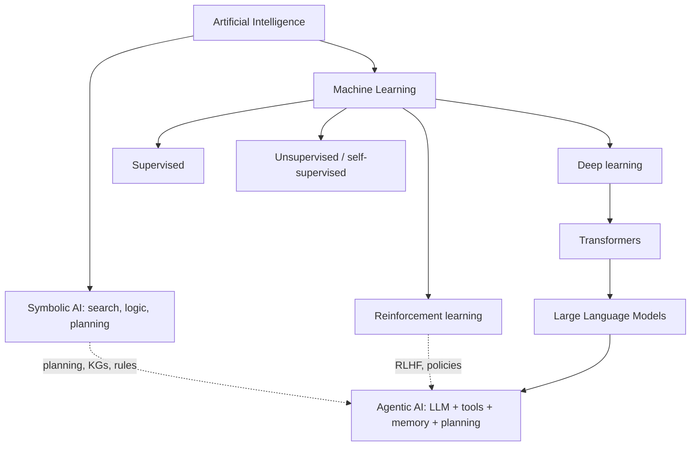

# Artificial Intelligence

> [!abstract] TL;DR
> Artificial intelligence is the study and engineering of systems that **perceive, reason, learn and act** to reach goals. The field has moved through symbolic AI (rules and search), statistical machine learning, and deep learning, which led to today's [[Large Language Models|foundation models]]. ==Agentic AI puts old ideas (agents, planning, search) on top of new learned models.== Knowing the history explains why current agents look the way they do.

**Related:** [[Large Language Models]] · [[AI Agents]] · [[Agentic AI]] · [[Reinforcement Learning (RL)]] · [[Model Evaluation]] · [[Knowledge Graphs]]

> [!note] Source scope
> A foundational hub note, written because [[Large Language Models]] lists it as a prerequisite. The framing follows Russell & Norvig (*beyond the lecture*).

> [!todo]- Contents
> - [[#1. Core Concepts]]
> - [[#2. Paradigms of AI]]
> - [[#3. A Short History]]
> - [[#4. Where Agentic AI Fits]]
> - [[#5. Worked Example – Three Ways to Route a Ticket]]
> - [[#6. Pitfalls and Misconceptions]]
> - [[#7. Key Takeaways]]
> - [[#8. Critical Analysis]]
> - [[#9. Self-Test]]
> - [[#10. Glossary]]
> - [[#Further Reading]]

---

## 1. Core Concepts

> [!info]+ Definition – Artificial intelligence (rational-agent view)
> The design of **agents** that pick actions expected to maximize a performance measure, given what they perceive and what they know (Russell & Norvig).

^def-ai

> [!info]+ Definition – Agent
> Anything that perceives its environment through sensors and acts on it through actuators. An agent function maps percept histories to actions. See [[AI Agents]].

^def-agent

| Four classic framings | Focus |
|---|---|
| Thinking humanly | Cognitive modelling |
| Acting humanly | Turing test |
| Thinking rationally | Logic, the "laws of thought" |
| **Acting rationally** | Rational agents (the dominant framing today) |

| Scope | Meaning |
|---|---|
| Narrow AI | Good at a specific task (spam filter, chess) |
| General AI (AGI) | Hypothetical human-level performance across a broad range of tasks. The definition is contested |

---

## 2. Paradigms of AI

| Paradigm | Core idea | Strengths | Weaknesses | Legacy in agentic AI |
|---|---|---|---|---|
| **Symbolic / GOFAI** | Explicit rules, logic, search | Explainable, exact | Brittle, knowledge bottleneck | Planning, [[Knowledge Graphs]], [[Gate Checks\|rule gates]] |
| **Statistical ML** | Learn functions from data | Robust to noise | Needs features and labels | Classifiers, [[Model Evaluation]] |
| **Deep learning** | Learned representations (neural nets) | Perception, language | Data- and compute-hungry, opaque | [[Large Language Models]], embeddings |
| **Reinforcement learning** | Learn from reward through interaction | Sequential decisions | Sample-inefficient, reward hacking | [[Reinforcement Learning (RL)\|RLHF]], agent training |

---

## 3. A Short History

| Era | Milestones |
|---|---|
| 1950s | Turing's "Computing Machinery and Intelligence" (1950). The Dartmouth workshop names the field (1956) |
| 1960s–80s | Search, theorem proving, expert systems. Two "AI winters" when expectations weren't met |
| 1990s–2000s | Statistical ML: SVMs, Bayesian methods. Deep Blue (1997) |
| 2012 | AlexNet starts the deep-learning era |
| 2016 | AlphaGo (deep RL + search) |
| 2017 | The Transformer ("Attention Is All You Need") |
| 2020s | Large pretrained LLMs, instruction tuning and RLHF, tool-using agents |

---

## 4. Where Agentic AI Fits

[[Agentic AI]] brings back the **rational-agent loop** (perceive, decide, act) with an LLM as the decision policy:

| Classic agent component | Modern agentic version |
|---|---|
| Sensors / percepts | User input, tool observations, retrieval ([[Retrieval-Augmented Generation]]) |
| Knowledge base | [[AI Memory]], [[Vector Databases]], [[Knowledge Graphs]] |
| Reasoning / planning | [[Chain-of-Thought and ReAct]], [[Planning Agents]], [[Tree-of-Thought]] |
| Actuators | [[Tool Use]], APIs, [[Model Context Protocol]] |
| Performance measure | [[LLM Evaluation]], task success |

---

## 5. Worked Example – Three Ways to Route a Ticket

| Approach | How | Trade-off |
|---|---|---|
| Symbolic | `if "no internet" in text and node_down: route("outage")` | Transparent, but misses paraphrases |
| Supervised ML | Train a classifier on 10k labelled tickets | Robust, but needs labels and retraining |
| LLM + rules (agentic) | LLM classifies from a prompt, code rules check node status, gates validate | Flexible and needs no labels, but costs more and needs [[Output Validation]] |

Production systems usually **mix all three**, as in [[Sonar Ticket and Outage Classification - How-To]].

---

## 6. Pitfalls and Misconceptions

| Misconception | Reality |
|---|---|
| "AI = LLMs" | LLMs are one deep-learning technique inside a much larger field |
| "Fluent means intelligent" | Fluency is not grounding ([[LLM Hallucinations]]) |
| "Symbolic AI is obsolete" | Rules, search and graphs are still the reliable backbone of agents |
| "Benchmarks measure intelligence" | They measure performance on a task, and contamination makes it worse ([[Model Evaluation]]) |
| "AGI is a single threshold" | There is no agreed definition or test |

---

## 7. Key Takeaways

- [ ] AI in the rational-agent view: choose actions that maximize expected performance.
- [ ] Four paradigms: symbolic, statistical ML, deep learning, RL.
- [ ] LLMs are deep learning (Transformers) with RL-based fine-tuning.
- [ ] Agentic AI = the classic agent loop + an LLM policy + tools and memory.
- [ ] Robust systems combine learned models with symbolic checks.

---

## 8. Critical Analysis

- **Definitions change.** The "AI effect": once something works it stops being called AI. Treat capability claims as claims about specific tasks.
- **Evidence.** Many claims of "emergent" abilities depend on the metric chosen. Be sceptical of claims about general intelligence based on narrow benchmarks.
- **At scale.** Compute, data and energy are real limits. Scaling laws describe trends, not guarantees.
- **Safety and security.** More autonomy means more impact from errors and misuse, which is the core concern of [[AI Reliability]] and [[Prompt Injection]].

> [!question] Discussion
> 1. Is an LLM agent a rational agent in Russell & Norvig's sense? What is its performance measure?
> 2. Which symbolic-AI ideas are most underused in today's agent frameworks?

---

## 9. Self-Test

> [!question]- Q1. Define AI in the rational-agent framing.
> Designing agents that choose actions expected to maximize a performance measure, given their percepts and knowledge.

> [!question]- Q2. Name the four paradigms and one contribution from each to agentic AI.
> Symbolic (planning, rules and KGs), statistical ML (evaluation, classifiers), deep learning (LLMs, embeddings), RL (RLHF, policies).

> [!question]- Q3. Why did symbolic expert systems struggle?
> The knowledge bottleneck (hand-writing rules), brittleness to new inputs, and poor handling of uncertainty.

> [!question]- Q4. Design – map a NOC triage agent to the classic agent components
> Percepts: alarms and tickets. KB: runbooks in a vector DB, topology in a KG. Reasoning: ReAct. Actuators: read-only NMS tools, ticket updates. Performance measure: time to correct diagnosis.

> [!tip] Flashcards
> Review with [[Artificial Intelligence - Flashcards]].

---

## 10. Glossary

| Term | Meaning |
|---|---|
| Rational agent | Acts to maximize expected performance |
| GOFAI | "Good old-fashioned AI", i.e. symbolic AI |
| AI winter | Funding and interest collapse after overpromising |
| Narrow AI | Task-specific competence |
| AGI | Hypothetical broad, human-level competence |

---

## Further Reading

- [Artificial Intelligence: A Modern Approach (Russell & Norvig)](https://aima.cs.berkeley.edu/)
- [Computing Machinery and Intelligence (Turing, 1950)](https://doi.org/10.1093/mind/LIX.236.433)
- [Attention Is All You Need (Vaswani et al., 2017)](https://arxiv.org/abs/1706.03762)
