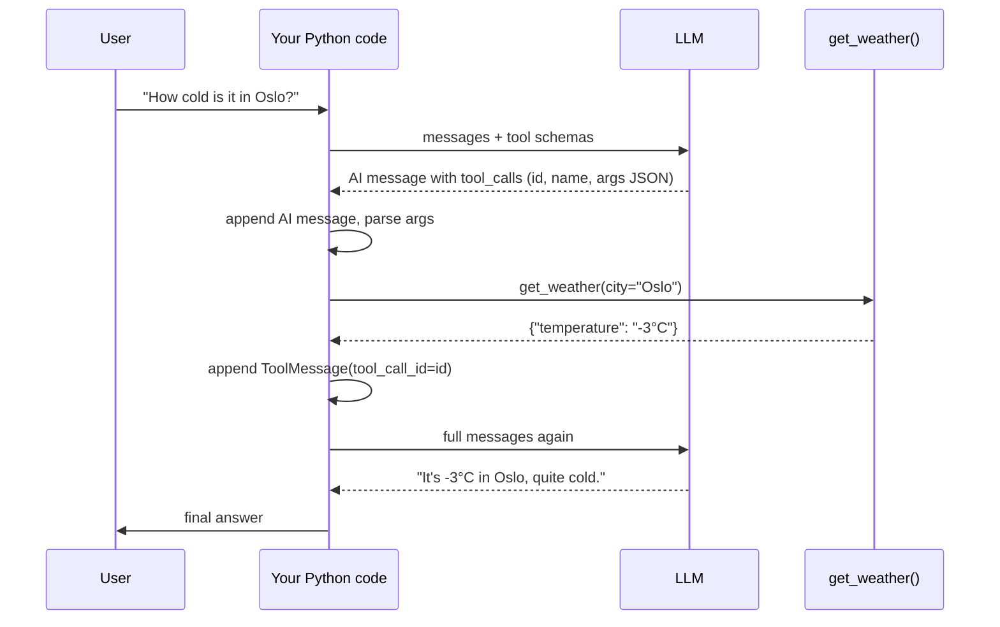

# Building Agents with Tools in Python

> [!abstract] TL;DR
> A tool-using agent in Python is a **message list** plus a **loop**. You define a typed, documented Python function, register its schema with the LLM, and send the conversation. When the model replies with a `tool_call` instead of text, ==your code runs the function and appends the result as a `ToolMessage` tied to the same `tool_call_id`==. You then call the model again so it can write the final answer. ==The model never runs code. It only asks your code to.==

**Prerequisites:** [[Tool Use]] · [[Implementing Agentic Workflows in Python]]
**Related:** [[Tool Descriptions in Agentic Systems]] · [[AI Agents#3. The Agent Loop]] · [[Chain-of-Thought and ReAct]] · [[Pydantic for Structured LLM Output - Study Guide]] · [[Runtime or Orchestration Layer]] · [[Prompt Injection]]

**Sources:** Course step-by-step instructions (basic LLM interaction, building a weather tool, using the tool in a conversation). The course code uses a course-provided wrapper (`LLM`, `SystemMessage`, `UserMessage`, `ToolMessage`, `@tool`). The raw OpenAI SDK version, the generic loop, the bug fixes in [[#4. Fixing the Course Snippets]], and the critical analysis are all *beyond the lecture*.

> [!todo]- Contents
> - [[#1. Core Concepts]]
> - [[#2. Basic Interaction – Single and Multi-Turn]]
> - [[#3. Building and Using a Tool – The Course Flow]]
> - [[#4. Fixing the Course Snippets]]
> - [[#5. Worked Example – Complete Weather Agent]]
> - [[#6. Generalizing – The Agent Loop]]
> - [[#7. Pitfalls and Failure Modes]]
> - [[#8. Key Takeaways]]
> - [[#9. Critical Analysis]]
> - [[#10. Self-Test]]
> - [[#11. Glossary]]
> - [[#Further Reading]]

---

## 1. Core Concepts

> [!info]+ Definition – Message roles
> A chat model takes an **ordered list of messages**, each with a role. **System** sets behavior and persona. **User** carries the human input. **Assistant (AI)** holds model output, which may include `tool_calls`. **Tool** carries the result of running a tool, linked to the call it answers by `tool_call_id`.

^def-roles

> [!info]+ Definition – Tool (in code)
> A Python function plus a machine-readable **schema** (name, description, typed parameters). The `@tool` decorator builds the schema from the ==function name, docstring and type hints==, which is why the course insists on "clear documentation and typed parameters".

^def-tool

> [!info]+ Definition – Binding tools
> Passing tool schemas to the model client (`LLM(tools=[get_weather])`) so that every request carries them. The model can then answer with a tool call instead of text.

^def-binding

| Object | Role | Who creates it | Key fields |
|---|---|---|---|
| `SystemMessage` | system | Developer | `content` |
| `UserMessage` | user | Human / app | `content` |
| AI message | assistant | Model | `content`, `tool_calls[i].id`, `.function.name`, `.function.arguments` (JSON **string**) |
| `ToolMessage` | tool | **Your code** | `content`, `tool_call_id`, `name` |

> [!important] The invariant
> Every `tool_call.id` in an assistant message must be answered by exactly one `ToolMessage` with the same `tool_call_id`, placed **after** that assistant message, before the next model call. Most provider APIs reject the request otherwise.

^tool-call-invariant

---

## 2. Basic Interaction – Single and Multi-Turn

**Single turn:** pass a string. The wrapper turns it into one user message.

```python
response = chat_model.invoke("What is an AI Agent?")
```

**Multi-turn / role-framed:** pass a list of messages. The system message sets the persona ([[Agent Components and Agent Types#2.1 Persona – the job title|persona component]]).

```python
messages = [
    SystemMessage(content="You're an OpenAI API specialist"),
    UserMessage(content="What is Function Calling?"),
]
response = chat_model.invoke(messages)
```

> [!note] The model is stateless
> The model remembers nothing between calls. "Conversation" means ==you resend the whole list every time==. Memory is just the list your code keeps (see [[AI Memory]]).

---

## 3. Building and Using a Tool – The Course Flow



| Step | What happens | Course code |
|---|---|---|
| 1. Define tool | Typed, documented function | `@tool def get_weather(city: str): """Get the current temperature for a city."""` |
| 2. Back it with data | Mock dict stands in for a real API | `mock_weather = {"Oslo": "-3°C", ...}` |
| 3. Bind | Model now sees the schema | `chat_model_with_tools = LLM(tools=[get_weather])` |
| 4. Instruct | System prompt says a tool exists | `"You are a helpful assistant that can access a tool..."` |
| 5. Invoke | Model returns a **tool call**, not an answer | `ai_message = chat_model_with_tools.invoke(messages)` |
| 6. Extract | Read the id and parse the JSON args | `tool_calls[0].id`, `json.loads(...function.arguments)` |
| 7. Execute | **Your code** runs the function | `tool_result = get_weather(**args)` |
| 8. Wrap result | Build a tool-role message | `ToolMessage(content=..., tool_call_id=..., name="get_weather")` |
| 9. Final call | Model writes the user-facing answer | `chat_model_with_tools.invoke(messages)` |

This is ReAct's Act → Observe step written out by hand ([[Chain-of-Thought and ReAct]]).

---

## 4. Fixing the Course Snippets

*Beyond the lecture.* As written, the snippets skip two `append` calls, so they won't work if you run them in order:

| Issue in the snippet | Why it breaks | Fix |
|---|---|---|
| `ai_message = ...invoke(messages)`, then `messages[-1].tool_calls[0]` | `messages[-1]` is still the `UserMessage`. The AI message was never appended | `messages.append(ai_message)` before extracting, or read `ai_message.tool_calls[0]` directly |
| `tool_message` is created but never added | The final `invoke(messages)` sends the same list as before, so the model just asks for the tool again | `messages.append(tool_message)` before the final call |
| `get_weather(**args)` on a decorated function | **Not a bug in the course library.** Its `@tool` returns a `Tool` object whose `__call__` forwards to the original function (see [[Building an AI Agent with Tools - Exercise#2. The Helper Library – What lib Does for You]]). Other libraries differ: in LangChain you call `get_weather.invoke(args)` | No fix needed with the course `lib`. Check the calling convention when switching libraries |
| `tool_result["temperature"]` | Assumes the function returns a dict, but the stub's body (`...`) isn't shown | Make the function return a dict, or pass `str(tool_result)` / `json.dumps(tool_result)` as content |
| Only `tool_calls[0]` is handled | The model may request several (parallel) calls in one turn | Loop over all `tool_calls` and answer each one ([[#^tool-call-invariant]]) |
| `"Sao Paulo"` vs `"São Paulo"` | Exact dict-key lookup fails on spelling, accent or case differences | Normalize keys, and return a helpful error for unknown cities |

> [!warning] `UserMessage` vs `HumanMessage`
> The course wrapper uses `UserMessage`. LangChain calls the same role `HumanMessage`, and the raw OpenAI SDK uses dicts (`{"role": "user", ...}`). The concepts are identical, so don't mix class names across libraries.

---

## 5. Worked Example – Complete Weather Agent

### 5.1 Course-wrapper style (corrected)

```python
import json

mock_weather = {"São Paulo": "28°C", "Oslo": "-3°C", "New York": "15°C", "Tokyo": "22°C"}

@tool
def get_weather(city: str):
    """Get the current temperature for a city."""
    temp = mock_weather.get(city)
    if temp is None:
        return {"error": f"Unknown city '{city}'. Known: {list(mock_weather)}"}
    return {"city": city, "temperature": temp}

chat_model_with_tools = LLM(tools=[get_weather])

messages = [
    SystemMessage(content="You are a helpful assistant that can access a tool to get current temperature for cities."),
    UserMessage(content="How cold is it in Oslo?"),
]

ai_message = chat_model_with_tools.invoke(messages)
messages.append(ai_message)                                   # ← missing in the course snippet

for call in ai_message.tool_calls or []:
    args = json.loads(call.function.arguments)                # arguments arrive as a JSON string
    result = get_weather(**args)
    messages.append(ToolMessage(
        content=json.dumps(result),
        tool_call_id=call.id,
        name=call.function.name,
    ))                                                        # ← missing in the course snippet

final = chat_model_with_tools.invoke(messages)
print(final.content)   # e.g. "It's currently -3°C in Oslo — quite cold."
```

### 5.2 Same thing with the raw OpenAI SDK

*Beyond the lecture.* Without the wrapper, you can see what `@tool` and `LLM(tools=...)` do for you: they produce a JSON Schema and attach it to every request.

```python
import json
from openai import OpenAI

client = OpenAI()

tools = [{
    "type": "function",
    "function": {
        "name": "get_weather",
        "description": "Get the current temperature for a city.",
        "parameters": {
            "type": "object",
            "properties": {"city": {"type": "string", "description": "City name, e.g. 'Oslo'"}},
            "required": ["city"],
        },
    },
}]

messages = [
    {"role": "system", "content": "You can call get_weather for current city temperatures."},
    {"role": "user", "content": "How cold is it in Oslo?"},
]

resp = client.chat.completions.create(model="gpt-4o-mini", messages=messages, tools=tools)
msg = resp.choices[0].message
messages.append(msg)

for call in msg.tool_calls or []:
    args = json.loads(call.function.arguments)
    result = get_weather_impl(**args)          # plain Python function
    messages.append({"role": "tool", "tool_call_id": call.id, "content": json.dumps(result)})

final = client.chat.completions.create(model="gpt-4o-mini", messages=messages, tools=tools)
print(final.choices[0].message.content)
```

| Decorator / wrapper does… | By hand you… |
|---|---|
| Reads type hints → `"type": "string"` | Write `parameters` JSON Schema |
| Reads docstring → `description` | Write `description` (see [[Tool Descriptions in Agentic Systems]]) |
| Builds a role-tagged message class | Build `{"role": ..., "content": ...}` dicts |

---

## 6. Generalizing – The Agent Loop

The course flow does exactly **one** round trip. A real agent repeats until the model stops asking for tools ([[AI Agents#3. The Agent Loop]], [[Runtime or Orchestration Layer#4. A Minimal Runtime]]).

```python
TOOLS = {"get_weather": get_weather_impl}

def run_agent(messages, max_steps=5):
    for _ in range(max_steps):                                  # step budget
        msg = call_llm(messages)
        messages.append(msg)
        if not msg.tool_calls:
            return msg.content                                  # done: plain answer
        for call in msg.tool_calls:
            fn = TOOLS.get(call.function.name)
            try:
                args = json.loads(call.function.arguments)
                result = fn(**args) if fn else {"error": f"unknown tool {call.function.name}"}
            except Exception as e:                              # bad JSON, bad args, tool crash
                result = {"error": str(e)}
            messages.append(tool_message(call.id, call.function.name, json.dumps(result)))
    return "Stopped: step limit reached."
```

^agent-loop

Design choices in this loop:
- **Registry dict** (`TOOLS`). The model's chosen name is looked up, never `eval`'d.
- **Errors become observations.** The model sees `{"error": ...}` and can retry with fixed arguments ([[Tool Use#3. Designing Tools]]).
- **Step budget.** Stops infinite tool loops. With $k$ steps each costing a model call, worst-case cost is $k \times (\text{input tokens grow each step})$, so the cost grows *superlinearly* because the whole history is resent.

---

## 7. Pitfalls and Failure Modes

| Failure | Symptom | Mitigation |
|---|---|---|
| Forgetting to append the AI message | API error: tool message without a preceding tool call | Append `ai_message` right after every invoke |
| Forgetting the `ToolMessage` | Model asks for the same tool again, or API error | Answer every `tool_call.id` ([[#^tool-call-invariant]]) |
| Treating `arguments` as a dict | `TypeError` on `**args` | `json.loads()` first. Wrap it in `try` because the JSON may be malformed |
| Missing type hints / docstring | Bad schema; model passes wrong types or never calls the tool | Type every parameter; write a "when to use" docstring |
| Exact-match lookups | `KeyError` on "oslo", "Sao Paulo" | Normalize input; return a helpful error |
| No step limit | Endless tool calls, runaway cost | `max_steps`; detect repeated identical calls |
| Executing by name with `eval`/`getattr` on a module | Model can call arbitrary functions | Explicit allow-list registry |
| Trusting tool output | Injected text in the tool result steers the agent | Treat tool content as data; least privilege ([[Prompt Injection]]) |
| Model answers without calling the tool | Hallucinated temperature | Stronger system prompt; `tool_choice` forcing where supported; check that a tool call happened |

---

## 8. Key Takeaways

- [ ] I can send a single-turn string and a multi-turn message list with system and user roles.
- [ ] I can define a tool with `@tool`, a docstring and type hints, and explain why each matters for the schema.
- [ ] I know binding tools only *advertises* them. The model returns a call, and my code executes it.
- [ ] I extract `tool_calls[i].id` and `json.loads(...function.arguments)` correctly.
- [ ] I append the AI message **and** a `ToolMessage` with the matching `tool_call_id` before the final call.
- [ ] I can turn the one-shot flow into a bounded loop with a tool registry and error-as-observation.

---

## 9. Critical Analysis

- **The demo hides the hard parts.** One tool, one call and a mock dict avoid every real problem: latency, rate limits, partial failures, parallel calls and auth. The 9-step manual flow is a teaching device. In production a runtime or framework owns the loop ([[Runtime or Orchestration Layer]]).
- **Wrapper lock-in.** The course's `LLM` / `UserMessage` classes resemble LangChain but aren't identical, and the raw `tool_calls[0].function.arguments` access is OpenAI's response shape. Learn the provider-neutral idea (assistant tool call → tool result with matching id). Anthropic's API, for example, uses `tool_use` / `tool_result` content blocks rather than a `tool` role.
- **Reliability math.** If the model calls the right tool with valid arguments with probability $p$ per step, a task needing $n$ sequential calls succeeds with roughly $p^n$. At $p = 0.95$ and $n = 5$ that is $\approx 0.77$, which is why validation and retry-on-error matter ([[AI Agents#5. Reliability and Cost Math]]).
- **Evaluation.** Test the *trajectory*, not only the final text. Did it call `get_weather`? With `city="Oslo"`? Exactly once? Did the answer match the tool result? ([[LLM Evaluation]]). A model that answers "-3°C" without calling the tool passes a naive output check while hallucinating.
- **Security.** `get_weather` is read-only and harmless. Swap in `send_email` and the same 9 steps can send mail because of injected text. Write tools need confirmation gates and least privilege ([[Tool Use#7. Critical Analysis]]).
- **Open questions:** When should the loop be yours, and when a framework's? How would you test that the model *refrains* from calling a tool when it shouldn't (e.g. "What is weather?")?

---

## 10. Self-Test

> [!question]- Q1. Who executes `get_weather` – the model or your code?
> Your code. The model returns a structured tool call (name + JSON arguments). Your Python runs the function and sends the result back as a `ToolMessage`.

> [!question]- Q2. Why do docstrings and type hints matter for a `@tool` function?
> The decorator builds the tool's schema from them. The docstring becomes the description the model uses to decide *when* to call the tool. The type hints become the parameter types the model must fill in.

> [!question]- Q3. What links a `ToolMessage` to the call it answers?
> The `tool_call_id`, which must equal the `id` of the tool call in the preceding assistant message.

> [!question]- Q4. In the course snippet, why does `messages[-1].tool_calls[0].id` fail?
> `ai_message` was never appended, so `messages[-1]` is still the `UserMessage`, which has no `tool_calls`. Append the AI message first, or read `ai_message.tool_calls` directly.

> [!question]- Q5. Why must you call `json.loads` on `function.arguments`?
> The API returns the arguments as a JSON **string**, not a dict. You need a dict to unpack with `**args`.

> [!question]- Q6. Design – extend the weather agent to answer "Is it warmer in Tokyo or Oslo?"
> The model may emit two `tool_calls` in one turn (parallel calls) or ask for them across two loop iterations. Loop over *all* tool calls, append one `ToolMessage` per `id`, and wrap the whole thing in a bounded agent loop ([[#^agent-loop]]) so it can call again if needed.

> [!question]- Q7. Quantitative – each model call resends the full history. The first call is 400 input tokens, and each tool round adds 150. What are the total input tokens for a 3-call run (two tool rounds + final answer)?
> Call 1: 400. Call 2: 550. Call 3: 700. Total = **1,650** input tokens, versus 1,200 if history didn't grow. That is the superlinear growth noted in [[#6. Generalizing – The Agent Loop]].

> [!question]- Q8. The model replies "It's -3°C in Oslo" but `tool_calls` was empty. What happened and how do you detect it?
> It hallucinated, answering from priors instead of calling the tool. Detect it by checking the trajectory for a tool call before accepting factual answers, or force tool use with `tool_choice` where the API supports it.

### Flashcards

> [!tip] Flashcards
> Review this topic with [[Building Agents with Tools in Python - Flashcards]].

---

## 11. Glossary

| Term | Meaning |
|---|---|
| `invoke` | Send messages (or a string) to the model and get one response |
| System message | Instruction that sets the model's role and behavior |
| `@tool` | Decorator that turns a Python function into a tool with a schema |
| Binding | Attaching tool schemas to the model client |
| `tool_calls` | List of structured call requests in an assistant message |
| `tool_call_id` | Identifier linking a tool result to its request |
| `ToolMessage` | Message carrying a tool's result back to the model |
| Parallel tool calls | Several tool calls in one assistant turn |
| Tool registry | Allow-list dict mapping tool names to functions |

---

## Further Reading

- [OpenAI docs – Function calling](https://platform.openai.com/docs/guides/function-calling)
- [Anthropic docs – Tool use](https://docs.anthropic.com/en/docs/build-with-claude/tool-use)
- [LangChain docs – Tool calling](https://python.langchain.com/docs/concepts/tool_calling/)
- [Yao et al. (2022) – ReAct](https://arxiv.org/abs/2210.03629)

%%
Study hint: the whole topic is one invariant — every tool_call.id gets exactly one ToolMessage, appended after the AI message. If you can write the 15-line agent loop from memory, you've got it.
%%
